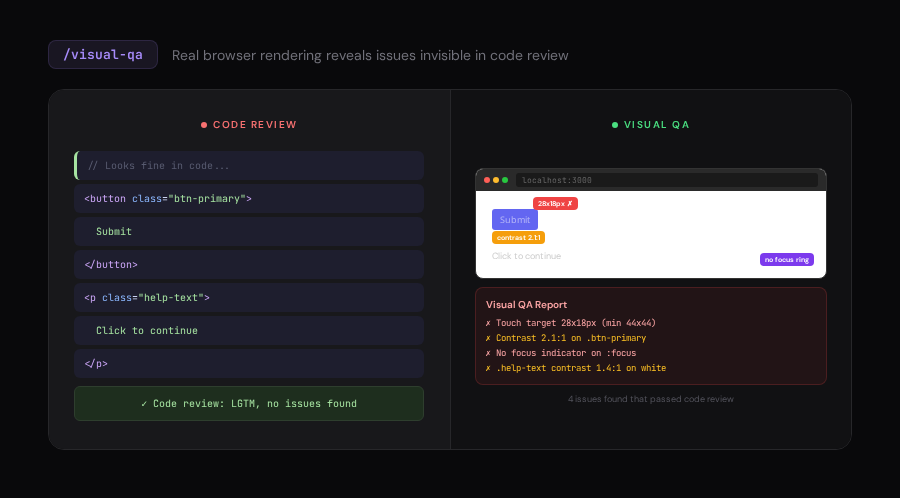
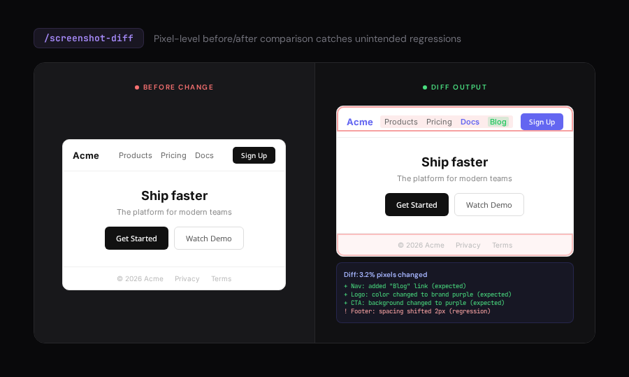

# Pixel Perfect

Browser-native visual QA for frontend interfaces. Uses real screenshots, live rendering, and multi-viewport testing to catch what code review can't.

> Built for [Factory Droid](https://factory.ai) with `agent-browser` integration. Code review finds bugs in logic. Pixel Perfect finds bugs in pixels.

## What Makes This Different

Most design linting happens in code. Pixel Perfect opens a real browser, takes real screenshots, and tests what users actually see. A button can pass every linter and still have 2.1:1 contrast, a 28x18px touch target, and no focus ring -- invisible in code, obvious in a screenshot.

## Commands

### Browser-Native (New)

#### `/visual-qa` - Real Rendered Inspection

Opens the page in a real browser, screenshots at mobile/tablet/desktop, checks contrast ratios on rendered elements, measures touch targets, detects overflow, and tests focus indicators. Produces an annotated visual report.

---

#### `/screenshot-diff` - Visual Regression Detection

Takes before/after screenshots and produces a pixel diff. Catches unintended regressions at every viewport. Compare two URLs side-by-side or track changes across edits.

---

## Attribution

Browser-native commands and skill rewrites are original work by Factory AI. See [NOTICE.md](NOTICE.md).
