# betteranswers/better-answers Wiki

Version: 3

## Overview

### Introduction to Better Answers

<details>
<summary>Relevant source files</summary>

The following files were used as context for generating this wiki page:

- [VISION.md](https://github.com/betteranswers/better-answers/blob/d38db273b822e9daea6b5a407aee70c49c49f831/VISION.md)
- [GLOSSARY.md](https://github.com/betteranswers/better-answers/blob/d38db273b822e9daea6b5a407aee70c49c49f831/GLOSSARY.md)
- [AGENTS.md](https://github.com/betteranswers/better-answers/blob/d38db273b822e9daea6b5a407aee70c49c49f831/AGENTS.md)
- [packages/design-system/readme.md](https://github.com/betteranswers/better-answers/blob/d38db273b822e9daea6b5a407aee70c49c49f831/packages/design-system/readme.md)
- [packages/core/test/concepts/concepts.test.ts](https://github.com/betteranswers/better-answers/blob/d38db273b822e9daea6b5a407aee70c49c49f831/packages/core/test/concepts/concepts.test.ts)
- [packages/schema/test/boundary-schemas.test.ts](https://github.com/betteranswers/better-answers/blob/d38db273b822e9daea6b5a407aee70c49c49f831/packages/schema/test/boundary-schemas.test.ts)
- [contracts/links/cases.json](https://github.com/betteranswers/better-answers/blob/d38db273b822e9daea6b5a407aee70c49c49f831/contracts/links/cases.json)
</details>

# Introduction to Better Answers

Better Answers provides a living company knowledge map for small and medium-sized businesses (SMBs). It aggregates scattered information from documents, systems, and people into a unified, portable, and graph-shaped structure based on the Open Knowledge Framework (OKF) v0.2. The platform ensures every answer is cited, permission-aware, and explainable, allowing both humans and AI agents to reason across business activities with confidence.

Sources: [VISION.md:5-10](https://github.com/betteranswers/better-answers/blob/d38db273b822e9daea6b5a407aee70c49c49f831/VISION.md#L5-L10), [GLOSSARY.md:3-5](https://github.com/betteranswers/better-answers/blob/d38db273b822e9daea6b5a407aee70c49c49f831/GLOSSARY.md#L3-L5), [packages/design-system/readme.md:3-6](https://github.com/betteranswers/better-answers/blob/d38db273b822e9daea6b5a407aee70c49c49f831/packages/design-system/readme.md#L3-L6)

## 1. The Knowledge System Architecture

The platform organizes knowledge into three distinct layers and a separate layer for operational records. This separation ensures that curated knowledge remains a portable asset for the company while the platform tracks usage and outcomes.

### 1.1 Knowledge Layers

| Layer | Definition | Storage/Format |
| :--- | :--- | :--- |
| **Sources** | The original systems and documents (evidence) where information originates. | Indexed for search; stay in original systems. |
| **Bundles** | Curated OKF concepts representing the "body of what the company knows." | Written to OKF spec; graph-shaped; portable files. |
| **Map** | A derived, queryable picture of concepts, relations, and people. | Derived from bundles and records; never a source of truth. |
| **Records** | Operational data generated by running use cases (guides, audit, usage). | Cites concepts by IRI; never restates knowledge. |

Sources: [VISION.md:14-30](https://github.com/betteranswers/better-answers/blob/d38db273b822e9daea6b5a407aee70c49c49f831/VISION.md#L14-L30), [GLOSSARY.md:8-13](https://github.com/betteranswers/better-answers/blob/d38db273b822e9daea6b5a407aee70c49c49f831/GLOSSARY.md#L8-L13), [GLOSSARY.md:65-68](https://github.com/betteranswers/better-answers/blob/d38db273b822e9daea6b5a407aee70c49c49f831/GLOSSARY.md#L65-L68)

### 1.2 Data Flow and Extraction

The system ingests data from connected sources through specific connectors (e.g., SharePoint, HubSpot, or manual uploads). Redaction rules remove personal data at the ingestion stage before extraction templates identify concepts and claims.

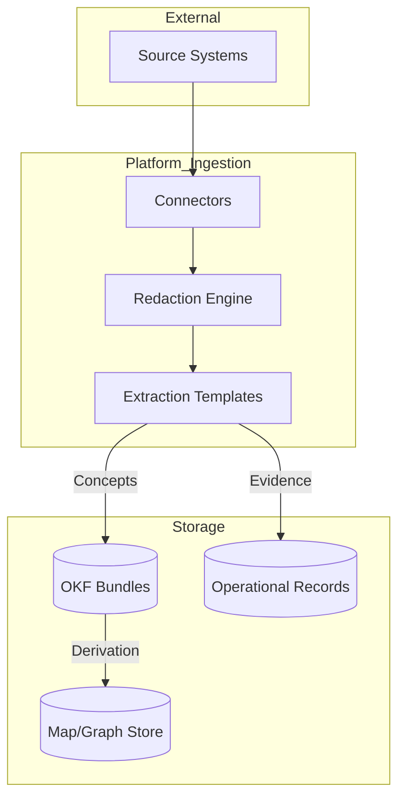
The diagram shows the transformation of raw source data into structured OKF concepts and a derived knowledge map.

Sources: [VISION.md:15-20](https://github.com/betteranswers/better-answers/blob/d38db273b822e9daea6b5a407aee70c49c49f831/VISION.md#L15-L20), [GLOSSARY.md:86-114](https://github.com/betteranswers/better-answers/blob/d38db273b822e9daea6b5a407aee70c49c49f831/GLOSSARY.md#L86-L114), [GLOSSARY.md:150-160](https://github.com/betteranswers/better-answers/blob/d38db273b822e9daea6b5a407aee70c49c49f831/GLOSSARY.md#L150-L160)

## 2. Core Concepts and Glossary

Better Answers utilizes a strict vocabulary to ensure consistency across the codebase and user interface.

*   **Concept:** The basic unit of knowledge, carried as one OKF concept document. It is sized by trust—an entity or fact that can be verified independently.
*   **IRI (Internationalized Resource Identifier):** A concept's stable, platform-minted identity that survives renames.
*   **Collection:** A top-level division of knowledge by ownership (e.g., product, service, or sector).
*   **Kind:** The specific type of a concept (e.g., "Answer," "Policy," or "Tier").

Sources: [GLOSSARY.md:18-42](https://github.com/betteranswers/better-answers/blob/d38db273b822e9daea6b5a407aee70c49c49f831/GLOSSARY.md#L18-L42), [packages/core/test/concepts/concepts.test.ts:40-55](https://github.com/betteranswers/better-answers/blob/d38db273b822e9daea6b5a407aee70c49c49f831/packages/core/test/concepts/concepts.test.ts#L40-L55)

### 2.1 Trust and Visibility

Trust and sensitivity are handled as separate attributes. Sensitivity gates whether a user can see a document, while trust informs the user of the data's reliability.

*   **Trust Tiers:**
    *   *Verified by [Person]* (Human-reviewed)
    *   *Verified automatically* (Machine-confirmed)
    *   *Unverified*
*   **Sensitivity Tiers:** Restricted, Internal, Public.

Sources: [VISION.md:32-38](https://github.com/betteranswers/better-answers/blob/d38db273b822e9daea6b5a407aee70c49c49f831/VISION.md#L32-L38), [GLOSSARY.md:135-140](https://github.com/betteranswers/better-answers/blob/d38db273b822e9daea6b5a407aee70c49c49f831/GLOSSARY.md#L135-L140), [GLOSSARY.md:188-192](https://github.com/betteranswers/better-answers/blob/d38db273b822e9daea6b5a407aee70c49c49f831/GLOSSARY.md#L188-L192)

## 3. System Components

The repository is organized into capability slices and shared packages.

| Path | Component | Responsibility |
| :--- | :--- | :--- |
| `apps/api/` | API Server | Hono-based Node.js application; handles transports. |
| `apps/web/` | Web Interface | Vite React SPA; communicates via tRPC. |
| `apps/worker/` | Knowledge Worker | Python-based worker for heavy extraction/processing tasks. |
| `packages/core/` | Business Logic | Capability slices; transport-agnostic business rules. |
| `packages/schema/` | Schema | Shared TypeScript types and database boundary schemas. |

Sources: [AGENTS.md:10-25](https://github.com/betteranswers/better-answers/blob/d38db273b822e9daea6b5a407aee70c49c49f831/AGENTS.md#L10-L25), [packages/schema/test/boundary-schemas.test.ts:10-50](https://github.com/betteranswers/better-answers/blob/d38db273b822e9daea6b5a407aee70c49c49f831/packages/schema/test/boundary-schemas.test.ts#L10-L50)

## 4. Interface and Design System

The design system follows a "blueprint" register rather than a traditional dashboard. It emphasizes high density and mechanical precision.

### 4.1 Visual Foundations
*   **Modular Grid:** A module-based layout (32px/64px pitch) with visible registration marks ("+") on cornered objects.
*   **Typography:** Uses Geist for interface body (14px) and Geist Mono for machine strings (IRIs, hashes).
*   **Color Palette:** Cool grey structural ramp with a single interactive accent: Ink Blue (`#2e4bd4`).
*   **Components:** Leverages shadcn, Kibo UI, and Vercel AI Elements, skinning them to meet platform-specific meaning and trust requirements.

Sources: [packages/design-system/readme.md:15-60](https://github.com/betteranswers/better-answers/blob/d38db273b822e9daea6b5a407aee70c49c49f831/packages/design-system/readme.md#L15-L60), [packages/design-system/guidelines/kits-adoption.card.html:10-30](https://github.com/betteranswers/better-answers/blob/d38db273b822e9daea6b5a407aee70c49c49f831/packages/design-system/guidelines/kits-adoption.card.html#L10-L30)

### 4.2 The Outcome Loop

The system turns knowledge into action through an outcome loop. For example, a bid outcome triggers a review of the `Answer` concepts used in that bid.

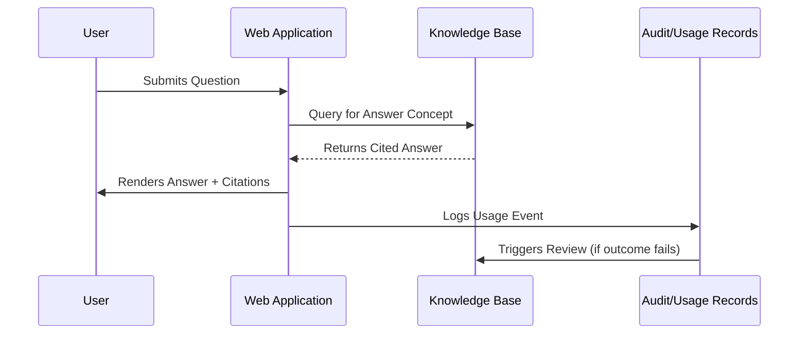
The sequence shows how user interactions result in citations and feed back into the curation of the knowledge base.

Sources: [VISION.md:46-55](https://github.com/betteranswers/better-answers/blob/d38db273b822e9daea6b5a407aee70c49c49f831/VISION.md#L46-L55), [GLOSSARY.md:235-245](https://github.com/betteranswers/better-answers/blob/d38db273b822e9daea6b5a407aee70c49c49f831/GLOSSARY.md#L235-L245)

## 5. Security and Permissions

Better Answers is **Private by Default**. Every answer is permission-aware, and every API call carries a principal (user identity). 

*   **Workspaces:** Each company occupies a workspace boundary. Data never leaks between workspaces.
*   **Redaction:** Personal data is withheld from document text before any AI model processes it.
*   **Roles:** Members hold specific roles (Admin, Editor, Viewer) that dictate permitted actions.

Sources: [VISION.md:58-62](https://github.com/betteranswers/better-answers/blob/d38db273b822e9daea6b5a407aee70c49c49f831/VISION.md#L58-L62), [GLOSSARY.md:158-165](https://github.com/betteranswers/better-answers/blob/d38db273b822e9daea6b5a407aee70c49c49f831/GLOSSARY.md#L158-L165), [GLOSSARY.md:258-270](https://github.com/betteranswers/better-answers/blob/d38db273b822e9daea6b5a407aee70c49c49f831/GLOSSARY.md#L258-L270)

Better Answers establishes a structured environment where company knowledge is not just searchable text, but a queryable graph of concepts with rigorous provenance and trust signals. This foundation allows SMBs to scale their AI usage safely by grounding models in a curated, cited knowledge map.

Sources: [VISION.md:5-10](https://github.com/betteranswers/better-answers/blob/d38db273b822e9daea6b5a407aee70c49c49f831/VISION.md#L5-L10), [VISION.md:65-75](https://github.com/betteranswers/better-answers/blob/d38db273b822e9daea6b5a407aee70c49c49f831/VISION.md#L65-L75)

### Domain Glossary

<details>
<summary>Relevant source files</summary>

The following files were used as context for generating this wiki page:

- [GLOSSARY.md](https://github.com/betteranswers/better-answers/blob/d38db273b822e9daea6b5a407aee70c49c49f831/GLOSSARY.md)
- [VISION.md](https://github.com/betteranswers/better-answers/blob/d38db273b822e9daea6b5a407aee70c49c49f831/VISION.md)
- [AGENTS.md](https://github.com/betteranswers/better-answers/blob/d38db273b822e9daea6b5a407aee70c49c49f831/AGENTS.md)
- [packages/design-system/readme.md](https://github.com/betteranswers/better-answers/blob/d38db273b822e9daea6b5a407aee70c49c49f831/packages/design-system/readme.md)
- [packages/schema/src/boundary-schemas/guides.ts](https://github.com/betteranswers/better-answers/blob/d38db273b822e9daea6b5a407aee70c49c49f831/packages/schema/src/boundary-schemas/guides.ts)
- [contracts/links/cases.json](https://github.com/betteranswers/better-answers/blob/d38db273b822e9daea6b5a407aee70c49c49f831/contracts/links/cases.json)
</details>

# Domain Glossary

The Domain Glossary defines the specific language and concepts used within the Better Answers platform. It ensures consistency across the product, code, and documentation by settling on a single word for each domain concept. This common language facilitates communication between humans and technical agents traversing the company knowledge map.

The glossary is structured around the Open Knowledge Framework (OKF), which provides a unified, portable shape for business information. It covers several functional areas, including the core knowledge system, data visibility, personal data protection, trust, and the outcome loop that turns knowledge into action.

Sources: [GLOSSARY.md:1-7](https://github.com/betteranswers/better-answers/blob/d38db273b822e9daea6b5a407aee70c49c49f831/GLOSSARY.md#L1-L7), [VISION.md:10-15](https://github.com/betteranswers/better-answers/blob/d38db273b822e9daea6b5a407aee70c49c49f831/VISION.md#L10-L15)

## Knowledge System

The knowledge system consists of three distinct layers and the platform records maintained over them. The platform uses a "minting" rule to decide where a unit of knowledge resides.

### Knowledge Layers

| Layer | Definition |
| :--- | :--- |
| **Sources** | The original company systems and documents (e.g., SharePoint, wiki, website). They are never concepts themselves. |
| **Bundles** | The curated body of knowledge held as OKF concepts. A bundle represents a company's knowledge base. |
| **Map** | A derived, queryable picture of concepts, relations, sources, and people. It is never a source of truth. |

Sources: [GLOSSARY.md:12-16](https://github.com/betteranswers/better-answers/blob/d38db273b822e9daea6b5a407aee70c49c49f831/GLOSSARY.md#L12-L16), [GLOSSARY.md:54-58](https://github.com/betteranswers/better-answers/blob/d38db273b822e9daea6b5a407aee70c49c49f831/GLOSSARY.md#L54-L58), [VISION.md:16-29](https://github.com/betteranswers/better-answers/blob/d38db273b822e9daea6b5a407aee70c49c49f831/VISION.md#L16-L29)

### Core Knowledge Concepts

*   **Concept**: One unit of knowledge carried as a single OKF document. It represents an entity or fact that can be verified.
*   **IRI**: A stable identity minted by the platform for a concept. It survives renames and is never edited by hand.
*   **Kind**: The specific type of a concept (e.g., Answer, Policy, Role).
*   **Relation**: A link between concepts as held in the **Map**, with the relation type derived from the surrounding prose.
*   **Evidence**: A citation or locator into a **Source** that backs a specific concept.
*   **Record**: Information the platform keeps to run use cases (e.g., audits, usage, guides). Records cite concepts by IRI and never restate them.

Sources: [GLOSSARY.md:20-52](https://github.com/betteranswers/better-answers/blob/d38db273b822e9daea6b5a407aee70c49c49f831/GLOSSARY.md#L20-L52), [VISION.md:31-33](https://github.com/betteranswers/better-answers/blob/d38db273b822e9daea6b5a407aee70c49c49f831/VISION.md#L31-L33)

### Knowledge Flow Diagram

The following diagram represents the progression from raw unstructured data to a structured, queryable knowledge map.

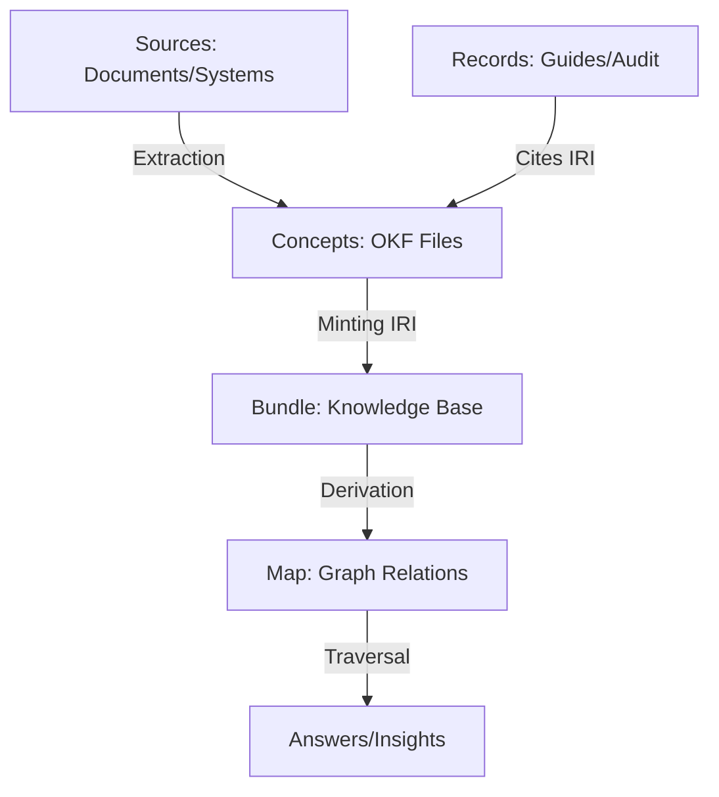

The diagram shows how information flows from original Sources into the structured Bundle, which then powers the derived Map and platform Records.
Sources: [VISION.md:16-33](https://github.com/betteranswers/better-answers/blob/d38db273b822e9daea6b5a407aee70c49c49f831/VISION.md#L16-L33), [GLOSSARY.md:12-25](https://github.com/betteranswers/better-answers/blob/d38db273b822e9daea6b5a407aee70c49c49f831/GLOSSARY.md#L12-L25)

## Sources and Extraction

Sources are the assets from which knowledge is extracted. The platform manages how these sources are reached and processed.

*   **Connected Source**: An administrator's connection of a source system to a workspace, including its schedule and audience.
*   **Connector**: The technical means of reaching a system, such as a SharePoint or HubSpot uploader.
*   **Source Document**: A single item yielded by a connected source.
*   **Passage**: A unit of redacted text from a source document.
*   **Locator**: The specific address of a passage within its source document.
*   **Extraction Template**: Instructions for a model or agent explaining how to derive specific **Kinds** and claims from a document.

Sources: [GLOSSARY.md:65-98](https://github.com/betteranswers/better-answers/blob/d38db273b822e9daea6b5a407aee70c49c49f831/GLOSSARY.md#L65-L98)

## Visibility and Personal Data

The platform is private by default. Access to information is governed by sensitivity levels and specific data protection mechanisms.

### Sensitivity and Audience
Sensitivity gates viewing, whereas trust does not.
*   **Sensitivity**: Categorization of content as **Restricted**, **Internal**, or **Public**.
*   **Audience**: Named groups or everyone in the workspace who may view content.
*   **Publish**: An action that allows content to reach users outside of the Control Centre.
*   **Cascade**: The process of carrying a visibility change to every concept or record that cites the affected evidence.

Sources: [GLOSSARY.md:104-126](https://github.com/betteranswers/better-answers/blob/d38db273b822e9daea6b5a407aee70c49c49f831/GLOSSARY.md#L104-L126), [VISION.md:73-77](https://github.com/betteranswers/better-answers/blob/d38db273b822e9daea6b5a407aee70c49c49f831/VISION.md#L73-L77)

### Redaction and Privacy
*   **Redaction**: Withholding personal data from text before it is processed by models or agents.
*   **Special Category**: Sensitive personal data (e.g., health data) that triggers a document "narrowing" (stricter sensitivity).
*   **Suppression**: A standing entry that prevents a specific person's identifiers from being derived in any sync.
*   **Subject Request**: A person's formal request to access or erase their data within the platform.

Sources: [GLOSSARY.md:130-164](https://github.com/betteranswers/better-answers/blob/d38db273b822e9daea6b5a407aee70c49c49f831/GLOSSARY.md#L130-L164)

## Trust and Verification

Trust tiers define the level of confirmation for a specific concept.

| Trust Tier | Description | Display Label |
| :--- | :--- | :--- |
| **Human-reviewed** | Confirmed by a person. | Verified by [Person] |
| **Machine-confirmed** | Confirmed by an AI agent. | Verified automatically |
| **Unverified** | No verification has taken place. | Unverified |

*   **Verify**: The act of confirming a concept against its sources.
*   **Changed since verified**: A state where a previously verified concept's content has been updated.
*   **Rider**: An additional note on verification, such as "imported" or "source moved on."

Sources: [GLOSSARY.md:168-182](https://github.com/betteranswers/better-answers/blob/d38db273b822e9daea6b5a407aee70c49c49f831/GLOSSARY.md#L168-L182), [packages/design-system/readme.md:46-49](https://github.com/betteranswers/better-answers/blob/d38db273b822e9daea6b5a407aee70c49c49f831/packages/design-system/readme.md#L46-L49)

## Guides and Write-ups

Guides transform raw concepts into actionable prose for specific roles.

*   **Guide**: A set of pages providing knowledge about a specific subject (Product, Service, Sector) to company people.
*   **Section**: A node in a guide's tree structure containing a prompt and expected concepts.
*   **Layer**: The method of display, either **Assembled** (prose written over concepts) or **Quoted** (concepts in their own words).
*   **Write-up**: The actual prose record generated over concepts.
*   **Footnote**: A mark in a write-up that ties a specific claim back to an included concept.

Sources: [GLOSSARY.md:186-212](https://github.com/betteranswers/better-answers/blob/d38db273b822e9daea6b5a407aee70c49c49f831/GLOSSARY.md#L186-L212), [packages/schema/src/boundary-schemas/guides.ts:21-35](https://github.com/betteranswers/better-answers/blob/d38db273b822e9daea6b5a407aee70c49c49f831/packages/schema/src/boundary-schemas/guides.ts#L21-L35)

### Guide Structure Relationship

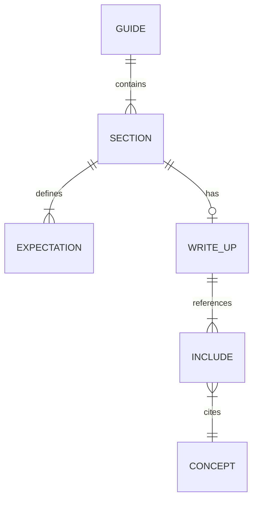

The relationship shows how a Guide is composed of Sections, which generate Write-ups by including specific Concepts based on Expectations.
Sources: [GLOSSARY.md:186-212](https://github.com/betteranswers/better-answers/blob/d38db273b822e9daea6b5a407aee70c49c49f831/GLOSSARY.md#L186-L212), [packages/schema/src/boundary-schemas/guides.ts:50-80](https://github.com/betteranswers/better-answers/blob/d38db273b822e9daea6b5a407aee70c49c49f831/packages/schema/src/boundary-schemas/guides.ts#L50-L80)

## People and Accountability

Accountability is managed through defined roles and workspaces.

*   **Workspace**: The primary boundary for a company, containing its people, sources, and knowledge base.
*   **Member**: A person within a workspace assigned to a specific **Role** (Admin, Editor, or Viewer).
*   **Group**: A collection of members used to define an **Audience** for sensitive sources.
*   **Assistant**: An external AI host (e.g., Claude) that reaches company knowledge through the platform's MCP surface.

Sources: [GLOSSARY.md:250-272](https://github.com/betteranswers/better-answers/blob/d38db273b822e9daea6b5a407aee70c49c49f831/GLOSSARY.md#L250-L272), [packages/design-system/readme.md:37-40](https://github.com/betteranswers/better-answers/blob/d38db273b822e9daea6b5a407aee70c49c49f831/packages/design-system/readme.md#L37-L40)

## Summary

The Domain Glossary serves as the foundational vocabulary for the Better Answers platform. By adhering to these definitions, the system maintains a "living company knowledge map" where every answer is cited, permission-aware, and explainable. This structure allows both human employees and platform agents to curate and use business knowledge with high confidence.

Sources: [VISION.md:6-9](https://github.com/betteranswers/better-answers/blob/d38db273b822e9daea6b5a407aee70c49c49f831/VISION.md#L6-L9), [GLOSSARY.md:1-5](https://github.com/betteranswers/better-answers/blob/d38db273b822e9daea6b5a407aee70c49c49f831/GLOSSARY.md#L1-L5)

### Local Setup and Environment

<details>
<summary>Relevant source files</summary>

The following files were used as context for generating this wiki page:

- [deploy/local-database.sh](https://github.com/betteranswers/better-answers/blob/d38db273b822e9daea6b5a407aee70c49c49f831/deploy/local-database.sh)
- [deploy/local.compose.yaml](https://github.com/betteranswers/better-answers/blob/d38db273b822e9daea6b5a407aee70c49c49f831/deploy/local.compose.yaml)
- [deploy/host-setup.sh](https://github.com/betteranswers/better-answers/blob/d38db273b822e9daea6b5a407aee70c49c49f831/deploy/host-setup.sh)
- [AGENTS.md](https://github.com/betteranswers/better-answers/blob/d38db273b822e9daea6b5a407aee70c49c49f831/AGENTS.md)
- [VISION.md](https://github.com/betteranswers/better-answers/blob/d38db273b822e9daea6b5a407aee70c49c49f831/VISION.md)
- [packages/design-system/readme.md](https://github.com/betteranswers/better-answers/blob/d38db273b822e9daea6b5a407aee70c49c49f831/packages/design-system/readme.md)
</details>

# Local Setup and Environment

The local setup provides a development environment for building and testing the Better Answers platform. It establishes a multi-service architecture consisting of a TypeScript API, a React web application, and a Python-based knowledge worker, all supported by a Postgres database and an object store. 

The environment is designed to mirror production configurations as closely as possible while enabling rapid development cycles. It emphasizes repository quality through functional testing, strict directory layouts, and automated gating tools.

Sources: [AGENTS.md:14-23](https://github.com/betteranswers/better-answers/blob/d38db273b822e9daea6b5a407aee70c49c49f831/AGENTS.md#L14-L23), [VISION.md:73-77](https://github.com/betteranswers/better-answers/blob/d38db273b822e9daea6b5a407aee70c49c49f831/VISION.md#L73-L77)

## Architecture Overview

The platform uses a tiered architecture to separate concerns between user interaction, business logic, and heavy knowledge processing.

### Component Structure

| Path | Component | Technology | Description |
| :--- | :--- | :--- | :--- |
| `apps/api/` | API Server | Hono (Node.js) | Handles transports and coordinates between services via tRPC. |
| `apps/web/` | Web Client | Vite / React | Single-page application for the user interface. |
| `apps/worker/` | Worker | Python (uv) | Executes knowledge processing and extraction tasks. |
| `packages/core/` | Core Logic | TypeScript | Contains the primary business logic capability slices. |
| `packages/schema/` | Schema | TypeScript | Centralized data models and Zod schemas. |

Sources: [AGENTS.md:14-23](https://github.com/betteranswers/better-answers/blob/d38db273b822e9daea6b5a407aee70c49c49f831/AGENTS.md#L14-L23)

### Development Data Flow

The following diagram illustrates how local components interact during development:

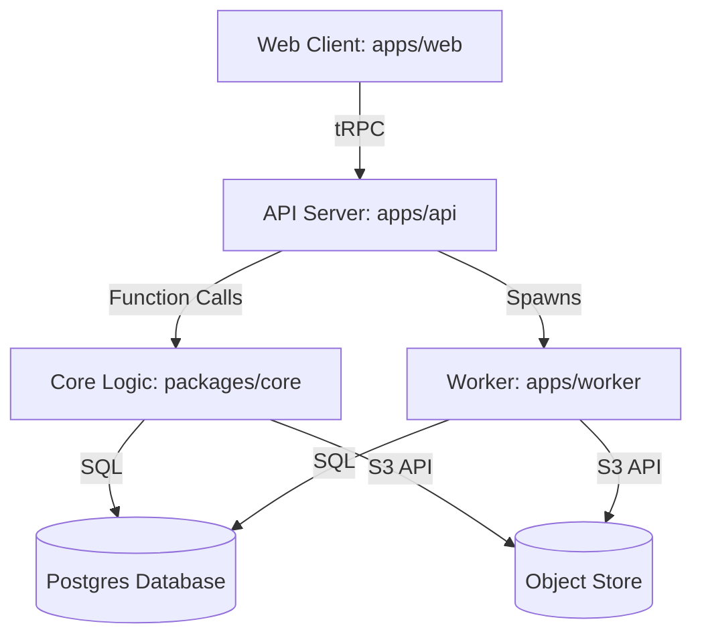

The API server serves as the central hub, communicating with the web client via tRPC and invoking business logic within the core package. The worker handles background processing, interacting with the same shared database and object store.

Sources: [AGENTS.md:14-23](https://github.com/betteranswers/better-answers/blob/d38db273b822e9daea6b5a407aee70c49c49f831/AGENTS.md#L14-L23), [AGENTS.md:55-58](https://github.com/betteranswers/better-answers/blob/d38db273b822e9daea6b5a407aee70c49c49f831/AGENTS.md#L55-L58)

## Local Infrastructure Setup

The local environment relies on Docker Compose and shell scripts to initialize necessary services and configurations.

### Database Initialization

The `deploy/local-database.sh` script automates the creation of the development database. It performs the following actions:
1. Pulls and starts a Postgres container using the officially specified `pgvector` image.
2. Configures a superuser for initial setup.
3. Creates the required database schema and local development roles.

Sources: [deploy/local-database.sh](https://github.com/betteranswers/better-answers/blob/d38db273b822e9daea6b5a407aee70c49c49f831/deploy/local-database.sh), [packages/devtools/test/ci/deploy-tree.test.ts:133-134](https://github.com/betteranswers/better-answers/blob/d38db273b822e9daea6b5a407aee70c49c49f831/packages/devtools/test/ci/deploy-tree.test.ts#L133-L134)

### Host Configuration

The `deploy/host-setup.sh` script prepares the host machine for the application. While primarily used for VPC setup, it provides the template for local directory structures and permission handling:
*   Creates `/data` directories for persistent storage.
*   Sets up swap files for memory management.
*   Hardens the host environment by restricting file permissions on sensitive directories like `/etc/better-answers/`.

Sources: [deploy/host-setup.sh:33-45](https://github.com/betteranswers/better-answers/blob/d38db273b822e9daea6b5a407aee70c49c49f831/deploy/host-setup.sh#L33-L45), [deploy/wizard-41.sh:163-172](https://github.com/betteranswers/better-answers/blob/d38db273b822e9daea6b5a407aee70c49c49f831/deploy/wizard-41.sh#L163-L172)

## Development Workflow and Constraints

Development within the Better Answers repository is governed by strict structural and coding rules to maintain quality.

### Structural Rules
*   **Module Limits**: A single folder in `src`, `test`, or `e2e` trees may hold at most 15 tracked files.
*   **Path Helpers**: Scripts must use the workspace's `roots` helper (e.g., `repositoryRoot`) to reach files outside their own workspace.
*   **Test Mirroring**: Test folders must mirror the source folder structure (e.g., `test/a/b/` for `src/a/b/`).

Sources: [AGENTS.md:26-47](https://github.com/betteranswers/better-answers/blob/d38db273b822e9daea6b5a407aee70c49c49f831/AGENTS.md#L26-L47)

### Environment Configuration
The application reads environment variables through specific configuration modules.
*   **Secrets**: Secrets must never be stored in the environment for workspace-specific data; they are stored as rows in the database.
*   **Deployment Facts**: Deployment-level facts (like `APP_KEY` or `DATABASE_URL`) are read once by the tier's config module.

Sources: [AGENTS.md:51-53](https://github.com/betteranswers/better-answers/blob/d38db273b822e9daea6b5a407aee70c49c49f831/AGENTS.md#L51-L53), [AGENTS.md:83-86](https://github.com/betteranswers/better-answers/blob/d38db273b822e9daea6b5a407aee70c49c49f831/AGENTS.md#L83-L86)

## Testing in the Local Environment

Tests are categorized by their dependency on infrastructure and the layer they target.

### Testing Tiers
1.  **Pure Functions**: Tested in-process with no external dependencies.
2.  **Transports**: Tested via `server.request(...)` for the API or entry points for the worker.
3.  **Infrastructure Tests**: Real Postgres or Object Store instances are used only when testing migrations, SQL logic, row-level security, or race conditions.
4.  **Browser Suite**: Includes one spec per page, enforcing accessibility gates and keyboard reach.

Sources: [AGENTS.md:55-75](https://github.com/betteranswers/better-answers/blob/d38db273b822e9daea6b5a407aee70c49c49f831/AGENTS.md#L55-L75)

### Development Gating
The repository includes several "gate" tools that must pass before code is considered ready:
*   `pnpm run lint`: Enforces code style and prevents workspace climbing.
*   `pnpm run check`: Runs the main test suite and lints.
*   `pnpm run check:images`: Runs tests involving Docker images and compose scripts (skipped by standard `check`).

Sources: [AGENTS.md:42-45](https://github.com/betteranswers/better-answers/blob/d38db273b822e9daea6b5a407aee70c49c49f831/AGENTS.md#L42-L45), [AGENTS.md:77-81](https://github.com/betteranswers/better-answers/blob/d38db273b822e9daea6b5a407aee70c49c49f831/AGENTS.md#L77-L81)

## Summary

The local setup and environment for Better Answers prioritize architectural parity with production through containerized services and shell-based automation. By enforcing strict directory structures, repository-wide gating tools, and layered testing strategies, the environment ensures that the "living company knowledge map" remains accurate, permission-aware, and maintainable for developers.

Sources: [VISION.md:73-77](https://github.com/betteranswers/better-answers/blob/d38db273b822e9daea6b5a407aee70c49c49f831/VISION.md#L73-L77), [AGENTS.md:14-23](https://github.com/betteranswers/better-answers/blob/d38db273b822e9daea6b5a407aee70c49c49f831/AGENTS.md#L14-L23)


## System Architecture

### Monorepo Architecture

<details>
<summary>Relevant source files</summary>

The following files were used as context for generating this wiki page:

- [AGENTS.md](https://github.com/betteranswers/better-answers/blob/d38db273b822e9daea6b5a407aee70c49c49f831/AGENTS.md)
- [VISION.md](https://github.com/betteranswers/better-answers/blob/d38db273b822e9daea6b5a407aee70c49c49f831/VISION.md)
- [packages/design-system/readme.md](https://github.com/betteranswers/better-answers/blob/d38db273b822e9daea6b5a407aee70c49c49f831/packages/design-system/readme.md)
- [deploy/wizard-41.sh](https://github.com/betteranswers/better-answers/blob/d38db273b822e9daea6b5a407aee70c49c49f831/deploy/wizard-41.sh)
- [packages/devtools/test/ci/deploy-tree.test.ts](https://github.com/betteranswers/better-answers/blob/d38db273b822e9daea6b5a407aee70c49c49f831/packages/devtools/test/ci/deploy-tree.test.ts)
- [apps/web/vite.config.ts](https://github.com/betteranswers/better-answers/blob/d38db273b822e9daea6b5a407aee70c49c49f831/apps/web/vite.config.ts)
- [GLOSSARY.md](https://github.com/betteranswers/better-answers/blob/d38db273b822e9daea6b5a407aee70c49c49f831/GLOSSARY.md)
</details>

# Monorepo Architecture

The better-answers project uses a monorepo architecture to manage a living company knowledge map based on the Open Knowledge Framework (OKF). This structure centralizes multiple applications and shared TypeScript packages to ensure consistency across the platform. The repository includes the web interface, API services, knowledge workers, and shared infrastructure code.

Sources: [AGENTS.md:1-5](https://github.com/betteranswers/better-answers/blob/d38db273b822e9daea6b5a407aee70c49c49f831/AGENTS.md#L1-L5), [VISION.md:65-68](https://github.com/betteranswers/better-answers/blob/d38db273b822e9daea6b5a407aee70c49c49f831/VISION.md#L65-L68)

## Workspace Layout

The project organizes code into four primary top-level directories: `apps/`, `packages/`, `contracts/`, and `deploy/`. Each directory serves a specific role in the platform lifecycle.

### Directory Structure

| Path | Description |
| --- | --- |
| `apps/api/` | Hono on Node.js. Handles transports and API endpoints. |
| `apps/web/` | Vite React single-page app (SPA). The primary human interface. |
| `apps/worker/` | Python-based knowledge worker (using uv). |
| `packages/core/` | Transport-agnostic business logic and capability slices. |
| `packages/schema/` | Centralized Zod schemas and database boundary definitions. |
| `packages/design-system/` | Shared UI tokens, components, and design guidelines. |
| `packages/devtools/` | Repository gate tooling and CI/CD scripts. |
| `deploy/` | Docker Compose files and deployment configuration. |

Sources: [AGENTS.md:14-25](https://github.com/betteranswers/better-answers/blob/d38db273b822e9daea6b5a407aee70c49c49f831/AGENTS.md#L14-L25), [packages/design-system/readme.md:168-176](https://github.com/betteranswers/better-answers/blob/d38db273b822e9daea6b5a407aee70c49c49f831/packages/design-system/readme.md#L168-L176)

This diagram shows the relationship between different workspace components:

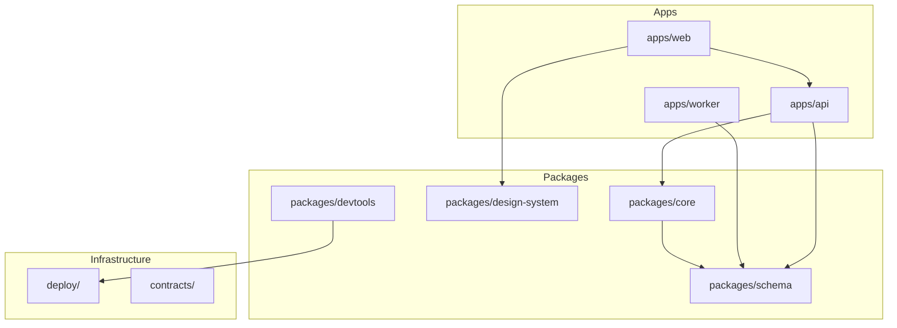

The diagram illustrates how application tiers depend on shared packages.
Sources: [AGENTS.md:14-25](https://github.com/betteranswers/better-answers/blob/d38db273b822e9daea6b5a407aee70c49c49f831/AGENTS.md#L14-L25), [apps/web/vite.config.ts:16-20](https://github.com/betteranswers/better-answers/blob/d38db273b822e9daea6b5a407aee70c49c49f831/apps/web/vite.config.ts#L16-L20)

## Component Roles and Data Flow

The monorepo enforces a strict dependency hierarchy to maintain a transport-agnostic core.

### Application Tiers
*   **apps/web**: This React SPA provides the "Ask", "Knowledge", "Inbox", and "Control Centre" areas. It communicates with `apps/api` exclusively via tRPC.
*   **apps/api**: This Hono server acts as a thin transport layer. It delegates all business logic to `packages/core`.
*   **apps/worker**: This Python service performs heavy knowledge processing and map enrichment tasks.
*   **packages/core**: This package contains capability slices. It interacts with data stores (Postgres, Git, S3) through defined "store doors".

Sources: [AGENTS.md:14-25](https://github.com/betteranswers/better-answers/blob/d38db273b822e9daea6b5a407aee70c49c49f831/AGENTS.md#L14-L25), [AGENTS.md:46-52](https://github.com/betteranswers/better-answers/blob/d38db273b822e9daea6b5a407aee70c49c49f831/AGENTS.md#L46-L52), [packages/design-system/readme.md:16-25](https://github.com/betteranswers/better-answers/blob/d38db273b822e9daea6b5a407aee70c49c49f831/packages/design-system/readme.md#L16-L25)

### Internal Request Flow

The following sequence shows how a user request traverses the monorepo layers:

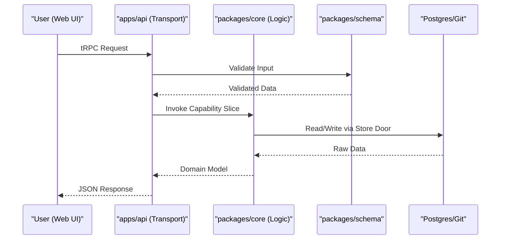

The sequence shows logic separation where the API only handles transport.
Sources: [AGENTS.md:16](https://github.com/betteranswers/better-answers/blob/d38db273b822e9daea6b5a407aee70c49c49f831/AGENTS.md#L16), [AGENTS.md:46-52](https://github.com/betteranswers/better-answers/blob/d38db273b822e9daea6b5a407aee70c49c49f831/AGENTS.md#L46-L52)

## Infrastructure and Deployment

The monorepo includes deployment scripts that target a two-node VPS architecture (VPC 1 and VPC 2). Deployment is managed via Docker Compose and Coolify.

### Deployment Components
*   **VPC 1 (Production)**: Hosts the production API, worker, and PostgreSQL database.
*   **VPC 2 (Coolify/Staging)**: Hosts the Coolify control plane, a Git mirror, and on-demand staging environments.
*   **Image Management**: Images for `api`, `worker`, and `backup` are built and pushed to GHCR. Production deployments use immutable digests rather than tags.

Sources: [deploy/wizard-41.sh:220-245](https://github.com/betteranswers/better-answers/blob/d38db273b822e9daea6b5a407aee70c49c49f831/deploy/wizard-41.sh#L220-L245), [packages/devtools/test/ci/deploy-tree.test.ts:255-265](https://github.com/betteranswers/better-answers/blob/d38db273b822e9daea6b5a407aee70c49c49f831/packages/devtools/test/ci/deploy-tree.test.ts#L255-L265)

### Deployment Architecture

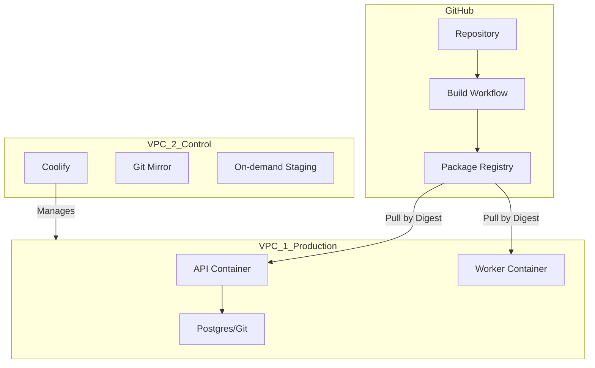

The diagram shows how the monorepo source becomes running containers.
Sources: [deploy/wizard-41.sh:220-250](https://github.com/betteranswers/better-answers/blob/d38db273b822e9daea6b5a407aee70c49c49f831/deploy/wizard-41.sh#L220-L250), [packages/devtools/test/ci/deploy-tree.test.ts:255-275](https://github.com/betteranswers/better-answers/blob/d38db273b822e9daea6b5a407aee70c49c49f831/packages/devtools/test/ci/deploy-tree.test.ts#L255-L275)

## Repository Standards

The monorepo architecture enforces several quality gates:
*   **Loose Files**: Folders in `src` or `test` trees must hold at most 15 tracked files directly to maintain readability.
*   **Mirroring**: Test folders must mirror the source folder structure (e.g., `test/a/b/` for `src/a/b/`).
*   **Roots Helpers**: Scripts reach files through workspace-specific `roots` helpers (e.g., `repositoryRoot`) to prevent arbitrary directory climbing.
*   **Versioning**: The project uses a single deployment model with multi-tenant-ready data structures.

Sources: [AGENTS.md:27-35](https://github.com/betteranswers/better-answers/blob/d38db273b822e9daea6b5a407aee70c49c49f831/AGENTS.md#L27-L35), [AGENTS.md:38-42](https://github.com/betteranswers/better-answers/blob/d38db273b822e9daea6b5a407aee70c49c49f831/AGENTS.md#L38-L42), [VISION.md:65-68](https://github.com/betteranswers/better-answers/blob/d38db273b822e9daea6b5a407aee70c49c49f831/VISION.md#L65-L68)

## Conclusion

The Monorepo Architecture of better-answers provides a unified environment for developing company knowledge map tools. By separating transport layers in `apps/` from business logic in `packages/core` and using a centralized `packages/schema`, the system maintains high technical accuracy and consistency. The integrated deployment scripts in `deploy/` ensure that the entire estate remains reproducible and verifiable.

### tRPC & API Layer

<details>
<summary>Relevant source files</summary>

The following files were used as context for generating this wiki page:

- [VISION.md](https://github.com/betteranswers/better-answers/blob/d38db273b822e9daea6b5a407aee70c49c49f831/VISION.md)
- [AGENTS.md](https://github.com/betteranswers/better-answers/blob/d38db273b822e9daea6b5a407aee70c49c49f831/AGENTS.md)
- [GLOSSARY.md](https://github.com/betteranswers/better-answers/blob/d38db273b822e9daea6b5a407aee70c49c49f831/GLOSSARY.md)
- [apps/api/package.json](https://github.com/betteranswers/better-answers/blob/d38db273b822e9daea6b5a407aee70c49c49f831/apps/api/package.json)
- [apps/web/package.json](https://github.com/betteranswers/better-answers/blob/d38db273b822e9daea6b5a407aee70c49c49f831/apps/web/package.json)
- [apps/api/tests/auth/oauth-flow.test.ts](https://github.com/betteranswers/better-answers/blob/d38db273b822e9daea6b5a407aee70c49c49f831/apps/api/tests/auth/oauth-flow.test.ts)
- [apps/api/tests/auth/auth-pages.test.ts](https://github.com/betteranswers/better-answers/blob/d38db273b822e9daea6b5a407aee70c49c49f831/apps/api/tests/auth/auth-pages.test.ts)
</details>

# tRPC & API Layer

The API layer provides a structured interface for the web application and external agents to interact with the company's knowledge map. It acts as a transport-only shell that delegates business logic to core packages while maintaining strict type safety and permission awareness.

The platform uses a single deployment model that is multi-tenant-ready. It prioritizes local models and UK-preferred hosting. Every API call carries a principal to ensure all answers remain permission-aware and private by default.

Sources: [VISION.md:79-85](https://github.com/betteranswers/better-answers/blob/d38db273b822e9daea6b5a407aee70c49c49f831/VISION.md#L79-L85), [AGENTS.md:14-16](https://github.com/betteranswers/better-answers/blob/d38db273b822e9daea6b5a407aee70c49c49f831/AGENTS.md#L14-L16)

## Architecture Overview

The API architecture consists of a Hono-based server running on Node.js, which serves as the host for tRPC procedures and standard HTTP endpoints. The system enforces a strict separation where the API holds transport logic only, and business logic resides in `packages/core`.

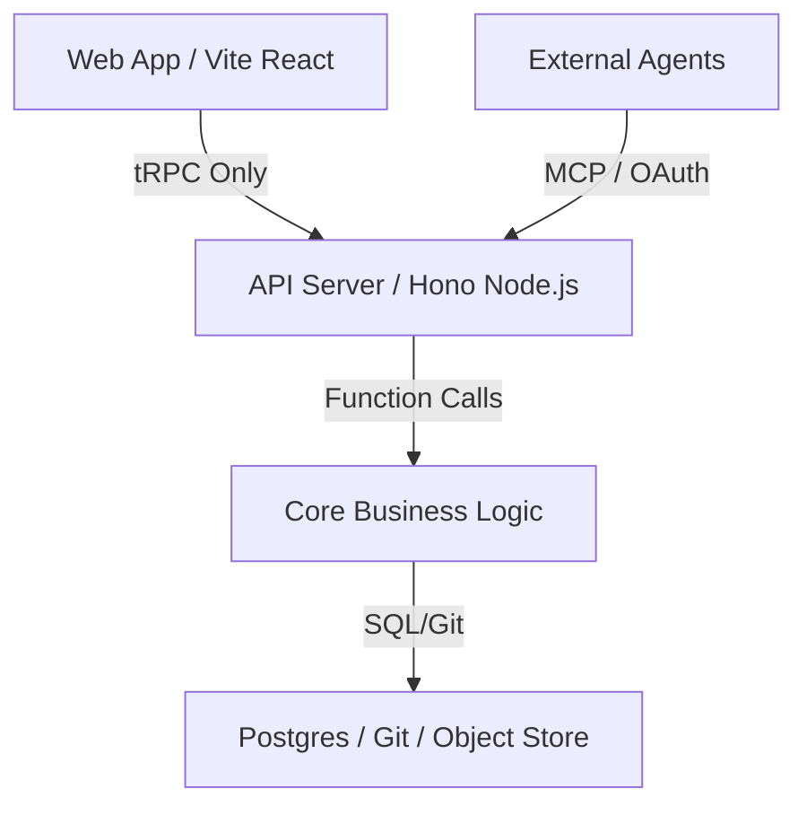
The diagram shows the communication flow from the frontend through the API layer to the core business logic and data stores.

Sources: [AGENTS.md:14-18](https://github.com/betteranswers/better-answers/blob/d38db273b822e9daea6b5a407aee70c49c49f831/AGENTS.md#L14-L18), [VISION.md:85](https://github.com/betteranswers/better-answers/blob/d38db273b822e9daea6b5a407aee70c49c49f831/VISION.md#L85)

### Core Components

| Component | Path | Technology |
| :--- | :--- | :--- |
| API Server | `apps/api/` | Hono, Node.js, @hono/trpc-server |
| Web Client | `apps/web/` | Vite, React, @trpc/client |
| Router | `apps/api/src/trpc/` | @trpc/server |
| Schema Validation | N/A | Zod |

Sources: [apps/api/package.json:28-40](https://github.com/betteranswers/better-answers/blob/d38db273b822e9daea6b5a407aee70c49c49f831/apps/api/package.json#L28-L40), [apps/web/package.json:34](https://github.com/betteranswers/better-answers/blob/d38db273b822e9daea6b5a407aee70c49c49f831/apps/web/package.json#L34)

## tRPC Integration

The Vite React single-page app communicates with the API exclusively via tRPC. This ensures end-to-end type safety between the frontend and backend. The API exports an `appRouter` that defines all available procedures for the web interface.

### Identified Procedures
Test suites indicate several key procedures handled through the tRPC interface:
*   `person.setDisplayName`: Updates a user's display name.
*   `session.member`: Retrieves details about the current user's membership.
*   `members.remove`: Facilitates member removal from a workspace.

Sources: [AGENTS.md:15](https://github.com/betteranswers/better-answers/blob/d38db273b822e9daea6b5a407aee70c49c49f831/AGENTS.md#L15), [apps/api/tests/auth/oauth-flow.test.ts:167](https://github.com/betteranswers/better-answers/blob/d38db273b822e9daea6b5a407aee70c49c49f831/apps/api/tests/auth/oauth-flow.test.ts#L167), [apps/api/package.json:6-8](https://github.com/betteranswers/better-answers/blob/d38db273b822e9daea6b5a407aee70c49c49f831/apps/api/package.json#L6-L8)

## Authentication & Identity Endpoints

While the web app uses tRPC, the API layer also exposes standard REST/HTTP endpoints for OAuth2 flows, discovery, and static assets. These are critical for external agent integration and initial user authentication.

### Discovery & OAuth2
The API advertises capabilities via RFC 8414 and RFC 9728 compliant metadata documents.
*   **Discovery Path:** `/.well-known/oauth-authorization-server`
*   **Resource Metadata:** `/.well-known/oauth-protected-resource/mcp`
*   **Token Endpoint:** `/oauth2/token`
*   **Revocation:** `/oauth2/revoke`

### Auth Pages
The server mounts Hono-based pages for user interaction during the auth flow:
*   **Sign-in:** `/sign-in`
*   **Consent:** `/consent`

Sources: [apps/api/tests/auth/oauth-flow.test.ts:32-48](https://github.com/betteranswers/better-answers/blob/d38db273b822e9daea6b5a407aee70c49c49f831/apps/api/tests/auth/oauth-flow.test.ts#L32-L48), [apps/api/tests/auth/auth-pages.test.ts:10-15](https://github.com/betteranswers/better-answers/blob/d38db273b822e9daea6b5a407aee70c49c49f831/apps/api/tests/auth/auth-pages.test.ts#L10-L15)

## Request Lifecycle

When a request arrives, the Hono server processes it based on the path. For tRPC requests, the `@hono/trpc-server` middleware intercepts the call and routes it to the appropriate procedure.

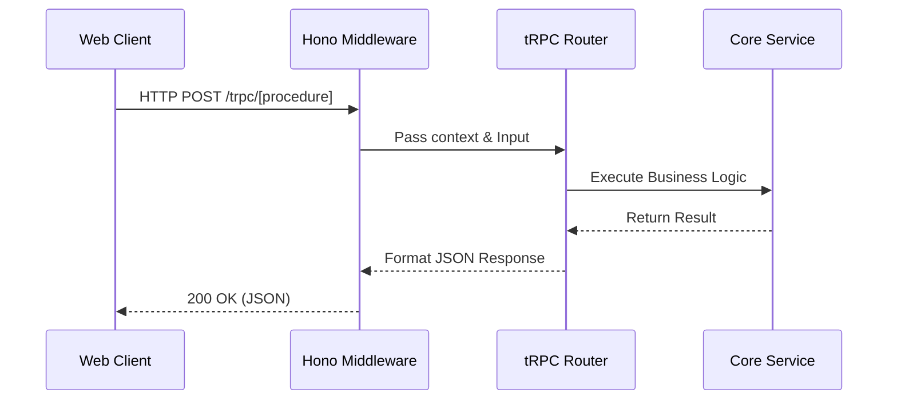
The sequence diagram illustrates how a tRPC call is handled within the Node.js API server.

Sources: [AGENTS.md:46-52](https://github.com/betteranswers/better-answers/blob/d38db273b822e9daea6b5a407aee70c49c49f831/AGENTS.md#L46-L52), [apps/api/package.json:32](https://github.com/betteranswers/better-answers/blob/d38db273b822e9daea6b5a407aee70c49c49f831/apps/api/package.json#L32)

## API Configuration

The API layer reads its environment from a dedicated config module. It avoids backward compatibility shims by default, meaning no legacy fallbacks or `omitempty` shims are used unless explicitly requested.

| Feature | Implementation |
| :--- | :--- |
| Validation | Zod schemas for input and output |
| Error Handling | Standard tRPC error codes |
| Security | Every call carries a principal; sensitivity gates viewing |
| Transport | Hono on Node.js |

Sources: [AGENTS.md:38-42](https://github.com/betteranswers/better-answers/blob/d38db273b822e9daea6b5a407aee70c49c49f831/AGENTS.md#L38-L42), [VISION.md:80](https://github.com/betteranswers/better-answers/blob/d38db273b822e9daea6b5a407aee70c49c49f831/VISION.md#L80)

## Summary

The tRPC and API layer serves as a secure, type-safe gateway to the Better Answers knowledge system. By utilizing tRPC for internal web communications and Hono for external OAuth/MCP standards, the system maintains a high degree of integration for humans while remaining accessible to platform and external agents. All interactions are governed by the minting rules and principal-based access controls defined in the core system.

### Core Business Logic

<details>
<summary>Relevant source files</summary>

The following files were used as context for generating this wiki page:

- [VISION.md](https://github.com/betteranswers/better-answers/blob/d38db273b822e9daea6b5a407aee70c49c49f831/VISION.md)
- [AGENTS.md](https://github.com/betteranswers/better-answers/blob/d38db273b822e9daea6b5a407aee70c49c49f831/AGENTS.md)
- [GLOSSARY.md](https://github.com/betteranswers/better-answers/blob/d38db273b822e9daea6b5a407aee70c49c49f831/GLOSSARY.md)
- [packages/core/src/concepts/file.ts](https://github.com/betteranswers/better-answers/blob/d38db273b822e9daea6b5a407aee70c49c49f831/packages/core/src/concepts/file.ts)
- [packages/core/test/concepts/concepts.test.ts](https://github.com/betteranswers/better-answers/blob/d38db273b822e9daea6b5a407aee70c49c49f831/packages/core/test/concepts/concepts.test.ts)
- [packages/core/test/concepts/import/import-bundle.test.ts](https://github.com/betteranswers/better-answers/blob/d38db273b822e9daea6b5a407aee70c49c49f831/packages/core/test/concepts/import/import-bundle.test.ts)
- [packages/core/test/concepts/rebuild-equivalence.test.ts](https://github.com/betteranswers/better-answers/blob/d38db273b822e9daea6b5a407aee70c49c49f831/packages/core/test/concepts/rebuild-equivalence.test.ts)

</details>

# Core Business Logic

The Core Business Logic of Better Answers implements a living company knowledge map based on the Open Knowledge Framework (OKF). It manages the transition of unstructured information from diverse sources into a structured, trust-bearing knowledge base composed of concepts, bundles, and a derived map.

This logic resides primarily within `packages/core`, providing transport-agnostic capability slices that interact with four specific "store doors": Postgres for relational data, a Git repository for versioned concept files, an object store for documents, and the Map for graph-based traversal.

Sources: [VISION.md:7-9](https://github.com/betteranswers/better-answers/blob/d38db273b822e9daea6b5a407aee70c49c49f831/VISION.md#L7-L9), [AGENTS.md:19-21](https://github.com/betteranswers/better-answers/blob/d38db273b822e9daea6b5a407aee70c49c49f831/AGENTS.md#L19-L21)

## Knowledge Representation Architecture

The system organizes business logic across three distinct knowledge layers. Records track platform activities over these layers without restating the knowledge itself.

### The Three Layers

| Layer | Description | Implementation |
| :--- | :--- | :--- |
| **Sources** | Original systems and documents (SharePoint, HubSpot, local uploads). | Redacted passages and locators. |
| **Bundles** | The curated body of knowledge, held as OKF concepts. | Git-versioned Markdown files with YAML frontmatter. |
| **Map** | A derived, queryable graph of concepts, relations, and citations. | Postgres-backed graph (nodes and edges). |

Sources: [VISION.md:17-31](https://github.com/betteranswers/better-answers/blob/d38db273b822e9daea6b5a407aee70c49c49f831/VISION.md#L17-L31), [GLOSSARY.md:8-10](https://github.com/betteranswers/better-answers/blob/d38db273b822e9daea6b5a407aee70c49c49f831/GLOSSARY.md#L8-L10), [GLOSSARY.md:65-68](https://github.com/betteranswers/better-answers/blob/d38db273b822e9daea6b5a407aee70c49c49f831/GLOSSARY.md#L65-L68)

### Logic Flow: From Source to Map

The following diagram illustrates how the core logic processes a piece of information from an external source into a verified concept.

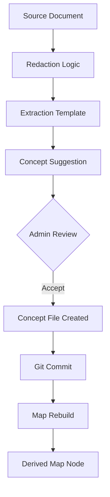
The diagram shows the transformation from a Source Document through redaction and extraction into a Git-backed Concept File and finally a Map Node.
Sources: [GLOSSARY.md:95-100](https://github.com/betteranswers/better-answers/blob/d38db273b822e9daea6b5a407aee70c49c49f831/GLOSSARY.md#L95-L100), [GLOSSARY.md:148-152](https://github.com/betteranswers/better-answers/blob/d38db273b822e9daea6b5a407aee70c49c49f831/GLOSSARY.md#L148-L152), [packages/core/test/concepts/rebuild-equivalence.test.ts:160-165](https://github.com/betteranswers/better-answers/blob/d38db273b822e9daea6b5a407aee70c49c49f831/packages/core/test/concepts/rebuild-equivalence.test.ts#L160-L165)

## Concept Management and Governance

Concepts are the atomic units of knowledge. Each concept is stored as a single file to ensure portability and human-readability outside the platform.

### Concept File Structure
A concept file consists of YAML frontmatter and a Markdown body. The core logic enforces a strict canonical format for hashing and storage to ensure equivalence and detect changes.

*   **Frontmatter**: Contains metadata including `type` (Kind), `title`, `iri` (Stable Identity), `status`, and `sources` (Citations).
*   **Body**: The actual knowledge text.
*   **Normalization**: The system normalizes line endings and removes trailing whitespace before hashing.

Sources: [packages/core/src/concepts/file.ts:25-32](https://github.com/betteranswers/better-answers/blob/d38db273b822e9daea6b5a407aee70c49c49f831/packages/core/src/concepts/file.ts#L25-L32), [packages/core/test/concepts/concepts.test.ts:117-133](https://github.com/betteranswers/better-answers/blob/d38db273b822e9daea6b5a407aee70c49c49f831/packages/core/test/concepts/concepts.test.ts#L117-L133)

### Trust and Verification
The business logic tracks the "Trust Tier" of every concept. Verification can be performed by humans or automated agents.

*   **Verified by <Person>**: Human-reviewed status.
*   **Verified automatically**: Machine-confirmed status.
*   **Changed since verified**: A state triggered when the underlying source or concept content changes after verification.

Sources: [GLOSSARY.md:188-195](https://github.com/betteranswers/better-answers/blob/d38db273b822e9daea6b5a407aee70c49c49f831/GLOSSARY.md#L188-L195), [packages/core/test/concepts/concepts.test.ts:850-865](https://github.com/betteranswers/better-answers/blob/d38db273b822e9daea6b5a407aee70c49c49f831/packages/core/test/concepts/concepts.test.ts#L850-L865)

## Governed Writes and Transactions

All changes to the knowledge base are "Governed Writes." The core logic ensures that updates to the Git repository and the Postgres index happen within a single atomic operation where possible, or are reconciled if they diverge.

### The Write Protocol
When an actor (Person or Agent) writes a concept, the system:
1. Validates the principal's permissions (Role-aware).
2. Normalizes the content and generates a content hash.
3. Commits the file to Git using a "Platform Bot" as the committer and the user as the author.
4. Updates the `concept_index` and `map_node` in Postgres.
5. Records an `audit_event` linked to the Git commit SHA.

Sources: [packages/core/test/concepts/concepts.test.ts:80-100](https://github.com/betteranswers/better-answers/blob/d38db273b822e9daea6b5a407aee70c49c49f831/packages/core/test/concepts/concepts.test.ts#L80-L100), [packages/core/test/concepts/concepts.test.ts:180-195](https://github.com/betteranswers/better-answers/blob/d38db273b822e9daea6b5a407aee70c49c49f831/packages/core/test/concepts/concepts.test.ts#L180-L195)

### Conflict Resolution
The logic uses a "Merge Key" strategy to prevent duplicate concepts for the same claim. If a write attempts to use a path or merge key already taken by another concept, the system refuses the operation with `path-taken` or `merge-key-taken`.

Sources: [packages/core/test/concepts/import/import-bundle.test.ts:390-405](https://github.com/betteranswers/better-answers/blob/d38db273b822e9daea6b5a407aee70c49c49f831/packages/core/test/concepts/import/import-bundle.test.ts#L390-L405), [packages/core/test/concepts/concepts.test.ts:510-520](https://github.com/betteranswers/better-answers/blob/d38db273b822e9daea6b5a407aee70c49c49f831/packages/core/test/concepts/concepts.test.ts#L510-L520)

## The Map and Traversal Logic

The Map is a derived picture of the knowledge base. It is queryable and traversable, enabling features like "What breaks if this policy changes?"

### Map Generation
The system maintains a `live_gen` (live generation) ID. When knowledge is updated, a new generation is built. The worker process performs full rebuilds to ensure the Postgres graph accurately reflects the Git-backed concepts.

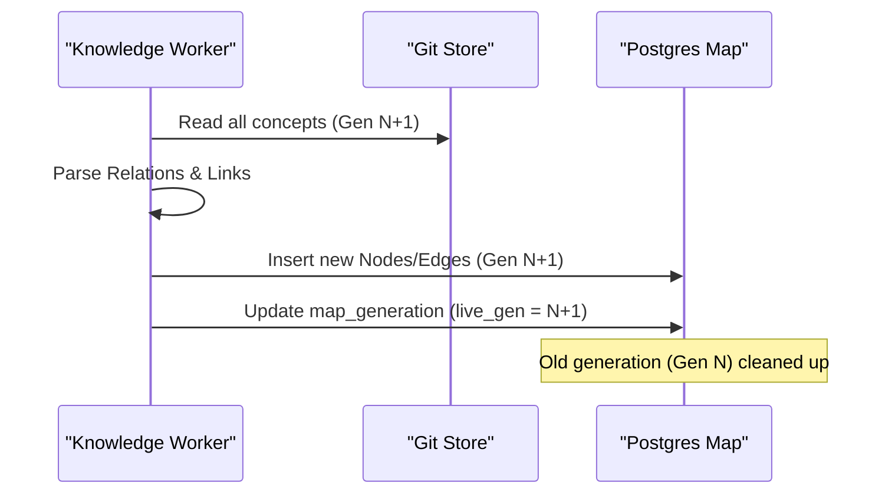
The sequence shows the Knowledge Worker reading concepts from Git to build a new generation of the graph in Postgres.
Sources: [packages/core/test/concepts/rebuild-equivalence.test.ts:175-195](https://github.com/betteranswers/better-answers/blob/d38db273b822e9daea6b5a407aee70c49c49f831/packages/core/test/concepts/rebuild-equivalence.test.ts#L175-L195), [packages/core/test/store/map/map.test.ts:155-170](https://github.com/betteranswers/better-answers/blob/d38db273b822e9daea6b5a407aee70c49c49f831/packages/core/test/store/map/map.test.ts#L155-L170)

### Link Resolution
The logic differentiates between:
*   **Resolved Links**: Links using the concept's IRI.
*   **Unresolved References**: Links to paths that do not yet exist in the bundle. These are tracked in `map_unresolved_reference` and settled automatically when a concept is landed at the matching path.

Sources: [packages/core/test/store/map/map.test.ts:460-475](https://github.com/betteranswers/better-answers/blob/d38db273b822e9daea6b5a407aee70c49c49f831/packages/core/test/store/map/map.test.ts#L460-L475), [packages/core/test/concepts/import/import-bundle.test.ts:520-535](https://github.com/betteranswers/better-answers/blob/d38db273b822e9daea6b5a407aee70c49c49f831/packages/core/test/concepts/import/import-bundle.test.ts#L520-L535)

## Visibility and Sensitivity Logic

The core logic is "permission-aware" at every layer. Sensitivity gates viewing, ensuring that Restricted or Internal information only reaches authorized audiences.

| Sensitivity | Access Logic |
| :--- | :--- |
| **Public** | Visible to everyone, including external agents. |
| **Internal** | Visible to all workspace members. |
| **Restricted** | Visible only to the Admin and named groups. |

The system uses a "Cascade" mechanism: if a source's sensitivity narrows, the change propagates to every concept citing that evidence, and then to every guide or write-up including those concepts.

Sources: [GLOSSARY.md:131-146](https://github.com/betteranswers/better-answers/blob/d38db273b822e9daea6b5a407aee70c49c49f831/GLOSSARY.md#L131-L146), [packages/core/test/concepts/concepts.test.ts:600-615](https://github.com/betteranswers/better-answers/blob/d38db273b822e9daea6b5a407aee70c49c49f831/packages/core/test/concepts/concepts.test.ts#L600-L615)

## Conclusion

The Core Business Logic of Better Answers serves as the engine for maintaining a high-integrity, explainable knowledge graph. By enforcing governed writes, canonical file structures, and a multi-layered trust model, it ensures that every answer provided by the platform is cited and permission-aware. The separation of the versioned concept store (Git) from the queryable graph (Map) allows the system to remain portable while providing rich, traversable context for both humans and AI agents.


## Core Features

### Knowledge Management

<details>
<summary>Relevant source files</summary>

The following files were used as context for generating this wiki page:

- [VISION.md](https://github.com/betteranswers/better-answers/blob/d38db273b822e9daea6b5a407aee70c49c49f831/VISION.md)
- [GLOSSARY.md](https://github.com/betteranswers/better-answers/blob/d38db273b822e9daea6b5a407aee70c49c49f831/GLOSSARY.md)
- [packages/design-system/readme.md](https://github.com/betteranswers/better-answers/blob/d38db273b822e9daea6b5a407aee70c49c49f831/packages/design-system/readme.md)
- [packages/schema/test/boundary-schemas.test.ts](https://github.com/betteranswers/better-answers/blob/d38db273b822e9daea6b5a407aee70c49c49f831/packages/schema/test/boundary-schemas.test.ts)
- [packages/core/test/concepts/concepts.test.ts](https://github.com/betteranswers/better-answers/blob/d38db273b822e9daea6b5a407aee70c49c49f831/packages/core/test/concepts/concepts.test.ts)
- [packages/core/test/concepts/import/import-bundle.test.ts](https://github.com/betteranswers/better-answers/blob/d38db273b822e9daea6b5a407aee70c49c49f831/packages/core/test/concepts/import/import-bundle.test.ts)
- [packages/core/test/concepts/rebuild-equivalence.test.ts](https://github.com/betteranswers/better-answers/blob/d38db273b822e9daea6b5a407aee70c49c49f831/packages/core/test/concepts/rebuild-equivalence.test.ts)
</details>

# Knowledge Management

Knowledge Management (KM) organizes company information into a unified, portable structure using the Open Knowledge Format (OKF). It provides an accurate, cited, and permission-aware knowledge map that both humans and AI agents use to perform business activities.
Sources: [VISION.md:4-8](https://github.com/betteranswers/better-answers/blob/d38db273b822e9daea6b5a407aee70c49c49f831/VISION.md#L4-L8), [GLOSSARY.md:6-8](https://github.com/betteranswers/better-answers/blob/d38db273b822e9daea6b5a407aee70c49c49f831/GLOSSARY.md#L6-L8)

The system separates knowledge into three distinct layers:
1.  **Sources**: The original systems and documents where knowledge originates.
2.  **Bundles**: Curated OKF concept files that represent the company's "source of truth."
3.  **Map**: A derived graph that represents the relationships between all knowledge units.
Sources: [VISION.md:14-23](https://github.com/betteranswers/better-answers/blob/d38db273b822e9daea6b5a407aee70c49c49f831/VISION.md#L14-L23), [packages/design-system/readme.md:12-15](https://github.com/betteranswers/better-answers/blob/d38db273b822e9daea6b5a407aee70c49c49f831/packages/design-system/readme.md#L12-L15)

## Knowledge Layers

### Sources
Sources are the primary origin of information, such as documents, spreadsheets, or third-party systems like HubSpot or SharePoint. The platform copy-indexes these for search or reads them live without storing a copy. Sources back concepts but do not function as curated knowledge themselves.
Sources: [GLOSSARY.md:122-124](https://github.com/betteranswers/better-answers/blob/d38db273b822e9daea6b5a407aee70c49c49f831/GLOSSARY.md#L122-L124), [GLOSSARY.md:142-144](https://github.com/betteranswers/better-answers/blob/d38db273b822e9daea6b5a407aee70c49c49f831/GLOSSARY.md#L142-L144)

### Bundles and Concepts
A **Concept** is the atomic unit of knowledge. Each concept is a single fact or entity (e.g., a policy, product, or Q&A pair) stored as an OKF document. A **Bundle** is the collection of these concepts, forming a portable knowledge base. Each concept possesses a stable **IRI** (Internationalized Resource Identifier) that survives renames.
Sources: [GLOSSARY.md:15-22](https://github.com/betteranswers/better-answers/blob/d38db273b822e9daea6b5a407aee70c49c49f831/GLOSSARY.md#L15-L22), [GLOSSARY.md:45-47](https://github.com/betteranswers/better-answers/blob/d38db273b822e9daea6b5a407aee70c49c49f831/GLOSSARY.md#L45-L47), [packages/core/test/concepts/concepts.test.ts:168-175](https://github.com/betteranswers/better-answers/blob/d38db273b822e9daea6b5a407aee70c49c49f831/packages/core/test/concepts/concepts.test.ts#L168-L175)

### The Map
The **Map** is a queryable representation of concepts, sources, and their relations. It is derived from the other layers and is never a primary source of truth. It uses **Nodes** to represent concepts and **Edges** to represent relationships like "LINKS_TO" or "SUPERSEDES".
Sources: [GLOSSARY.md:108-111](https://github.com/betteranswers/better-answers/blob/d38db273b822e9daea6b5a407aee70c49c49f831/GLOSSARY.md#L108-L111), [packages/core/test/concepts/rebuild-equivalence.test.ts:114-118](https://github.com/betteranswers/better-answers/blob/d38db273b822e9daea6b5a407aee70c49c49f831/packages/core/test/concepts/rebuild-equivalence.test.ts#L114-L118)

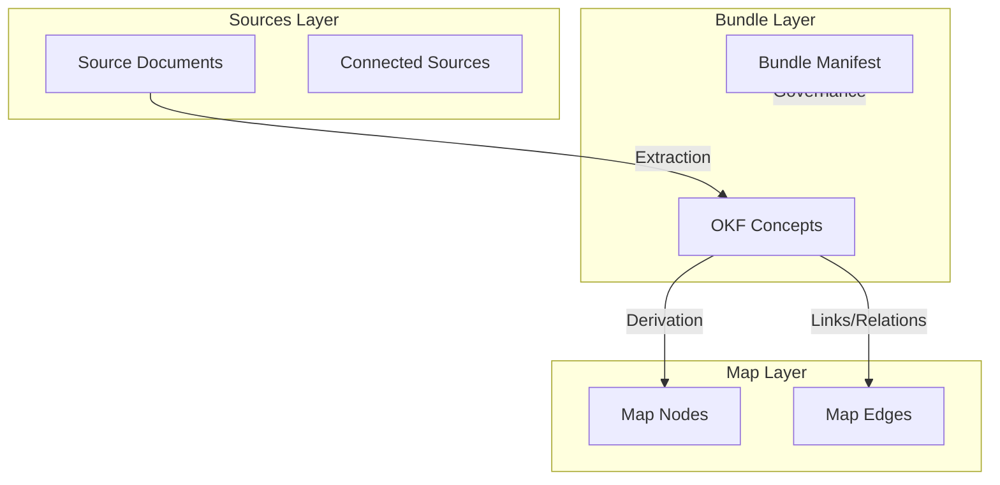
This diagram shows how data flows from raw source documents through curated OKF bundles into the derived map layer.
Sources: [VISION.md:14-23](https://github.com/betteranswers/better-answers/blob/d38db273b822e9daea6b5a407aee70c49c49f831/VISION.md#L14-L23), [GLOSSARY.md:10-14](https://github.com/betteranswers/better-answers/blob/d38db273b822e9daea6b5a407aee70c49c49f831/GLOSSARY.md#L10-L14)

## Data Structures and Schema

The platform stores knowledge metadata in a relational database to support search, visibility, and trust.

| Table | Purpose | Key Fields |
| :--- | :--- | :--- |
| `concept_index` | Primary registry for concept content. | `iri`, `path`, `kind`, `title`, `content_hash`, `status`, `sensitivity` |
| `concept_identity` | Maps stable IRIs to merge keys. | `iri`, `merge_key`, `workspace_id` |
| `concept_verification` | Records trust signals and verifiers. | `iri`, `actor`, `verified_at`, `origin` |
| `map_node` | Graph nodes in the derived map. | `uid`, `label`, `kind`, `gen`, `sensitivity` |
| `map_edge` | Graph relationships. | `uid`, `label`, `from_uid`, `to_uid`, `sentence` |
Sources: [packages/schema/test/boundary-schemas.test.ts:800-845](https://github.com/betteranswers/better-answers/blob/d38db273b822e9daea6b5a407aee70c49c49f831/packages/schema/test/boundary-schemas.test.ts#L800-L845), [packages/core/test/concepts/concepts.test.ts:250-270](https://github.com/betteranswers/better-answers/blob/d38db273b822e9daea6b5a407aee70c49c49f831/packages/core/test/concepts/concepts.test.ts#L250-L270)

## Governed Writes and Reconciler

Every change to a concept is a **Governed Write**. The system records a commit in a Git-backed store and simultaneously updates the database.
Sources: [packages/core/test/concepts/concepts.test.ts:135-145](https://github.com/betteranswers/better-answers/blob/d38db273b822e9daea6b5a407aee70c49c49f831/packages/core/test/concepts/concepts.test.ts#L135-L145)

1.  **Content Hashing**: The system generates a `content_hash` from the concept body and frontmatter. If the content changes, the hash changes.
2.  **Commitment**: Each write creates a commit with an `actor` (the person) and a `committer` (the platform bot).
3.  **Reconciliation**: If a process dies between the Git commit and the database update, the **Reconciler** replays the missed commits to synchronize the database with the Git history.
Sources: [packages/core/test/concepts/concepts.test.ts:150-165](https://github.com/betteranswers/better-answers/blob/d38db273b822e9daea6b5a407aee70c49c49f831/packages/core/test/concepts/concepts.test.ts#L150-L165), [packages/core/test/concepts/writes/reconciler.test.ts:145-160](https://github.com/betteranswers/better-answers/blob/d38db273b822e9daea6b5a407aee70c49c49f831/packages/core/test/concepts/writes/reconciler.test.ts#L145-L160)

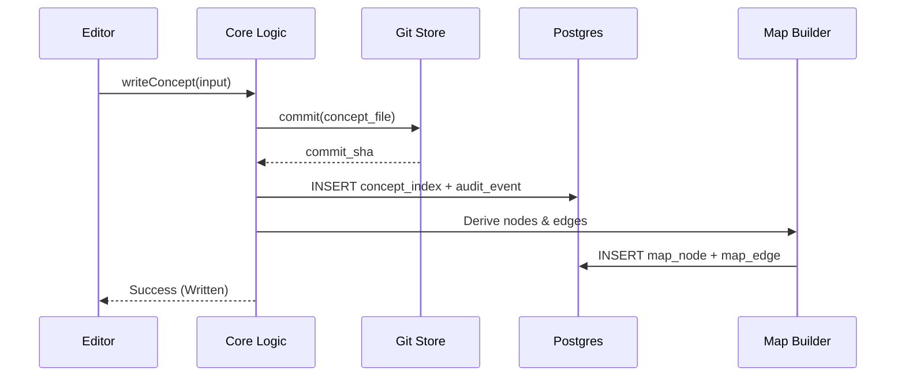
This sequence illustrates the governed write process, ensuring synchronization between the Git repository and the database.
Sources: [packages/core/test/concepts/concepts.test.ts:138-155](https://github.com/betteranswers/better-answers/blob/d38db273b822e9daea6b5a407aee70c49c49f831/packages/core/test/concepts/concepts.test.ts#L138-L155), [packages/core/test/concepts/rebuild-equivalence.test.ts:120-140](https://github.com/betteranswers/better-answers/blob/d38db273b822e9daea6b5a407aee70c49c49f831/packages/core/test/concepts/rebuild-equivalence.test.ts#L120-L140)

## Trust and Visibility

### Trust Tiers
Concepts carry trust signals based on who verified them. Trust tiers are a closed set of words used throughout the interface.
Sources: [packages/design-system/readme.md:21-23](https://github.com/betteranswers/better-answers/blob/d38db273b822e9daea6b5a407aee70c49c49f831/packages/design-system/readme.md#L21-L23), [GLOSSARY.md:214-216](https://github.com/betteranswers/better-answers/blob/d38db273b822e9daea6b5a407aee70c49c49f831/GLOSSARY.md#L214-L216)

*   **Verified by [Person]**: Human-reviewed.
*   **Verified automatically**: Machine-confirmed (e.g., by an agent).
*   **Unverified**: No confirmation yet.
*   **Changed since verified**: Content updated after the last check.
Sources: [packages/core/test/concepts/concepts.test.ts:915-930](https://github.com/betteranswers/better-answers/blob/d38db273b822e9daea6b5a407aee70c49c49f831/packages/core/test/concepts/concepts.test.ts#L915-L930)

### Sensitivity and Audience
Knowledge visibility is gated by **Sensitivity** levels:
*   **Public**: Visible to anyone.
*   **Internal**: Visible to all workspace members.
*   **Restricted**: Visible only to specific groups or Admins.
Sources: [GLOSSARY.md:156-159](https://github.com/betteranswers/better-answers/blob/d38db273b822e9daea6b5a407aee70c49c49f831/GLOSSARY.md#L156-L159), [packages/design-system/readme.md:36-40](https://github.com/betteranswers/better-answers/blob/d38db273b822e9daea6b5a407aee70c49c49f831/packages/design-system/readme.md#L36-L40)

If a source document's sensitivity narrows (becomes more restricted), a **Cascade** carries that change to every concept citing that document as evidence.
Sources: [GLOSSARY.md:172-176](https://github.com/betteranswers/better-answers/blob/d38db273b822e9daea6b5a407aee70c49c49f831/GLOSSARY.md#L172-L176)

## Bundle Import Process

The platform supports importing entire OKF bundles from directories.
Sources: [packages/core/test/concepts/import/import-bundle.test.ts:25-30](https://github.com/betteranswers/better-answers/blob/d38db273b822e9daea6b5a407aee70c49c49f831/packages/core/test/concepts/import/import-bundle.test.ts#L25-L30)

1.  **Manifest Validation**: The system checks `manifest.yaml` for valid `id`, `origin`, and `owner`.
2.  **Path Resolution**: Concepts are imported into the `knowledge/` directory, maintaining their folder structure.
3.  **Link Rewriting**: During import, relative Markdown links (e.g., `[Title](https://github.com/betteranswers/better-answers/blob/d38db273b822e9daea6b5a407aee70c49c49f831/other.md)`) are rewritten to use the stable IRIs of the target concepts.
4.  **Verification Recording**: Verifications found in the OKF frontmatter are recorded as `imported` trust events.
Sources: [packages/core/test/concepts/import/import-bundle.test.ts:320-340](https://github.com/betteranswers/better-answers/blob/d38db273b822e9daea6b5a407aee70c49c49f831/packages/core/test/concepts/import/import-bundle.test.ts#L320-L340), [packages/core/test/concepts/import/import-bundle.test.ts:440-455](https://github.com/betteranswers/better-answers/blob/d38db273b822e9daea6b5a407aee70c49c49f831/packages/core/test/concepts/import/import-bundle.test.ts#L440-L455)

Knowledge Management in this platform ensures that all company information remains portable, verifiable, and structured as a queryable graph. This architecture allows AI agents to traverse business knowledge with high confidence while maintaining human oversight through trust tiers and governed writes.
Sources: [VISION.md:10-13](https://github.com/betteranswers/better-answers/blob/d38db273b822e9daea6b5a407aee70c49c49f831/VISION.md#L10-L13)

### Authentication and Workspaces

<details>
<summary>Relevant source files</summary>

The following files were used as context for generating this wiki page:

- [apps/api/src/auth/auth.ts](https://github.com/betteranswers/better-answers/blob/d38db273b822e9daea6b5a407aee70c49c49f831/apps/api/src/auth/auth.ts)
- [apps/api/src/auth/sign-in/sign-in-email.ts](https://github.com/betteranswers/better-answers/blob/d38db273b822e9daea6b5a407aee70c49c49f831/apps/api/src/auth/sign-in/sign-in-email.ts)
- [VISION.md](https://github.com/betteranswers/better-answers/blob/d38db273b822e9daea6b5a407aee70c49c49f831/VISION.md)
- [GLOSSARY.md](https://github.com/betteranswers/better-answers/blob/d38db273b822e9daea6b5a407aee70c49c49f831/GLOSSARY.md)
- [apps/api/tests/auth/oauth-flow.test.ts](https://github.com/betteranswers/better-answers/blob/d38db273b822e9daea6b5a407aee70c49c49f831/apps/api/tests/auth/oauth-flow.test.ts)
- [packages/schema/test/boundary-schemas.test.ts](https://github.com/betteranswers/better-answers/blob/d38db273b822e9daea6b5a407aee70c49c49f831/packages/schema/test/boundary-schemas.test.ts)
</details>

# Authentication and Workspaces

Authentication and Workspaces provide the foundational security and multi-tenancy layer for the Better Answers platform. This system ensures that every interaction is permission-aware, citing specific knowledge only when the reader has the appropriate access.

The platform follows a private-by-default principle. A person belongs to one or more **Workspaces**, which act as the boundary for people, connected sources, knowledge bases, maps, and records. Every API call carries a principal, and every answer generated by the system is aware of the user's role and workspace membership.

Sources: [VISION.md:73-77](https://github.com/betteranswers/better-answers/blob/d38db273b822e9daea6b5a407aee70c49c49f831/VISION.md#L73-L77), [GLOSSARY.md:286-289](https://github.com/betteranswers/better-answers/blob/d38db273b822e9daea6b5a407aee70c49c49f831/GLOSSARY.md#L286-L289)

## Authentication Architecture

Better Answers uses a multi-layered authentication strategy powered by the `better-auth` framework. It supports several sign-in methods, including Email One-Time Passwords (OTP), sign-in links, and Passkeys.

### Core Components
*   **Identity Store**: A Drizzle-based adapter manages users, sessions, accounts, and verifications.
*   **Plugins**: The system extends core functionality using plugins for `emailOTP`, `organization`, `passkey`, and `twoFactor` authentication.
*   **OAuth 2.0 Provider**: The platform acts as an OAuth provider, allowing external agents (like Claude Desktop) to access company knowledge securely via MCP (Model Context Protocol).

Sources: [apps/api/src/auth/auth.ts:98-144](https://github.com/betteranswers/better-answers/blob/d38db273b822e9daea6b5a407aee70c49c49f831/apps/api/src/auth/auth.ts#L98-L144), [apps/api/src/auth/auth.ts:241-260](https://github.com/betteranswers/better-answers/blob/d38db273b822e9daea6b5a407aee70c49c49f831/apps/api/src/auth/auth.ts#L241-L260)

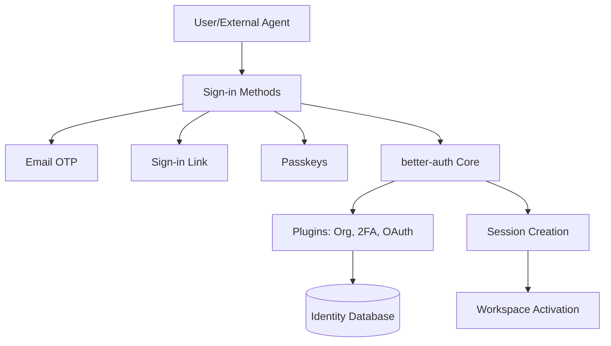
The diagram shows the flow from user sign-in through the authentication core to session and workspace activation.
Sources: [apps/api/src/auth/auth.ts:167-336](https://github.com/betteranswers/better-answers/blob/d38db273b822e9daea6b5a407aee70c49c49f831/apps/api/src/auth/auth.ts#L167-L336)

## Workspace Management

A Workspace represents a single company's environment. Multi-tenancy is enforced by linking every record and concept to a `workspaceId`.

### Roles and Permissions
The platform defines three primary roles that gate actions based on specific thresholds:
| Role | Description | Access Level |
| :--- | :--- | :--- |
| **Admin** | Manages sources, kinds, suggestions, and the Control Centre. | Full management |
| **Editor** | Curates knowledge and acts on suggestions. | Write/Edit knowledge |
| **Viewer** | Reads knowledge and uses the "Ask" interface. | Read-only |

Sources: [VISION.md:65-68](https://github.com/betteranswers/better-answers/blob/d38db273b822e9daea6b5a407aee70c49c49f831/VISION.md#L65-L68), [GLOSSARY.md:295-298](https://github.com/betteranswers/better-answers/blob/d38db273b822e9daea6b5a407aee70c49c49f831/GLOSSARY.md#L295-L298)

### Active Workspace Selection
When a user belongs to multiple workspaces, they must select an active one. The system automatically activates a workspace if the user only belongs to one. If a user tries to access a workspace they are not a member of, the system returns a `403 Forbidden` error.

Sources: [apps/api/src/auth/auth.ts:182-195](https://github.com/betteranswers/better-answers/blob/d38db273b822e9daea6b5a407aee70c49c49f831/apps/api/src/auth/auth.ts#L182-L195), [apps/api/tests/auth/oauth-flow.test.ts:145-155](https://github.com/betteranswers/better-answers/blob/d38db273b822e9daea6b5a407aee70c49c49f831/apps/api/tests/auth/oauth-flow.test.ts#L145-L155)

## OAuth 2.0 and MCP Integration

The platform enables external agents to "carry knowledge anywhere it's needed" through an MCP server. This is secured via an OAuth 2.0 flow where users grant specific scopes to assistants.

### Scopes
The following scopes are supported for OAuth clients:
*   `knowledge:read`: Allows reading concepts and maps.
*   `feedback:write`: Allows submitting feedback on answers.
*   `offline_access`: Enables the use of refresh tokens.

Sources: [apps/api/src/auth/auth.ts:85](https://github.com/betteranswers/better-answers/blob/d38db273b822e9daea6b5a407aee70c49c49f831/apps/api/src/auth/auth.ts#L85), [apps/api/tests/auth/oauth-flow.test.ts:106-110](https://github.com/betteranswers/better-answers/blob/d38db273b822e9daea6b5a407aee70c49c49f831/apps/api/tests/auth/oauth-flow.test.ts#L106-L110)

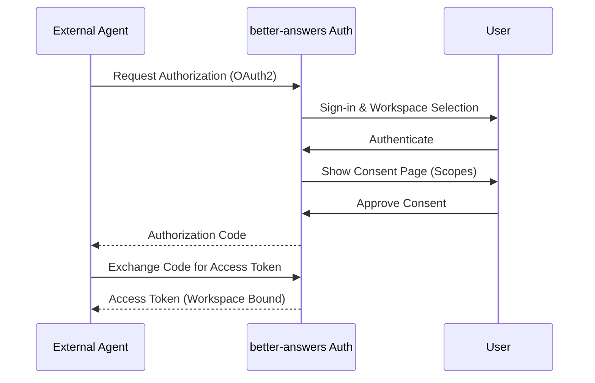
The sequence shows how an external agent gains workspace-bound access through user consent.
Sources: [apps/api/tests/auth/oauth-flow.test.ts:114-142](https://github.com/betteranswers/better-answers/blob/d38db273b822e9daea6b5a407aee70c49c49f831/apps/api/tests/auth/oauth-flow.test.ts#L114-L142), [apps/api/src/auth/auth.ts:285-320](https://github.com/betteranswers/better-answers/blob/d38db273b822e9daea6b5a407aee70c49c49f831/apps/api/src/auth/auth.ts#L285-L320)

## Security and Auditing

The system maintains a rigorous audit log for every administrative and authentication action. 

### Audit Logging
The `identity-set audit log` records actions acting on a person's identity (e.g., sign-ins), while workspace-specific audit logs record internal changes.
*   **Sign-in Events**: Logs the method used (e.g., "email_otp", "passkey").
*   **Workspace Events**: Logs member role changes and workspace provisioning.
*   **OAuth Events**: Logs token issuance, refresh, and revocation, but never logs the tokens themselves or secrets.

Sources: [apps/api/src/auth/auth.ts:200-238](https://github.com/betteranswers/better-answers/blob/d38db273b822e9daea6b5a407aee70c49c49f831/apps/api/src/auth/auth.ts#L200-L238), [GLOSSARY.md:323-328](https://github.com/betteranswers/better-answers/blob/d38db273b822e9daea6b5a407aee70c49c49f831/GLOSSARY.md#L323-L328), [apps/api/tests/auth/oauth-flow.test.ts:581-610](https://github.com/betteranswers/better-answers/blob/d38db273b822e9daea6b5a407aee70c49c49f831/apps/api/tests/auth/oauth-flow.test.ts#L581-L610)

### Security Headers and Controls
*   **CSRF Protection**: The system refuses cross-site forms and verifies `origin` and `sec-fetch-site` headers.
*   **Frame Protection**: The consent page uses `frame-ancestors 'none'` and `X-Frame-Options: DENY` to prevent clickjacking.
*   **Rate Limiting**: Ingress counters throttle requests by IP or email to prevent brute-force attacks on OTP endpoints.

Sources: [apps/api/tests/auth/oauth-flow.test.ts:468-500](https://github.com/betteranswers/better-answers/blob/d38db273b822e9daea6b5a407aee70c49c49f831/apps/api/tests/auth/oauth-flow.test.ts#L468-L500), [apps/api/tests/auth/oauth-flow.test.ts:678-700](https://github.com/betteranswers/better-answers/blob/d38db273b822e9daea6b5a407aee70c49c49f831/apps/api/tests/auth/oauth-flow.test.ts#L678-L700)

## Data Models

Authentication and workspace data is structured across several relational tables.

| Table | Purpose |
| :--- | :--- |
| `workspace` | The primary boundary for a company's data. |
| `user` | Stores person-level identity and global settings. |
| `member` | Maps a `user` to a `workspace` with a specific `role`. |
| `session` | Tracks active sign-ins and the `activeWorkspaceId`. |
| `oauth_consent` | Records which scopes a user has granted to a specific client. |

Sources: [packages/schema/test/boundary-schemas.test.ts:38-160](https://github.com/betteranswers/better-answers/blob/d38db273b822e9daea6b5a407aee70c49c49f831/packages/schema/test/boundary-schemas.test.ts#L38-L160), [packages/schema/test/boundary-schemas.test.ts:484-510](https://github.com/betteranswers/better-answers/blob/d38db273b822e9daea6b5a407aee70c49c49f831/packages/schema/test/boundary-schemas.test.ts#L484-L510)

Authentication in Better Answers ensures that company knowledge remains secure and private. By combining robust multi-factor authentication with strict workspace boundaries, the platform provides a trustworthy environment where humans and agents can collaborate across sensitive business data.

### Two-Factor Authentication

<details>
<summary>Relevant source files</summary>

The following files were used as context for generating this wiki page:

- [apps/api/tests/auth/second-factor/second-factor-foundation.test.ts](https://github.com/betteranswers/better-answers/blob/d38db273b822e9daea6b5a407aee70c49c49f831/apps/api/tests/auth/second-factor/second-factor-foundation.test.ts)
- [apps/web/e2e/journeys/second-factor.spec.ts](https://github.com/betteranswers/better-answers/blob/d38db273b822e9daea6b5a407aee70c49c49f831/apps/web/e2e/journeys/second-factor.spec.ts)
- [packages/schema/test/boundary-schemas.test.ts](https://github.com/betteranswers/better-answers/blob/d38db273b822e9daea6b5a407aee70c49c49f831/packages/schema/test/boundary-schemas.test.ts)
- [GLOSSARY.md](https://github.com/betteranswers/better-answers/blob/d38db273b822e9daea6b5a407aee70c49c49f831/GLOSSARY.md)
- [VISION.md](https://github.com/betteranswers/better-answers/blob/d38db273b822e9daea6b5a407aee70c49c49f831/VISION.md)
</details>

# Two-Factor Authentication

Two-Factor Authentication (2FA) provides a mandatory security layer for sensitive operations and initial workspace access in better-answers. The system implements 2FA through Time-based One-Time Passwords (TOTP) and Passkeys. Every administrative action is gated by the reader's role and a specific threshold, ensuring that high-privilege operations require a verified second factor.

Sources: [VISION.md:80-81](https://github.com/betteranswers/better-answers/blob/d38db273b822e9daea6b5a407aee70c49c49f831/VISION.md#L80-L81), [GLOSSARY.md:278-281](https://github.com/betteranswers/better-answers/blob/d38db273b822e9daea6b5a407aee70c49c49f831/GLOSSARY.md#L278-L281)

## Authentication Mechanisms

The platform supports multiple second-factor methods to verify a user's identity.

### Authenticator (TOTP)
Users can set up an authenticator app that generates time-based codes. The system provides a QR code during setup and requires the user to enter a valid code to verify the connection. Once enabled, the user must provide a TOTP code during sign-in or when prompted for sensitive actions.

Sources: [apps/web/e2e/journeys/second-factor.spec.ts:69-75](https://github.com/betteranswers/better-answers/blob/d38db273b822e9daea6b5a407aee70c49c49f831/apps/web/e2e/journeys/second-factor.spec.ts#L69-L75), [apps/api/tests/auth/second-factor/second-factor-foundation.test.ts:46-49](https://github.com/betteranswers/better-answers/blob/d38db273b822e9daea6b5a407aee70c49c49f831/apps/api/tests/auth/second-factor/second-factor-foundation.test.ts#L46-L49)

### Passkeys
Passkeys serve as a secondary authentication method. The API includes endpoints for verifying passkey registration. Users can dismiss passkey offers, and the system tracks this dismissal to manage future prompts.

Sources: [apps/api/tests/auth/second-factor/second-factor-foundation.test.ts:74-75](https://github.com/betteranswers/better-answers/blob/d38db273b822e9daea6b5a407aee70c49c49f831/apps/api/tests/auth/second-factor/second-factor-foundation.test.ts#L74-L75), [packages/schema/test/boundary-schemas.test.ts:517-526](https://github.com/betteranswers/better-answers/blob/d38db273b822e9daea6b5a407aee70c49c49f831/packages/schema/test/boundary-schemas.test.ts#L517-L526)

### Recovery Codes
When a user sets up a second factor, the system generates a set of 10 recovery codes. These codes allow access if the primary second-factor device is lost. Codes follow a specific format: four blocks of four alphanumeric characters separated by hyphens (e.g., `xxxx-xxxx-xxxx-xxxx`).

Sources: [apps/web/e2e/journeys/second-factor.spec.ts:25-28](https://github.com/betteranswers/better-answers/blob/d38db273b822e9daea6b5a407aee70c49c49f831/apps/web/e2e/journeys/second-factor.spec.ts#L25-L28), [apps/web/e2e/journeys/second-factor.spec.ts:76-80](https://github.com/betteranswers/better-answers/blob/d38db273b822e9daea6b5a407aee70c49c49f831/apps/web/e2e/journeys/second-factor.spec.ts#L76-L80)

## Session Gating and Enforcement

The system enforces 2FA verification by placing sessions in a "pending" state.

### Pending Sessions
If a user has 2FA enabled but signs in using only a primary method (like an email code), the session is marked as `second-factor-pending`. In this state, the user can access the `/get-session` endpoint to see their user ID, but sensitive endpoints (such as `/me`) return a `403 Forbidden` error.

Sources: [apps/api/tests/auth/second-factor/second-factor-foundation.test.ts:51-60](https://github.com/betteranswers/better-answers/blob/d38db273b822e9daea6b5a407aee70c49c49f831/apps/api/tests/auth/second-factor/second-factor-foundation.test.ts#L51-L60)

### Verification Flow
When a user attempts to access a protected area while 2FA is pending, the system redirects them to a confirmation page. The user must provide a valid authenticator code to transition the session from pending to confirmed.

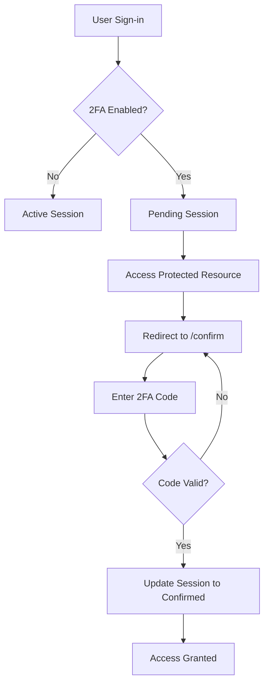
The diagram shows the transition from a pending second-factor state to a confirmed active session.
Sources: [apps/api/tests/auth/second-factor/second-factor-foundation.test.ts:51-60](https://github.com/betteranswers/better-answers/blob/d38db273b822e9daea6b5a407aee70c49c49f831/apps/api/tests/auth/second-factor/second-factor-foundation.test.ts#L51-L60), [apps/web/e2e/journeys/second-factor.spec.ts:52-62](https://github.com/betteranswers/better-answers/blob/d38db273b822e9daea6b5a407aee70c49c49f831/apps/web/e2e/journeys/second-factor.spec.ts#L52-L62)

## Data Model and Persistence

The 2FA system relies on several database tables to track authenticators, passkeys, and session states.

### Key Data Structures

| Table | Purpose | Key Fields |
| :--- | :--- | :--- |
| `authenticator` | Stores TOTP configuration | `secret`, `backup_codes`, `verified` |
| `passkey` | Stores WebAuthn credentials | `public_key`, `credential_id`, `counter`, `aaguid` |
| `session` | Tracks authentication state | `second_factor_confirmed_at`, `pending_since`, `setup_granted_at` |
| `recovery_code` | Stores hashed recovery codes | `user_id`, `code_hash` |
| `second_factor_throttle` | Prevents brute force attacks | `kind`, `failures`, `wait_until` |

Sources: [packages/schema/test/boundary-schemas.test.ts:182-205](https://github.com/betteranswers/better-answers/blob/d38db273b822e9daea6b5a407aee70c49c49f831/packages/schema/test/boundary-schemas.test.ts#L182-L205), [apps/api/tests/auth/second-factor/second-factor-foundation.test.ts:38-42](https://github.com/betteranswers/better-answers/blob/d38db273b822e9daea6b5a407aee70c49c49f831/apps/api/tests/auth/second-factor/second-factor-foundation.test.ts#L38-L42)

### Privacy and Security
To protect user privacy, 2FA-specific fields in the `user` and `session` tables—such as `recovery_codes_acknowledged` or `second_factor_confirmed_at`—are not returned in standard session reads. These fields are declared for platform-only use and are filtered out before sending data to the client.

Sources: [apps/api/tests/auth/second-factor/second-factor-foundation.test.ts:88-106](https://github.com/betteranswers/better-answers/blob/d38db273b822e9daea6b5a407aee70c49c49f831/apps/api/tests/auth/second-factor/second-factor-foundation.test.ts#L88-L106), [apps/api/tests/auth/second-factor/second-factor-foundation.test.ts:110-117](https://github.com/betteranswers/better-answers/blob/d38db273b822e9daea6b5a407aee70c49c49f831/apps/api/tests/auth/second-factor/second-factor-foundation.test.ts#L110-L117)

## Implementation Summary

2FA in better-answers is an integrated security feature that protects workspace boundaries. By combining TOTP authenticators with Passkeys and enforced session gating, the platform ensures that identities are verified before allowing access to company knowledge. The use of recovery codes and throttling mechanisms provides a balance between user recovery and protection against automated attacks.

Sources: [VISION.md:80-81](https://github.com/betteranswers/better-answers/blob/d38db273b822e9daea6b5a407aee70c49c49f831/VISION.md#L80-L81), [apps/web/e2e/journeys/second-factor.spec.ts:69-80](https://github.com/betteranswers/better-answers/blob/d38db273b822e9daea6b5a407aee70c49c49f831/apps/web/e2e/journeys/second-factor.spec.ts#L69-L80), [packages/schema/test/boundary-schemas.test.ts:199-201](https://github.com/betteranswers/better-answers/blob/d38db273b822e9daea6b5a407aee70c49c49f831/packages/schema/test/boundary-schemas.test.ts#L199-L201)

### Asking and Answering Engine

<details>
<summary>Relevant source files</summary>

The following files were used as context for generating this wiki page:

- [VISION.md](https://github.com/betteranswers/better-answers/blob/d38db273b822e9daea6b5a407aee70c49c49f831/VISION.md)
- [GLOSSARY.md](https://github.com/betteranswers/better-answers/blob/d38db273b822e9daea6b5a407aee70c49c49f831/GLOSSARY.md)
- [packages/design-system/readme.md](https://github.com/betteranswers/better-answers/blob/d38db273b822e9daea6b5a407aee70c49c49f831/packages/design-system/readme.md)
- [apps/web/e2e/ask/new-question.spec.ts](https://github.com/betteranswers/better-answers/blob/d38db273b822e9daea6b5a407aee70c49c49f831/apps/web/e2e/ask/new-question.spec.ts)
- [packages/schema/test/boundary-schemas.test.ts](https://github.com/betteranswers/better-answers/blob/d38db273b822e9daea6b5a407aee70c49c49f831/packages/schema/test/boundary-schemas.test.ts)
- [packages/core/test/concepts/concepts.test.ts](https://github.com/betteranswers/better-answers/blob/d38db273b822e9daea6b5a407aee70c49c49f831/packages/core/test/concepts/concepts.test.ts)
</details>

# Asking and Answering Engine

The Asking and Answering Engine is the core retrieval and generation system of better-answers. It provides accurate, cited, and permission-aware information about a business by reasoning over the company knowledge map. The engine processes natural language questions, identifies relevant [Concepts](#knowledge-concepts), and generates explainable answers with verifiable provenance.

The engine operates across three knowledge layers: **Sources** (raw documents), **Bundles** (curated OKF concepts), and the **Map** (derived relationships). It ensures that every answer is permission-aware, only reaching knowledge that the requester's [Role](#people-and-accountability) and [Sensitivity](#visibility) level allow.

Sources: [VISION.md:7-14](https://github.com/betteranswers/better-answers/blob/d38db273b822e9daea6b5a407aee70c49c49f831/VISION.md#L7-L14), [packages/design-system/readme.md:12-16](https://github.com/betteranswers/better-answers/blob/d38db273b822e9daea6b5a407aee70c49c49f831/packages/design-system/readme.md#L12-L16), [GLOSSARY.md:270-274](https://github.com/betteranswers/better-answers/blob/d38db273b822e9daea6b5a407aee70c49c49f831/GLOSSARY.md#L270-L274)

## Core Logic and Data Flow

The answering process follows a structured sequence: judging candidate concepts, drafting the response, and streaming the result to the consumer.

### Execution Sequence

1.  **Question Input**: A user provides a question via the web interface or an MCP (Model Context Protocol) assistant.
2.  **Judging**: The engine evaluates candidate Q&A pairs (Answer concepts) to determine if they fit the specific question asked.
3.  **Drafting**: If no direct Q&A fit is found, the engine identifies "Related Knowledge" and drafts a response based on available concepts.
4.  **Verification and Citations**: The engine attaches trust signals (e.g., "Verified by", "Unverified") and citations (locators to passages) to the answer.
5.  **Streaming**: The platform streams the answer to the user interface, which is the only continuous motion allowed in the product.

The following sequence diagram illustrates the flow from a user question to a cited answer:

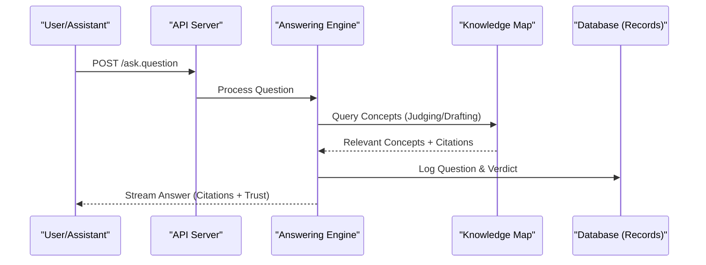

Sources: [GLOSSARY.md:270-282](https://github.com/betteranswers/better-answers/blob/d38db273b822e9daea6b5a407aee70c49c49f831/GLOSSARY.md#L270-L282), [apps/web/e2e/ask/new-question.spec.ts:133-146](https://github.com/betteranswers/better-answers/blob/d38db273b822e9daea6b5a407aee70c49c49f831/apps/web/e2e/ask/new-question.spec.ts#L133-L146), [packages/design-system/readme.md:104-106](https://github.com/betteranswers/better-answers/blob/d38db273b822e9daea6b5a407aee70c49c49f831/packages/design-system/readme.md#L104-L106)

## Components of an Answer

An **Answer** is a record of what the platform returned for a question. It is distinct from a **Q&A pair** (a static concept), though it may reuse one.

| Component | Description |
| :--- | :--- |
| **Verdict** | The engine's high-level result: `ok`, `warn`, `refuse`, or `related`. |
| **Judge State** | Indicates if candidate concepts were `judged`, `not-judged`, or if `judging-failed`. |
| **Citations** | Locators linking answer claims to specific source documents or concept IRIs. |
| **Trust Tier** | The confirmation level: `human-reviewed`, `machine-confirmed`, or `unverified`. |
| **Drafted Content** | A set of sentences mapped to specific concepts when a direct Q&A fit is absent. |

Sources: [GLOSSARY.md:270-274](https://github.com/betteranswers/better-answers/blob/d38db273b822e9daea6b5a407aee70c49c49f831/GLOSSARY.md#L270-L274), [packages/schema/test/boundary-schemas.test.ts:492-515](https://github.com/betteranswers/better-answers/blob/d38db273b822e9daea6b5a407aee70c49c49f831/packages/schema/test/boundary-schemas.test.ts#L492-L515)

## Constraints and Accountability

The engine enforces strict boundaries regarding what can be answered and how the results are recorded for audit purposes.

### Permission Awareness
Sensitivity gates the engine's reach. Concepts or sources marked as **Restricted** or **Internal** are only included in answers if the requester has the appropriate audience membership or role. Trust levels (e.g., "Unverified") never gate viewing, only the content's sensitivity does.

### Spending Limits
The engine monitors LLM (Large Language Model) usage costs per request. If a pre-configured workspace spending limit is met, the engine refuses to process the question further and returns a "spending-limit-met" alert.

### Feedback Loop
Users can provide feedback on answers by "flagging" them. Admins or owners use these flags to record **Corrections** at different levels:
*   **Concept**: The underlying knowledge is wrong.
*   **Source**: The evidence document is incorrect.
*   **Retrieval**: The engine failed to find or use the right information.

Sources: [VISION.md:50-52](https://github.com/betteranswers/better-answers/blob/d38db273b822e9daea6b5a407aee70c49c49f831/VISION.md#L50-L52), [GLOSSARY.md:200-205](https://github.com/betteranswers/better-answers/blob/d38db273b822e9daea6b5a407aee70c49c49f831/GLOSSARY.md#L200-L205), [apps/web/e2e/ask/new-question.spec.ts:98-115](https://github.com/betteranswers/better-answers/blob/d38db273b822e9daea6b5a407aee70c49c49f831/apps/web/e2e/ask/new-question.spec.ts#L98-L115), [GLOSSARY.md:295-300](https://github.com/betteranswers/better-answers/blob/d38db273b822e9daea6b5a407aee70c49c49f831/GLOSSARY.md#L295-L300)

## Technical Schema: `question_asked`

The platform persists every interaction with the engine in the `question_asked` and `question_content` tables for audit and training purposes.

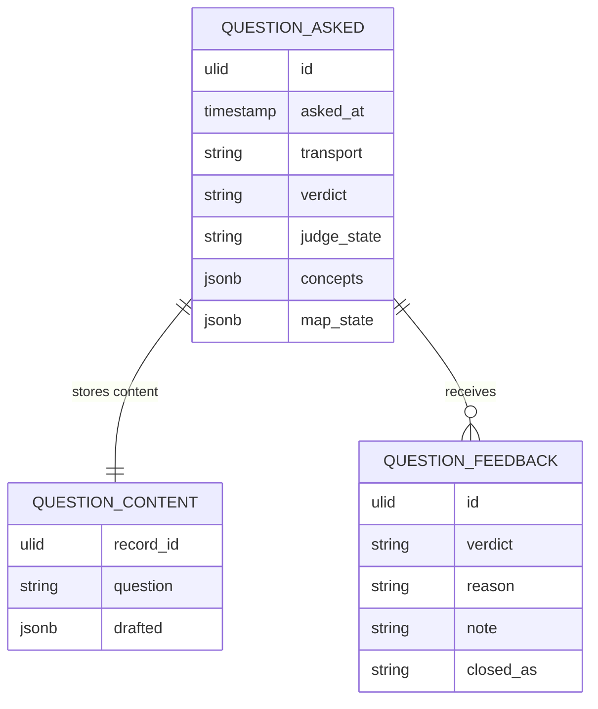

Sources: [packages/schema/test/boundary-schemas.test.ts:492-540](https://github.com/betteranswers/better-answers/blob/d38db273b822e9daea6b5a407aee70c49c49f831/packages/schema/test/boundary-schemas.test.ts#L492-L540)

## Conclusion

The Asking and Answering Engine transforms fragmented company data into a reliable knowledge asset. By enforcing [OKF](https://github.com/betteranswers/better-answers/blob/d38db273b822e9daea6b5a407aee70c49c49f831/GLOSSARY.md#knowledge) standards and permission-aware retrieval, it ensures that employees and agents receive accurate, cited information while maintaining strict data governance and cost control.

### Source Management

<details>
<summary>Relevant source files</summary>

The following files were used as context for generating this wiki page:

- [VISION.md](https://github.com/betteranswers/better-answers/blob/d38db273b822e9daea6b5a407aee70c49c49f831/VISION.md)
- [GLOSSARY.md](https://github.com/betteranswers/better-answers/blob/d38db273b822e9daea6b5a407aee70c49c49f831/GLOSSARY.md)
- [packages/schema/test/boundary-schemas.test.ts](https://github.com/betteranswers/better-answers/blob/d38db273b822e9daea6b5a407aee70c49c49f831/packages/schema/test/boundary-schemas.test.ts)
- [packages/core/test/sources/connected-source-list.test.ts](https://github.com/betteranswers/better-answers/blob/d38db273b822e9daea6b5a407aee70c49c49f831/packages/core/test/sources/connected-source-list.test.ts)
- [apps/web/e2e/sources/connected-sources.spec.ts](https://github.com/betteranswers/better-answers/blob/d38db273b822e9daea6b5a407aee70c49c49f831/apps/web/e2e/sources/connected-sources.spec.ts)
- [packages/design-system/readme.md](https://github.com/betteranswers/better-answers/blob/d38db273b822e9daea6b5a407aee70c49c49f831/packages/design-system/readme.md)
</details>

# Source Management

Source Management represents the foundational layer of the Better Answers knowledge system. It handles the ingestion, indexing, and lifecycle of company documents and systems, which serve as evidence for [Concepts](#concepts). Sources are external assets that remain in their original locations while the platform indexes them for search and extraction.

The system distinguishes between the physical **Source** (the document or system itself), the **Connected Source** (the administrative connection and configuration), and the **Source Document** (the specific items yielded by a connection). This management ensures that every answer provided by the platform is cited and permission-aware.

Sources: [VISION.md:12-14](https://github.com/betteranswers/better-answers/blob/d38db273b822e9daea6b5a407aee70c49c49f831/VISION.md#L12-L14), [GLOSSARY.md:68-70](https://github.com/betteranswers/better-answers/blob/d38db273b822e9daea6b5a407aee70c49c49f831/GLOSSARY.md#L68-L70)

## Architecture and Data Flow

Source management follows a structured flow from raw ingestion to searchable passages. An Administrator connects a source system through a **Connector**, which then syncs documents based on a defined schedule or manual trigger.

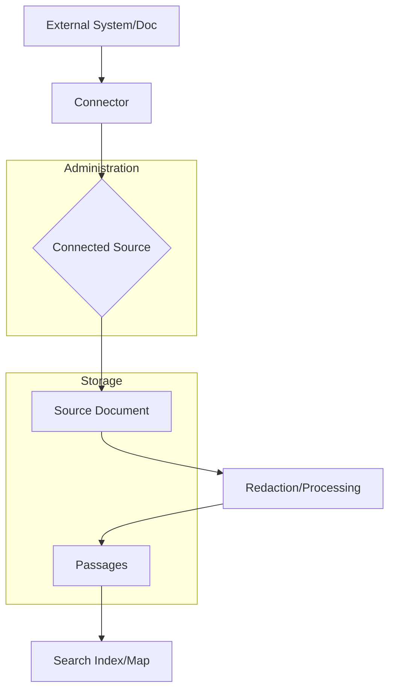
The diagram shows the lifecycle of data as it moves from external systems into the platform's queryable layers.
Sources: [GLOSSARY.md:83-110](https://github.com/betteranswers/better-answers/blob/d38db273b822e9daea6b5a407aee70c49c49f831/GLOSSARY.md#L83-L110), [packages/design-system/readme.md:10-14](https://github.com/betteranswers/better-answers/blob/d38db273b822e9daea6b5a407aee70c49c49f831/packages/design-system/readme.md#L10-L14)

### Key Components

| Component | Description |
| :--- | :--- |
| **Connector** | The mechanism for reaching source systems like uploads, websites, SharePoint, or HubSpot. |
| **Connected Source** | An Admin-defined connection including collection, sensitivity, audience, and sync schedule. |
| **Source Document** | Individual items (e.g., a PDF, a Markdown file) yielded by a Connected Source. |
| **Passage** | A unit of redacted text from a Source Document used as the basis for citations. |
| **Sync** | The process of bringing documents and passages up to date. |

Sources: [GLOSSARY.md:83-108](https://github.com/betteranswers/better-answers/blob/d38db273b822e9daea6b5a407aee70c49c49f831/GLOSSARY.md#L83-L108), [packages/schema/test/boundary-schemas.test.ts:316-339](https://github.com/betteranswers/better-answers/blob/d38db273b822e9daea6b5a407aee70c49c49f831/packages/schema/test/boundary-schemas.test.ts#L316-L339)

## Connectivity and Ingestion

The platform utilizes specific connectors to interface with external data. Administrators manage these connections within the **Control Centre**. 

### Connectors and Reach
Connectors like `upload` allow for manual document ingestion, while others interface with live systems. The "Reach" of a source determines if the platform stores a copy (**Copied**) or reads it live (**Live**) without keeping a copy. 

```mermaid
sequenceDiagram
    participant Admin as Administrator
    participant API as API Server
    participant Worker as Background Worker
    participant Store as Object Store/DB
    
    Admin->>API: POST /sources.connect (Upload File)
    API->>Store: Store Original Document
    API-->>Admin: Connection Received
    Worker->>Store: Read for Indexing
    Worker->>Worker: Redact & Parse Passages
    Worker->>Store: Save Passages & Metadata
    Worker-->>API: Sync Complete
```
This sequence illustrates the interaction between the Administrator and platform components during a source upload and sync.
Sources: [apps/web/e2e/sources/connected-sources.spec.ts:38-55](https://github.com/betteranswers/better-answers/blob/d38db273b822e9daea6b5a407aee70c49c49f831/apps/web/e2e/sources/connected-sources.spec.ts#L38-L55), [GLOSSARY.md:79-82](https://github.com/betteranswers/better-answers/blob/d38db273b822e9daea6b5a407aee70c49c49f831/GLOSSARY.md#L79-L82), [packages/core/test/sources/connected-source-list.test.ts:86-105](https://github.com/betteranswers/better-answers/blob/d38db273b822e9daea6b5a407aee70c49c49f831/packages/core/test/sources/connected-source-list.test.ts#L86-L105)

## Visibility and Sensitivity

Every Connected Source is governed by visibility rules that prevent unauthorized access to sensitive information. Access is determined by a combination of Sensitivity levels and Audience groups.

*   **Sensitivity Levels:** Restricted, Internal, or Public.
*   **Audience:** Defines which members or groups within a workspace can view the content.
*   **Effective Class:** The final sensitivity applied to a document, taking the narrower of the Connected Source's level and the document's own level.

Sources: [GLOSSARY.md:118-129](https://github.com/betteranswers/better-answers/blob/d38db273b822e9daea6b5a407aee70c49c49f831/GLOSSARY.md#L118-L129), [packages/schema/test/boundary-schemas.test.ts:316-324](https://github.com/betteranswers/better-answers/blob/d38db273b822e9daea6b5a407aee70c49c49f831/packages/schema/test/boundary-schemas.test.ts#L316-L324)

### Admin Lifecycle Actions
Administrators perform specific actions to manage the availability of sources:
1.  **Publish:** Allows content to reach users beyond the Control Centre.
2.  **Widen:** Moves a source to a broader sensitivity or audience.
3.  **Narrowing:** Occurs when a document is assigned a stricter sensitivity, often due to findings during redaction.

Sources: [GLOSSARY.md:130-142](https://github.com/betteranswers/better-answers/blob/d38db273b822e9daea6b5a407aee70c49c49f831/GLOSSARY.md#L130-L142), [apps/web/e2e/sources/connected-sources.spec.ts:153-170](https://github.com/betteranswers/better-answers/blob/d38db273b822e9daea6b5a407aee70c49c49f831/apps/web/e2e/sources/connected-sources.spec.ts#L153-L170)

## Data Retention and Redaction

The platform manages the lifecycle of stored source data through **Retention Classes**:
*   **Mirror:** Keeps a local copy synchronized with the external source.
*   **Keep:** Retains the document regardless of external changes.
*   **Transient:** Documents are processed and then discarded, keeping only cited evidence.

Sources: [GLOSSARY.md:111-114](https://github.com/betteranswers/better-answers/blob/d38db273b822e9daea6b5a407aee70c49c49f831/GLOSSARY.md#L111-L114), [packages/schema/test/boundary-schemas.test.ts:316-330](https://github.com/betteranswers/better-answers/blob/d38db273b822e9daea6b5a407aee70c49c49f831/packages/schema/test/boundary-schemas.test.ts#L316-L330)

### Redaction Finding Tiers
Redaction rules identify personal data before it is indexed. These rules operate at three tiers:
*   **Always:** Mandatory redaction.
*   **Default On:** Enabled unless manually overridden.
*   **Default Off:** Disabled unless manually enabled.

Sources: [GLOSSARY.md:149-152](https://github.com/betteranswers/better-answers/blob/d38db273b822e9daea6b5a407aee70c49c49f831/GLOSSARY.md#L149-L152), [packages/schema/test/boundary-schemas.test.ts:696-708](https://github.com/betteranswers/better-answers/blob/d38db273b822e9daea6b5a407aee70c49c49f831/packages/schema/test/boundary-schemas.test.ts#L696-L708)

## Technical Schema Summary

The following table outlines the core data fields for managing connected sources and their documents.

| Table | Field | Type | Description |
| :--- | :--- | :--- | :--- |
| `connected_source` | `id` | ULID | Unique identifier for the connection. |
| `connected_source` | `connector` | String | Type of connector (e.g., `upload`). |
| `connected_source` | `state` | Enum | Current state: `received`, `indexing`, `indexed`, `published`. |
| `source_document` | `byte_size` | Number | Original size of the document. |
| `source_document` | `outcome` | Enum | Result of processing: `converted`, `unreadable`. |
| `source_document` | `sensitivity` | Enum | Calculated sensitivity level. |

Sources: [packages/schema/test/boundary-schemas.test.ts:770-798](https://github.com/betteranswers/better-answers/blob/d38db273b822e9daea6b5a407aee70c49c49f831/packages/schema/test/boundary-schemas.test.ts#L770-L798)

Source Management ensures that all business knowledge is grounded in verifiable evidence while maintaining strict privacy and sensitivity controls across the three knowledge layers.

### Inbox and Operator Workflow

<details>
<summary>Relevant source files</summary>

The following files were used as context for generating this wiki page:

- [GLOSSARY.md](https://github.com/betteranswers/better-answers/blob/d38db273b822e9daea6b5a407aee70c49c49f831/GLOSSARY.md)
- [VISION.md](https://github.com/betteranswers/better-answers/blob/d38db273b822e9daea6b5a407aee70c49c49f831/VISION.md)
- [packages/design-system/readme.md](https://github.com/betteranswers/better-answers/blob/d38db273b822e9daea6b5a407aee70c49c49f831/packages/design-system/readme.md)
- [apps/web/src/features/inbox/inbox-api.ts](https://github.com/betteranswers/better-answers/blob/d38db273b822e9daea6b5a407aee70c49c49f831/apps/web/src/features/inbox/inbox-api.ts)
- [apps/web/src/features/inbox/edit-compare.tsx](https://github.com/betteranswers/better-answers/blob/d38db273b822e9daea6b5a407aee70c49c49f831/apps/web/src/features/inbox/edit-compare.tsx)
- [packages/schema/test/boundary-schemas.test.ts](https://github.com/betteranswers/better-answers/blob/d38db273b822e9daea6b5a407aee70c49c49f831/packages/schema/test/boundary-schemas.test.ts)
</details>

# Inbox and Operator Workflow

The Inbox and Operator systems manage the flow of knowledge curation and platform administration. The Inbox acts as a staging area for members to review proposed changes, while the Operator role provides global oversight across all workspaces.

Sources: [GLOSSARY.md:206-220](https://github.com/betteranswers/better-answers/blob/d38db273b822e9daea6b5a407aee70c49c49f831/GLOSSARY.md#L206-L220), [VISION.md:73-82](https://github.com/betteranswers/better-answers/blob/d38db273b822e9daea6b5a407aee70c49c49f831/VISION.md#L73-L82)

## Inbox System

The Inbox is a dedicated navigation area that displays items waiting for human action. It serves as the primary workspace for members with Admin or Editor roles to curate and verify company knowledge.

Sources: [packages/design-system/readme.md:19-25](https://github.com/betteranswers/better-answers/blob/d38db273b822e9daea6b5a407aee70c49c49f831/packages/design-system/readme.md#L19-L25), [GLOSSARY.md:206](https://github.com/betteranswers/better-answers/blob/d38db273b822e9daea6b5a407aee70c49c49f831/GLOSSARY.md#L206)

### Inbox Item Types
The platform populates the Inbox with several categories of tasks:

*   **Suggestions:** Proposed edits to existing concepts or new concepts prepared by the platform or users.
*   **Promotions:** Proposals to turn a specific answer or response into a permanent Q&A pair.
*   **Write-up Reviews:** Guide sections that require attention because their underlying concepts changed or were removed.
*   **Unmet Expectations:** Guide sections where expected facts are missing or do not meet trust thresholds.

Sources: [GLOSSARY.md:55-70](https://github.com/betteranswers/better-answers/blob/d38db273b822e9daea6b5a407aee70c49c49f831/GLOSSARY.md#L55-L70), [apps/web/src/features/inbox/inbox-api.ts:25-45](https://github.com/betteranswers/better-answers/blob/d38db273b822e9daea6b5a407aee70c49c49f831/apps/web/src/features/inbox/inbox-api.ts#L25-L45), [packages/core/test/guides/guides.test.ts:400-415](https://github.com/betteranswers/better-answers/blob/d38db273b822e9daea6b5a407aee70c49c49f831/packages/core/test/guides/guides.test.ts#L400-L415)

### Inbox Item States
Inbox items exist in specific states that dictate available actions:

| State | Description |
| :--- | :--- |
| **Waiting** | The item requires a decision from an owner or Admin. |
| **Accepted** | An Admin or owner confirmed the change and committed it to the knowledge base. |
| **Declined** | The proposal was rejected and will not be applied. |
| **Returned** | The platform refused the suggestion because the target knowledge changed while the suggestion was in flight. |

Sources: [GLOSSARY.md:61-68](https://github.com/betteranswers/better-answers/blob/d38db273b822e9daea6b5a407aee70c49c49f831/GLOSSARY.md#L61-L68), [packages/schema/test/boundary-schemas.test.ts:770-785](https://github.com/betteranswers/better-answers/blob/d38db273b822e9daea6b5a407aee70c49c49f831/packages/schema/test/boundary-schemas.test.ts#L770-L785)

## Operator Workflow

An Operator administers the platform globally across every workspace. Unlike workspace-specific roles, the Operator operates within the **Console**, a management area outside individual workspace boundaries.

Sources: [GLOSSARY.md:183-186](https://github.com/betteranswers/better-answers/blob/d38db273b822e9daea6b5a407aee70c49c49f831/GLOSSARY.md#L183-L186), [GLOSSARY.md:220](https://github.com/betteranswers/better-answers/blob/d38db273b822e9daea6b5a407aee70c49c49f831/GLOSSARY.md#L220)

### Operator Responsibilities
Operators manage cross-workspace configurations and identity-level security:

*   **Console Management:** Accessing the Operator's area to oversee all workspaces and users.
*   **Identity Audit:** Viewing the **Identity-set Audit Log**, which records actions like sign-ins that belong to no specific workspace.
*   **Support:** Providing "better-answers support" to members and workspace Admins.

Sources: [GLOSSARY.md:183-195](https://github.com/betteranswers/better-answers/blob/d38db273b822e9daea6b5a407aee70c49c49f831/GLOSSARY.md#L183-L195), [packages/design-system/readme.md:105-110](https://github.com/betteranswers/better-answers/blob/d38db273b822e9daea6b5a407aee70c49c49f831/packages/design-system/readme.md#L105-L110)

```mermaid
graph TD
    subgraph Global_Console["Global Console (Operator)"]
        A[Manage Workspaces]
        B[Identity-set Audit Logs]
        C[Global User Overview]
    end
    subgraph Workspace_Inbox["Workspace Inbox (Admin/Editor)"]
        D[Review Suggestions]
        E[Approve Promotions]
        F[Fix Guide Write-ups]
    end
    Operator((Operator)) --> Global_Console
    Admin((Admin)) --> Workspace_Inbox
    Editor((Editor)) --> Workspace_Inbox
```
The diagram above illustrates the separation between global Operator management and workspace-level knowledge curation.
Sources: [GLOSSARY.md:183-220](https://github.com/betteranswers/better-answers/blob/d38db273b822e9daea6b5a407aee70c49c49f831/GLOSSARY.md#L183-L220), [packages/design-system/readme.md:15-30](https://github.com/betteranswers/better-answers/blob/d38db273b822e9daea6b5a407aee70c49c49f831/packages/design-system/readme.md#L15-L30)

## Knowledge Curation Workflow

The Inbox supports a "governed write" process where changes are proposed as suggestions before entering the knowledge base.

### Edit Comparison
When a member reviews a suggestion in the Inbox, the platform displays a comparison between the current version and the proposed version. The interface highlights changes in the title, body text, and cited sources.

Sources: [apps/web/src/features/inbox/edit-compare.tsx:55-80](https://github.com/betteranswers/better-answers/blob/d38db273b822e9daea6b5a407aee70c49c49f831/apps/web/src/features/inbox/edit-compare.tsx#L55-L80), [apps/web/src/features/inbox/inbox-api.ts:60-70](https://github.com/betteranswers/better-answers/blob/d38db273b822e9daea6b5a407aee70c49c49f831/apps/web/src/features/inbox/inbox-api.ts#L60-L70)

### Decision Flow
1.  **Preparation:** A user or agent proposes a change, creating a `Suggestion` record.
2.  **Notification:** The item appears in the Inbox of relevant members (owners or Admins).
3.  **Review:** The member compares the `current` concept against the `proposed` edit.
4.  **Action:**
    *   **Accept:** The platform mints a new commit in the Git-backed knowledge bundle.
    *   **Decline:** The suggestion is archived without changes to the bundle.
    *   **Return:** The proposer receives the item back for revision if a conflict occurs.

Sources: [GLOSSARY.md:55-70](https://github.com/betteranswers/better-answers/blob/d38db273b822e9daea6b5a407aee70c49c49f831/GLOSSARY.md#L55-L70), [packages/schema/test/boundary-schemas.test.ts:790-805](https://github.com/betteranswers/better-answers/blob/d38db273b822e9daea6b5a407aee70c49c49f831/packages/schema/test/boundary-schemas.test.ts#L790-L805)

```mermaid
sequenceDiagram
    participant P as Proposer (Person/Agent)
    participant I as Inbox (Member)
    participant K as Knowledge Base (Git Bundle)
    P->>I: Submit Suggestion
    Note over I: Item appears in "Waiting on You"
    I->>I: Compare Proposed vs Current
    alt Accept
        I->>K: Commit Change
        K-->>I: New IRI/Commit SHA
    else Decline
        I-->>P: Suggestion Declined
    end
```
This sequence diagram shows the governed write path for knowledge updates initiated from the Inbox.
Sources: [GLOSSARY.md:55-65](https://github.com/betteranswers/better-answers/blob/d38db273b822e9daea6b5a407aee70c49c49f831/GLOSSARY.md#L55-L65), [apps/web/src/features/inbox/edit-compare.tsx:55-80](https://github.com/betteranswers/better-answers/blob/d38db273b822e9daea6b5a407aee70c49c49f831/apps/web/src/features/inbox/edit-compare.tsx#L55-L80)

## Data Models for Workflow

The system uses specific schema boundaries to track the lifecycle of Inbox and Operator tasks.

### Suggestion and Write-Request Structures
| Field | Type | Description |
| :--- | :--- | :--- |
| `kind` | `edit \| promotion \| suggested-concept` | The type of workflow item. |
| `status` | `waiting \| accepted \| declined \| returned` | The current lifecycle state. |
| `proposer` | `string` | The actor ID (human or process) that initiated the item. |
| `targetIri` | `ConceptIri \| null` | The concept being changed (null for new concepts). |

Sources: [packages/schema/test/boundary-schemas.test.ts:770-785](https://github.com/betteranswers/better-answers/blob/d38db273b822e9daea6b5a407aee70c49c49f831/packages/schema/test/boundary-schemas.test.ts#L770-L785), [apps/web/src/features/inbox/inbox-api.ts:25-40](https://github.com/betteranswers/better-answers/blob/d38db273b822e9daea6b5a407aee70c49c49f831/apps/web/src/features/inbox/inbox-api.ts#L25-L40)

Summary: The Inbox and Operator systems establish a clear hierarchy of administration and curation. Workspace members utilize the Inbox to maintain knowledge integrity through suggestions and promotions, while Operators use the Console to manage global platform health and identity security. sources: [GLOSSARY.md:183-220](https://github.com/betteranswers/better-answers/blob/d38db273b822e9daea6b5a407aee70c49c49f831/GLOSSARY.md#L183-L220), [VISION.md:73-82](https://github.com/betteranswers/better-answers/blob/d38db273b822e9daea6b5a407aee70c49c49f831/VISION.md#L73-L82)

### Erasure and Privacy Routines

<details>
<summary>Relevant source files</summary>

The following files were used as context for generating this wiki page:

- [packages/core/src/erasure/routine/routine.ts](https://github.com/betteranswers/better-answers/blob/d38db273b822e9daea6b5a407aee70c49c49f831/packages/core/src/erasure/routine/routine.ts)
- [packages/core/src/erasure/suppressions.ts](https://github.com/betteranswers/better-answers/blob/d38db273b822e9daea6b5a407aee70c49c49f831/packages/core/src/erasure/suppressions.ts)
- [packages/core/src/erasure/report.ts](https://github.com/betteranswers/better-answers/blob/d38db273b822e9daea6b5a407aee70c49c49f831/packages/core/src/erasure/report.ts)
- [packages/core/src/erasure/rehearsal.ts](https://github.com/betteranswers/better-answers/blob/d38db273b822e9daea6b5a407aee70c49c49f831/packages/core/src/erasure/rehearsal.ts)
- [GLOSSARY.md](https://github.com/betteranswers/better-answers/blob/d38db273b822e9daea6b5a407aee70c49c49f831/GLOSSARY.md)
- [packages/core/test/erasure/routine/erasure-routine.test.ts](https://github.com/betteranswers/better-answers/blob/d38db273b822e9daea6b5a407aee70c49c49f831/packages/core/test/erasure/routine/erasure-routine.test.ts)
</details>

# Erasure and Privacy Routines

Erasure and Privacy Routines manage the permanent removal of personal data from the platform in response to subject requests. This system ensures that identifiers for specific persons are scrubbed from all knowledge layers, including source documents, git history, indexes, and derived maps.

The system distinguishes between an **Erasure Request**, which is a record of actions taken across stores, and a **Suppression**, which is a standing entry preventing identifiers from being reintroduced during future syncs.
Sources: [GLOSSARY.md:214-222](https://github.com/betteranswers/better-answers/blob/d38db273b822e9daea6b5a407aee70c49c49f831/GLOSSARY.md#L214-L222), [packages/core/src/erasure/report.ts:47-51](https://github.com/betteranswers/better-answers/blob/d38db273b822e9daea6b5a407aee70c49c49f831/packages/core/src/erasure/report.ts#L47-L51)

## Erasure Request Lifecycle

The erasure routine follows a structured sequence to identify and purge personal data. When a routine runs, it locks the workspace to prevent concurrent edits and proceeds through specialized "arms" of the identity set.

### 1. Subject Identification and Mapping
The routine uses a set of identifiers (emails, names, or other strings) provided in the initial **Subject Request**. It generates an **Erasure Map** that categorizes where the person is held across different data families, such as `source-document`, `concept-file`, and `identity-user`.
Sources: [packages/core/src/erasure/report.ts:4-10](https://github.com/betteranswers/better-answers/blob/d38db273b822e9daea6b5a407aee70c49c49f831/packages/core/src/erasure/report.ts#L4-L10), [packages/core/test/erasure/routine/erasure-routine.test.ts:424-428](https://github.com/betteranswers/better-answers/blob/d38db273b822e9daea6b5a407aee70c49c49f831/packages/core/test/erasure/routine/erasure-routine.test.ts#L424-L428)

### 2. Pseudonymization and Redaction
Every actor identifier for the target person is rewritten using an opaque pseudonym. This process affects:
*   **Git History**: Rewrites author and committer lines.
*   **Knowledge Index**: Updates metadata and concept bodies.
*   **Map Generation**: Purges nodes and edges associated with the subject.
*   **Audit Logs**: Replaces specific actor IDs with the pseudonym.

Sources: [packages/core/src/erasure/report.ts:25-30](https://github.com/betteranswers/better-answers/blob/d38db273b822e9daea6b5a407aee70c49c49f831/packages/core/src/erasure/report.ts#L25-L30), [packages/core/test/erasure/routine/erasure-routine.test.ts:742-760](https://github.com/betteranswers/better-answers/blob/d38db273b822e9daea6b5a407aee70c49c49f831/packages/core/test/erasure/routine/erasure-routine.test.ts#L742-L760)

### 3. Beyond Use Scheduling
Backup copies created before the erasure are not immediately edited. Instead, they are marked as **Beyond Use**. These copies are encrypted and restricted to disaster recovery only. The platform calculates four expiration dates based on the erasure anchor time: hourly, daily, weekly, and monthly expiration tiers.
Sources: [packages/core/src/erasure/report.ts:32-38](https://github.com/betteranswers/better-answers/blob/d38db273b822e9daea6b5a407aee70c49c49f831/packages/core/src/erasure/report.ts#L32-L38), [packages/core/src/erasure/report.ts:12-19](https://github.com/betteranswers/better-answers/blob/d38db273b822e9daea6b5a407aee70c49c49f831/packages/core/src/erasure/report.ts#L12-L19)

```mermaid
sequenceDiagram
    participant Admin
    participant Routine as "Erasure Routine"
    participant DB as "Postgres/Git Stores"
    participant Storage as "Object Store"

    Admin->>Routine: Trigger runErasure(SubjectRequest)
    Routine->>Routine: Generate Pseudonym
    Routine->>DB: Rewrite Author History (Git)
    Routine->>DB: Purge Identity Tables (Sessions, Accounts)
    Routine->>DB: Apply Suppression Entry
    Routine->>Storage: Store Replay Copy (Platform Prefix)
    Routine->>Admin: Return Erasure Report
```
The routine orchestrates multi-store purges to ensure no identifiers remain in active usage.
Sources: [packages/core/src/erasure/routine/routine.ts](https://github.com/betteranswers/better-answers/blob/d38db273b822e9daea6b5a407aee70c49c49f831/packages/core/src/erasure/routine/routine.ts), [packages/core/test/erasure/routine/erasure-routine.test.ts:1288-1300](https://github.com/betteranswers/better-answers/blob/d38db273b822e9daea6b5a407aee70c49c49f831/packages/core/test/erasure/routine/erasure-routine.test.ts#L1288-L1300)

## Identifier Suppression

Suppression is a preventative privacy measure. It keeps identifiers out of all derived content during every subsequent synchronization.

*   **Standing Entry**: Once an erasure request completes, a row is written to the `suppression` table.
*   **Sync Logic**: During document indexing, the Share Agent or Worker checks for suppressed identifiers and withholds them from the redacted text before it reaches any model or index.
*   **Scope**: Suppression entries include emails, names, and custom identifiers (e.g., phone numbers).

Sources: [packages/core/src/erasure/suppressions.ts:46-55](https://github.com/betteranswers/better-answers/blob/d38db273b822e9daea6b5a407aee70c49c49f831/packages/core/src/erasure/suppressions.ts#L46-L55), [GLOSSARY.md:220-222](https://github.com/betteranswers/better-answers/blob/d38db273b822e9daea6b5a407aee70c49c49f831/GLOSSARY.md#L220-L222)

### Suppression Data Structure
| Field | Type | Description |
| --- | --- | --- |
| `workspaceId` | ID | The boundary the suppression applies to. |
| `erasureRequestId` | ID | Link to the originating erasure request. |
| `identifiers` | JSONB | Set of emails, names, and other strings to withhold. |

Sources: [packages/core/test/erasure/routine/erasure-routine.test.ts:1115-1122](https://github.com/betteranswers/better-answers/blob/d38db273b822e9daea6b5a407aee70c49c49f831/packages/core/test/erasure/routine/erasure-routine.test.ts#L1115-L1122)

## Erasure Rehearsal

To verify the integrity of the erasure routines without using real personal data, the system includes a **Rehearsal** or "drill" mechanism.

1.  **Seed Synthetic Subject**: Generates a synthetic user row, an Admin member, one concept file, and one indexed document.
2.  **Generate Rehearsal Report**: Executes the full erasure routine on this synthetic data.
3.  **Verification**: The platform records a `platform.erasure.rehearsed` audit event and allows administrators to confirm that the synthetic identifiers are gone from the index.

Sources: [packages/core/src/erasure/rehearsal.ts:160-200](https://github.com/betteranswers/better-answers/blob/d38db273b822e9daea6b5a407aee70c49c49f831/packages/core/src/erasure/rehearsal.ts#L160-L200), [packages/core/src/erasure/rehearsal.ts:246-260](https://github.com/betteranswers/better-answers/blob/d38db273b822e9daea6b5a407aee70c49c49f831/packages/core/src/erasure/rehearsal.ts#L246-L260)

```mermaid
flowchart TD
    Start[Start Rehearsal] --> Seed[Seed Synthetic Subject]
    Seed --> Concept[Write Rehearsal Concept]
    Seed --> Doc[Upload Rehearsal Document]
    Doc --> Sync[Wait for Document Indexing]
    Sync --> Run[Run Erasure Routine]
    Run --> Verify[Check Index for Identifiers]
    Verify --> Audit[Record Rehearsal Audit Event]
```
The rehearsal proves the efficacy of the redaction and purging logic.
Sources: [packages/core/src/erasure/rehearsal.ts:120-150](https://github.com/betteranswers/better-answers/blob/d38db273b822e9daea6b5a407aee70c49c49f831/packages/core/src/erasure/rehearsal.ts#L120-L150)

## Reporting and Compliance

Every erasure request concludes with an **Erasure Report**. This document provides a transparent record of what was purges and what remains in backups.

### Report Components
*   **Rewritten History**: Confirmation that identifiers were moved to the pseudonym in the index and map.
*   **Manual Edits Required**: Lists IRI addresses for concept bodies that name the person. Bodies must be manually edited by the owner because a programmatic rewrite might break the semantic context.
*   **Family Breakdown**: Itemized list of affected families (e.g., `identity-invitation`, `question-asked`).
*   **Safety Clause**: States that invitations sent to the person's sign-in address are deleted platform-wide.

Sources: [packages/core/src/erasure/report.ts:55-75](https://github.com/betteranswers/better-answers/blob/d38db273b822e9daea6b5a407aee70c49c49f831/packages/core/src/erasure/report.ts#L55-L75), [packages/core/test/erasure/routine/erasure-routine.test.ts:450-465](https://github.com/betteranswers/better-answers/blob/d38db273b822e9daea6b5a407aee70c49c49f831/packages/core/test/erasure/routine/erasure-routine.test.ts#L450-L465)

## Summary

Erasure and Privacy Routines provide a robust, multi-tier system for honoring data deletion requests. By combining immediate pseudonymization across all stores with preventative suppression entries, the project ensures that personal data is removed from both historical records and future knowledge extractions. The rehearsal system provides ongoing assurance that these complex purges function as intended across the project's distributed storage architecture.


## Data Management/Flow

### Database Schema and RLS

<details>
<summary>Relevant source files</summary>

The following files were used as context for generating this wiki page:

- [packages/schema/src/knowledge/write-up-tables.ts](https://github.com/betteranswers/better-answers/blob/d38db273b822e9daea6b5a407aee70c49c49f831/packages/schema/src/knowledge/write-up-tables.ts)
- [packages/schema/src/boundary-schemas/guides.ts](https://github.com/betteranswers/better-answers/blob/d38db273b822e9daea6b5a407aee70c49c49f831/packages/schema/src/boundary-schemas/guides.ts)
- [packages/schema/migrations/0098_the-guide-records.sql](https://github.com/betteranswers/better-answers/blob/d38db273b822e9daea6b5a407aee70c49c49f831/packages/schema/migrations/0098_the-guide-records.sql)
- [packages/schema/test/support/rls-probes.ts](https://github.com/betteranswers/better-answers/blob/d38db273b822e9daea6b5a407aee70c49c49f831/packages/schema/test/support/rls-probes.ts)
- [packages/schema/test/boundary-schemas.test.ts](https://github.com/betteranswers/better-answers/blob/d38db273b822e9daea6b5a407aee70c49c49f831/packages/schema/test/boundary-schemas.test.ts)
- [VISION.md](https://github.com/betteranswers/better-answers/blob/d38db273b822e9daea6b5a407aee70c49c49f831/VISION.md)
- [AGENTS.md](https://github.com/betteranswers/better-answers/blob/d38db273b822e9daea6b5a407aee70c49c49f831/AGENTS.md)
</details>

# Database Schema and RLS

The database system stores company knowledge, platform records, and audit data within a multi-tenant PostgreSQL environment. It uses Row-Level Security (RLS) to isolate data by workspace and enforce permission-aware access. The schema distinguishes between **Concepts** (portable units of knowledge) and **Records** (platform-specific data like guides and write-ups).

Sources: [VISION.md:27-38](https://github.com/betteranswers/better-answers/blob/d38db273b822e9daea6b5a407aee70c49c49f831/VISION.md#L27-L38), [AGENTS.md:79-81](https://github.com/betteranswers/better-answers/blob/d38db273b822e9daea6b5a407aee70c49c49f831/AGENTS.md#L79-L81)

## Multi-Tenant Architecture and RLS

The platform implements multi-tenancy through a single deployment where each company occupies one **workspace**. RLS policies ensure that every database call carries a principal and that users only access data belonging to their active workspace.

### Workspace Isolation
Every multi-tenant table includes a `workspace_id` column. RLS policies use a session-level function, `current_workspace_id()`, to filter rows. This prevents data leakage between different companies sharing the same database instance.

```mermaid
flowchart TD
    User[User/Agent] --> App[API Server]
    App --> Session[Set current_workspace_id]
    Session --> DB[(PostgreSQL)]
    subgraph RLS Policies
    DB --> Policy{workspace_id = current_workspace_id}
    end
    Policy --> Rows[Authorized Data]
```
The diagram shows how the application sets a session variable that the database uses to filter all subsequent queries.

Sources: [VISION.md:82-83](https://github.com/betteranswers/better-answers/blob/d38db273b822e9daea6b5a407aee70c49c49f831/VISION.md#L82-L83), [packages/schema/migrations/0098_the-guide-records.sql:110-123](https://github.com/betteranswers/better-answers/blob/d38db273b822e9daea6b5a407aee70c49c49f831/packages/schema/migrations/0098_the-guide-records.sql#L110-L123)

### RLS Enforcement Implementation
The schema definition uses a helper function `withRLS` to wrap table definitions. This helper automatically adds the `workspace_id` column and configures the necessary PostgreSQL policies.

| Policy Name | Action | Logic |
| :--- | :--- | :--- |
| `*_workspace_isolation` | ALL | `workspace_id = (select current_workspace_id())` |

Sources: [packages/schema/src/knowledge/write-up-tables.ts:25-33](https://github.com/betteranswers/better-answers/blob/d38db273b822e9daea6b5a407aee70c49c49f831/packages/schema/src/knowledge/write-up-tables.ts#L25-L33), [packages/schema/migrations/0098_the-guide-records.sql:110-123](https://github.com/betteranswers/better-answers/blob/d38db273b822e9daea6b5a407aee70c49c49f831/packages/schema/migrations/0098_the-guide-records.sql#L110-L123)

## Knowledge and Records Schema

The schema organizes data into three knowledge layers and a separate records layer. Records exist only to run platform-specific use cases, such as guides and bid proposals.

### Guides and Write-Ups
Guides provide structured views of knowledge based on specific roles. Write-ups are records containing prose written over included concepts.

```mermaid
erDiagram
    guide_definition ||--o{ guide_section : contains
    guide_definition ||--o{ guide_role : defines
    guide_section ||--o{ guide_expected_fact : requires
    guide_section ||--o{ write_up : "home for"
    write_up ||--o{ write_up_include : references
    write_up ||--o{ write_up_version : tracks
    write_up_include }|--|| concept_identity : cites
```
This ER diagram represents the relationship between guide configuration, the expected facts, and the actual write-ups produced by users.

Sources: [packages/schema/src/knowledge/write-up-tables.ts:1-100](https://github.com/betteranswers/better-answers/blob/d38db273b822e9daea6b5a407aee70c49c49f831/packages/schema/src/knowledge/write-up-tables.ts#L1-L100), [packages/schema/migrations/0098_the-guide-records.sql:16-100](https://github.com/betteranswers/better-answers/blob/d38db273b822e9daea6b5a407aee70c49c49f831/packages/schema/migrations/0098_the-guide-records.sql#L16-L100)

### Core Tables Summary

| Table | Description | Key Fields |
| :--- | :--- | :--- |
| `guide_definition` | Stores the high-level guide configuration and template info. | `id`, `template`, `collection`, `subject_iri` |
| `guide_section` | Defines the hierarchy and prompts for a guide. | `id`, `parent_id`, `prompt`, `role_label` |
| `write_up` | Records prose for a section or response. | `id`, `home`, `guide_id`, `needs_review` |
| `write_up_include` | Links a write-up to specific concepts by IRI. | `write_up_id`, `iri`, `content_hash` |
| `usage` | Audits the export or copying of knowledge. | `id`, `actor`, `act`, `iri`, `write_up_id` |

Sources: [packages/schema/src/knowledge/write-up-tables.ts:25-100](https://github.com/betteranswers/better-answers/blob/d38db273b822e9daea6b5a407aee70c49c49f831/packages/schema/src/knowledge/write-up-tables.ts#L25-L100), [packages/schema/migrations/0098_the-guide-records.sql:16-100](https://github.com/betteranswers/better-answers/blob/d38db273b822e9daea6b5a407aee70c49c49f831/packages/schema/migrations/0098_the-guide-records.sql#L16-L100)

## Data Integrity and Constraints

The schema uses strict PostgreSQL constraints to maintain data quality. This includes regex checks for ULIDs (Universally Unique Lexicographically Sortable Identifiers) and enum-like checks for roles and review statuses.

*   **Review Reasons**: `write_up` rows are marked with `needs_review` values: `concept-changed`, `concept-removed`, `expectation-unmet`, or `review-finding`.
*   **Actor Validation**: The `actor` column in version tables must match a specific regex pattern for humans (e.g., `human:[ULID]`) or processes.
*   **Hashing**: `write_up_include` stores a `content_hash` to detect when a cited concept has changed since the write-up was created.

Sources: [packages/schema/src/knowledge/write-up-tables.ts:19-23](https://github.com/betteranswers/better-answers/blob/d38db273b822e9daea6b5a407aee70c49c49f831/packages/schema/src/knowledge/write-up-tables.ts#L19-L23), [packages/schema/migrations/0098_the-guide-records.sql:35-37](https://github.com/betteranswers/better-answers/blob/d38db273b822e9daea6b5a407aee70c49c49f831/packages/schema/migrations/0098_the-guide-records.sql#L35-L37), [packages/schema/src/boundary-schemas/guides.ts:101-110](https://github.com/betteranswers/better-answers/blob/d38db273b822e9daea6b5a407aee70c49c49f831/packages/schema/src/boundary-schemas/guides.ts#L101-L110)

## Erasure and Pseudonymization

To support privacy requirements, the database includes functions to pseudonymize personal data. The `pseudonymise_record_actors` function replaces human actor identifiers with a pseudonym across versioned tables like `write_up_version` and `guide_definition_version`.

*   **Security Context**: The function is defined as `SECURITY DEFINER` but execution is revoked from `PUBLIC` and granted only to the `app_rt` (application runtime) role.
*   **Verification**: It performs an `erasure_scope_check` before modifying any data.

Sources: [packages/schema/migrations/0098_the-guide-records.sql:128-154](https://github.com/betteranswers/better-answers/blob/d38db273b822e9daea6b5a407aee70c49c49f831/packages/schema/migrations/0098_the-guide-records.sql#L128-L154)

## Boundary Schema Validation

The project uses `drizzle-zod` to generate Zod schemas from the Drizzle ORM table definitions. These boundary schemas validate data at the application edge (API and Worker) before it enters the database.

*   **Select/Insert/Update**: Separate schemas are created for selecting, inserting, and updating each table.
*   **Custom Refinements**: The schemas include refinements for specific data types like `workspaceId`, `writeUpId`, and `conceptIri`.

Sources: [packages/schema/src/boundary-schemas/guides.ts:14-17](https://github.com/betteranswers/better-answers/blob/d38db273b822e9daea6b5a407aee70c49c49f831/packages/schema/src/boundary-schemas/guides.ts#L14-L17), [packages/schema/test/boundary-schemas.test.ts:983-995](https://github.com/betteranswers/better-answers/blob/d38db273b822e9daea6b5a407aee70c49c49f831/packages/schema/test/boundary-schemas.test.ts#L983-L995)

The database schema and RLS configuration provide the foundation for a secure, multi-tenant knowledge system. By separating portable concepts from platform records and enforcing strict workspace isolation, the system ensures that company knowledge remains accurate and private.

### Audit Logging System

<details>
<summary>Relevant source files</summary>

The following files were used as context for generating this wiki page:

- [GLOSSARY.md](https://github.com/betteranswers/better-answers/blob/d38db273b822e9daea6b5a407aee70c49c49f831/GLOSSARY.md)
- [VISION.md](https://github.com/betteranswers/better-answers/blob/d38db273b822e9daea6b5a407aee70c49c49f831/VISION.md)
- [packages/schema/test/support/rls-probes.ts](https://github.com/betteranswers/better-answers/blob/d38db273b822e9daea6b5a407aee70c49c49f831/packages/schema/test/support/rls-probes.ts)
- [packages/schema/test/boundary-schemas.test.ts](https://github.com/betteranswers/better-answers/blob/d38db273b822e9daea6b5a407aee70c49c49f831/packages/schema/test/boundary-schemas.test.ts)
- [apps/web/e2e/people/audit-log.spec.ts](https://github.com/betteranswers/better-answers/blob/d38db273b822e9daea6b5a407aee70c49c49f831/apps/web/e2e/people/audit-log.spec.ts)
- [packages/core/test/concepts/concepts.test.ts](https://github.com/betteranswers/better-answers/blob/d38db273b822e9daea6b5a407aee70c49c49f831/packages/core/test/concepts/concepts.test.ts)
- [packages/core/test/guides/guides.test.ts](https://github.com/betteranswers/better-answers/blob/d38db273b822e9daea6b5a407aee70c49c49f831/packages/core/test/guides/guides.test.ts)
</details>

# Audit Logging System

The Audit Logging System provides an append-only record of every significant action performed by administrators, users, and automated platform processes. It captures the identity of the actor, the specific action taken, the subject of the action, and relevant metadata to ensure accountability and explainability across the platform.

The system distinguishes between workspace-specific events and identity-level events that occur outside a specific workspace context. This data is leveraged to provide audit trails for knowledge curation, source management, and administrative changes.
Sources: [GLOSSARY.md:275-280](https://github.com/betteranswers/better-answers/blob/d38db273b822e9daea6b5a407aee70c49c49f831/GLOSSARY.md#L275-L280), [VISION.md:8-11](https://github.com/betteranswers/better-answers/blob/d38db273b822e9daea6b5a407aee70c49c49f831/VISION.md#L8-L11)

## Data Architecture

The system utilizes two primary tables for storing logs: `audit_event` for workspace-related actions and `identity_audit_event` for global actions like sign-ins. Both tables store event details in JSONB format to accommodate varied metadata requirements.

### Core Audit Tables

| Field | Type | Description |
| :--- | :--- | :--- |
| `id` | ULID | Stable, sortable identity for the event. |
| `workspace_id` | ULID | The boundary the action belongs to (null for identity events). |
| `action` | String | A structured name (e.g., `people.member.role_changed`). |
| `family` | Enum | The functional area: `people`, `knowledge`, `sources`, or `platform`. |
| `actor` | String | The entity performing the action (e.g., `human:ID` or `process:NAME`). |
| `subject_id` | String | The ID of the entity acted upon. |
| `detail` | JSONB | Action-specific metadata (e.g., previous and new roles). |
| `batch_id` | ULID | Optional ID to group related events in a single run. |

Sources: [packages/schema/test/boundary-schemas.test.ts:241-285](https://github.com/betteranswers/better-answers/blob/d38db273b822e9daea6b5a407aee70c49c49f831/packages/schema/test/boundary-schemas.test.ts#L241-L285), [packages/schema/test/support/rls-probes.ts:7-24](https://github.com/betteranswers/better-answers/blob/d38db273b822e9daea6b5a407aee70c49c49f831/packages/schema/test/support/rls-probes.ts#L7-L24)

### Relationship Diagram

The following diagram illustrates how audit events relate to users and workspaces within the system schema.

```mermaid
erDiagram
    WORKSPACE ||--o{ AUDIT_EVENT : contains
    USER ||--o{ AUDIT_EVENT : performs
    USER ||--o{ IDENTITY_AUDIT_EVENT : performs
    AUDIT_EVENT }|--o{ BUNDLE_COMMIT : references
    AUDIT_EVENT {
        ulid id
        string action
        string family
        jsonb detail
    }
    IDENTITY_AUDIT_EVENT {
        ulid id
        string action
        jsonb detail
    }
```
Sources: [packages/schema/test/boundary-schemas.test.ts:241-285](https://github.com/betteranswers/better-answers/blob/d38db273b822e9daea6b5a407aee70c49c49f831/packages/schema/test/boundary-schemas.test.ts#L241-L285), [packages/core/test/concepts/concepts.test.ts:88-100](https://github.com/betteranswers/better-answers/blob/d38db273b822e9daea6b5a407aee70c49c49f831/packages/core/test/concepts/concepts.test.ts#L88-L100)

## Action Families and Examples

Audit actions are categorized into families to facilitate filtering in the [Audit Log](#audit-log-interface).

*   **People**: Management of members, roles, and groups (e.g., `people.member.role_changed`).
*   **Knowledge**: Curation of concepts, imports, and write-ups (e.g., `knowledge.concept.committed`).
*   **Sources**: Connection and publication of data sources (e.g., `sources.connected_source.published`).
*   **Platform**: System-level events like workspace provisioning (e.g., `platform.workspace.provisioned`).

Sources: [apps/web/e2e/people/audit-log.spec.ts:114-124](https://github.com/betteranswers/better-answers/blob/d38db273b822e9daea6b5a407aee70c49c49f831/apps/web/e2e/people/audit-log.spec.ts#L114-L124), [packages/schema/test/boundary-schemas.test.ts:241-285](https://github.com/betteranswers/better-answers/blob/d38db273b822e9daea6b5a407aee70c49c49f831/packages/schema/test/boundary-schemas.test.ts#L241-L285)

### Audit Logging Sequence

When a curated concept is written, the system records the commit to the git repository and the audit event in a single transaction.

```mermaid
sequenceDiagram
    participant Admin as "Administrator"
    participant Core as "Core Logic"
    participant Git as "Git Store"
    participant DB as "Postgres DB"
    
    Admin->>Core: writeConcept(...)
    activate Core
    Core->>Git: commit(file)
    Git-->>Core: commit_sha
    Core->>DB: INSERT audit_event
    Core->>DB: INSERT bundle_commit (ref audit_event)
    DB-->>Core: success
    Core-->>Admin: { auditEventId, sha }
    deactivate Core
```
Sources: [packages/core/test/concepts/concepts.test.ts:78-85](https://github.com/betteranswers/better-answers/blob/d38db273b822e9daea6b5a407aee70c49c49f831/packages/core/test/concepts/concepts.test.ts#L78-L85), [packages/core/test/concepts/concepts.test.ts:130-145](https://github.com/betteranswers/better-answers/blob/d38db273b822e9daea6b5a407aee70c49c49f831/packages/core/test/concepts/concepts.test.ts#L130-L145)

## Audit Log Interface

The Audit Log page, located within the Control Centre under the System group, allows Administrators to review and search historical events. 

### Interface Capabilities
*   **Filtering**: Users can filter events by family (People, Knowledge, Sources, Platform).
*   **Search**: A search box allows filtering by person, group, or specific action name.
*   **Expansion**: Each event line can be expanded to show detailed metadata stored in the `detail` JSONB field.
*   **Identity Mapping**: The interface maps actor IDs to human-readable names and sign-in addresses.

Sources: [apps/web/e2e/people/audit-log.spec.ts:20-50](https://github.com/betteranswers/better-answers/blob/d38db273b822e9daea6b5a407aee70c49c49f831/apps/web/e2e/people/audit-log.spec.ts#L20-L50), [apps/web/e2e/people/audit-log.spec.ts:130-150](https://github.com/betteranswers/better-answers/blob/d38db273b822e9daea6b5a407aee70c49c49f831/apps/web/e2e/people/audit-log.spec.ts#L130-L150)

## Implementation Details

The core logging logic is transport-agnostic, typically executed within the `packages/core` business logic slices.

1.  **Single Transaction**: Actions that modify the knowledge base (e.g., `writeConcept`) must include the audit event insertion in the same database transaction as the data change to maintain consistency.
2.  **Trailers**: Git commits for knowledge concepts carry the Audit Event ID in their trailers, linking the version control history directly to the audit log.
3.  **Governance**: The system records the "Actor" as a trailer in the bundle history to identify the human or process responsible for the commit.

Sources: [packages/core/test/concepts/concepts.test.ts:130-145](https://github.com/betteranswers/better-answers/blob/d38db273b822e9daea6b5a407aee70c49c49f831/packages/core/test/concepts/concepts.test.ts#L130-L145), [packages/core/test/guides/guides.test.ts:310-325](https://github.com/betteranswers/better-answers/blob/d38db273b822e9daea6b5a407aee70c49c49f831/packages/core/test/guides/guides.test.ts#L310-L325)

## Summary

The Audit Logging System ensures all platform activities are traceable. By capturing both workspace and identity events in structured, searchable formats, the system supports administrative oversight and regulatory compliance. It tightly integrates with the knowledge base via shared transactions and Git trailers, providing a complete history of how company information evolves.
Sources: [GLOSSARY.md:275-280](https://github.com/betteranswers/better-answers/blob/d38db273b822e9daea6b5a407aee70c49c49f831/GLOSSARY.md#L275-L280), [VISION.md:8-11](https://github.com/betteranswers/better-answers/blob/d38db273b822e9daea6b5a407aee70c49c49f831/VISION.md#L8-L11)

### Python Redaction Engine

<details>
<summary>Relevant source files</summary>

The following files were used as context for generating this wiki page:

- [apps/worker/src/better\_answers\_worker/redaction/engine.py](https://github.com/betteranswers/better-answers/blob/d38db273b822e9daea6b5a407aee70c49c49f831/apps/worker/src/better_answers_worker/redaction/engine.py)
- [apps/worker/src/better\_answers\_worker/redaction/detector.py](https://github.com/betteranswers/better-answers/blob/d38db273b822e9daea6b5a407aee70c49c49f831/apps/worker/src/better_answers_worker/redaction/detector.py)
- [apps/worker/src/better\_answers\_worker/redaction/suppressions.py](https://github.com/betteranswers/better-answers/blob/d38db273b822e9daea6b5a407aee70c49c49f831/apps/worker/src/better_answers_worker/redaction/detector.py)
- [GLOSSARY.md](https://github.com/betteranswers/better-answers/blob/d38db273b822e9daea6b5a407aee70c49c49f831/GLOSSARY.md)
- [packages/schema/test/boundary-schemas.test.ts](https://github.com/betteranswers/better-answers/blob/d38db273b822e9daea6b5a407aee70c49c49f831/packages/schema/test/boundary-schemas.test.ts)
- [packages/core/test/sources/redaction.contract.test.ts](https://github.com/betteranswers/better-answers/blob/d38db273b822e9daea6b5a407aee70c49c49f831/packages/core/test/sources/redaction.contract.test.ts)
- [apps/worker/tests/fixtures/redaction/README.md](https://github.com/betteranswers/better-answers/blob/d38db273b822e9daea6b5a407aee70c49c49f831/apps/worker/tests/fixtures/redaction/README.md)
</details>

# Python Redaction Engine

The Python Redaction Engine is a core component of the worker service responsible for withholding personal data from source documents. It processes document text to identify and replace sensitive information before the data is indexed, derived into concepts, or read by Large Language Models (LLMs). This ensures the platform remains private by default and compliant with data protection requirements.

The engine operates at the **Knowledge Layer**, specifically targeting **Sources** during the synchronization process. It uses a tiered system of rules to categorize findings and applies placeholders to the redacted text. Certain high-sensitivity findings, such as health data, are classified as **Special Category**, which triggers automatic document narrowing and requires manual administrator review.

Sources: [GLOSSARY.md:143-145](https://github.com/betteranswers/better-answers/blob/d38db273b822e9daea6b5a407aee70c49c49f831/GLOSSARY.md#L143-L145), [GLOSSARY.md:167-170](https://github.com/betteranswers/better-answers/blob/d38db273b822e9daea6b5a407aee70c49c49f831/GLOSSARY.md#L167-L170), [VISION.md:88-90](https://github.com/betteranswers/better-answers/blob/d38db273b822e9daea6b5a407aee70c49c49f831/VISION.md#L88-L90)

## Architecture and Data Flow

The redaction process follows a structured pipeline where raw text from a source document is analyzed by detectors, filtered against suppressions, and finally transformed into redacted text with associated findings.

```mermaid
flowchart TD
    RawText[Raw Document Text] --> Detector[Redaction Detector]
    Detector --> Findings[Raw Findings]
    Findings --> Filter[Suppression Filter]
    Filter --> FinalFindings[Refined Findings]
    FinalFindings --> Engine[Redaction Engine]
    Engine --> RedactedText[Redacted Text]
    Engine --> Metadata[Finding Metadata]
```
The diagram shows the transformation of raw document text into redacted output through detection and suppression filtering.
Sources: [apps/worker/src/better_answers_worker/redaction/engine.py](https://github.com/betteranswers/better-answers/blob/d38db273b822e9daea6b5a407aee70c49c49f831/apps/worker/src/better_answers_worker/redaction/engine.py), [apps/worker/src/better_answers_worker/redaction/detector.py](https://github.com/betteranswers/better-answers/blob/d38db273b822e9daea6b5a407aee70c49c49f831/apps/worker/src/better_answers_worker/redaction/detector.py)

### Finding Categories and Tiers
Redaction applies rules at three distinct tiers, determining which data is withheld based on the configuration of the connected source.

| Tier | Description | Requirement |
| :--- | :--- | :--- |
| **Always** | Withheld in every document regardless of settings. | Mandatory |
| **Default On** | Withheld unless specifically disabled for a source. | Optional (Default) |
| **Default Off** | Only withheld if specifically enabled for a source. | Optional |

Sources: [GLOSSARY.md:171-173](https://github.com/betteranswers/better-answers/blob/d38db273b822e9daea6b5a407aee70c49c49f831/GLOSSARY.md#L171-L173), [packages/core/test/sources/redaction.contract.test.ts:47-50](https://github.com/betteranswers/better-answers/blob/d38db273b822e9daea6b5a407aee70c49c49f831/packages/core/test/sources/redaction.contract.test.ts#L47-L50)

## Redaction Components

### Redaction Detector
The detector identifies potential personal data within the text. It returns a category (e.g., `person-name`, `bank-details`) and the character offsets (`charStart`, `charEnd`) of the sensitive span. It does not store the actual value of the found data.

*   **Detector Pinning**: Findings are associated with a specific detector version (e.g., `presidio-2.2.364`) to maintain audit trails.
*   **Scoring**: Each finding includes a confidence score (0.0 to 1.0).

Sources: [GLOSSARY.md:174-176](https://github.com/betteranswers/better-answers/blob/d38db273b822e9daea6b5a407aee70c49c49f831/GLOSSARY.md#L174-L176), [packages/schema/test/boundary-schemas.test.ts:327-338](https://github.com/betteranswers/better-answers/blob/d38db273b822e9daea6b5a407aee70c49c49f831/packages/schema/test/boundary-schemas.test.ts#L327-L338), [packages/core/test/sources/redaction.contract.test.ts:133-135](https://github.com/betteranswers/better-answers/blob/d38db273b822e9daea6b5a407aee70c49c49f831/packages/core/test/sources/redaction.contract.test.ts#L133-L135)

### Suppression System
The suppression system allows the workspace to stand entries that keep specific person identifiers out of derived content. If a finding matches a suppressed identifier, it is automatically withheld across all future synchronizations.

Sources: [GLOSSARY.md:188-190](https://github.com/betteranswers/better-answers/blob/d38db273b822e9daea6b5a407aee70c49c49f831/GLOSSARY.md#L188-L190), [apps/worker/src/better_answers_worker/redaction/suppressions.py](https://github.com/betteranswers/better-answers/blob/d38db273b822e9daea6b5a407aee70c49c49f831/apps/worker/src/better_answers_worker/redaction/suppressions.py)

### Redaction Engine Logic
The engine performs the final text transformation. It replaces identified spans with category-based placeholders.

1.  **Placeholder Application**: Text is replaced with bracketed category names (e.g., `[person-name]`). 
2.  **Tier Neutralization**: Findings at the "Always" tier are replaced with a single neutral word so the reader cannot discern the specific category of the withheld data.
3.  **Special Category Handling**: Findings identified as health data or other special categories trigger a "Narrowing" of the document's sensitivity to `Restricted`.

Sources: [GLOSSARY.md:177-183](https://github.com/betteranswers/better-answers/blob/d38db273b822e9daea6b5a407aee70c49c49f831/GLOSSARY.md#L177-L183), [packages/core/test/sources/redaction.contract.test.ts:102-105](https://github.com/betteranswers/better-answers/blob/d38db273b822e9daea6b5a407aee70c49c49f831/packages/core/test/sources/redaction.contract.test.ts#L102-L105)

## Data Model and Schema

The redaction engine interacts with the `finding` table to record the locations of sensitive data for administrator review.

| Field | Type | Description |
| :--- | :--- | :--- |
| `category` | String | The type of PII (e.g., `email`, `phone-number`). |
| `tier` | Enum | The rule tier: `always`, `default-on`, or `default-off`. |
| `charStart` | Integer | Starting character offset in the normalized text. |
| `charEnd` | Integer | Ending character offset in the normalized text. |
| `reviewState` | Enum | Status of Admin review: `unreviewed`, `narrowed`, `dismissed`. |

Sources: [packages/schema/test/boundary-schemas.test.ts:327-346](https://github.com/betteranswers/better-answers/blob/d38db273b822e9daea6b5a407aee70c49c49f831/packages/schema/test/boundary-schemas.test.ts#L327-L346), [packages/schema/test/boundary-schemas.test.ts:512-516](https://github.com/betteranswers/better-answers/blob/d38db273b822e9daea6b5a407aee70c49c49f831/packages/schema/test/boundary-schemas.test.ts#L512-L516)

## Operational Procedures

### Administrative Review
Administrators review groups of findings to decide their impact on document visibility.
1.  **Dismissal**: An admin may mark a special-category finding as incorrect. This is the only way to widen the sensitivity of a document that was automatically narrowed.
2.  **Restoration**: In specific contexts (e.g., an officer block on a public filing), an admin can restore a specific name or identifier to the text using a `restoreReason`.

Sources: [GLOSSARY.md:179-181](https://github.com/betteranswers/better-answers/blob/d38db273b822e9daea6b5a407aee70c49c49f831/GLOSSARY.md#L179-L181), [packages/schema/test/boundary-schemas.test.ts:339-346](https://github.com/betteranswers/better-answers/blob/d38db273b822e9daea6b5a407aee70c49c49f831/packages/schema/test/boundary-schemas.test.ts#L339-L346)

### Normalization and Consistency
To ensure locators remain accurate, the engine operates on normalized text. This involves:
*   Standardizing line endings (CRLF to LF).
*   Handling plain text vs Markdown conversions.
*   Using `AnchoredWindows` for long paragraphs to ensure word boundaries are respected during detection.

Sources: [apps/worker/tests/fixtures/redaction/README.md:15-18](https://github.com/betteranswers/better-answers/blob/d38db273b822e9daea6b5a407aee70c49c49f831/apps/worker/tests/fixtures/redaction/README.md#L15-L18), [apps/worker/src/better_answers_worker/concepts/concept_file.py:112-115](https://github.com/betteranswers/better-answers/blob/d38db273b822e9daea6b5a407aee70c49c49f831/apps/worker/src/better_answers_worker/concepts/concept_file.py#L112-L115)

## Summary
The Python Redaction Engine serves as the primary privacy guard for the Better Answers platform. By combining automated detection, mandatory tiers, and administrator-driven review cycles, it ensures that personal data is withheld from LLM processing and knowledge derivation. This system transforms raw sources into safe, redacted passages while maintaining clear audit trails through its finding and review metadata.

### Worker Pipeline and Queues

<details>
<summary>Relevant source files</summary>

The following files were used as context for generating this wiki page:

- [apps/worker/src/better\_answers\_worker/loop.py](https://github.com/betteranswers/better-answers/blob/d38db273b822e9daea6b5a407aee70c49c49f831/apps/worker/src/better_answers_worker/loop.py)
- [apps/worker/src/better\_answers\_worker/queue.py](https://github.com/betteranswers/better-answers/blob/d38db273b822e9daea6b5a407aee70c49c49f831/apps/worker/src/better_answers_worker/queue.py)
- [apps/worker/src/better\_answers\_worker/pipeline/run.py](https://github.com/betteranswers/better-answers/blob/d38db273b822e9daea6b5a407aee70c49c49f831/apps/worker/src/better_answers_worker/pipeline/run.py)
- [GLOSSARY.md](https://github.com/betteranswers/better-answers/blob/d38db273b822e9daea6b5a407aee70c49c49f831/GLOSSARY.md)
- [packages/schema/test/rls.test.ts](https://github.com/betteranswers/better-answers/blob/d38db273b822e9daea6b5a407aee70c49c49f831/packages/schema/test/rls.test.ts)
- [deploy/platform.compose.yaml](https://github.com/betteranswers/better-answers/blob/d38db273b822e9daea6b5a407aee70c49c49f831/deploy/platform.compose.yaml)
- [packages/schema/test/boundary-schemas.test.ts](https://github.com/betteranswers/better-answers/blob/d38db273b822e9daea6b5a407aee70c49c49f831/packages/schema/test/boundary-schemas.test.ts)
- [packages/core/test/concepts/rebuild-equivalence.test.ts](https://github.com/betteranswers/better-answers/blob/d38db273b822e9daea6b5a407aee70c49c49f831/packages/core/test/concepts/rebuild-equivalence.test.ts)
</details>

# Worker Pipeline and Queues

The worker pipeline processes company knowledge into queryable assets. It operates as a Python-based service that executes background tasks, including document redaction, indexing, and knowledge map reconstruction. The system relies on a PostgreSQL-backed job queue to coordinate work across one or more worker instances.

Sources: [VISION.md](https://github.com/betteranswers/better-answers/blob/d38db273b822e9daea6b5a407aee70c49c49f831/VISION.md), [GLOSSARY.md](https://github.com/betteranswers/better-answers/blob/d38db273b822e9daea6b5a407aee70c49c49f831/GLOSSARY.md), [deploy/platform.compose.yaml](https://github.com/betteranswers/better-answers/blob/d38db273b822e9daea6b5a407aee70c49c49f831/deploy/platform.compose.yaml)

## Job Queue Management

The worker service monitors a central `job` table in PostgreSQL. It uses a "claim" mechanism to ensure that multiple workers do not process the same task simultaneously.

### Job States and Lifecycle
Jobs transition through several states during their lifecycle. A job is initially created in the `queued` state by the API tier. A worker then claims the job, moving it to `claimed`, and finally to `done` or `failed` upon completion or error.

| State | Description |
| :--- | :--- |
| `queued` | The job is waiting for an available worker. |
| `claimed` | A worker instance has locked the job for processing. |
| `done` | Processing completed successfully. |
| `failed` | Processing encountered an error; may be retried. |
| `poisoned` | The job failed repeatedly and is no longer retried. |

Sources: [packages/schema/test/boundary-schemas.test.ts:742-762](https://github.com/betteranswers/better-answers/blob/d38db273b822e9daea6b5a407aee70c49c49f831/packages/schema/test/boundary-schemas.test.ts#L742-L762), [packages/schema/test/rls.test.ts:1533-1540](https://github.com/betteranswers/better-answers/blob/d38db273b822e9daea6b5a407aee70c49c49f831/packages/schema/test/rls.test.ts#L1533-L1540)

### Queue Operations
The worker interacts with the queue through specific database functions that manage concurrency and visibility:

1.  **`claim_job`**: A worker searches for available `queued` jobs that match supported kinds. It sets a lease expiration and records its worker ID.
2.  **`heartbeat_job`**: The worker periodically updates a timestamp to signal it is still processing. If the heartbeat stops and the lease expires, the job becomes available for other workers.
3.  **`finish_job` / `fail_job`**: The worker records the final outcome and marks the job as `done` or `failed`.
4.  **`hand_back_job`**: A worker releases a claimed job back to the queue without marking it as finished or failed.

Sources: [packages/schema/test/rls.test.ts:1546-1550](https://github.com/betteranswers/better-answers/blob/d38db273b822e9daea6b5a407aee70c49c49f831/packages/schema/test/rls.test.ts#L1546-L1550), [packages/schema/test/rls.test.ts:1560-1568](https://github.com/betteranswers/better-answers/blob/d38db273b822e9daea6b5a407aee70c49c49f831/packages/schema/test/rls.test.ts#L1560-L1568)

```mermaid
sequenceDiagram
    participant W as Worker Service
    participant DB as Postgres Queue
    W->>DB: claim_job(worker_id, kinds)
    DB-->>W: job_id (if available)
    loop Every heartbeat interval
        W->>DB: heartbeat_job(job_id)
    end
    W->>DB: finish_job(job_id, outcome)
    DB-->>W: success
```
The sequence above shows the worker claiming a job and maintaining its lease via heartbeats until completion. 

Sources: [packages/schema/test/rls.test.ts:1546-1568](https://github.com/betteranswers/better-answers/blob/d38db273b822e9daea6b5a407aee70c49c49f831/packages/schema/test/rls.test.ts#L1546-L1568)

## Pipeline Execution

The pipeline executes specific logic based on the job kind. Primary tasks include syncing sources and rebuilding the knowledge map.

### Knowledge Sync and Indexing
A `Sync` represents one run that brings a `connected_source` and its documents up to date. The worker performs the following actions:
-   **Document Conversion**: Converts raw uploads into normalized text.
-   **Redaction**: Identifies and withholds personal data using predefined redaction rules.
-   **Indexing**: Generates embeddings and searchable passages for the passage index.
-   **Outcome Recording**: Updates the `source_document` table with results like `converted` or `unreadable`.

Sources: [GLOSSARY.md](https://github.com/betteranswers/better-answers/blob/d38db273b822e9daea6b5a407aee70c49c49f831/GLOSSARY.md), [packages/schema/test/rls.test.ts:1330-1345](https://github.com/betteranswers/better-answers/blob/d38db273b822e9daea6b5a407aee70c49c49f831/packages/schema/test/rls.test.ts#L1330-L1345)

### Map Rebuilding
A `full-rebuild` job derives a new generation of the knowledge map. The worker:
1.  Iterates through all concepts in the knowledge base.
2.  Identifies relations and links.
3.  Writes new nodes and edges to the `map_node` and `map_edge` tables.
4.  Updates the `live_gen` in the `map_generation` table to flip the system to the new map view.

Sources: [packages/core/test/concepts/rebuild-equivalence.test.ts:192-205](https://github.com/betteranswers/better-answers/blob/d38db273b822e9daea6b5a407aee70c49c49f831/packages/core/test/concepts/rebuild-equivalence.test.ts#L192-L205), [packages/schema/test/rls.test.ts:1091-1100](https://github.com/betteranswers/better-answers/blob/d38db273b822e9daea6b5a407aee70c49c49f831/packages/schema/test/rls.test.ts#L1091-L1100)

```mermaid
flowchart TD
    Start[Job Claimed] --> Kind{Job Kind?}
    Kind -->|index| Sync[Sync Source]
    Kind -->|full-rebuild| Rebuild[Map Rebuild]
    Sync --> Redact[Apply Redaction]
    Redact --> Index[Generate Passages]
    Index --> Finish
    Rebuild --> Nodes[Extract Nodes]
    Nodes --> Edges[Map Edges]
    Edges --> Flip[Flip Generation]
    Flip --> Finish[Finish Job]
```
The flowchart describes the high-level logic branches for different worker job types.

Sources: [GLOSSARY.md](https://github.com/betteranswers/better-answers/blob/d38db273b822e9daea6b5a407aee70c49c49f831/GLOSSARY.md), [packages/schema/test/rls.test.ts:1105-1115](https://github.com/betteranswers/better-answers/blob/d38db273b822e9daea6b5a407aee70c49c49f831/packages/schema/test/rls.test.ts#L1105-L1115)

## Runtime Roles and Security

Workers operate under a restricted database role named `worker_rt`. This role uses Row-Level Security (RLS) to ensure that workers can only access data belonging to the workspace they are currently processing.

### Multi-Tenancy Enforcement
A worker instance is scoped to a specific workspace by setting the `app.workspace_id` configuration parameter in the database session. RLS policies then filter all table access.

| Permission | Tables |
| :--- | :--- |
| **Read Only** | `workspace`, `concept_index`, `connected_source`, `suppression` |
| **Write/Update** | `job` (via functions), `source_document` (outcomes), `finding`, `map_node`, `map_edge`, `passage` |
| **Denied** | `user`, `member`, `audit_event`, `concept_identity`, `concept_verification` |

Workers are explicitly prohibited from deleting source records or modifying user identity data.

Sources: [packages/schema/test/rls.test.ts:195-205](https://github.com/betteranswers/better-answers/blob/d38db273b822e9daea6b5a407aee70c49c49f831/packages/schema/test/rls.test.ts#L195-L205), [packages/schema/test/rls.test.ts:1320-1360](https://github.com/betteranswers/better-answers/blob/d38db273b822e9daea6b5a407aee70c49c49f831/packages/schema/test/rls.test.ts#L1320-L1360), [packages/schema/test/rls.test.ts:1530-1555](https://github.com/betteranswers/better-answers/blob/d38db273b822e9daea6b5a407aee70c49c49f831/packages/schema/test/rls.test.ts#L1530-L1555)

## Service Configuration

The worker service is configured via environment variables, typically managed in a Docker Compose environment.

| Variable | Description |
| :--- | :--- |
| `MAX_CONCURRENT_RUNS` | Limits the number of simultaneous pipeline executions per worker instance. |
| `LMDB_DIR` | Directory for local caching of document indexing data. |
| `WORKER_DATABASE_URL` | The DSN used to connect to Postgres as the `worker_rt` role. |
| `GIT_STORE_DIR` | Location of the OKF concept repositories (read-only for the worker). |

Sources: [deploy/platform.compose.yaml:68-80](https://github.com/betteranswers/better-answers/blob/d38db273b822e9daea6b5a407aee70c49c49f831/deploy/platform.compose.yaml#L68-L80)

The worker requires read-only access to the Git storage to parse concept files during map rebuilds. It does not perform Git commits; all knowledge modifications are handled by the API tier.

Sources: [packages/schema/test/rls.test.ts:875-885](https://github.com/betteranswers/better-answers/blob/d38db273b822e9daea6b5a407aee70c49c49f831/packages/schema/test/rls.test.ts#L875-L885), [deploy/platform.compose.yaml:94](https://github.com/betteranswers/better-answers/blob/d38db273b822e9daea6b5a407aee70c49c49f831/deploy/platform.compose.yaml#L94)

## Summary

The worker pipeline provides the computational engine for the Better Answers platform. By separating the API tier from knowledge processing, the system ensures that long-running tasks like document indexing and map rebuilds do not block user interactions. The `job` queue and `worker_rt` database role maintain strict multi-tenant isolation and data integrity throughout these operations.


## Frontend Components

### Web App Shell and Routing

<details>
<summary>Relevant source files</summary>

The following files were used as context for generating this wiki page:

- [packages/design-system/readme.md](https://github.com/betteranswers/better-answers/blob/d38db273b822e9daea6b5a407aee70c49c49f831/packages/design-system/readme.md)
- [apps/web/test/shared/navigation.test.ts](https://github.com/betteranswers/better-answers/blob/d38db273b822e9daea6b5a407aee70c49c49f831/apps/web/test/shared/navigation.test.ts)
- [apps/web/src/shared/navigation.ts](https://github.com/betteranswers/better-answers/blob/d38db273b822e9daea6b5a407aee70c49c49f831/apps/web/src/shared/navigation.ts) (Referenced via test file context)
- [apps/web/AGENTS.md](https://github.com/betteranswers/better-answers/blob/d38db273b822e9daea6b5a407aee70c49c49f831/apps/web/AGENTS.md)
- [packages/design-system/guidelines/kits-adoption.card.html](https://github.com/betteranswers/better-answers/blob/d38db273b822e9daea6b5a407aee70c49c49f831/packages/design-system/guidelines/kits-adoption.card.html)
- [apps/web/vite.config.ts](https://github.com/betteranswers/better-answers/blob/d38db273b822e9daea6b5a407aee70c49c49f831/apps/web/vite.config.ts)
</details>

# Web App Shell and Routing

The better-answers web application utilizes a specialized shell and routing system designed to provide a "blueprint" interface for knowledge management. The architecture separates the persistent interface frame (the shell) from the dynamic page content, ensuring that primary navigation and global controls remain stable while the user traverses different areas of the application.

This system is built as a Vite React single-page application (SPA) that communicates with the backend via tRPC. It adheres to a strict design system defined in the `@better-answers/design-system` package, focusing on a modular 32px grid and square-cornered visual foundations.
Sources: [packages/design-system/readme.md:1-20](https://github.com/betteranswers/better-answers/blob/d38db273b822e9daea6b5a407aee70c49c49f831/packages/design-system/readme.md#L1-L20), [AGENTS.md:15-18](https://github.com/betteranswers/better-answers/blob/d38db273b822e9daea6b5a407aee70c49c49f831/AGENTS.md#L15-L18)

## Application Shell Architecture

The shell is a hand-built frame consisting of two primary rows: a top 48px band and a lower section containing the rail, menu, and page content. This structure ensures the top-level navigation and breadcrumbs never move when sidebars are toggled.
Sources: [packages/design-system/guidelines/kits-adoption.card.html:268-275](https://github.com/betteranswers/better-answers/blob/d38db273b822e9daea6b5a407aee70c49c49f831/packages/design-system/guidelines/kits-adoption.card.html#L268-L275)

### Component Layout
The shell structure follows a specific grid-aligned layout:

1.  **The Band (48px high):** Runs across the top of every page. It contains three cells:
    *   **Rail-width cell:** Holds the company logo (links to home).
    *   **Menu-width cell:** Holds the workspace switcher and sidebar toggle.
    *   **Content-width cell:** Holds the breadcrumb, ⌘K jump-to, and avatar menu.
2.  **The Rail (56px wide):** Sits below the band on the left. It lists high-level application areas (Ask, Knowledge, Inbox, Control Centre).
3.  **The Menu (248px wide):** Sits to the right of the rail. it lists specific groups and pages within the currently active area.
4.  **The Page Pane:** Fills the remaining width up to a 1200px maximum (`--page-max`).
Sources: [packages/design-system/readme.md:65-80](https://github.com/betteranswers/better-answers/blob/d38db273b822e9daea6b5a407aee70c49c49f831/packages/design-system/readme.md#L65-L80), [packages/design-system/readme.md:95-102](https://github.com/betteranswers/better-answers/blob/d38db273b822e9daea6b5a407aee70c49c49f831/packages/design-system/readme.md#L95-L102)

```mermaid
flowchart TD
    subgraph Shell_Frame ["App Shell Frame"]
        direction TB
        Band[Top Band - 48px]
        subgraph Lower_Section ["Lower Content Row"]
            direction LR
            Rail[Rail - 56px]
            Menu[Menu - 248px]
            Page[Page Pane - max 1200px]
        end
        Band --- Lower_Section
    end
    
    subgraph Band_Cells ["Band Composition"]
        Logo[Logo]
        Switcher[Workspace Switcher]
        Nav[Breadcrumbs / Cmd+K / Avatar]
    end
    
    Band --> Logo
    Band --> Switcher
    Band --> Nav
```
The diagram shows the hierarchical relationship between the top-level Band and the functional navigation and content areas below it.
Sources: [packages/design-system/readme.md:65-80](https://github.com/betteranswers/better-answers/blob/d38db273b822e9daea6b5a407aee70c49c49f831/packages/design-system/readme.md#L65-L80)

## Navigation and Areas

The application is divided into four main **Areas**, each containing multiple **Groups** of **Pages**. Navigation visibility and access are strictly governed by the user's role and ownership of concepts.

| Area | Purpose | Access Level |
| :--- | :--- | :--- |
| **Ask** | Question and answer interface. | All Roles |
| **Knowledge** | Search, guides, and knowledge map. | All Roles |
| **Inbox** | Task queue and notifications. | Owners & Admins |
| **Control Centre** | System administration and configuration. | Admin Only |
| **Console** | Operator-level cross-workspace management. | Operator Only |
Sources: [packages/design-system/readme.md:12-18](https://github.com/betteranswers/better-answers/blob/d38db273b822e9daea6b5a407aee70c49c49f831/packages/design-system/readme.md#L12-L18), [apps/web/test/shared/navigation.test.ts:50-80](https://github.com/betteranswers/better-answers/blob/d38db273b822e9daea6b5a407aee70c49c49f831/apps/web/test/shared/navigation.test.ts#L50-L80)

### Role-Based Access Control (RBAC)
The application defines unique home pages and navigation visibility based on the user's role:
*   **Admin:** Lands on `/people/members`. Sees all areas including the Control Centre.
*   **Editor/Viewer:** Lands on `/ask/new-question`. See Ask and Knowledge areas.
*   **Operator:** Lands on `/console/workspaces/every-workspace`. Sees the Console area.
Sources: [apps/web/test/shared/navigation.test.ts:130-145](https://github.com/betteranswers/better-answers/blob/d38db273b822e9daea6b5a407aee70c49c49f831/apps/web/test/shared/navigation.test.ts#L130-L145)

### Visibility Logic
Navigation items are hidden or shown based on specific conditions:
1.  **Built status:** Only pages marked as `built: true` appear in the navigation.
2.  **Role requirements:** Pages define a `seenBy` array (e.g., `['Admin']`).
3.  **Ownership:** Some pages (like Curation or Inbox) only appear if the user owns a collection or specific concepts.
Sources: [apps/web/test/shared/navigation.test.ts:155-200](https://github.com/betteranswers/better-answers/blob/d38db273b822e9daea6b5a407aee70c49c49f831/apps/web/test/shared/navigation.test.ts#L155-L200)

## Routing and Address Resolution

The routing system handles URL path resolution, including legacy path redirects and role-based redirects.

### Path Redirects
The application maintains a list of moved addresses to ensure backward compatibility and prevent broken links.
*   `/people` redirects to `/people/members`.
*   `/sources` redirects to `/sources/connected-sources`.
*   `/system` redirects to `/system/audit-log`.
Sources: [apps/web/test/shared/navigation.test.ts:310-320](https://github.com/betteranswers/better-answers/blob/d38db273b822e9daea6b5a407aee70c49c49f831/apps/web/test/shared/navigation.test.ts#L310-L320)

### Detail Address Resolution
Specific pages allow "detail" paths for individual items (e.g., members). The `detailAt` function resolves these sub-paths. For example, a person with ID `01JBZ6Q2...` at the Members page resolves to `/people/members/01JBZ6Q2...`. 
Sources: [apps/web/test/shared/navigation.test.ts:275-290](https://github.com/betteranswers/better-answers/blob/d38db273b822e9daea6b5a407aee70c49c49f831/apps/web/test/shared/navigation.test.ts#L275-L290)

```mermaid
sequenceDiagram
    participant User as User Browser
    participant Router as App Router
    participant RBAC as Access Controller
    participant Shell as App Shell
    
    User->>Router: GET /people
    Router->>Router: Resolve Redirect to /people/members
    Router->>RBAC: Check Permissions (Admin)
    alt Is Authorized
        RBAC-->>Router: Authorized
        Router->>Shell: Render Members Page
        Shell-->>User: Display Page
    else Not Authorized
        RBAC-->>Router: Denied
        Router->>Shell: Render "Page Not Found"
        Shell-->>User: Display 404 + Return to Home Link
    end
```
The sequence illustrates the flow of a navigation request, showing how redirects and permission checks gate the final rendering in the shell.
Sources: [apps/web/test/shared/navigation.test.ts:310-380](https://github.com/betteranswers/better-answers/blob/d38db273b822e9daea6b5a407aee70c49c49f831/apps/web/test/shared/navigation.test.ts#L310-L380)

## Implementation Details

### Design System Integration
The shell uses Tailwind CSS aliases to manage layout constants. These are imported from the design system tokens:
*   `w-rail`: `--rail-w` (56px)
*   `w-sidebar`: `--sidebar-w` (248px)
*   `h-band`: `--band-h` (48px)
*   `max-w-page`: `--page-max` (1200px)
Sources: [packages/design-system/readme.md:60-63](https://github.com/betteranswers/better-answers/blob/d38db273b822e9daea6b5a407aee70c49c49f831/packages/design-system/readme.md#L60-L63)

### The First Paint Script
To prevent theme flickering, the shell injects a `FIRST_PAINT` script at the very beginning of the `<head>`. This script determines the user's theme (light/dark) before the React application hydrates.
Sources: [apps/web/vite.config.ts:75-80](https://github.com/betteranswers/better-answers/blob/d38db273b822e9daea6b5a407aee70c49c49f831/apps/web/vite.config.ts#L75-L80)

### Built-in Components
The shell utilizes a mix of hand-built and "skinned" third-party components:
*   **Breadcrumb and Command (⌘K):** Adopted from `shadcn`.
*   **Icons:** Exclusively uses `Phosphor` via a custom `Icon` component for product meaning.
*   **Navigation:** Custom `rail` and `menu` components to adhere to specific better-answers layout rules.
Sources: [packages/design-system/guidelines/kits-adoption.card.html:268-285](https://github.com/betteranswers/better-answers/blob/d38db273b822e9daea6b5a407aee70c49c49f831/packages/design-system/guidelines/kits-adoption.card.html#L268-L285)

## Summary

The Web App Shell and Routing system provides a stable, grid-aligned framework for the better-answers product. By decoupling the top-level "Band" and "Rail" from the page content, the application maintains a consistent mechanical register. The routing logic integrates deeply with the workspace's Role-Based Access Control, ensuring that users only encounter the areas and data relevant to their specific permissions and knowledge ownership.

### Design System and UI Components

<details>
<summary>Relevant source files</summary>

The following files were used as context for generating this wiki page:

- [packages/design-system/readme.md](https://github.com/betteranswers/better-answers/blob/d38db273b822e9daea6b5a407aee70c49c49f831/packages/design-system/readme.md)
- [packages/design-system/guidelines/kits-adoption.card.html](https://github.com/betteranswers/better-answers/blob/d38db273b822e9daea6b5a407aee70c49c49f831/packages/design-system/guidelines/kits-adoption.card.html)
- [apps/api/src/auth/page-style.ts](https://github.com/betteranswers/better-answers/blob/d38db273b822e9daea6b5a407aee70c49c49f831/apps/api/src/auth/page-style.ts)
- [apps/web/src/index.css](https://github.com/betteranswers/better-answers/blob/d38db273b822e9daea6b5a407aee70c49c49f831/apps/web/src/index.css)
- [apps/web/vite.config.ts](https://github.com/betteranswers/better-answers/blob/d38db273b822e9daea6b5a407aee70c49c49f831/apps/web/vite.config.ts)
- [GLOSSARY.md](https://github.com/betteranswers/better-answers/blob/d38db273b822e9daea6b5a407aee70c49c49f831/GLOSSARY.md)
- [packages/design-system/assets/README.md](https://github.com/betteranswers/better-answers/blob/d38db273b822e9daea6b5a407aee70c49c49f831/packages/design-system/assets/README.md)
</details>

# Design System and UI Components

The Better Answers design system provides the visual language and interface components for the living company knowledge map. It implements a "blueprint" register characterized by a quiet, dense, and mechanical aesthetic. The system relies on a modular grid and hairline borders rather than shadows or gradients, emphasizing technical precision and explainability.

This system bridges multiple UI registries—shadcn, Kibo UI, and Vercel AI Elements—by skinning their behavioral foundations with platform-specific meaning and visual tokens. It supports both a light theme and a full alias-flipped dark theme, controlled via the `data-theme` attribute on the `<html>` element.

Sources: [packages/design-system/readme.md:4-8](https://github.com/betteranswers/better-answers/blob/d38db273b822e9daea6b5a407aee70c49c49f831/packages/design-system/readme.md#L4-L8), [packages/design-system/readme.md:54-58](https://github.com/betteranswers/better-answers/blob/d38db273b822e9daea6b5a407aee70c49c49f831/packages/design-system/readme.md#L54-L58), [packages/design-system/readme.md:73-77](https://github.com/betteranswers/better-answers/blob/d38db273b822e9daea6b5a407aee70c49c49f831/packages/design-system/readme.md#L73-L77)

## Core Visual Foundations

### Modular Grid and Spacing
The layout operates on a 32px module (`--grid-module`), increasing to 64px for wide layouts. The `GridPattern` component draws this pitch as a background substrate to ensure content alignment. Spacing follows a 4px base with specific 2px and 6px increments for dense interface controls.

| Constant | Token | Value |
| :--- | :--- | :--- |
| Grid Module | `--grid-module` | 32px |
| Rail Width | `--rail-w` | 56px |
| Sidebar Menu Width | `--sidebar-w` | 248px |
| Shell Band Height | `--band-h` | 48px |
| Max Page Width | `--page-max` | 1200px |
| Prose Measure | `--measure-prose` | 68ch |

Sources: [packages/design-system/readme.md:59-63](https://github.com/betteranswers/better-answers/blob/d38db273b822e9daea6b5a407aee70c49c49f831/packages/design-system/readme.md#L59-L63), [packages/design-system/readme.md:87-92](https://github.com/betteranswers/better-answers/blob/d38db273b822e9daea6b5a407aee70c49c49f831/packages/design-system/readme.md#L87-L92)

### Color and Typography
A cool grey ramp handles structural elements, while a single blue accent (`#2e4bd4`) denotes interactivity.
- **Grey Ramp**: Page (`#fcfcfd`), Cards (`#ffffff`), Lines (`#dfe1e6`), Text (`#17191c`).
- **Semantic Colors**: Green (`#137a52`), Amber (`#a55d09`), Red (`#c0362c`), and Violet (`#6741c4`) are restricted to status labels.
- **Typography**: Uses the Geist font family. **Geist Sans** is for interface body text (14px) and reader prose (16px). **Geist Mono** is for machine strings, IRIs, and identity elements.

Sources: [packages/design-system/readme.md:64-86](https://github.com/betteranswers/better-answers/blob/d38db273b822e9daea6b5a407aee70c49c49f831/packages/design-system/readme.md#L64-L86), [apps/api/src/auth/page-style.ts:18-26](https://github.com/betteranswers/better-answers/blob/d38db273b822e9daea6b5a407aee70c49c49f831/apps/api/src/auth/page-style.ts#L18-L26)

## UI Kit Adoption Strategy

The project adopts a "Three registries, one rule" architecture. External registries provide complex accessibility and interactive behaviors, while the design system defines the visual register and domain-specific meanings.

```mermaid
flowchart TD
    subgraph Registry_Layers [External Registries]
        shadcn[shadcn/ui]
        Kibo[Kibo UI]
        AI[AI Elements]
    end

    subgraph Internal_Domain [Better Answers Domain]
        Meaning[Meaning & Rules]
        Tokens[Design Tokens]
        Marks[Registration Marks]
    end

    Registry_Layers -->|Provides Behavior| Component
    Internal_Domain -->|Provides Identity| Component

    Component --> Resulting_UI[Branded UI Component]
```
*The diagram shows how external behavioral registries merge with internal design tokens to form branded components.*

### Adoption Map
The following table summarizes how external components are integrated:

| Strategy | Components | Responsibility |
| :--- | :--- | :--- |
| **Skinning** | Dialog, Select, Tabs, Checkbox | Take Radix behavior (focus traps, ARIA), apply Better Answers skin. |
| **Direct Adoption** | Table, Tree, Snippet, Code Block | Use Kibo UI versions directly with `radius: 0`. |
| **AI Integration** | Conversation, Prompt Input, Shimmer | Use Vercel AI Elements for streaming and LLM interactions. |
| **Custom (Ours)** | TrustTag, Citation, Button, Rail, Band | Implement product rules and glossary terms defined in `CONCEPTS.md`. |

Sources: [packages/design-system/guidelines/kits-adoption.card.html:200-245](https://github.com/betteranswers/better-answers/blob/d38db273b822e9daea6b5a407aee70c49c49f831/packages/design-system/guidelines/kits-adoption.card.html#L200-L245), [packages/design-system/readme.md:154-165](https://github.com/betteranswers/better-answers/blob/d38db273b822e9daea6b5a407aee70c49c49f831/packages/design-system/readme.md#L154-L165)

## The Blueprint Register

### Registration Marks
Registration marks are `+` symbols (7px arms, 1px thick) placed at the corners of board-level objects. These marks indicate that an object "registers" against the modular grid.
- **Permitted usage**: Page regions, module frames, cards that are direct children of the grid, and primary buttons.
- **Restrictions**: Marks are never placed on inputs, tags, or nested items. Only one marked level is allowed per stack, with a maximum of three marked objects per page.

Sources: [packages/design-system/readme.md:126-143](https://github.com/betteranswers/better-answers/blob/d38db273b822e9daea6b5a407aee70c49c49f831/packages/design-system/readme.md#L126-L143)

### Textures and Surfaces
Texture is used to define substrate and grain rather than decoration.

- **GridPattern**: The page substrate, drawn at a 32px pitch.
- **DotPattern**: Used for bounded empty areas (e.g., drop zones) to signify that "nothing is here yet."
- **NoiseTexture**: Applied at 3.5–5% to dark or accent surfaces only (e.g., the dark page theme or dialog scrims).

Sources: [packages/design-system/readme.md:148-164](https://github.com/betteranswers/better-answers/blob/d38db273b822e9daea6b5a407aee70c49c49f831/packages/design-system/readme.md#L148-L164)

## Application Shell Architecture

The shell is a hand-built two-row frame that remains stable as the user navigates.

```mermaid
graph TD
    subgraph Shell_Container [Application Shell]
        Band[48px Top Band]
        subgraph Main_Content [Main Layout]
            Rail[56px Left Rail]
            Menu[248px Area Menu]
            Page[Page Content Content]
        end
    end

    Band --> Workspace_Switcher
    Band --> Breadcrumb
    Band --> Jump_To[⌘K Jump-to]
    
    Rail --> Ask
    Rail --> Knowledge
    Rail --> Inbox
    Rail --> Control_Centre
```
*The shell architecture ensures that navigation components (Band, Rail, Menu) wrap the dynamic Page Content.*

1. **Band**: Contains the logo, workspace switcher, breadcrumbs, and avatar menu. It is as wide as the rail and menu combined.
2. **Rail**: Lists the high-level areas (Ask, Knowledge, Inbox, Control Centre).
3. **Menu**: Lists groups and pages within the currently open area.
4. **Responsive Behavior**: At narrow breakpoints, the band wraps to two rows and the rail/menu transition to a sheet (modal) view.

Sources: [packages/design-system/readme.md:95-125](https://github.com/betteranswers/better-answers/blob/d38db273b822e9daea6b5a407aee70c49c49f831/packages/design-system/readme.md#L95-L125), [packages/design-system/guidelines/kits-adoption.card.html:283-290](https://github.com/betteranswers/better-answers/blob/d38db273b822e9daea6b5a407aee70c49c49f831/packages/design-system/guidelines/kits-adoption.card.html#L283-L290)

## Implementation and Token Management

### CSS Token Bridges
Tokens are defined in CSS files and exposed to the application via a Tailwind bridge. The `vite.config.ts` file includes logic to resolve these tokens at build time, specifically for styling the logo as a dynamic SVG icon.

```typescript
const tokensUnder = (selectors: readonly string[]): ReadonlyMap<string, string> => {
  const css = TOKEN_FILES.map(designSystem).join("\n").replaceAll(COMMENT, "");
  const tokens = new Map<string, string>();
  for (const [, selector = "", body = ""] of css.matchAll(RULE)) {
    const named = selector.split(",").map((one) => one.replaceAll(/\s+/gu, " ").trim());
    if (!named.some((one) => selectors.includes(one))) continue;
    for (const [, name = "", value = ""] of body.matchAll(DECLARATION)) {
      tokens.set(name, value.trim());
    }
  }
  return tokens;
};
```
Sources: [apps/web/vite.config.ts:36-49](https://github.com/betteranswers/better-answers/blob/d38db273b822e9daea6b5a407aee70c49c49f831/apps/web/vite.config.ts#L36-L49), [apps/web/src/index.css:1-20](https://github.com/betteranswers/better-answers/blob/d38db273b822e9daea6b5a407aee70c49c49f831/apps/web/src/index.css#L1-L20)

### Iconography and Assets
- **Logo**: Stored as `assets/logo.svg`. It is drawn on a 16-unit square grid with 2-unit thick paths. It is designed to be inlined without leaking CSS rules.
- **Icons**: The primary set is **Phosphor** (`@phosphor-icons/react`). **Lucide** is used strictly for internal interface furniture (e.g., chevrons, dismiss buttons) within vendored registry components.

Sources: [packages/design-system/readme.md:167-184](https://github.com/betteranswers/better-answers/blob/d38db273b822e9daea6b5a407aee70c49c49f831/packages/design-system/readme.md#L167-L184), [packages/design-system/assets/README.md:1-20](https://github.com/betteranswers/better-answers/blob/d38db273b822e9daea6b5a407aee70c49c49f831/packages/design-system/assets/README.md#L1-L20)

The Design System and UI Components ensure that every interface element in Better Answers adheres to the "blueprint" aesthetic while maintaining high accessibility standards and technical consistency across the web application and API-generated pages.

### Feature UIs (Ask, Knowledge, People)

<details>
<summary>Relevant source files</summary>

The following files were used as context for generating this wiki page:

- [apps/web/src/features/knowledge/concept-page.tsx](https://github.com/betteranswers/better-answers/blob/d38db273b822e9daea6b5a407aee70c49c49f831/apps/web/src/features/knowledge/concept-page.tsx)
- [packages/design-system/readme.md](https://github.com/betteranswers/better-answers/blob/d38db273b822e9daea6b5a407aee70c49c49f831/packages/design-system/readme.md)
- [packages/design-system/guidelines/kits-adoption.card.html](https://github.com/betteranswers/better-answers/blob/d38db273b822e9daea6b5a407aee70c49c49f831/packages/design-system/guidelines/kits-adoption.card.html)
- [GLOSSARY.md](https://github.com/betteranswers/better-answers/blob/d38db273b822e9daea6b5a407aee70c49c49f831/GLOSSARY.md)
- [VISION.md](https://github.com/betteranswers/better-answers/blob/d38db273b822e9daea6b5a407aee70c49c49f831/VISION.md)
- [apps/web/test/shared/navigation.test.ts](https://github.com/betteranswers/better-answers/blob/d38db273b822e9daea6b5a407aee70c49c49f831/apps/web/test/shared/navigation.test.ts)
</details>

# Feature UIs (Ask, Knowledge, People)

The Feature UIs represent the primary interaction layers of the platform, organized into distinct functional areas: **Ask**, **Knowledge**, and **People**. These interfaces enable users to query business data, curate company knowledge, and manage workspace members within a unified, permission-aware environment.

The platform follows a "blueprint" design register—quiet, dense, and mechanical—utilizing a modular 32px grid and square corners for all UI elements. This approach prioritizes information density and technical accuracy over decorative elements.

Sources: [packages/design-system/readme.md:1-55](https://github.com/betteranswers/better-answers/blob/d38db273b822e9daea6b5a407aee70c49c49f831/packages/design-system/readme.md#L1-L55), [VISION.md:1-10](https://github.com/betteranswers/better-answers/blob/d38db273b822e9daea6b5a407aee70c49c49f831/VISION.md#L1-L10)

## Core Interface Areas

The platform navigation rail divides the interface into high-level areas based on user intent and roles.

| Area | Purpose | Key Pages | Primary Actors |
| :--- | :--- | :--- | :--- |
| **Ask** | Retrieval and questioning | New Question, Your Questions | Viewers, Editors, Admins |
| **Knowledge** | Exploration and curation | Search, Guides, Knowledge Base | All roles (Curation for Editors/Admins) |
| **People** | Access and identity | Members, Groups | Admins |
| **Control Centre** | Workspace administration | Sources, Models, System | Admins |

Sources: [packages/design-system/readme.md:21-30](https://github.com/betteranswers/better-answers/blob/d38db273b822e9daea6b5a407aee70c49c49f831/packages/design-system/readme.md#L21-L30), [apps/web/test/shared/navigation.test.ts:47-80](https://github.com/betteranswers/better-answers/blob/d38db273b822e9daea6b5a407aee70c49c49f831/apps/web/test/shared/navigation.test.ts#L47-L80)

### UI Component Strategy
The platform adopts a hybrid UI strategy, "skinning" established component registries for behavior while maintaining proprietary "meaning" for product-specific concepts.

```mermaid
graph TD
    subgraph Behavior_Registries["Behavior (External)"]
        shadcn[shadcn/ui - Dialog, Select]
        Kibo[Kibo UI - Tables, Trees]
        AIE[AI Elements - Chat, Streaming]
    end

    subgraph Proprietary_Meaning["Meaning (Internal)"]
        Trust[TrustTag - Verified Words]
        Cit[Citation - Concept/Source/Locator]
        Mark[MarkedRegion - Registration Marks]
    end

    Behavior_Registries -->|Skins| Interface["Feature UI Pages"]
    Proprietary_Meaning -->|Informs| Interface
```
The platform uses Phosphor icons for product meaning and Lucide only for internal furniture (e.g., chevrons). 

Sources: [packages/design-system/guidelines/kits-adoption.card.html:125-150](https://github.com/betteranswers/better-answers/blob/d38db273b822e9daea6b5a407aee70c49c49f831/packages/design-system/guidelines/kits-adoption.card.html#L125-L150), [packages/design-system/readme.md:144-155](https://github.com/betteranswers/better-answers/blob/d38db273b822e9daea6b5a407aee70c49c49f831/packages/design-system/readme.md#L144-L155)

## Ask Area
The **Ask** area provides the interface for retrieving answers from the company's knowledge map. It utilizes Vercel AI Elements for stream-safe rendering of conversational messages and progress markers.

*   **Behavior**: Answers stream continuously; this is the only continuous motion allowed in the product.
*   **Components**: Includes prompt inputs with attachment support and "What it could not answer" reasoning sections (Chain of Thought).
*   **Citations**: Inline citations anchor markers to tokens mid-stream, revealing a proprietary `Citation` unit upon interaction.

Sources: [packages/design-system/guidelines/kits-adoption.card.html:60-75](https://github.com/betteranswers/better-answers/blob/d38db273b822e9daea6b5a407aee70c49c49f831/packages/design-system/guidelines/kits-adoption.card.html#L60-L75), [packages/design-system/readme.md:135-140](https://github.com/betteranswers/better-answers/blob/d38db273b822e9daea6b5a407aee70c49c49f831/packages/design-system/readme.md#L135-L140)

## Knowledge Area
The **Knowledge** area allows users to search the [Knowledge Base](#knowledge-base) and interact with [Concepts](#concept).

### Concept Page Architecture
The `ConceptPage` component renders a detailed view of a single unit of knowledge. It is organized into semantic sections: header (metadata), body (prose), sources (evidence), and relations (links).

```mermaid
flowchart TD
    A[ConceptPage] --> B{IRI Valid?}
    B -- No --> C[NoSuchConcept Empty State]
    B -- Yes --> D[useConcept Hook]
    D --> E{Read Status}
    E -- Loading --> F[Loading State]
    E -- Error --> G[Failed Read UI]
    E -- Success --> H[ConceptShown]

    subgraph Concept_Layout["ConceptShown Component"]
        H --> I[Header: Title, Kind, Tags]
        H --> J[ConceptBody: Prose + Inline Citations]
        H --> K[Sources: Evidence List]
        H --> L[Verification: Trust Signals]
        H --> M[Links: Map Relations]
    end
```
*   **Trust Signals**: Displays trust tiers such as "Verified by [Actor]", "Verified automatically", or "Unverified". Status indicators show if content has "Changed since verified".
*   **Evidence Panel**: Lists cited sources. If a source is readable, a button triggers an `EvidenceSheet` (wide view) or `EvidenceInline` (narrow view).
*   **Navigation**: Includes a "WayBack" link to return users to their previous search results while preserving the search query state.

Sources: [apps/web/src/features/knowledge/concept-page.tsx:30-220](https://github.com/betteranswers/better-answers/blob/d38db273b822e9daea6b5a407aee70c49c49f831/apps/web/src/features/knowledge/concept-page.tsx#L30-L220), [GLOSSARY.md:200-220](https://github.com/betteranswers/better-answers/blob/d38db273b822e9daea6b5a407aee70c49c49f831/GLOSSARY.md#L200-L220)

## People Area
The **People** area manages workspace membership and access control. It is restricted primarily to the **Admin** role.

*   **Members**: Lists individuals with their assigned Role (Admin, Editor, Viewer).
*   **Groups**: Manages named sets of members used for defining [Audience](#audience) and [Sensitivity](#sensitivity) gates.
*   **Navigation Logic**: Admins are homed on the Members page by default. Viewers and Editors are homed on the "New Question" page in the Ask area.

Sources: [apps/web/test/shared/navigation.test.ts:115-145](https://github.com/betteranswers/better-answers/blob/d38db273b822e9daea6b5a407aee70c49c49f831/apps/web/test/shared/navigation.test.ts#L115-L145), [GLOSSARY.md:280-310](https://github.com/betteranswers/better-answers/blob/d38db273b822e9daea6b5a407aee70c49c49f831/GLOSSARY.md#L280-L310)

### Access Control Visibility
The UI dynamically hides pages or areas based on the user's role and ownership status.

```mermaid
sequenceDiagram
    participant U as User
    participant N as Navigation Logic
    participant P as Page Definition

    U->>N: Request Page (Path)
    N->>P: Check visibleTo(Role, Owns)
    alt Role Permitted
        P-->>N: Return Page Definition
        N-->>U: Render Interface
    else Role Forbidden
        P-->>N: Return Hidden
        N-->>U: Render "Page Not Found"
    end
```
An Editor who owns a [Collection](#collection) or [Concept](#concept) may see the "Curation" and "Inbox" groups, which are otherwise hidden from non-Admin users.

Sources: [apps/web/test/shared/navigation.test.ts:160-205](https://github.com/betteranswers/better-answers/blob/d38db273b822e9daea6b5a407aee70c49c49f831/apps/web/test/shared/navigation.test.ts#L160-L205), [GLOSSARY.md:320-330](https://github.com/betteranswers/better-answers/blob/d38db273b822e9daea6b5a407aee70c49c49f831/GLOSSARY.md#L320-L330)

## Technical Summary
The Feature UIs provide a permission-aware gateway to the company's knowledge. By strictly separating "Behavior" (handled by established kits) from "Meaning" (handled by custom platform logic), the interface ensures technical accuracy and WCAG 2.2 AA compliance while maintaining a distinct, mechanical brand identity.

Sources: [packages/design-system/readme.md:5-15](https://github.com/betteranswers/better-answers/blob/d38db273b822e9daea6b5a407aee70c49c49f831/packages/design-system/readme.md#L5-L15), [packages/design-system/guidelines/kits-adoption.card.html:1-10](https://github.com/betteranswers/better-answers/blob/d38db273b822e9daea6b5a407aee70c49c49f831/packages/design-system/guidelines/kits-adoption.card.html#L1-L10)

### Accessibility and Navigation

<details>
<summary>Relevant source files</summary>

The following files were used as context for generating this wiki page:

- [apps/web/AGENTS.md](https://github.com/betteranswers/better-answers/blob/d38db273b822e9daea6b5a407aee70c49c49f831/apps/web/AGENTS.md)
- [packages/design-system/readme.md](https://github.com/betteranswers/better-answers/blob/d38db273b822e9daea6b5a407aee70c49c49f831/apps/web/packages/design-system/readme.md)
- [apps/web/test/shared/navigation.test.ts](https://github.com/betteranswers/better-answers/blob/d38db273b822e9daea6b5a407aee70c49c49f831/apps/web/test/shared/navigation.test.ts)
- [packages/design-system/guidelines/kits-adoption.card.html](https://github.com/betteranswers/better-answers/blob/d38db273b822e9daea6b5a407aee70c49c49f831/packages/design-system/guidelines/kits-adoption.card.html)
- [apps/web/src/features/knowledge/concept-page.tsx](https://github.com/betteranswers/better-answers/blob/d38db273b822e9daea6b5a407aee70c49c49f831/apps/web/src/features/knowledge/concept-page.tsx)
- [apps/web/e2e/browser.ts](https://github.com/betteranswers/better-answers/blob/d38db273b822e9daea6b5a407aee70c49c49f831/apps/web/e2e/browser.ts)

</details>

# Accessibility and Navigation

Accessibility and navigation within better-answers ensure that the company knowledge map is usable by all employees and external agents regardless of their interaction method. The project mandates compliance with WCAG 2.2 AA standards and utilizes specific design patterns to maintain a clear, dense, and "mechanical" register that remains consistent across different user roles and devices.

Navigation logic is centralized and role-aware, gating access to specific "Areas" and "Pages" based on whether a user is an Admin, Editor, or Viewer. The interface leverages keyboard shortcuts for all common actions and uses a structured shell consisting of a band, rail, and menu to organize the knowledge base.

## Accessibility Standards and Enforcement

The platform adheres to WCAG 2.2 AA requirements. Developers must test the interface specifically with keyboards and screen readers to ensure full accessibility.

### Visual Contrast and Focus
*   **Contrast Ratios**: The design system enforces a 3:1 contrast ratio for control edges (using `--border-control`) against every surface in both light and dark themes. Sources: [packages/design-system/readme.md:46-50](https://github.com/betteranswers/better-answers/blob/d38db273b822e9daea6b5a407aee70c49c49f831/packages/design-system/readme.md#L46-L50)
*   **Focus Rings**: Focus is always visible via a 2px `--accent-200` ring with a 1px `--accent-600` outer edge. This combination ensures a 3:1 contrast ratio regardless of the control's fill color. Sources: [packages/design-system/readme.md:104-108](https://github.com/betteranswers/better-answers/blob/d38db273b822e9daea6b5a407aee70c49c49f831/packages/design-system/readme.md#L104-L108)
*   **Semantic HTML**: The UI follows GOV.UK Design System semantics for tags, details, notification banners, and summary lists. Sources: [apps/web/AGENTS.md:3-5](https://github.com/betteranswers/better-answers/blob/d38db273b822e9daea6b5a407aee70c49c49f831/apps/web/AGENTS.md#L3-L5)

### Accessibility Testing Gate
The project includes an automated accessibility gate within the E2E test suite. This gate uses `AxeBuilder` to analyze pages against WCAG tags and identifies violations or incomplete checks, such as insufficient color contrast over textures.

```mermaid
flowchart TD
    A[Start E2E Test] --> B[Wait for Transitions]
    B --> C[Audit Light Theme]
    C --> D[Analyze WCAG Tags]
    D --> E{Violations?}
    E -- Yes --> F[Fail Test]
    E -- No --> G[Switch to Dark Theme]
    G --> H[Repeat Audit]
    H --> I[Restore Original Theme]
    I --> J[Pass Accessibility Gate]
```
Sources: [apps/web/e2e/browser.ts:47-92](https://github.com/betteranswers/better-answers/blob/d38db273b822e9daea6b5a407aee70c49c49f831/apps/web/e2e/browser.ts#L47-L92)

## Navigation Architecture

Navigation is organized into high-level **Areas**, which contain **Groups** of **Pages**. The visibility of these elements depends on the user's role and their ownership of specific knowledge concepts.

### Interface Shell Structure
The interface shell is hand-built and maintains a fixed position to prevent layout shifts. It consists of three horizontal cells:
1.  **Logo**: Links to the user's home.
2.  **Workspace Switcher**: Includes the sidebar toggle.
3.  **Breadcrumb**: Displays the current Area, Group, and Page.

Sources: [packages/design-system/readme.md:73-82](https://github.com/betteranswers/better-answers/blob/d38db273b822e9daea6b5a407aee70c49c49f831/packages/design-system/readme.md#L73-L82)

### Role-Based Access Control (RBAC)
The system restricts navigation based on the user's assigned role.

| Role | Default Home Page | Accessible Areas |
| :--- | :--- | :--- |
| **Admin** | /people/members | Ask, Knowledge, Inbox, Control Centre |
| **Editor** | /ask/new-question | Ask, Knowledge (Browse/Curation if owner) |
| **Viewer** | /ask/new-question | Ask, Knowledge (Browse) |
| **Operator**| /console/workspaces | Console (Cross-workspace management) |

Sources: [apps/web/test/shared/navigation.test.ts:133-160](https://github.com/betteranswers/better-answers/blob/d38db273b822e9daea6b5a407aee70c49c49f831/apps/web/test/shared/navigation.test.ts#L133-L160)

### Navigation State Flow
Navigation logic tracks user location and allows for "way back" functionality, particularly when navigating between search results and specific concept pages.

```mermaid
sequenceDiagram
    participant U as User
    participant R as Router State
    participant C as Concept Page
    U->>R: Selects Search Result
    R->>C: Navigate to Concept
    Note right of R: Stores searchQuery in state
    C->>C: Render "To Search" link
    U->>C: Clicks "To Search"
    C->>R: navigate(href, state)
    R->>U: Returns to Search Results
```
Sources: [apps/web/src/features/knowledge/concept-page.tsx:43-62](https://github.com/betteranswers/better-answers/blob/d38db273b822e9daea6b5a407aee70c49c49f831/apps/web/src/features/knowledge/concept-page.tsx#L43-L62)

## Keyboard Navigation and Shortcuts

The platform prioritizes keyboard-first interaction. Every common action is assigned a keystroke, and bulk operations follow a "select-then-command" pattern.

### Global and Local Keystrokes
*   **Keystroke Help**: All available shortcuts are listed under the `?` key. Sources: [apps/web/AGENTS.md:6-7](https://github.com/betteranswers/better-answers/blob/d38db273b822e9daea6b5a407aee70c49c49f831/apps/web/AGENTS.md#L6-L7)
*   **Concept Page Shortcuts**: Specific keys allow users to jump between sections of a concept page, such as Evidence/Sources or Links. Sources: [apps/web/src/features/knowledge/concept-page.tsx:210-220](https://github.com/betteranswers/better-answers/blob/d38db273b822e9daea6b5a407aee70c49c49f831/apps/web/src/features/knowledge/concept-page.tsx#L210-L220)
*   **Command Palette**: A `⌘K` jump-to trigger is integrated into the shell band for rapid navigation. Sources: [packages/design-system/readme.md:76](https://github.com/betteranswers/better-answers/blob/d38db273b822e9daea6b5a407aee70c49c49f831/packages/design-system/readme.md#L76), [packages/design-system/guidelines/kits-adoption.card.html:125](https://github.com/betteranswers/better-answers/blob/d38db273b822e9daea6b5a407aee70c49c49f831/packages/design-system/guidelines/kits-adoption.card.html#L125)

### External Kit Adoption for Behavior
The project skins external libraries to handle complex accessible behaviors while maintaining the internal design register.

| Component Kit | Role in Accessibility |
| :--- | :--- |
| **Radix (via shadcn)** | Focus traps, roving tabindex, and ARIA for Dialogs, Selects, and Tooltips. |
| **Kibo UI** | Keyboard hints (Kbd) and accessible Tree/Table structures. |
| **AI Elements** | Scroll anchoring and stream-safe rendering for chat interfaces. |

Sources: [packages/design-system/guidelines/kits-adoption.card.html:105-155](https://github.com/betteranswers/better-answers/blob/d38db273b822e9daea6b5a407aee70c49c49f831/packages/design-system/guidelines/kits-adoption.card.html#L105-L155)

## Accessibility in Design Register

The "blueprint" design register uses specific visual cues that facilitate navigation without relying on color alone as a signal.

*   **Registration Marks**: A `+` mark at corners identifies board-level objects (cards, primary buttons, diagrams). Only three marked objects are allowed per page to prevent visual clutter. Sources: [packages/design-system/readme.md:121-125](https://github.com/betteranswers/better-answers/blob/d38db273b822e9daea6b5a407aee70c49c49f831/packages/design-system/readme.md#L121-L125)
*   **Reduced Motion**: The system honors `prefers-reduced-motion` by collapsing all transition durations (normally 80–240ms) to 1ms. Sources: [packages/design-system/readme.md:111-114](https://github.com/betteranswers/better-answers/blob/d38db273b822e9daea6b5a407aee70c49c49f831/packages/design-system/readme.md#L111-L114)
*   **Dark Mode**: Implemented via a full alias flip on `[data-theme="dark"]` at the `<html>` level, ensuring all semantic colors resolve correctly for accessibility in both modes. Sources: [packages/design-system/readme.md:52-54](https://github.com/betteranswers/better-answers/blob/d38db273b822e9daea6b5a407aee70c49c49f831/packages/design-system/readme.md#L52-L54)

Navigation and accessibility are treated as first-class citizens in the repository, with functional tests ensuring that journeys across pages through the API remain accessible and keyboard-reachable. Sources: [apps/web/AGENTS.md:10-12](https://github.com/betteranswers/better-answers/blob/d38db273b822e9daea6b5a407aee70c49c49f831/apps/web/AGENTS.md#L10-L12), [AGENTS.md:75-78](https://github.com/betteranswers/better-answers/blob/d38db273b822e9daea6b5a407aee70c49c49f831/AGENTS.md#L75-L78)


## Backend Systems

### API Transports and Endpoints

<details>
<summary>Relevant source files</summary>

The following files were used as context for generating this wiki page:

- [apps/api/src/server.ts](https://github.com/betteranswers/better-answers/blob/d38db273b822e9daea6b5a407aee70c49c49f831/apps/api/src/server.ts)
- [apps/api/src/auth/endpoints.ts](https://github.com/betteranswers/better-answers/blob/d38db273b822e9daea6b5a407aee70c49c49f831/apps/api/src/auth/endpoints.ts)
- [apps/api/src/ingress/hostnames.ts](https://github.com/betteranswers/better-answers/blob/d38db273b822e9daea6b5a407aee70c49c49f831/apps/api/src/ingress/hostnames.ts)
- [AGENTS.md](https://github.com/betteranswers/better-answers/blob/d38db273b822e9daea6b5a407aee70c49c49f831/AGENTS.md)
- [apps/api/tests/trpc/sources-procedures.test.ts](https://github.com/betteranswers/better-answers/blob/d38db273b822e9daea6b5a407aee70c49c49f831/apps/api/tests/trpc/sources-procedures.test.ts)
- [GLOSSARY.md](https://github.com/betteranswers/better-answers/blob/d38db273b822e9daea6b5a407aee70c49c49f831/GLOSSARY.md)
- [VISION.md](https://github.com/betteranswers/better-answers/blob/d38db273b822e9daea6b5a407aee70c49c49f831/VISION.md)
- [apps/api/tests/auth/auth-pages.test.ts](https://github.com/betteranswers/better-answers/blob/d38db273b822e9daea6b5a407aee70c49c49f831/apps/api/tests/auth/auth-pages.test.ts)
</details>

# API Transports and Endpoints

The API system handles all external communications for the platform, acting as a specialized transport layer that remains agnostic of core business logic. It provides structured interfaces for web clients, external AI agents, and internal authentication processes.

Sources: [AGENTS.md:12-16](https://github.com/betteranswers/better-answers/blob/d38db273b822e9daea6b5a407aee70c49c49f831/AGENTS.md#L12-L16), [VISION.md:73-77](https://github.com/betteranswers/better-answers/blob/d38db273b822e9daea6b5a407aee70c49c49f831/VISION.md#L73-L77)

## Architecture Overview

The API application runs as a Hono server on Node.js. It excludes business logic, instead calling capability slices defined in the core package. This separation ensures that the core logic is transport-agnostic and testable independently of HTTP concerns.

Sources: [AGENTS.md:12-16](https://github.com/betteranswers/better-answers/blob/d38db273b822e9daea6b5a407aee70c49c49f831/AGENTS.md#L12-L16), [AGENTS.md:61-63](https://github.com/betteranswers/better-answers/blob/d38db273b822e9daea6b5a407aee70c49c49f831/AGENTS.md#L61-L63)

```mermaid
flowchart TD
    subgraph Clients
        Web[Vite React App]
        Agents[Platform/External Agents]
    end

    subgraph APILayer["API Transport Layer (Hono)"]
        TRPC[tRPC Endpoint]
        MCP[MCP Server]
        Auth[Auth/HTML Endpoints]
        Assets[Static Assets]
    end

    subgraph CoreLayer["Core Business Logic"]
        Slices[Capability Slices]
        Stores[(Postgres / Git / Object Store)]
    end

    Web --> TRPC
    Agents --> MCP
    TRPC --> Slices
    MCP --> Slices
    Auth --> Slices
    Slices --> Stores
```
The diagram shows the flow of requests from various clients through the API transport layer into the core business logic and data stores.

## tRPC Transport

The primary interface for the Vite React web application is tRPC. This transport supports batching multiple queries into a single HTTP request to reduce overhead.

Sources: [AGENTS.md:13](https://github.com/betteranswers/better-answers/blob/d38db273b822e9daea6b5a407aee70c49c49f831/AGENTS.md#L13), [apps/api/tests/trpc/sources-procedures.test.ts:251-262](https://github.com/betteranswers/better-answers/blob/d38db273b822e9daea6b5a407aee70c49c49f831/apps/api/tests/trpc/sources-procedures.test.ts#L251-L262)

### Key tRPC Procedures
The system organizes procedures into capability namespaces, such as `sources` and `runs`.

| Procedure | Type | Description |
| :--- | :--- | :--- |
| `sources.connect` | Mutation | Initiates a source connection and uploads documents. |
| `sources.list` | Query | Retrieves all connected sources for the workspace. |
| `sources.narrow` | Mutation | Restricts the sensitivity or audience of a source. |
| `runs.ofSubject` | Query | Fetches the history of sync jobs for a specific source. |
| `session.member` | Query | Retrieves current user membership and role details. |

Sources: [apps/api/tests/trpc/sources-procedures.test.ts:182-195](https://github.com/betteranswers/better-answers/blob/d38db273b822e9daea6b5a407aee70c49c49f831/apps/api/tests/trpc/sources-procedures.test.ts#L182-L195), [apps/api/tests/trpc/sources-procedures.test.ts:602-615](https://github.com/betteranswers/better-answers/blob/d38db273b822e9daea6b5a407aee70c49c49f831/apps/api/tests/trpc/sources-procedures.test.ts#L602-L615)

### Data Streaming and Uploads
The API handles large file uploads through streaming mutations. It enforces a byte cap (`UPLOAD_BYTE_CAP`) and processes data through `ReadableStream` to maintain a low memory footprint. Uploads are associated with a `connectedSourceId` and generate an `originalKey` for storage in the object store.

Sources: [apps/api/tests/trpc/sources-procedures.test.ts:182-212](https://github.com/betteranswers/better-answers/blob/d38db273b822e9daea6b5a407aee70c49c49f831/apps/api/tests/trpc/sources-procedures.test.ts#L182-L212), [apps/api/tests/trpc/sources-procedures.test.ts:318-340](https://github.com/betteranswers/better-answers/blob/d38db273b822e9daea6b5a407aee70c49c49f831/apps/api/tests/trpc/sources-procedures.test.ts#L318-L340)

## Model Context Protocol (MCP)

The API provides a read-only surface through an MCP server. This allows external agents (such as Claude Desktop) and platform-native agents to traverse the company knowledge map and reason over concepts. 

Sources: [VISION.md:65-70](https://github.com/betteranswers/better-answers/blob/d38db273b822e9daea6b5a407aee70c49c49f831/VISION.md#L65-L70), [VISION.md:76](https://github.com/betteranswers/better-answers/blob/d38db273b822e9daea6b5a407aee70c49c49f831/VISION.md#L76)

### External Agent Access
Agents access the system via the MCP server to:
1.  **Traverse Knowledge**: Navigate relationships between concepts in the map.
2.  **Reference Concepts**: Link business tasks (e.g., in Asana or Notion) directly to trust-bearing concept files.
3.  **Read-Only Operations**: External access is restricted to read-only actions to maintain knowledge integrity.

Sources: [VISION.md:65-72](https://github.com/betteranswers/better-answers/blob/d38db273b822e9daea6b5a407aee70c49c49f831/VISION.md#L65-L72), [GLOSSARY.md:275-278](https://github.com/betteranswers/better-answers/blob/d38db273b822e9daea6b5a407aee70c49c49f831/GLOSSARY.md#L275-L278)

## Authentication and Static Assets

The API serves HTML pages for authentication flows and manages static assets required for those pages.

Sources: [apps/api/tests/auth/auth-pages.test.ts:74-85](https://github.com/betteranswers/better-answers/blob/d38db273b822e9daea6b5a407aee70c49c49f831/apps/api/tests/auth/auth-pages.test.ts#L74-L85)

### Auth Pages
The API directly renders critical authentication UI:
*   **Sign-in Page**: Entry point for user authentication.
*   **Consent Page**: Displays scopes and connection details (e.g., for Claude integration).
*   **Refusal Pages**: Handles errors like session expiration or cross-site request failures.

Sources: [apps/api/tests/auth/auth-pages.test.ts:48-53](https://github.com/betteranswers/better-answers/blob/d38db273b822e9daea6b5a407aee70c49c49f831/apps/api/tests/auth/auth-pages.test.ts#L48-L53), [apps/api/tests/product-name.test.ts:25-36](https://github.com/betteranswers/better-answers/blob/d38db273b822e9daea6b5a407aee70c49c49f831/apps/api/tests/product-name.test.ts#L25-L36)

### Static Asset Management
The API mounts specific directories to serve internal assets:
*   **Fonts**: Served via `/fonts/geist/...` and `/fonts/geist-mono/...` for consistent typography across auth pages.
*   **Styles**: Inlines CSS variables from the design system to ensure auth pages match the main application's theme.

Sources: [apps/api/tests/auth/auth-pages.test.ts:74-85](https://github.com/betteranswers/better-answers/blob/d38db273b822e9daea6b5a407aee70c49c49f831/apps/api/tests/auth/auth-pages.test.ts#L74-L85), [apps/api/tests/auth/auth-pages.test.ts:17-30](https://github.com/betteranswers/better-answers/blob/d38db273b822e9daea6b5a407aee70c49c49f831/apps/api/tests/auth/auth-pages.test.ts#L17-L30)

## Conclusion

API Transports and Endpoints provide a secure, multi-protocol gateway to the platform's knowledge system. By separating tRPC for the web UI, MCP for agents, and direct HTML for authentication, the project ensures that business logic remains centralized and protected while being accessible to diverse consumers.

### Principal, Authorization, and Security

<details>
<summary>Relevant source files</summary>

The following files were used as context for generating this wiki page:

- [VISION.md](https://github.com/betteranswers/better-answers/blob/d38db273b822e9daea6b5a407aee70c49c49f831/VISION.md)
- [GLOSSARY.md](https://github.com/betteranswers/better-answers/blob/d38db273b822e9daea6b5a407aee70c49c49f831/GLOSSARY.md)
- [packages/design-system/readme.md](https://github.com/betteranswers/better-answers/blob/d38db273b822e9daea6b5a407aee70c49c49f831/packages/design-system/readme.md)
- [packages/core/test/concepts/concepts.test.ts](https://github.com/betteranswers/better-answers/blob/d38db273b822e9daea6b5a407aee70c49c49f831/packages/core/test/concepts/concepts.test.ts)
- [packages/schema/test/boundary-schemas.test.ts](https://github.com/betteranswers/better-answers/blob/d38db273b822e9daea6b5a407aee70c49c49f831/packages/schema/test/boundary-schemas.test.ts)
- [apps/api/tests/auth/auth-pages.test.ts](https://github.com/betteranswers/better-answers/blob/d38db273b822e9daea6b5a407aee70c49c49f831/apps/api/tests/auth/auth-pages.test.ts)
</details>

# Principal, Authorization, and Security

Better Answers implements a "private by default" security model where every call carries a principal and every answer is permission-aware. The system enforces strict boundaries between workspaces, ensuring that users and agents only access knowledge they are authorized to see based on their role and the sensitivity of the data.

Security is enforced across three knowledge layers: **Sources**, **Bundles** (Concepts), and the **Map**. Governance is maintained through Row-Level Security (RLS) in the database, governed git commits for knowledge changes, and automated redaction of personal data.

Sources: [VISION.md](https://github.com/betteranswers/better-answers/blob/d38db273b822e9daea6b5a407aee70c49c49f831/VISION.md), [GLOSSARY.md](https://github.com/betteranswers/better-answers/blob/d38db273b822e9daea6b5a407aee70c49c49f831/GLOSSARY.md), [packages/design-system/readme.md](https://github.com/betteranswers/better-answers/blob/d38db273b822e9daea6b5a407aee70c49c49f831/packages/design-system/readme.md)

## Workspace and Multi-Tenancy

A **Workspace** serves as the primary security boundary. It contains a company's people, connected sources, knowledge base, map, and records. Data is isolated so that a person in one workspace cannot reach concepts or records belonging to another.

The platform uses a multi-tenant-ready data model with a single deployment. Multi-tenancy is enforced at the database level using a `workspace_id` column present in nearly all tables.

Sources: [GLOSSARY.md](https://github.com/betteranswers/better-answers/blob/d38db273b822e9daea6b5a407aee70c49c49f831/GLOSSARY.md), [VISION.md](https://github.com/betteranswers/better-answers/blob/d38db273b822e9daea6b5a407aee70c49c49f831/VISION.md), [packages/schema/test/boundary-schemas.test.ts:74-78](https://github.com/betteranswers/better-answers/blob/d38db273b822e9daea6b5a407aee70c49c49f831/packages/schema/test/boundary-schemas.test.ts#L74-L78)

### Principal and Membership

An identity represents a person or an agent acting within the system. A **Member** is the specific record of a person's presence in a workspace, defining their role and group affiliations.

```mermaid
erDiagram
    USER ||--o{ MEMBER : "has membership in"
    WORKSPACE ||--o{ MEMBER : "contains"
    MEMBER ||--o{ GROUP_MEMBER : "belongs to"
    GROUP ||--o{ GROUP_MEMBER : "contains"
    MEMBER {
        ulid id
        ulid workspace_id
        ulid user_id
        string role
        datetime credentials_revoked_at
    }
```
Diagram shows the relationship between users, workspaces, and members.
Sources: [packages/schema/test/boundary-schemas.test.ts:74-88](https://github.com/betteranswers/better-answers/blob/d38db273b822e9daea6b5a407aee70c49c49f831/packages/schema/test/boundary-schemas.test.ts#L74-L88)

## Authorization Roles

The platform defines three fixed roles that determine what a member may do within a workspace. Roles are levels of authority rather than job titles.

| Role | Description | Permissions |
| :--- | :--- | :--- |
| **Admin** | Workspace Administrator | Manages sources, people, models, and system settings in the Control Centre. |
| **Editor** | Knowledge Contributor | Can propose changes to the knowledge base and curate concepts. |
| **Viewer** | Knowledge Consumer | Can search and read knowledge, but cannot write or edit concepts. |

Sources: [GLOSSARY.md](https://github.com/betteranswers/better-answers/blob/d38db273b822e9daea6b5a407aee70c49c49f831/GLOSSARY.md), [packages/design-system/readme.md](https://github.com/betteranswers/better-answers/blob/d38db273b822e9daea6b5a407aee70c49c49f831/packages/design-system/readme.md), [packages/core/test/concepts/concepts.test.ts:600-610](https://github.com/betteranswers/better-answers/blob/d38db273b822e9daea6b5a407aee70c49c49f831/packages/core/test/concepts/concepts.test.ts#L600-L610)

## Visibility and Sensitivity

Sensitivity determines who can view specific knowledge. Sensitivity gates viewing, whereas trust never does. 

### Sensitivity Tiers

1.  **Public**: Viewable by anyone with access to the workspace.
2.  **Internal**: Default level for company-wide internal knowledge.
3.  **Restricted**: Limited to specific members or groups.

An Admin must **Publish** a connected source before its content reaches anyone beyond the Control Centre. If a source document contains sensitive information, an Admin can apply a **Narrowing** to restrict its visibility further than the parent source.

Sources: [GLOSSARY.md](https://github.com/betteranswers/better-answers/blob/d38db273b822e9daea6b5a407aee70c49c49f831/GLOSSARY.md), [packages/design-system/readme.md](https://github.com/betteranswers/better-answers/blob/d38db273b822e9daea6b5a407aee70c49c49f831/packages/design-system/readme.md)

### Audience and Groups

While roles define *actions*, **Groups** define *visibility*. A connected source can be targeted to "everyone" or to named groups. If a concept is Restricted, it remains hidden from users not in the permitted audience as if it were unminted.

Sources: [GLOSSARY.md](https://github.com/betteranswers/better-answers/blob/d38db273b822e9daea6b5a407aee70c49c49f831/GLOSSARY.md), [packages/core/test/concepts/concepts.test.ts:738-752](https://github.com/betteranswers/better-answers/blob/d38db273b822e9daea6b5a407aee70c49c49f831/packages/core/test/concepts/concepts.test.ts#L738-L752)

```mermaid
flowchart TD
    A[User Request] --> B{Valid Workspace?}
    B -- No --> C[Refuse Access]
    B -- Yes --> D{Role allows action?}
    D -- No --> E[Refuse Action]
    D -- Yes --> F{Sensitivity permits viewing?}
    F -- No --> G[Hide Content]
    F -- Yes --> H[Return Content]
```
Flowchart illustrating the authorization and sensitivity check sequence.
Sources: [packages/core/test/concepts/concepts.test.ts:600-610](https://github.com/betteranswers/better-answers/blob/d38db273b822e9daea6b5a407aee70c49c49f831/packages/core/test/concepts/concepts.test.ts#L600-L610), [packages/core/test/concepts/concepts.test.ts:738-752](https://github.com/betteranswers/better-answers/blob/d38db273b822e9daea6b5a407aee70c49c49f831/packages/core/test/concepts/concepts.test.ts#L738-L752)

## Data Protection and Privacy

### Redaction

**Redaction** is the withholding of personal data from source documents before the system derives concepts or provides text to models. 
*   **Always Tier**: Text is replaced with a neutral word so a reader never learns what was there.
*   **Findings**: The system identifies potential personal data (e.g., bank details, health data) as "findings" for Admin review.
*   **Special Category**: Data such as health information triggers an automatic narrowing of the document's sensitivity.

Sources: [GLOSSARY.md](https://github.com/betteranswers/better-answers/blob/d38db273b822e9daea6b5a407aee70c49c49f831/GLOSSARY.md), [packages/schema/test/boundary-schemas.test.ts:258-292](https://github.com/betteranswers/better-answers/blob/d38db273b822e9daea6b5a407aee70c49c49f831/packages/schema/test/boundary-schemas.test.ts#L258-L292)

### Subject Requests

The system supports GDPR-style subject requests for access or erasure.
*   **Erasure Request**: Triggers the removal of a person's personal data across every store, including git history rewrites if necessary.
*   **Suppression**: A standing entry that prevents a person's identifiers from being processed in future syncs.

Sources: [GLOSSARY.md](https://github.com/betteranswers/better-answers/blob/d38db273b822e9daea6b5a407aee70c49c49f831/GLOSSARY.md), [packages/schema/test/boundary-schemas.test.ts:333-353](https://github.com/betteranswers/better-answers/blob/d38db273b822e9daea6b5a407aee70c49c49f831/packages/schema/test/boundary-schemas.test.ts#L333-L353)

## Secure Knowledge Governance

Knowledge changes are governed through a combination of database state and Git version control.

### Governed Writes

Every write to the knowledge base is a governed transaction. The system validates:
1.  **Principal Authority**: The actor must be an Admin or Editor.
2.  **Credential Validity**: Checks if the member's credentials have been revoked since the request started.
3.  **Stale Preconditions**: Ensures the write is against the current head of the git repository to prevent race conditions.

```mermaid
sequenceDiagram
    participant User
    participant API
    participant DB
    participant Git
    User->>API: Save Concept
    API->>DB: Check Role & Revocation
    DB-->>API: Authorized
    API->>Git: Write File & Commit
    Git-->>API: New SHA
    API->>DB: Update Concept Index & Commits
    DB-->>API: Success
    API-->>User: Done
```
Sequence of a governed write operation.
Sources: [packages/core/test/concepts/concepts.test.ts:50-100](https://github.com/betteranswers/better-answers/blob/d38db273b822e9daea6b5a407aee70c49c49f831/packages/core/test/concepts/concepts.test.ts#L50-L100), [packages/core/test/concepts/concepts.test.ts:646-680](https://github.com/betteranswers/better-answers/blob/d38db273b822e9daea6b5a407aee70c49c49f831/packages/core/test/concepts/concepts.test.ts#L646-L680)

### Audit Logging

The platform maintains an append-only **Audit Log** for every workspace. Significant actions, such as changing a member's role or accepting a knowledge suggestion, are recorded with:
*   Action type (e.g., `knowledge.concept.committed`).
*   Actor (the person or agent performing the action).
*   Subject (the resource affected).
*   Timestamp and detailed metadata.

Sources: [GLOSSARY.md](https://github.com/betteranswers/better-answers/blob/d38db273b822e9daea6b5a407aee70c49c49f831/GLOSSARY.md), [packages/schema/test/boundary-schemas.test.ts:186-224](https://github.com/betteranswers/better-answers/blob/d38db273b822e9daea6b5a407aee70c49c49f831/packages/schema/test/boundary-schemas.test.ts#L186-L224)

## Authentication

Authentication is handled via a dedicated auth module, supporting sessions, passkeys, and multi-factor authentication (MFA). 
*   **Sessions**: Carry an expiration time and are tied to a specific user.
*   **Revocation**: Admin actions can revoke a member's credentials globally or within a specific workspace. Any request in flight during revocation is refused at the database commit stage.
*   **OAuth**: Supports external agents (like Claude or ChatGPT) through MCP (Model Context Protocol) with specific scopes (e.g., `knowledge:read`).

Sources: [GLOSSARY.md](https://github.com/betteranswers/better-answers/blob/d38db273b822e9daea6b5a407aee70c49c49f831/GLOSSARY.md), [apps/api/tests/auth/auth-pages.test.ts](https://github.com/betteranswers/better-answers/blob/d38db273b822e9daea6b5a407aee70c49c49f831/apps/api/tests/auth/auth-pages.test.ts), [packages/schema/test/boundary-schemas.test.ts:93-160](https://github.com/betteranswers/better-answers/blob/d38db273b822e9daea6b5a407aee70c49c49f831/packages/schema/test/boundary-schemas.test.ts#L93-L160)

## Summary

The "Principal, Authorization, and Security" system ensures that Better Answers remains a trusted repository for company knowledge. By enforcing workspace isolation, role-based access control, and data sensitivity gating, the platform protects intellectual property and personal data. Every action is audited, and knowledge integrity is maintained through governed git-backed transactions.


## Model Integration

### LLM Integration and Spend

<details>
<summary>Relevant source files</summary>

The following files were used as context for generating this wiki page:

- [packages/core/src/llm/client.ts](https://github.com/betteranswers/better-answers/blob/d38db273b822e9daea6b5a407aee70c49c49f831/packages/core/src/llm/client.ts)
- [packages/core/src/llm/spend.ts](https://github.com/betteranswers/better-answers/blob/d38db273b822e9daea6b5a407aee70c49c49f831/packages/core/src/llm/spend.ts)
- [packages/schema/src/platform/llm-tables.ts](https://github.com/betteranswers/better-answers/blob/d38db273b822e9daea6b5a407aee70c49c49f831/packages/schema/src/platform/llm-tables.ts)
- [GLOSSARY.md](https://github.com/betteranswers/better-answers/blob/d38db273b822e9daea6b5a407aee70c49c49f831/GLOSSARY.md)
- [VISION.md](https://github.com/betteranswers/better-answers/blob/d38db273b822e9daea6b5a407aee70c49c49f831/VISION.md)

</details>

# LLM Integration and Spend

LLM Integration and Spend manages the platform's interaction with Large Language Model (LLM) providers and tracks the associated costs. It provides a unified interface for model calls while ensuring cost governance through a spend reservation system. Sources: [GLOSSARY.md](https://github.com/betteranswers/better-answers/blob/d38db273b822e9daea6b5a407aee70c49c49f831/GLOSSARY.md), [packages/core/src/llm/client.ts](https://github.com/betteranswers/better-answers/blob/d38db273b822e9daea6b5a407aee70c49c49f831/packages/core/src/llm/client.ts)

The system handles multiple LLM purposes, including extraction, enrichment, answering, judging, and embedding. It records every call for audit and billing, supporting various model providers like Anthropic, Mistral, and Cloudflare. Sources: [GLOSSARY.md](https://github.com/betteranswers/better-answers/blob/d38db273b822e9daea6b5a407aee70c49c49f831/GLOSSARY.md), [packages/schema/src/platform/llm-tables.ts:79-84](https://github.com/betteranswers/better-answers/blob/d38db273b822e9daea6b5a407aee70c49c49f831/packages/schema/src/platform/llm-tables.ts#L79-L84)

## Architecture and Model Choices

The platform utilizes a **Model choice** configuration for each workspace. This configuration defines which model provider and specific model version to use for a particular task. Sources: [GLOSSARY.md](https://github.com/betteranswers/better-answers/blob/d38db273b822e9daea6b5a407aee70c49c49f831/GLOSSARY.md)

### Supported Providers and Purposes
The system supports several primary providers and categorizes calls by their functional purpose.

| Purpose | Description |
| :--- | :--- |
| `extraction` | Extracting concepts from source documents. |
| `enrichment` | Adding metadata or context to existing concepts. |
| `answering` | Generating responses to user queries. |
| `judging` | Evaluating if a Q&A pair fits a specific question. |
| `embedding` | Converting text into vector representations. |

Sources: [packages/schema/src/platform/llm-tables.ts:79-84](https://github.com/betteranswers/better-answers/blob/d38db273b822e9daea6b5a407aee70c49c49f831/packages/schema/src/platform/llm-tables.ts#L79-L84), [GLOSSARY.md](https://github.com/betteranswers/better-answers/blob/d38db273b822e9daea6b5a407aee70c49c49f831/GLOSSARY.md)

## Spend Governance

The spend system prevents unexpected costs by requiring a **Spend reservation** before making an LLM call. This reservation calculates the maximum possible cost based on current model pricing and token limits. Sources: [packages/core/src/llm/spend.ts:31-38](https://github.com/betteranswers/better-answers/blob/d38db273b822e9daea6b5a407aee70c49c49f831/packages/core/src/llm/spend.ts#L31-L38)

### Reservation Flow
The following diagram illustrates how the system reserves budget before executing an LLM call:

```mermaid
flowchart TD
    Start[Start LLM Task] --> GetPrice[Fetch Model Pricing]
    GetPrice --> Reserve[Create Spend Reservation]
    Reserve --> Execute[Call LLM Provider]
    Execute --> Record[Record LLM Call & Actual Spend]
    Record --> Release[Expire/Clear Reservation]
```
The diagram shows the lifecycle of a budget reservation from task start to completion. Sources: [packages/core/src/llm/spend.ts:161-175](https://github.com/betteranswers/better-answers/blob/d38db273b822e9daea6b5a407aee70c49c49f831/packages/core/src/llm/spend.ts#L161-L175), [packages/schema/src/platform/llm-tables.ts:109-115](https://github.com/betteranswers/better-answers/blob/d38db273b822e9daea6b5a407aee70c49c49f831/packages/schema/src/platform/llm-tables.ts#L109-L115)

### Key Data Structures
Costs are tracked using specific schemas to ensure accuracy in GBP.

*   **`modelPrice`**: Stores the price per million tokens (In/Out) for a provider and model, effective from a specific date. Sources: [packages/schema/src/platform/llm-tables.ts:46-51](https://github.com/betteranswers/better-answers/blob/d38db273b822e9daea6b5a407aee70c49c49f831/packages/schema/src/platform/llm-tables.ts#L46-L51)
*   **`spendReservation`**: Temporarily holds a GBP amount against a workspace, expiring if not converted into an actual call. Sources: [packages/schema/src/platform/llm-tables.ts:109-123](https://github.com/betteranswers/better-answers/blob/d38db273b822e9daea6b5a407aee70c49c49f831/packages/schema/src/platform/llm-tables.ts#L109-L123)
*   **`llmCall`**: Records the actual outcome, token usage, duration, and final cost of a completed call. Sources: [packages/schema/src/platform/llm-tables.ts:76-96](https://github.com/betteranswers/better-answers/blob/d38db273b822e9daea6b5a407aee70c49c49f831/packages/schema/src/platform/llm-tables.ts#L76-L96)

## Model Call Lifecycle

The `LlmClient` serves as the primary interface for executing calls. It handles token estimation, interaction with the provider, and recording the results in the database. Sources: [packages/core/src/llm/client.ts:18-25](https://github.com/betteranswers/better-answers/blob/d38db273b822e9daea6b5a407aee70c49c49f831/packages/core/src/llm/client.ts#L18-L25)

### Process Sequence
The interaction between the core logic, the spend tracker, and external providers is shown below:

```mermaid
sequenceDiagram
    participant App as Core Logic
    participant Spend as Spend Tracker
    participant DB as Postgres
    participant Prov as LLM Provider

    App->>Spend: Request Reservation
    Spend->>DB: Check Price & Insert Reservation
    DB-->>Spend: Reservation ID
    Spend-->>App: OK
    App->>Prov: POST /v1/chat/completions
    Prov-->>App: LLM Response (Tokens Used)
    App->>DB: Insert llm_call (Actual Cost)
    App->>DB: Mark Reservation as Expired
```
The sequence diagram details the coordination between database transactions and external API requests. Sources: [packages/core/src/llm/client.ts:30-45](https://github.com/betteranswers/better-answers/blob/d38db273b822e9daea6b5a407aee70c49c49f831/packages/core/src/llm/client.ts#L30-L45), [packages/core/src/llm/spend.ts:161-175](https://github.com/betteranswers/better-answers/blob/d38db273b822e9daea6b5a407aee70c49c49f831/packages/core/src/llm/spend.ts#L161-L175)

## Database Schema

The platform maintains strict audit trails for LLM usage and pricing thresholds.

### LLM Tables Summary

| Table Name | Description | Key Fields |
| :--- | :--- | :--- |
| `model_choice` | Workspace-specific model settings. | `purpose`, `provider`, `model` |
| `model_price` | Global price list for models. | `gbp_per_million_in`, `effective_from` |
| `llm_call` | Audit log of every API call. | `tokens_in`, `tokens_out`, `cost_gbp`, `outcome` |
| `spend_reservation` | Budget locks for in-flight tasks. | `reserved_gbp`, `expires_at` |
| `decision_threshold` | Model-specific thresholds for judgements. | `threshold` (0.0 to 1.0) |

Sources: [packages/schema/src/platform/llm-tables.ts:13-140](https://github.com/betteranswers/better-answers/blob/d38db273b822e9daea6b5a407aee70c49c49f831/packages/schema/src/platform/llm-tables.ts#L13-L140)

## Conclusion

The LLM Integration and Spend system ensures that AI usage within the platform remains permission-aware and fiscally controlled. By combining dynamic model selection with a robust reservation mechanism, the platform provides accurate, traceable AI features while protecting against budget overruns. Sources: [VISION.md](https://github.com/betteranswers/better-answers/blob/d38db273b822e9daea6b5a407aee70c49c49f831/VISION.md), [packages/core/src/llm/spend.ts](https://github.com/betteranswers/better-answers/blob/d38db273b822e9daea6b5a407aee70c49c49f831/packages/core/src/llm/spend.ts)


## Deployment/Infrastructure

### Deployment and Infrastructure

<details>
<summary>Relevant source files</summary>

The following files were used as context for generating this wiki page:

- [deploy/wizard-41.sh](https://github.com/betteranswers/better-answers/blob/d38db273b822e9daea6b5a407aee70c49c49f831/deploy/wizard-41.sh)
- [deploy/platform.compose.yaml](https://github.com/betteranswers/better-answers/blob/d38db273b822e9daea6b5a407aee70c49c49f831/deploy/platform.compose.yaml)
- [deploy/release-redeploy.sh](https://github.com/betteranswers/better-answers/blob/d38db273b822e9daea6b5a407aee70c49c49f831/deploy/release-redeploy.sh)
- [VISION.md](https://github.com/betteranswers/better-answers/blob/d38db273b822e9daea6b5a407aee70c49c49f831/VISION.md)
- [AGENTS.md](https://github.com/betteranswers/better-answers/blob/d38db273b822e9daea6b5a407aee70c49c49f831/AGENTS.md)
- [packages/devtools/test/ci/deploy-tree.test.ts](https://github.com/betteranswers/better-answers/blob/d38db273b822e9daea6b5a407aee70c49c49f831/packages/devtools/test/ci/deploy-tree.test.ts)
</details>

# Deployment and Infrastructure

Better Answers uses a multi-tenant-ready, single-deployment architecture primarily hosted in the UK. The infrastructure supports a living knowledge map by integrating human activities with platform and external agents. Deployment relies on Docker Compose and Coolify for orchestration, with Cloudflare providing edge services, tunneling, and security.

The system emphasizes repository quality and reliability through automated gates, functional testing, and a comprehensive "restore drill" to verify disaster recovery.

Sources: [VISION.md:86-88](https://github.com/betteranswers/better-answers/blob/d38db273b822e9daea6b5a407aee70c49c49f831/VISION.md#L86-L88), [AGENTS.md:14-16](https://github.com/betteranswers/better-answers/blob/d38db273b822e9daea6b5a407aee70c49c49f831/AGENTS.md#L14-L16), [deploy/wizard-41.sh:354-365](https://github.com/betteranswers/better-answers/blob/d38db273b822e9daea6b5a407aee70c49c49f831/deploy/wizard-41.sh#L354-L365)

## Server Architecture

The platform runs on two Virtual Private Servers (VPS) designated as VPC 1 and VPC 2. Each server requires 4 vCPUs, 4 GB RAM, and 120 GB NVMe storage.

*   **VPC 1 (Production):** Hosts the production application environment, including the API, worker, and primary database.
*   **VPC 2 (Control Plane & Recovery):** Runs Coolify for orchestration, a git mirror, and acts as the target for restore drills and on-demand staging environments.

```mermaid
graph TD
    subgraph VPC_1[VPC 1: Production]
        API[API Server]
        Worker[Python Worker]
        DB[(PostgreSQL)]
        Garage[Garage Object Store]
    end
    subgraph VPC_2[VPC 2: Control Plane]
        Coolify[Coolify Orchestrator]
        GitMirror[Git Mirror]
        Drill[Restore Drill Target]
    end
    Coolify -- SSH --> VPC_1
    API -- SQL --> DB
    Worker -- SQL --> DB
    GitMirror -- Sync --> VPC_1
```
The diagram shows the distribution of services across the two primary servers and the orchestration flow from VPC 2 to VPC 1.
Sources: [deploy/wizard-41.sh:169-183](https://github.com/betteranswers/better-answers/blob/d38db273b822e9daea6b5a407aee70c49c49f831/deploy/wizard-41.sh#L169-L183), [AGENTS.md:18-22](https://github.com/betteranswers/better-answers/blob/d38db273b822e9daea6b5a407aee70c49c49f831/AGENTS.md#L18-L22)

## Edge and Connectivity

Cloudflare manages the apex domain and provides edge-level security and connectivity. All traffic to the internal API is routed through a Cloudflare Tunnel.

*   **Tunnels:** A remotely managed tunnel connects Cloudflare to the internal API. Public hostnames (app., agent., and apex) all route to `http://api:3000`.
*   **Security:** Cloudflare WAF applies rate-limiting rules based on paths such as `/oauth2/*`, `/.well-known/*`, and sign-in endpoints.
*   **Ingress Policy:** The system enforces a "private by default" posture. Connected sources remain restricted until published by an admin.

| Hostname Role | Destination | Purpose |
| :--- | :--- | :--- |
| `app.` | `http://api:3000` | Web UI and user interactions |
| `agent.` | `http://api:3000` | Agent-specific authentication and API |
| `apex` | `http://api:3000` | Catch-all and root domain access |

Sources: [deploy/wizard-41.sh:220-244](https://github.com/betteranswers/better-answers/blob/d38db273b822e9daea6b5a407aee70c49c49f831/deploy/wizard-41.sh#L220-L244), [VISION.md:82-84](https://github.com/betteranswers/better-answers/blob/d38db273b822e9daea6b5a407aee70c49c49f831/VISION.md#L82-L84), [packages/devtools/test/ci/deploy-tree.test.ts:589-594](https://github.com/betteranswers/better-answers/blob/d38db273b822e9daea6b5a407aee70c49c49f831/packages/devtools/test/ci/deploy-tree.test.ts#L589-L594)

## Container Orchestration

Docker Compose manages the application services. Images are pinned by exact digest to ensure consistency across environments.

### Platform Services
The platform stack comprises three main services defined in `platform.compose.yaml`:
1.  **API:** Node.js application running Hono and tRPC.
2.  **Worker:** Python-based knowledge worker (using `uv`).
3.  **Migrate:** A one-shot service for database migrations.

### Data Stores
The `stores.compose.yaml` file defines the infrastructure for data persistence:
*   **PostgreSQL:** Uses the official `pgvector` image. Access is split between a migration role (DDL) and runtime roles (DML) for the API and worker.
*   **Garage:** A single-node S3-compatible object store for platform files.

Sources: [AGENTS.md:18-22](https://github.com/betteranswers/better-answers/blob/d38db273b822e9daea6b5a407aee70c49c49f831/AGENTS.md#L18-L22), [deploy/wizard-41.sh:282-300](https://github.com/betteranswers/better-answers/blob/d38db273b822e9daea6b5a407aee70c49c49f831/deploy/wizard-41.sh#L282-L300), [packages/devtools/test/ci/deploy-tree.test.ts:130-135](https://github.com/betteranswers/better-answers/blob/d38db273b822e9daea6b5a407aee70c49c49f831/packages/devtools/test/ci/deploy-tree.test.ts#L130-L135)

## Deployment Pipeline

Deployment is managed via GitHub Actions and Coolify. Promotions are recorded as annotated `release/<stamp>` tags.

```mermaid
sequenceDiagram
    participant GH as GitHub Actions
    participant Registry as GHCR.io
    participant Coolify as VPC 2 Coolify
    participant Prod as VPC 1 Production
    GH->>Registry: Push images (API, Worker, Backup)
    GH->>Coolify: POST /deploy (Redeploy Trigger)
    Coolify->>Registry: Pull images by digest
    Coolify->>Prod: Update containers
    Note over Prod: API starts after Migrate completes
```
This sequence illustrates the flow from code push to production update via image digests.
Sources: [deploy/wizard-41.sh:147-158](https://github.com/betteranswers/better-answers/blob/d38db273b822e9daea6b5a407aee70c49c49f831/deploy/wizard-41.sh#L147-L158), [deploy/release-redeploy.sh:1-10](https://github.com/betteranswers/better-answers/blob/d38db273b822e9daea6b5a407aee70c49c49f831/deploy/release-redeploy.sh#L1-L10), [AGENTS.md:92-95](https://github.com/betteranswers/better-answers/blob/d38db273b822e9daea6b5a407aee70c49c49f831/AGENTS.md#L92-L95)

## Backup and Disaster Recovery

A comprehensive backup strategy involves multi-tier storage and a residency risk model for keys.

*   **Object Store:** Backups are sent to S3 buckets with versioning and object locking enabled. Lifecycle policies manage retention for hourly, daily, weekly, and monthly dumps.
*   **Encryption:** Dumps are encrypted using `age`. The `backup-age.key` resides on VPC 2 to allow automated drills, representing a calculated risk where a VPC 2 compromise exposes dump plaintext.
*   **Restore Drill:** A host-level cron job on VPC 2 runs `restore-drill.sh`. It restores the entire estate (PostgreSQL and Object Store) to a staging project on VPC 2 to verify RTO and data integrity.

Sources: [deploy/wizard-41.sh:195-214](https://github.com/betteranswers/better-answers/blob/d38db273b822e9daea6b5a407aee70c49c49f831/deploy/wizard-41.sh#L195-L214), [deploy/wizard-41.sh:354-365](https://github.com/betteranswers/better-answers/blob/d38db273b822e9daea6b5a407aee70c49c49f831/deploy/wizard-41.sh#L354-L365), [packages/devtools/test/ci/deploy-tree.test.ts:74-84](https://github.com/betteranswers/better-answers/blob/d38db273b822e9daea6b5a407aee70c49c49f831/packages/devtools/test/ci/deploy-tree.test.ts#L74-L84)

## Monitoring and Health

Monitoring utilizes `healthchecks.io` for "dead-man's switch" style alerting.

*   **Ping Endpoints:** Services like the scheduler, database hourly tasks, and the restore drill ping unique URLs.
*   **Alerting Channels:** Notifications are routed to a primary email and a second channel (e.g., SMS or Signal) for high-priority failures such as missed drills or unhealthy containers.
*   **Uptime Probes:** VPC 2 runs an `uptime-probe.sh` script to monitor the public availability of the API via Cloudflare.

Sources: [deploy/wizard-41.sh:323-340](https://github.com/betteranswers/better-answers/blob/d38db273b822e9daea6b5a407aee70c49c49f831/deploy/wizard-41.sh#L323-L340), [deploy/wizard-41.sh:255-260](https://github.com/betteranswers/better-answers/blob/d38db273b822e9daea6b5a407aee70c49c49f831/deploy/wizard-41.sh#L255-L260)

### Backup and Restore Operations

<details>
<summary>Relevant source files</summary>

The following files were used as context for generating this wiki page:

- [deploy/wizard-41.sh](https://github.com/betteranswers/better-answers/blob/d38db273b822e9daea6b5a407aee70c49c49f831/deploy/wizard-41.sh)
- [deploy/restore-production.sh](https://github.com/betteranswers/better-answers/blob/d38db273b822e9daea6b5a407aee70c49c49f831/deploy/restore-production.sh)
- [apps/api/tests/images/backup-image.test.ts](https://github.com/betteranswers/better-answers/blob/d38db273b822e9daea6b5a407aee70c49c49f831/apps/api/tests/images/backup-image.test.ts)
- [packages/devtools/test/ci/deploy-tree.test.ts](https://github.com/betteranswers/better-answers/blob/d38db273b822e9daea6b5a407aee70c49c49f831/packages/devtools/test/ci/deploy-tree.test.ts)
- [apps/api/tests/ops/concepts.test.ts](https://github.com/betteranswers/better-answers/blob/d38db273b822e9daea6b5a407aee70c49c49f831/apps/api/tests/ops/concepts.test.ts)
- [VISION.md](https://github.com/betteranswers/better-answers/blob/d38db273b822e9daea6b5a407aee70c49c49f831/VISION.md)
</details>

# Backup and Restore Operations

Backup and Restore Operations provide data durability and disaster recovery for the Better Answers platform. The system protects four primary knowledge layers: the PostgreSQL database, the Object Store (Garage), Git repositories (Bundles), and the platform configuration.

The architecture utilizes encrypted S3-compatible buckets for long-term storage and a dedicated secondary Virtual Private Cloud (VPC 2) for staging-based restoration drills. Sources: [VISION.md:14-23](https://github.com/betteranswers/better-answers/blob/d38db273b822e9daea6b5a407aee70c49c49f831/VISION.md#L14-L23), [deploy/wizard-41.sh:164-180](https://github.com/betteranswers/better-answers/blob/d38db273b822e9daea6b5a407aee70c49c49f831/deploy/wizard-41.sh#L164-L180)

## Backup Architecture

The platform runs a dedicated backup image as a service within the stores stack. This image contains tools including `pg_dump`, `rclone`, and `age` to perform encrypted backups to remote storage. Sources: [apps/api/tests/images/backup-image.test.ts:47-58](https://github.com/betteranswers/better-answers/blob/d38db273b822e9daea6b5a407aee70c49c49f831/apps/api/tests/images/backup-image.test.ts#L47-L58), [packages/devtools/test/ci/deploy-tree.test.ts:145-155](https://github.com/betteranswers/better-answers/blob/d38db273b822e9daea6b5a407aee70c49c49f831/packages/devtools/test/ci/deploy-tree.test.ts#L145-L155)

### Data Protection Workflow

Backups follow a tiered schedule based on data type:
- **PostgreSQL**: Hourly, daily, weekly, and monthly dumps.
- **Git Repositories**: Nightly bundles of all workspace knowledge.
- **Object Store**: Daily mirrors of the platform's S3 bucket.

Every backup is encrypted using `age` before transmission to prevent exposure in the event of a storage provider compromise. Sources: [deploy/wizard-41.sh:164-180](https://github.com/betteranswers/better-answers/blob/d38db273b822e9daea6b5a407aee70c49c49f831/deploy/wizard-41.sh#L164-L180), [apps/api/tests/images/backup-image.test.ts:397-408](https://github.com/betteranswers/better-answers/blob/d38db273b822e9daea6b5a407aee70c49c49f831/apps/api/tests/images/backup-image.test.ts#L397-L408)

```mermaid
flowchart TD
    subgraph VPC_1_Production
        DB[(Postgres)]
        OBJ[Garage Object Store]
        GIT[Git Repositories]
        B_IMG[Backup Image]
    end

    subgraph Remote_Storage
        S3_DUMPS[(S3 Dumps Bucket)]
        S3_MIRROR[(S3 Mirror Bucket)]
    end

    B_IMG -- pg_dump --> DB
    B_IMG -- rclone sync --> OBJ
    B_IMG -- git bundle --> GIT
    
    B_IMG -- Encrypted Upload --> S3_DUMPS
    B_IMG -- Encrypted Mirror --> S3_MIRROR
```
The diagram shows the backup image orchestrating data extraction from production services for encrypted off-site storage. Sources: [apps/api/tests/images/backup-image.test.ts:47-58](https://github.com/betteranswers/better-answers/blob/d38db273b822e9daea6b5a407aee70c49c49f831/apps/api/tests/images/backup-image.test.ts#L47-L58), [deploy/wizard-41.sh:164-180](https://github.com/betteranswers/better-answers/blob/d38db273b822e9daea6b5a407aee70c49c49f831/deploy/wizard-41.sh#L164-L180)

## Restore Operations

The system supports two restore paths: production recovery and the automated restore drill.

### Production Recovery

A production restore requires stopping the platform services to ensure data consistency. The process follows a strict sequence:
1. Stop the `backup` and `api` services.
2. Retrieve and decrypt the newest database globals and dumps.
3. Re-initiate Git repositories and clone bundles.
4. Replay erasures to ensure compliance with subject requests made since the last backup.
5. Restart the `api` and run smoke tests.
Sources: [packages/devtools/test/ci/deploy-tree.test.ts:167-190](https://github.com/betteranswers/better-answers/blob/d38db273b822e9daea6b5a407aee70c49c49f831/packages/devtools/test/ci/deploy-tree.test.ts#L167-L190)

### Restore Drill

Restoration drills run on VPC 2 to verify backup integrity without impacting production. The drill simulates a "Coolify lost" scenario and validates that a synthetic workspace can be fully recovered and queried. Sources: [deploy/wizard-41.sh:317-330](https://github.com/betteranswers/better-answers/blob/d38db273b822e9daea6b5a407aee70c49c49f831/deploy/wizard-41.sh#L317-L330), [packages/devtools/test/ci/deploy-tree.test.ts:285-300](https://github.com/betteranswers/better-answers/blob/d38db273b822e9daea6b5a407aee70c49c49f831/packages/devtools/test/ci/deploy-tree.test.ts#L285-L300)

```mermaid
sequenceDiagram
    participant VPC2 as "VPC 2 (Drill Host)"
    participant S3 as "S3 Storage"
    participant DB as "Staging Postgres"
    participant GS as "Staging Garage"

    VPC2->>S3: List & Download latest encrypted dumps
    VPC2->>VPC2: Decrypt using escrowed KEK
    VPC2->>DB: Restore pg_dump
    VPC2->>GS: Restore object store objects
    VPC2->>VPC2: Replay erasure subject requests
    Note over VPC2: Verify counts and synthetic data
```
The sequence shows the automated steps taken on the staging host to validate a recovery point. Sources: [packages/devtools/test/ci/deploy-tree.test.ts:400-415](https://github.com/betteranswers/better-answers/blob/d38db273b822e9daea6b5a407aee70c49c49f831/packages/devtools/test/ci/deploy-tree.test.ts#L400-L415), [deploy/wizard-41.sh:317-330](https://github.com/betteranswers/better-answers/blob/d38db273b822e9daea6b5a407aee70c49c49f831/deploy/wizard-41.sh#L317-L330)

## Configuration and Secrets

Backup and restore operations rely on specific environment variables and escrowed secrets.

| Variable | Description | Source |
| :--- | :--- | :--- |
| `BACKUP_DUMPS_BUCKET` | Destination for encrypted database and git bundles. | [deploy/wizard-41.sh:164](https://github.com/betteranswers/better-answers/blob/d38db273b822e9daea6b5a407aee70c49c49f831/deploy/wizard-41.sh#L164) |
| `BACKUP_AGE_RECIPIENT` | Public key used for backup encryption. | [deploy/wizard-41.sh:185](https://github.com/betteranswers/better-answers/blob/d38db273b822e9daea6b5a407aee70c49c49f831/deploy/wizard-41.sh#L185) |
| `KEK` | Key Encryption Key stored in escrow for restoration. | [deploy/wizard-41.sh:130](https://github.com/betteranswers/better-answers/blob/d38db273b822e9daea6b5a407aee70c49c49f831/deploy/wizard-41.sh#L130) |
| `DATABASE_URL` | Connection string for the database being backed up. | [apps/api/tests/images/backup-image.test.ts:430](https://github.com/betteranswers/better-answers/blob/d38db273b822e9daea6b5a407aee70c49c49f831/apps/api/tests/images/backup-image.test.ts#L430) |

### Retention Policy

Storage buckets utilize lifecycle rules to manage backup versions and costs:
- **pg/hourly**: Retained for 48 hours.
- **pg/daily**: Retained for 30 days.
- **pg/weekly**: Retained for 8 weeks.
- **pg/monthly**: Retained for 6 months.
- **Drills**: Reports retained for 12 months.
Sources: [deploy/wizard-41.sh:167-170](https://github.com/betteranswers/better-answers/blob/d38db273b822e9daea6b5a407aee70c49c49f831/deploy/wizard-41.sh#L167-L170)

## Integrity Verification

The platform performs post-restoration reconciliation to ensure the database "watermark" matches the Git repository head. This prevents "lost in the window" scenarios where a commit exists in Git but its corresponding database rows are missing. Sources: [apps/api/tests/ops/concepts.test.ts:98-115](https://github.com/betteranswers/better-answers/blob/d38db273b822e9daea6b5a407aee70c49c49f831/apps/api/tests/ops/concepts.test.ts#L98-L115)

### Reconciliation Process
- The reconciler compares the `bundle_commit` table against the Git history.
- If a commit is missing from the database, the reconciler replays the commit to land the required concept rows.
- If history has diverged, the operation is refused as a precondition failure.
Sources: [apps/api/tests/ops/concepts.test.ts:133-150](https://github.com/betteranswers/better-answers/blob/d38db273b822e9daea6b5a407aee70c49c49f831/apps/api/tests/ops/concepts.test.ts#L133-L150)

## Conclusion

Backup and Restore Operations ensure that company knowledge—the platform's most valuable asset—is portable and protected. By combining encrypted off-site storage with automated restoration drills on isolated infrastructure, the project maintains a high recovery point objective (RPO) and verifiable recovery time objective (RTO). Sources: [VISION.md:20-25](https://github.com/betteranswers/better-answers/blob/d38db273b822e9daea6b5a407aee70c49c49f831/VISION.md#L20-L25), [deploy/wizard-41.sh:328-335](https://github.com/betteranswers/better-answers/blob/d38db273b822e9daea6b5a407aee70c49c49f831/deploy/wizard-41.sh#L328-L335)

### Testing and QA Tooling

<details>
<summary>Relevant source files</summary>

The following files were used as context for generating this wiki page:

- [AGENTS.md](https://github.com/betteranswers/better-answers/blob/d38db273b822e9daea6b5a407aee70c49c49f831/AGENTS.md)
- [packages/devtools/test/gates/solutions-docs.test.ts](https://github.com/betteranswers/better-answers/blob/d38db273b822e9daea6b5a407aee70c49c49f831/packages/devtools/test/gates/solutions-docs.test.ts)
- [apps/web/test/gates/web-skills.test.ts](https://github.com/betteranswers/better-answers/blob/d38db273b822e9daea6b5a407aee70c49c49f831/apps/web/test/gates/web-skills.test.ts)
- [packages/devtools/test/test-title-setup.test.ts](https://github.com/betteranswers/better-answers/blob/d38db273b822e9daea6b5a407aee70c49c49f831/packages/devtools/test/test-title-setup.test.ts)
- [packages/devtools/test/comments/comment-inventory.test.ts](https://github.com/betteranswers/better-answers/blob/d38db273b822e9daea6b5a407aee70c49c49f831/packages/devtools/test/comments/comment-inventory.test.ts)
- [VISION.md](https://github.com/betteranswers/better-answers/blob/d38db273b822e9daea6b5a407aee70c49c49f831/VISION.md)
</details>

# Testing and QA Tooling

Testing and QA Tooling encompasses the automated gates, repository checks, and multi-layered testing strategies utilized to maintain the integrity of the better-answers platform. The project prioritizes high-quality repository standards, utilizing functional tests through interfaces, strictly defined glossaries, and Architectural Decision Records (ADRs) to govern development.

The system employs a "gate" architecture where specific tools (e.g., `pnpm run check:gates`) verify configuration, lint rules, and documentation formats before changes are merged. This tooling ensures that knowledge artifacts, such as [Bundles](#the-knowledge-system), meet the required specifications and that code remains verifiable through mutation triage and comprehensive test suites.
Sources: [AGENTS.md:103-108](https://github.com/betteranswers/better-answers/blob/d38db273b822e9daea6b5a407aee70c49c49f831/AGENTS.md#L103-L108), [VISION.md:108-112](https://github.com/betteranswers/better-answers/blob/d38db273b822e9daea6b5a407aee70c49c49f831/VISION.md#L108-L112)

## Testing Strategy and Layers

The project utilizes a tiered testing strategy where tests are executed at the lowest layer capable of verifying a claim. This minimizes unnecessary mocking and ensures tests interact with real system components where appropriate.

### Test Organization and Placement

Test folders mirror the structure of source folders. For instance, tests for `src/a/b/` are located in `test/a/b/`. Specific directories handle different test types:
*   **support/** and **fixtures/**: Contain helpers and test data.
*   **gates/**: Located at the test root, these verify repository-level configurations, lint rules, and workflows.
*   **run/**: Holds specialized test jobs like `readings/`, `budgets/`, and `images/`.

Sources: [AGENTS.md:38-51](https://github.com/betteranswers/better-answers/blob/d38db273b822e9daea6b5a407aee70c49c49f831/AGENTS.md#L38-L51), [apps/web/AGENTS.md:6-10](https://github.com/betteranswers/better-answers/blob/d38db273b822e9daea6b5a407aee70c49c49f831/apps/web/AGENTS.md#L6-L10)

### Multi-Layer Execution

The following diagram illustrates how the system partitions testing responsibilities across different architectural layers:

```mermaid
graph TD
    subgraph "Testing Layers"
        A[Pure Functions] -->|In-process| B[Path Imports]
        C[Capability Slices] -->|Store Doors| D[packages/core]
        E[Transports] -->|Request/Response| F[apps/api & apps/worker]
        G[UI Components] -->|Testing Library| H[apps/web]
        I[End-to-End] -->|Real API| J[Browser Spec]
    end
    
    B --- K[Fast Execution]
    F --- L[Integration]
    J --- M[Latency/A11y Budgets]
```
The diagram shows the progression from unit-level pure function testing to full end-to-end browser specifications.
Sources: [AGENTS.md:65-80](https://github.com/betteranswers/better-answers/blob/d38db273b822e9daea6b5a407aee70c49c49f831/AGENTS.md#L65-L80)

## Repository Gates and Scans

Gate tooling, primarily located in `packages/devtools/`, enforces project-specific rules that standard linters do not cover.

### Documentation and ADR Validation

The system validates that every document in `docs/solutions` includes an `applies_when` list in its frontmatter. This ensures that AI agents can correctly identify when a specific solution or decision is relevant to a task. Additionally, Architecture Decision Records (ADRs) are checked for strict formatting:
*   Filename must follow `adr-NNNN.md`.
*   Frontmatter must contain `status`, `title`, and `applies_when`.
*   The title must be excluded from the document body.

Sources: [packages/devtools/test/gates/solutions-docs.test.ts:47-75](https://github.com/betteranswers/better-answers/blob/d38db273b822e9daea6b5a407aee70c49c49f831/packages/devtools/test/gates/solutions-docs.test.ts#L47-L75)

### Code and Comment Inventory

The `comment-inventory.mjs` script manages the lifecycle of comments within the codebase. It classifies comments into categories like `directive`, `doc`, `line`, and `trailing`. This allows the QA process to track technical debt or temporary suppressions (e.g., `eslint-disable`).
Sources: [packages/devtools/test/comments/comment-inventory.test.ts:80-100](https://github.com/betteranswers/better-answers/blob/d38db273b822e9daea6b5a407aee70c49c49f831/packages/devtools/test/comments/comment-inventory.test.ts#L80-L100)

| Feature | Description | Tool/Path |
| :--- | :--- | :--- |
| **Test Title Setup** | Refuses test titles that use the word "should" or exceed 10 words. | `packages/devtools/test/test-title-setup.test.ts` |
| **Loose Files Scan** | Limits directories to at most 15 tracked files to prevent folder clutter. | `pnpm run loose-files` |
| **Skill Path Scan** | Ensures AI skill frontmatter "paths" align with the files they serve. | `pnpm run skill-paths` |
| **A11y Gate** | Enforces WCAG 2.2 AA standards in the web suite. | `apps/web/e2e` |

Sources: [AGENTS.md:61-63](https://github.com/betteranswers/better-answers/blob/d38db273b822e9daea6b5a407aee70c49c49f831/AGENTS.md#L61-L63), [packages/devtools/test/test-title-setup.test.ts:101-115](https://github.com/betteranswers/better-answers/blob/d38db273b822e9daea6b5a407aee70c49c49f831/packages/devtools/test/test-title-setup.test.ts#L101-L115), [apps/web/test/gates/web-skills.test.ts:133-138](https://github.com/betteranswers/better-answers/blob/d38db273b822e9daea6b5a407aee70c49c49f831/apps/web/test/gates/web-skills.test.ts#L133-L138)

## AI Agent Skill Verification

The project includes specialized QA for AI skills located in `.claude/skills/`. Tests verify that these skills correctly point to existing files in the tree and cover shared helper modules.

```mermaid
sequenceDiagram
    participant CI as "CI Runner"
    participant SkillTest as "web-skills.test.ts"
    participant SkillDir as ".claude/skills/"
    participant Tree as "Repository Tree"

    CI->>SkillTest: Run Skill Verification
    SkillTest->>SkillDir: Read SKILL.md Frontmatter
    SkillTest->>Tree: Verify NAMED_PATH files exist
    alt File Missing
        SkillTest-->>CI: FAIL: Skill names non-existent file
    else File Exists
        SkillTest->>SkillTest: Check shared helper coverage
        SkillTest-->>CI: PASS
    end
```
The sequence shows the validation process for AI skills to ensure they remain synchronized with the actual codebase.
Sources: [apps/web/test/gates/web-skills.test.ts:98-120](https://github.com/betteranswers/better-answers/blob/d38db273b822e9daea6b5a407aee70c49c49f831/apps/web/test/gates/web-skills.test.ts#L98-L120)

## Automation and Mutation Testing

The platform employs advanced QA techniques to verify test effectiveness and infrastructure stability.

### Mutation Triage
Mutation survivors are treated as hypotheses. The project uses a "mutant-probe" system to verify if a survivor indicates a genuine testing gap. This is managed via `docs/agents/mutation-triage.md`.
Sources: [AGENTS.md:126-127](https://github.com/betteranswers/better-answers/blob/d38db273b822e9daea6b5a407aee70c49c49f831/AGENTS.md#L126-L127)

### Infrastructure Testing
*   **Database**: Tests use a real Postgres instance for row-level security, migrations, and SQL slice verification.
*   **Images**: Docker images and compose scripts are verified in a dedicated job (`pnpm run check:images`).
*   **Latency**: Browser specs include a latency budget to ensure performance standards are met.

Sources: [AGENTS.md:68-80](https://github.com/betteranswers/better-answers/blob/d38db273b822e9daea6b5a407aee70c49c49f831/AGENTS.md#L68-L80)

The Testing and QA Tooling system provides a rigorous environment that ensures both human-written code and AI-generated knowledge artifacts adhere to the platform's core principles of accuracy and explainability.
Sources: [VISION.md:13-17](https://github.com/betteranswers/better-answers/blob/d38db273b822e9daea6b5a407aee70c49c49f831/VISION.md#L13-L17)


## Extensibility and Customization

### MCP Integration

<details>
<summary>Relevant source files</summary>

The following files were used as context for generating this wiki page:

- [VISION.md](https://github.com/betteranswers/better-answers/blob/d38db273b822e9daea6b5a407aee70c49c49f831/VISION.md)
- [AGENTS.md](https://github.com/betteranswers/better-answers/blob/d38db273b822e9daea6b5a407aee70c49c49f831/AGENTS.md)
- [GLOSSARY.md](https://github.com/betteranswers/better-answers/blob/d38db273b822e9daea6b5a407aee70c49c49f831/GLOSSARY.md)
- [apps/api/tests/mcp/invisibility.test.ts](https://github.com/betteranswers/better-answers/blob/d38db273b822e9daea6b5a407aee70c49c49f831/apps/api/tests/mcp/invisibility.test.ts)
- [apps/api/tests/trpc/knowledge-procedures.test.ts](https://github.com/betteranswers/better-answers/blob/d38db273b822e9daea6b5a407aee70c49c49f831/apps/api/tests/trpc/knowledge-procedures.test.ts)
- [apps/api/tests/auth/oauth-flow.test.ts](https://github.com/betteranswers/better-answers/blob/d38db273b822e9daea6b5a407aee70c49c49f831/apps/api/tests/auth/oauth-flow.test.ts)
</details>

# MCP Integration

The Model Context Protocol (MCP) integration provides a standardized interface for external and platform agents to access company knowledge. It acts as a read-only surface that enables AI assistants and agents from other platforms to traverse the living knowledge map while maintaining strict permission awareness and explainability.

The integration supports both **Platform Agents** (local or hosted producer/consumer agents) and **External Agents** (such as Claude Desktop or Notion) through a remote MCP server. This allows the system's knowledge to be carried into external task managers, workspaces, or communication channels.
Sources: [VISION.md:37-43](https://github.com/betteranswers/better-answers/blob/d38db273b822e9daea6b5a407aee70c49c49f831/VISION.md#L37-L43), [AGENTS.md:3](https://github.com/betteranswers/better-answers/blob/d38db273b822e9daea6b5a407aee70c49c49f831/AGENTS.md#L3), [GLOSSARY.md:275-279](https://github.com/betteranswers/better-answers/blob/d38db273b822e9daea6b5a407aee70c49c49f831/GLOSSARY.md#L275-L279)

## Architecture and Data Flow

The MCP integration sits within the API transport layer, separate from the core business logic. It translates requests from AI models or agent hosts into queries against the three knowledge layers: **Sources**, **Bundles**, and the **Map**.

```mermaid
flowchart TD
    EA[External Agent] -->|MCP Request| API[apps/api]
    PA[Platform Agent] -->|MCP Request| API
    API -->|Auth Check| OAUTH[OAuth 2.0 / tokens]
    OAUTH -->|Authorized| CORE[packages/core]
    CORE -->|Query| MAP[Knowledge Map]
    CORE -->|Read| BUNDLE[OKF Bundles]
    CORE -->|Search| SRC[Source Documents]
    MAP -->|Response| API
    BUNDLE -->|Response| API
    SRC -->|Response| API
    API -->|JSON-RPC| EA
```
The MCP server provides access to knowledge layers while ensuring visibility rules (Sensitivity) are enforced.
Sources: [AGENTS.md:16](https://github.com/betteranswers/better-answers/blob/d38db273b822e9daea6b5a407aee70c49c49f831/AGENTS.md#L16), [VISION.md:21-31](https://github.com/betteranswers/better-answers/blob/d38db273b822e9daea6b5a407aee70c49c49f831/VISION.md#L21-L31), [GLOSSARY.md:21-25](https://github.com/betteranswers/better-answers/blob/d38db273b822e9daea6b5a407aee70c49c49f831/GLOSSARY.md#L21-L25)

## Authentication and Security

MCP access is gated by OAuth 2.0. External agents must obtain an access token with specific scopes to read knowledge or provide feedback. The API enforces per-person ceilings for MCP calls to prevent abuse.

*   **OAuth Scopes:** The system advertises `knowledge:read`, `feedback:write`, and `offline_access`.
*   **Bearer Method:** Standard `header` bearer methods are used for authorization.
*   **Rate Limiting:** A `mcpCallCounter` tracks usage per token within a specific time window.
Sources: [apps/api/tests/auth/oauth-flow.test.ts:133-145](https://github.com/betteranswers/better-answers/blob/d38db273b822e9daea6b5a407aee70c49c49f831/apps/api/tests/auth/oauth-flow.test.ts#L133-L145), [packages/schema/test/boundary-schemas.test.ts:153](https://github.com/betteranswers/better-answers/blob/d38db273b822e9daea6b5a407aee70c49c49f831/packages/schema/test/boundary-schemas.test.ts#L153)

### Invisibility and Sensitivity

Sensitivity gates viewing in the MCP surface. If a concept is derived from a **Restricted** source, an agent with **Viewer** permissions will receive a "not found" response, even if the concept exists.

*   **Find:** Returns hits only for sources the reader's role and sensitivity allows.
*   **Ask:** Refuses questions that rely on withheld concepts, returning a generic "refuse" verdict to avoid leaking existence.
*   **Open:** Returns `found: false` for IRIs the user cannot access.
Sources: [apps/api/tests/mcp/invisibility.test.ts:108-112](https://github.com/betteranswers/better-answers/blob/d38db273b822e9daea6b5a407aee70c49c49f831/apps/api/tests/mcp/invisibility.test.ts#L108-L112), [apps/api/tests/mcp/invisibility.test.ts:147-152](https://github.com/betteranswers/better-answers/blob/d38db273b822e9daea6b5a407aee70c49c49f831/apps/api/tests/mcp/invisibility.test.ts#L147-L152), [GLOSSARY.md:158-160](https://github.com/betteranswers/better-answers/blob/d38db273b822e9daea6b5a407aee70c49c49f831/GLOSSARY.md#L158-L160)

## Key MCP Tools

The integration defines specific tools for agents to interact with the knowledge base.

| Tool | Parameters | Description |
| :--- | :--- | :--- |
| `find` | `query`, `limit`, `cursor` | Searches for concepts and source documents matching a query. Supports pagination via cursors. |
| `ask` | `question` | Returns a judged answer or related knowledge bearing on the question. |
| `open` | `iri` OR `locator` | Opens a specific OKF concept by its IRI or a source passage by its locator. |
Sources: [apps/api/tests/trpc/knowledge-procedures.test.ts:109-114](https://github.com/betteranswers/better-answers/blob/d38db273b822e9daea6b5a407aee70c49c49f831/apps/api/tests/trpc/knowledge-procedures.test.ts#L109-L114), [apps/api/tests/mcp/invisibility.test.ts:130-135](https://github.com/betteranswers/better-answers/blob/d38db273b822e9daea6b5a407aee70c49c49f831/apps/api/tests/mcp/invisibility.test.ts#L130-L135), [apps/api/tests/mcp/invisibility.test.ts:251-255](https://github.com/betteranswers/better-answers/blob/d38db273b822e9daea6b5a407aee70c49c49f831/apps/api/tests/mcp/invisibility.test.ts#L251-L255)

### Tool Behavior: `find`
The `find` tool returns matches from two distinct layers:
1.  **Bundles:** OKF concepts including kind, title, and trust signals (e.g., "Verified automatically").
2.  **Sources:** Source documents that are not yet curated into concepts, labeled as "Not company knowledge".
Sources: [apps/api/tests/mcp/invisibility.test.ts:230-245](https://github.com/betteranswers/better-answers/blob/d38db273b822e9daea6b5a407aee70c49c49f831/apps/api/tests/mcp/invisibility.test.ts#L230-L245)

### Tool Behavior: `open`
When opening a concept, the MCP server provides detailed provenance and trust information.

```mermaid
sequenceDiagram
    participant Agent
    participant MCP as MCP Server
    participant Core as Core Logic
    Agent->>MCP: open(iri)
    MCP->>Core: Get Concept by IRI
    Core-->>MCP: Concept Data + Evidence Locators
    MCP->>MCP: Filter based on Sensitivity
    Note over MCP: Check if Viewer can see Sources
    MCP-->>Agent: JSON Response (Title, Body, Trust, Evidence)
```
Sources: [apps/api/tests/mcp/invisibility.test.ts:355-385](https://github.com/betteranswers/better-answers/blob/d38db273b822e9daea6b5a407aee70c49c49f831/apps/api/tests/mcp/invisibility.test.ts#L355-L385), [GLOSSARY.md:204-208](https://github.com/betteranswers/better-answers/blob/d38db273b822e9daea6b5a407aee70c49c49f831/GLOSSARY.md#L204-L208)

## Data Structures

MCP responses utilize standardized shapes to ensure agents can parse trust and evidence consistently.

### Trust Metadata
Trust is represented as a closed set of tiers and status words:
*   **Tiers:** `human-reviewed`, `machine-confirmed`, `unverified`.
*   **Status:** `current`, `changed-since-checked`, `out-of-date`, `draft`, `deprecated`.
Sources: [packages/core/test/concepts/concepts.test.ts:742-760](https://github.com/betteranswers/better-answers/blob/d38db273b822e9daea6b5a407aee70c49c49f831/packages/core/test/concepts/concepts.test.ts#L742-L760)

### Evidence Locators
Evidence cited by concepts includes:
*   **Source:** The human-readable name of the system or document.
*   **Locator:** A stable address for a specific passage (e.g., `p.4#para-2`).
Sources: [packages/core/test/concepts/concepts.test.ts:599-603](https://github.com/betteranswers/better-answers/blob/d38db273b822e9daea6b5a407aee70c49c49f831/packages/core/test/concepts/concepts.test.ts#L599-L603), [GLOSSARY.md:129-131](https://github.com/betteranswers/better-answers/blob/d38db273b822e9daea6b5a407aee70c49c49f831/GLOSSARY.md#L129-L131)

## Summary

MCP Integration serves as the primary bridge between the **Better Answers** knowledge map and AI agents. By enforcing OAuth-based authorization and sensitivity-aware visibility, it allows agents to safely consume curated company knowledge with full citations and trust provenance. This enables business activities like answering bid packs or discussing concepts within external tools like Claude or Slack.
Sources: [VISION.md:40-45](https://github.com/betteranswers/better-answers/blob/d38db273b822e9daea6b5a407aee70c49c49f831/VISION.md#L40-L45), [AGENTS.md:167-172](https://github.com/betteranswers/better-answers/blob/d38db273b822e9daea6b5a407aee70c49c49f831/AGENTS.md#L167-L172)

### Agent Playbooks and Claude Skills

<details>
<summary>Relevant source files</summary>

The following files were used as context for generating this wiki page:

- [AGENTS.md](https://github.com/betteranswers/better-answers/blob/d38db273b822e9daea6b5a407aee70c49c49f831/AGENTS.md)
- [VISION.md](https://github.com/betteranswers/better-answers/blob/d38db273b822e9daea6b5a407aee70c49c49f831/VISION.md)
- [skills-lock.json](https://github.com/betteranswers/better-answers/blob/d38db273b822e9daea6b5a407aee70c49c49f831/skills-lock.json)
- [apps/web/test/gates/web-skills.test.ts](https://github.com/betteranswers/better-answers/blob/d38db273b822e9daea6b5a407aee70c49c49f831/apps/web/test/gates/web-skills.test.ts)
- [GLOSSARY.md](https://github.com/betteranswers/better-answers/blob/d38db273b822e9daea6b5a407aee70c49c49f831/GLOSSARY.md)
- [packages/devtools/test/gates/solutions-docs.test.ts](https://github.com/betteranswers/better-answers/blob/d38db273b822e9daea6b5a407aee70c49c49f831/packages/devtools/test/gates/solutions-docs.test.ts)
</details>

# Agent Playbooks and Claude Skills

The Better Answers platform utilizes a combination of automated agents, repository-specific playbooks, and specialized Claude skills to manage, enrich, and verify company knowledge. These components ensure that both platform-native and external agents operate with consistent logic and within the project's architectural constraints.

## Agent Architecture and Roles

The system categorizes agents based on their origin and function within the knowledge layers.

### Types of Agents
*   **Platform Agents:** These agents run within the platform infrastructure. **Producer agents** extract and map knowledge from sources into bundles, while **consumer agents** provide answers and draft documents by reading the map and bundles.
*   **External Agents:** Remote entities, such as Claude Desktop or assistants in Asana and Teams, reach the knowledge system through a read-only Model Context Protocol (MCP) surface.
*   **Assistant:** A specific type of AI host (e.g., Claude or ChatGPT) that provides users with access to a workspace's knowledge once consent is granted.

Sources: [VISION.md:43-52](https://github.com/betteranswers/better-answers/blob/d38db273b822e9daea6b5a407aee70c49c49f831/VISION.md#L43-L52), [GLOSSARY.md:213-222](https://github.com/betteranswers/better-answers/blob/d38db273b822e9daea6b5a407aee70c49c49f831/GLOSSARY.md#L213-L222)

### Workflow and Playbooks
Agents follow the **pstack** workflow. Day-to-day activities start with the command `/poteto-mode <goal and definition of done>`. Repository-specific steps are defined in playbooks located in `.agents/playbooks/`. 

#### The Review and Landing Process
Automation manages the lifecycle of code and knowledge changes:
1.  **Reviewers:** Cubic, CodeRabbit, and Codacy review pull requests.
2.  **Verifiers:** Once a verifier issues a `PASS` or `PASS+NOTES` verdict, the verifier records a commit status on the head.
3.  **Landing:** Pull requests land via `gh pr merge --squash` once the `verdict` and `check` statuses are successful.

Sources: [AGENTS.md:112-127](https://github.com/betteranswers/better-answers/blob/d38db273b822e9daea6b5a407aee70c49c49f831/AGENTS.md#L112-L127)

```mermaid
flowchart TD
    A[Start: /poteto-mode] --> B[Execute Playbook Steps]
    B --> C[Submit Pull Request]
    C --> D{AI Reviewers}
    D -->|FAIL| B
    D -->|PASS| E[Verifier Records Verdict]
    E --> F{GitHub Ruleset Check}
    F -->|Success| G[Squash and Merge]
```
This diagram shows the path from goal initiation to the final code merge. Sources: [AGENTS.md:112-127](https://github.com/betteranswers/better-answers/blob/d38db273b822e9daea6b5a407aee70c49c49f831/AGENTS.md#L112-L127)

## Claude Skills Management

Claude skills are modular capabilities stored in `.claude/skills/`. They are never placed under an individual application directory.

### Skill Lifecycle and Configuration
*   **Installation:** Skills are tracked as real folders using `installMode: copy`.
*   **Updates:** The command `pnpm run skills-update` executes the `npx skills update` utility and synchronizes paths.
*   **Frontmatter:** Every skill must contain a `SKILL.md` file. A `paths` line in the frontmatter determines which files the skill serves.
*   **Enforcement:** The repository gate refuses symlinked skill folders and verifies that skills do not drift from the configuration in `packages/devtools/src/scans/skill-paths.ts`.

Sources: [AGENTS.md:131-141](https://github.com/betteranswers/better-answers/blob/d38db273b822e9daea6b5a407aee70c49c49f831/AGENTS.md#L131-L141), [skills-lock.json:1-5](https://github.com/betteranswers/better-answers/blob/d38db273b822e9daea6b5a407aee70c49c49f831/skills-lock.json#L1-L5)

### Skill Inventory
The project utilizes a variety of third-party and custom skills:

| Skill Name | Source Repository | Purpose |
| --- | --- | --- |
| `adapter-fetch` | trpc/trpc | Server-side fetch adaptations |
| `auth` | trpc/trpc | Authentication logic |
| `hono` | honojs/skills | Hono API framework support |
| `verify` | better-answers | Web E2E and Playwright verification |
| `pii-detection` | mukul975/privacy | Personal data detection in unstructured text |

Sources: [skills-lock.json:4-100](https://github.com/betteranswers/better-answers/blob/d38db273b822e9daea6b5a407aee70c49c49f831/skills-lock.json#L4-L100), [apps/web/test/gates/web-skills.test.ts:13-14](https://github.com/betteranswers/better-answers/blob/d38db273b822e9daea6b5a407aee70c49c49f831/apps/web/test/gates/web-skills.test.ts#L13-L14)

## The Verify and Playwright-Specs Skill

The `verify` skill is a specialized tool used by agents to validate the web application through end-to-end (E2E) testing.

### Logic and Constraints
The `verify` skill interacts with the browser using specific script triggers (`browse.sh`, `sign-in.sh`). It adheres to strict operational rules:
*   **Wait Conditions:** After a `navigation` action (open or reload), the agent must wait for drawn text or specific elements before performing a page action (click, fill, type).
*   **Element Selection:** The skill uses `document` attributes like `baseURI` or `readyState` to confirm page state.
*   **Helper Access:** The skill must name every shared helper in the E2E suite to ensure valid checks.

Sources: [apps/web/test/gates/web-skills.test.ts:17-105](https://github.com/betteranswers/better-answers/blob/d38db273b822e9daea6b5a407aee70c49c49f831/apps/web/test/gates/web-skills.test.ts#L17-L105)

```mermaid
sequenceDiagram
    participant Agent
    participant VerifySkill as "Verify Skill"
    participant Browser
    Agent->>VerifySkill: browse.sh <port> open
    VerifySkill->>Browser: Load URL
    Note over VerifySkill: Wait for drawn text/element
    VerifySkill-->>Browser: browse.sh <port> wait --text
    Browser-->>VerifySkill: Element Visible
    Agent->>VerifySkill: browse.sh <port> fill [input]
    VerifySkill->>Browser: Input Data
```
This sequence illustrates the mandatory wait-before-act logic required for agent-led browser verification. Sources: [apps/web/test/gates/web-skills.test.ts:21-30](https://github.com/betteranswers/better-answers/blob/d38db273b822e9daea6b5a407aee70c49c49f831/apps/web/test/gates/web-skills.test.ts#L21-L30)

## Knowledge Integration for Agents

Agents leverage specific repository documentation to solve problems and understand architectural decisions.

### Lessons Learned and ADRs
*   **Solutions Directory:** Located in `docs/solutions/`, this directory serves as the repository's memory. Agents look up documents where the `applies_when` frontmatter matches their current task.
*   **Architecture Decision Records (ADRs):** These reside in `docs/solutions/architecture-patterns/` and follow a strict format including status (proposed, accepted, deprecated, or superseded), title, and `applies_when` metadata.
*   **Citations:** Agents must cite code by path and symbol rather than line number to maintain reference accuracy across edits.

Sources: [AGENTS.md:151-154](https://github.com/betteranswers/better-answers/blob/d38db273b822e9daea6b5a407aee70c49c49f831/AGENTS.md#L151-L154), [packages/devtools/test/gates/solutions-docs.test.ts:16-60](https://github.com/betteranswers/better-answers/blob/d38db273b822e9daea6b5a407aee70c49c49f831/packages/devtools/test/gates/solutions-docs.test.ts#L16-L60)

## Conclusion
Agent Playbooks and Claude Skills form a controlled environment for AI-driven development and knowledge curation. By enforcing strict directory structures, automated verification gates, and clear documentation look-up rules, the system ensures that agents act as reliable producers and consumers within the Better Answers knowledge map.
