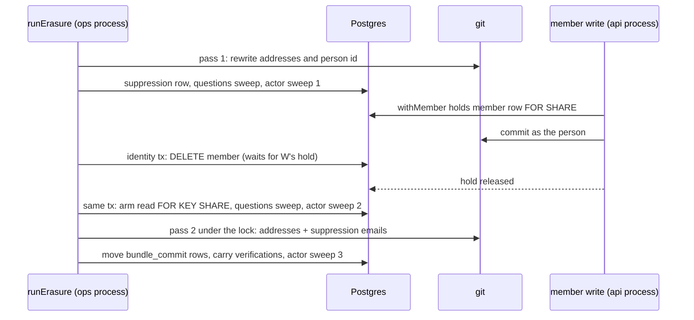

# Erasure Reaches a Late Commit and the Two Actor Columns - Plan

## Goal Capsule

- **Objective:** A finished erasure leaves nothing of the person in the workspace's git history or on the platform's commit and verification records, whatever their sessions do while it runs, and a concept they verified no longer shows their name on any arm.
- **Means:** Hold the member's row across every git commit a member makes, rewrite history a second time once the member has ended, rewrite the person id in history as well as the address, and rewrite `bundle_commit.actor` and `concept_verification.actor` to the erasure pseudonym (KTD1 to KTD5).
- **Authority:** Linear BA-166 with its comments of 14/10/2026, BA-160's ruling comment of 14/10/2026, BA-167's description; ADR 0019, ADR 0020, ADR 0035; `CODING_STANDARDS.md`.
- **Stop conditions:** Stop and report before adding a migration (Track A holds 0080). Stop and report if a change would touch `contracts/`.
- **Execution profile:** One pull request, no migration, no `contracts/` change. Five units.
- **Who finishes:** This session builds and opens the pull request; the orchestrator arms it.
- **Open blockers:** None. BA-167 is a separate migration change (R8).

---

## Product Contract

### Summary

The erasure routine gets three gaps closed. A commit made as the person after the git step is rewritten before the run answers `ok` (BA-166). The commit and verification rows that name the person by person id are rewritten to the erasure pseudonym, so a held-elsewhere person's verifications stop showing their name (BA-160). The identity step picks its arm from the memberships it holds, not from a read made before its transaction opened (BA-166, comment of 14/10/2026).

### Problem Frame

The routine runs from `pnpm ops` (rehearsal and replay), a process apart from the api. The repository lock (`withRepositoryLock`) is an in-process map, so it fences nothing between the two. A member's concept write reads its membership in one transaction, commits to git outside any transaction, and lands its rows in a third. Between the git step and the identity step's member delete, the member can commit, and a write that passed its membership read just before the delete can commit just after it. The git trailer `Actor: human:<person id>` then lets the reconciler replay that commit with the person id after the run answered `ok`.

ADR 0020 says every actor id the platform wrote becomes the pseudonym, `bundle_commit` and verification rows among them. No run rewrites either column today, and ADR 0019 says the opposite of a platform record. The owner ruled on 14/10/2026 that the rewrite is owed and ADR 0019's sentence narrows to the audit log.

### Requirements

**Late commits (BA-166)**

- R1. A member's git commit holds their member row from before the commit until it has landed in git, so the identity step's member delete waits for it, and a commit that starts after the delete is refused.
- R2. After the identity step, the routine rewrites history again under the repository lock, by the addresses it held at open and the addresses its suppression row stands on, so a rerun by id alone after a crash still reaches a late commit.
- R3. A test drives the whole run, commits a concept through `writeConcept` as the person after the git step, and the finished run leaves neither their author line nor their address in history (BA-166 criterion 1).
- R4. The run does not answer `ok` while such a commit remains, and a rerun by address alone still reaches the person's commits (BA-166 criteria 2 and 3).
- R5. The identity step chooses its arm inside the transaction that acts on it, holding the other memberships it read, so a removal elsewhere cannot make a last workspace look held elsewhere.

**Actor ids on platform records (BA-160, ruled 14/10/2026)**

- R6. Erasure rewrites `bundle_commit.actor` and `concept_verification.actor` from `human:<person id>` to `human:<erasure pseudonym>`, in the erasing workspace alone, on every arm, and reports how many of each it rewrote.
- R7. The map finds both families by the request's person and by the member an address finds, as it finds *Questions asked*.

**Disputed sentence (BA-167, ruled 14/10/2026)**

- R8. Not built here. `question_feedback_flag_check` requires `(disputed_sentence IS NULL) = (disputed_concept IS NULL)`, so clearing the sentence while keeping the reason and the concept needs a migration that relaxes the check. It ships as its own pull request once Track A's migration 0080 has merged.

### Key Decisions

- **The rewrite of the two columns is owed (owner, BA-160, 14/10/2026).** Governs R6, R7.
- **Only the audit log keeps the person id (owner, BA-160, 14/10/2026).** ADR 0019's "no routine rewrites" narrows to the audit log, in the wording U6 drafted. Governs R6.
- **The person id is rewritten in git history, commit trailers and frontmatter included (owner, 14/10/2026).** ADR 0020 already counts history among the records erasure rewrites, and the report's "every actor identifier … across the repository's history" is now true of trailers. Governs R2, R4; KTD3.
- **The verifier words stay "a former member" (owner, 14/10/2026).** A `human:<pseudonym>` actor has no user row, so `verifierWords` in `packages/core/src/concepts/trust.ts` already says it. Governs R6.
- **BA-167 is a migration that relaxes the check, in its own pull request after 0080 (owner, 14/10/2026).** The sentence is cleared and the reason and concept kept. Governs R8.

### Scope Boundaries

- Not built: a guard against a reconciler tick in the api process that reads a late commit before the second rewrite and lands it after the last actor sweep. The window is the reconciler reading an old sha and inserting after two sweeps and a history rewrite. A row it left would name a sha no longer in history, which the reconciler refuses as diverged on its next tick, so it would surface. Evidence that it happens would change this.
- Not built: a backfill. No erasure has run in production (owner, 14/10/2026).

### Deferred to Follow-Up Work

- BA-167, as a migration change once 0080 has merged (R8).

### Sources / Research

- `packages/core/src/erasure/routine.ts` (`runErasure`): the step order and the git step under `withRepositoryLockAs`.
- `packages/core/src/erasure/identity.ts`: `workspacesHeldBy` read before the identity transaction; the questions sweep inside it after the member delete (#726's pattern).
- `packages/core/src/concepts/index.ts` (`writeUnderLock`: `existingOf`, `commitWrite`, `landWrite`) and `packages/core/src/concepts/manifest.ts` (`writeManifest`, which commits with no membership read).
- `packages/core/src/store/postgres/index.ts`: `withMember` holds `FOR SHARE OF m, u`.
- `packages/core/src/concepts/reconciler.ts` (`trailerFactsOf`, `replayCommit`): a replay takes its actor from the trailer.
- `packages/core/src/store/git/index.ts` (`rewriteHistory`, `replacementsFor`): text and message replacements are `human:<address>` alone.
- `packages/schema/src/knowledge/question-tables.ts` (`question_feedback_flag_check`).
- `docs/solutions/best-practices/a-race-test-held-late-or-released-in-turn-cannot-prove-a-lock-order.md`: hold at the first contended statement.

---

## Planning Contract

### Key Technical Decisions

- KTD1. **The fence is the member row, not the repository lock.** The lock is per process and the routine runs in another. `withMember` already holds the row `FOR SHARE`, which a `DELETE` waits on, so wrapping the git commit in it gives the identity step's delete the wait it lacks. One more short transaction per write is the cost.
- KTD2. **A second history rewrite after the identity step, not one moved later.** Moving the only rewrite after the identity step would lose the sign-in address on a rerun by id alone, because the user row is tombstoned by then. Pass 2 reads the suppression row too, which the run writes before the identity step and never replaces.
- KTD3. **Rewrite `human:<person id>` in history text and messages (owner, 14/10/2026).** The reconciler replays a commit with the actor its trailer names, so a late commit whose rows were refused would land `human:<person id>` after the run. The replacement is the same mechanism as the address's, added to the same file, so trailers, frontmatter `verified` entries and any body naming the id move together. `rewriteHistory` also answers the paths it found, so pass 2 re-indexes a late path the map never named.
- KTD4. **The actor sweep runs where the questions sweep runs, and once more after pass 2.** Before the identity step with both person ids, so a former member is reached; inside the identity transaction after the member delete, so a failed run's rerun still finds them; after pass 2, for a row the reconciler replayed in between.
- KTD5. **The arm is read after the member delete, holding what it read.** `SELECT … FROM member WHERE user_id = $1 … FOR KEY SHARE` in the identity transaction. A concurrent removal elsewhere waits for the erasure to commit. The pre-read goes.

### High-Level Technical Design

---

## Implementation Units

### U1. Hold the member's row across their git commit

- **Goal:** A member's commit to the bundle cannot land after their member row is deleted.
- **Requirements:** R1; KTD1.
- **Dependencies:** none.
- **Files:** `packages/core/src/concepts/landing.ts`, `packages/core/src/concepts/index.ts`, `packages/core/src/concepts/manifest.ts`, `packages/core/test/concepts.test.ts`, `packages/core/test/manifest.test.ts`.
- **Approach:** One helper in `landing.ts` runs the git commit inside `withMember`, refusing as the principal refusal when the member is gone; `commitWrite` and `writeManifest` call it. `existingOf` and `landWrite` are unchanged.
- **Test scenarios:**
  - A write whose credentials are revoked after its first read is refused before it commits (the existing revocation test, which expected the commit and no rows).
  - A manifest write by a removed member is refused, and history has no new commit.
- **Verification:** the two suites pass; no other caller of `commit` exists in `packages/core/src`.

### U2. Rewrite the person id in history, and answer the paths found

- **Goal:** `rewriteHistory` rewrites `human:<person id>` to `human:<pseudonym>` in files and commit messages, and answers the paths whose files it found naming the person.
- **Requirements:** R2, R4; KTD3.
- **Dependencies:** none.
- **Files:** `packages/core/src/store/git/index.ts`, `packages/core/test/erasure-routine.test.ts` (the only caller is the routine, so the routine's suite holds it).
- **Approach:**
  1. `Pseudonymisation` gains the person ids.
  2. The replacements file adds one line per person id.
  3. The early return also looks for the person id in files and messages.
  4. The answer adds the blob paths found.
- **Test scenarios:**
  - A history whose trailers name `human:<person id>` reads `human:<pseudonym>` in every message after the rewrite.
  - A file naming `human:<person id>` is rewritten, and the path is in the answer.
  - A history naming neither address nor id moves nothing.
- **Verification:** `git.test.ts` passes.

### U3. Rewrite the two actor columns

- **Goal:** Erasure rewrites `bundle_commit.actor` and `concept_verification.actor` to the pseudonym and reports the counts.
- **Requirements:** R6, R7; KTD4.
- **Dependencies:** none.
- **Files:** `packages/core/src/erasure/actors.ts` (new), `packages/core/src/erasure/identity.ts`, `packages/core/src/erasure/map.ts`, `packages/core/src/erasure/routine.ts`, `packages/core/test/erasure-routine.test.ts`, `packages/core/test/erasure-map.test.ts`.
- **Approach:**
  1. A sweep in the caller's transaction, keyed by `askersOf` ids, answering the two counts.
  2. A standalone step after the questions step, with the map's person and the request's.
  3. A call inside the identity transaction after the member delete.
  4. The two map finders use `askersOf([subject.actor, subject.memberId])`.
  5. The two families' actions gain an `actorsRewritten` count.
- **Patterns to follow:** `sweepTheQuestions` and `eraseFromTheQuestions` in `packages/core/src/erasure/questions.ts`.
- **Test scenarios:**
  - After a run, every `bundle_commit` and `concept_verification` row that named the person names `human:<pseudonym>`, and another member's rows are unchanged.
  - The verified concept reads "Verified by a former member" on the last-workspace arm.
  - On the held-elsewhere arm the verified concept no longer reads the person's name.
  - A request by address alone finds and rewrites both families.
  - A row the person's write lands while the routine is held ahead of the member's end is rewritten.
  - The report's actions count each family's rewrites.
- **Verification:** `erasure-routine`, `erasure-map`, `erasure-replay` and `erasure-rehearsal` suites pass.

### U4. Rewrite history again once the member has ended

- **Goal:** A commit made as the person between pass 1 and the member's end is rewritten before the run completes.
- **Requirements:** R2, R3, R4; KTD2, KTD4.
- **Dependencies:** U1, U2, U3.
- **Files:** `packages/core/src/erasure/routine.ts`, `packages/core/test/erasure-routine.test.ts`.
- **Approach:**
  1. Factor the git step so it runs twice: rewrite, move `bundle_commit` rows, carry verifications over the map's paths and the paths the rewrite found.
  2. Pass 2 runs after the identity step, with the open addresses and the suppression row's emails. The person ids include any user row this request's tombstone names, and any its addresses or its suppression's addresses name, so a rerun after the identity step still rewrites the trailers of a person held elsewhere or a former member.
  3. The actor sweep runs after pass 2.
  4. Each family's counts are the two passes' sums.
- **Execution note:** Write the `writeConcept` test first and see it fail on `main`'s routine.
- **Test scenarios:**
  - Covers R3. A concept the person commits through `writeConcept` while the routine is held ahead of the member's end leaves no author line, address or person id in history.
  - A write parked in git's `reference-transaction` hook, its member row held, makes the member delete wait, and the finished run leaves nothing of the person in history.
  - After that run, a reconciler tick lands no row naming `human:<person id>`.
  - A run that dies after the identity step, rerun by address alone, rewrites the late commit.
  - A second run moves history no further.
- **Verification:** the erasure suites pass.

### U5. Choose the arm inside the identity transaction

- **Goal:** The arm reflects the memberships held when the member ends.
- **Requirements:** R5; KTD5.
- **Dependencies:** U3.
- **Files:** `packages/core/src/erasure/identity.ts`, `packages/core/test/erasure-routine.test.ts`.
- **Approach:** Drop the `workspacesHeldBy` pre-read. After the member delete, read the person's other memberships `FOR KEY SHARE` and pick the arm from them.
- **Test scenarios:**
  - A person removed from their other workspace after the run opens is erased on the last-workspace arm.
  - A removal elsewhere that starts during the identity transaction waits for it, and the run takes the held-elsewhere arm.
- **Verification:** the identity tests pass on both arms.

### U6. Decision docs

- **Goal:** The decision docs say what the routine now does.
- **Requirements:** R6; KTD3.
- **Dependencies:** U3, U4.
- **Files:** `docs/solutions/architecture-patterns/adr-0019.md`, `docs/solutions/architecture-patterns/adr-0020.md`.
- **Approach:** ADR 0019's sentence narrows to the audit log, in the wording the owner accepted on 14/10/2026. ADR 0020 gains the late commit, the person id in trailers, and an amendment line.
- **Test expectation:** none, docs only.
- **Verification:** `check:docs` passes.

---

## Verification Contract

| What | Command |
| --- | --- |
| Core suites touched | `pnpm --filter @better-answers/core run test test/erasure-routine.test.ts test/erasure-map.test.ts test/erasure-replay.test.ts test/erasure-rehearsal.test.ts test/concepts.test.ts test/manifest.test.ts test/git.test.ts test/reconciler.test.ts` |
| Types and lint | `pnpm --filter @better-answers/core run typecheck`, `pnpm run check:gates` |
| Mutation | `/mutation-testing` on `packages/core/src/erasure/` and the changed `rewriteHistory` |
| Review | full `/ce-code-review` in session |

## Definition of Done

- R1 to R7 hold, each with a test named by its behaviour.
- The pull request records the owner's rulings on KTD3, ADR 0019's wording, the verifier words and BA-167.
- No migration and no `contracts/` change in the diff; no abandoned code left in it.
