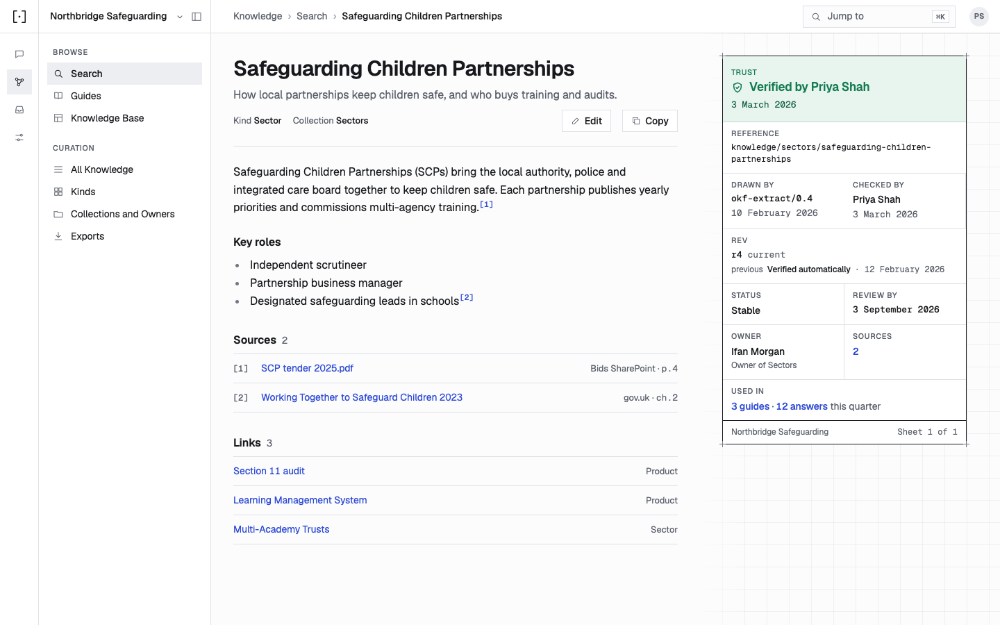
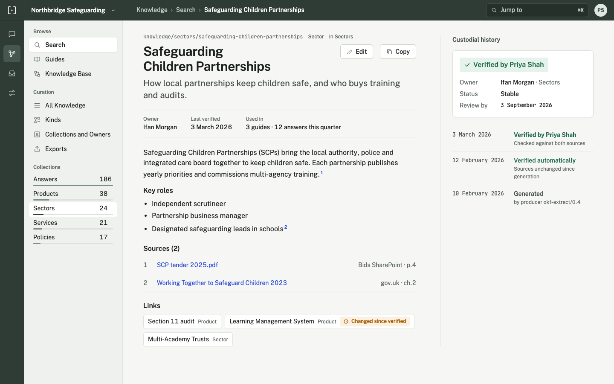
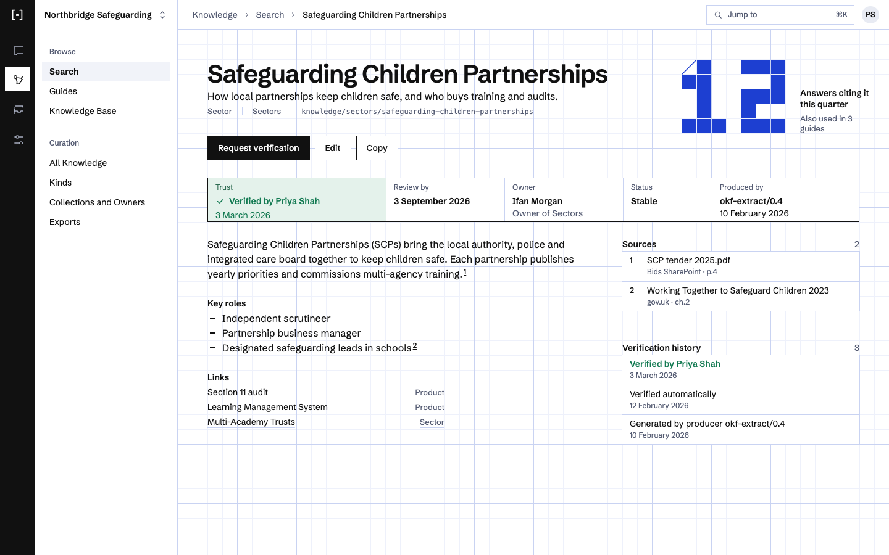
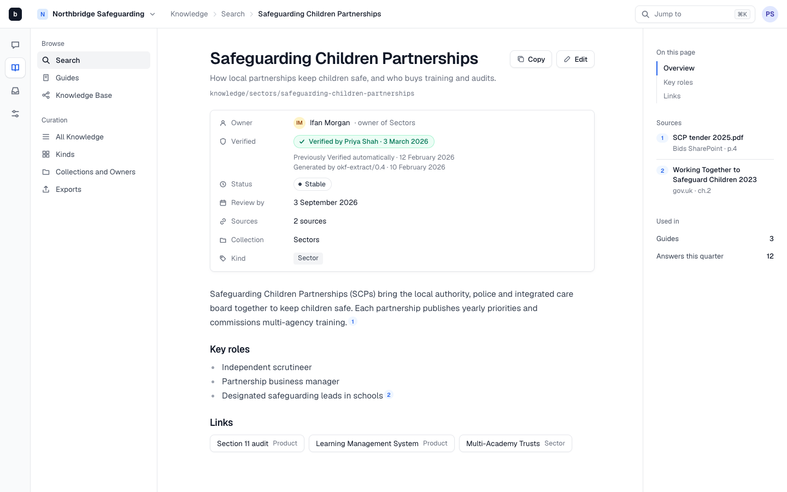
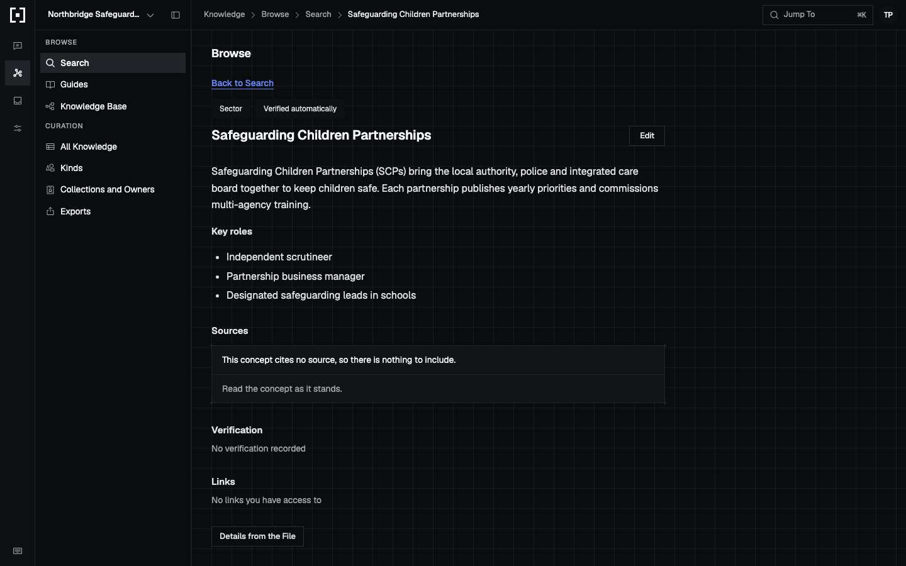
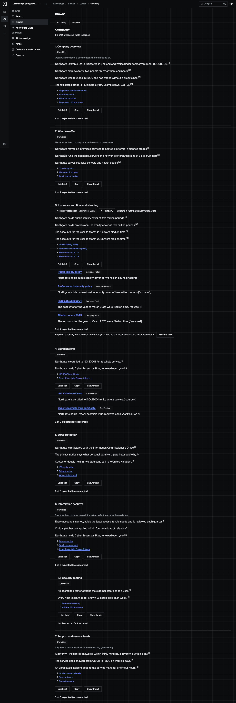
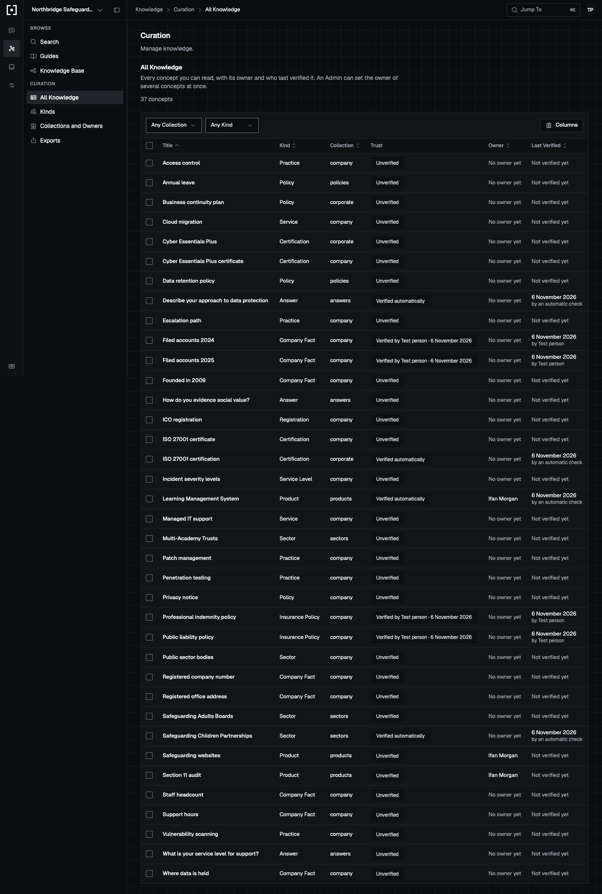
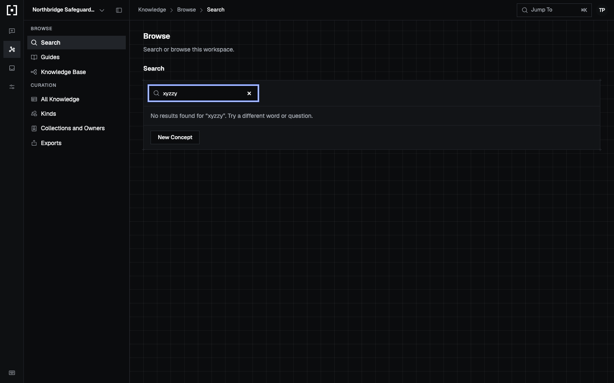

# Issued Drawing redesign plan

This plan is not on the v0.1 route. It serves the owner's decision of 06/11/2026 that better-answers' web app must look and read like a finished, trustworthy product. No route row changes, and no PR here takes work that a route block owns. Appendix C names those blocks.

Impeccable becomes the design authority. `DESIGN.md` and the tokens in `apps/web` replace `packages/design-system`, which goes, with its `better-answers-design` skill. Phase 1 (BA-339 to BA-345) sets the new standard on the Knowledge pages, the S3 area. It brings the Issued Drawing world, trust you can see, one title per page and a real type scale. Phase 2 (BA-346 to BA-351) removes the over-written copy everywhere and the causes that keep bringing it back. Phase 3 (BA-352 to BA-355) clears the critique's remaining issues on Knowledge.

The PRs, in order, are BA-339, BA-340, BA-341, BA-342, BA-343, BA-344, BA-345, BA-346, BA-347, BA-348, BA-349, BA-350, BA-351, BA-352, BA-353, BA-354 and BA-355. Rolling the world out to Ask, Inbox and Control Centre is a follow-on plan, and each of those surfaces gets a critique first.

Changed 06/11/2026. The operator asked for less ceremony and fewer PRs. There are no real users yet, so the program ships in six units, each one owner and one PR or one direct push to `main`. Unit A is BA-343 then BA-341, the trust data in core and the api. Unit B is BA-339 with BA-340, the tokens move and the foundation. Unit C is BA-342, BA-344 and BA-345, the concept page, search and `DESIGN.md`, after A and B. Unit D is BA-346 with BA-347, the copy guard and the Knowledge copy, after C. Unit E is BA-348 to BA-351, the rest of the copy, after D. Unit F is BA-352 to BA-355, the remaining Knowledge issues, after D and beside E. Each unit is verified by its unit tests, a green `check`, one live drive through `.claude/skills/verify/SKILL.md` with screenshots posted to the operator, and one independent verifier on another model. The ten-lane swarm, the perf rules and the blocking review gate are retired. Migrations may run beside other work. The boxes below stay as the checklist of what each unit must contain.

Status 07/11/2026. The units ran as the table shows. Three things differ from the paragraph above.

- BA-345 left unit C as unit C2, so the concept page and search reach the operator's review first.
- Unit D split into D1 (BA-346) and D2 (BA-347), so the copy guard lands before the Knowledge copy.
- Unit E may start after D1, because ADR 0054 fixes the voice. It waits for C1 to merge, since C1 also edits `features/auth/`, `features/ask/` and `app/pages/`. BA-351's last box, which turns the rule on for all of `apps/web/src/**`, still waits for BA-348, BA-349 and BA-350.

| Unit | Issues | State |
| --- | --- | --- |
| A1 | BA-343 | Merged, #1025 (`939fd3a37`) |
| A2 | BA-341 | Merged, #1026 (`fb3307178`) |
| B | BA-339, BA-340 | Merged, #1027 (`26b450f84`). `packages/design-system` is gone |
| C1 | BA-342, BA-344 | Merged, #1031 (`c7051c88a`) |
| C2 | BA-345 | Ready to start |
| D1 | BA-346 | Merged, #1030 (`fd3050040`). The `ui-copy-plain` rule is on `main` and off for every folder |
| D2 | BA-347 | Ready to start |
| E | BA-348 to BA-351 | Branch `liam/ba-348-rewrite-the-ask-and-questions-copy-with-clarify` holds only the commit that turns the rule on for its feature folders. It can restart now that C1 has merged |
| F | BA-352 to BA-355 | Waits for D2 |

The run paused at 01:13 on 07/11/2026, when the model's usage limit ran out. A new session took it up from the saved worktrees the same day.

Changed 07/11/2026. The operator reviews the app directly, so the review-gated PRs need no screenshots or video, and each one lands on `main` once its verifier records `PASS` or `PASS+NOTES`. The verifier may be another model from the same vendor.

## How to read this

One box is one unit of work. Every box names the evidence that checks it. A nested box is a sub-step of the box above it. Check a box only when its evidence exists, a file, a log line, a screenshot, a test run, or a SHA. The body is a how-to. The appendices explain and record.

The program runs `skills/poteto-mode/playbooks/orchestrate.md` from the installed plugin. It is seventeen PRs over several days with dependencies between them. One coordinator holds the ledger, and a later session takes it up through `.agents/playbooks/session-pickup.md`.

Each PR id is its Linear issue, BA-339 to BA-355, created on the operator's go of 06/11/2026 in the team and project that `docs/agents/issue-tracker.md` names. Each issue's blockers mirror the dependency graph below.

The coordinator lands every PR with `gh pr merge <n> --squash --match-head-commit <sha>` once an agent that did not write it records `PASS` as the `verdict` commit status at the head SHA, as AGENTS.md says. BA-340, BA-342, BA-344, BA-347, BA-352, BA-353, BA-354 and BA-355 change an interaction. They are the operator's items. Each stops at merge-ready until the operator has reviewed it in chat with screenshots and a video, and the coordinator lands it only after the operator approves.

Tests alone are not sufficient verification. A PR is verified only when its unit, live, and perf boxes are all checked.

Every file pointer and line number below was read at `b1e6991a7`. Each PR re-finds its paths in the tree it starts from.

## Program checklist

### Arm the program

- [ ] State the protocol and this plan to the operator, then stop. Start execution only on the operator's explicit go.
- [x] On the operator's go, create the seventeen Linear issues, BA-339 to BA-355, with blockers that mirror the dependency graph, and use their ids in this file.
- [x] On the operator's go, file three Linear issues for the work this plan leaves out, BA-356, BA-357 and BA-358. One is flagging near-duplicate concepts with the ADR 0026 matcher, which is S7 and V1 territory. One is per-concept trust in guides and verification requests, which V1 owns. One is the follow-on plan that critiques Ask, Inbox and Control Centre and rolls the world out to them.
- [ ] On the operator's go, write this exact text into `notes.md` in the program's store under `~/.claude/orchestrate/010-issued-drawing/` and restate it in your todolist. "Plan `docs/plans/010-issued-drawing-redesign.md`. PRs in order BA-339 to BA-355, by their `BA-N` ids once created. BA-343 runs alone because it adds a migration. Tests alone are not sufficient verification. A PR is verified only when its unit, live, and perf boxes are all checked. The coordinator lands each PR with `gh pr merge <n> --squash --match-head-commit <sha>` after an agent that did not write it records `PASS` as the `verdict` commit status at its head SHA. Before landing, read `main`'s newest completed `build` run, and land the fix for `main` first if it failed. BA-340, BA-342, BA-344, BA-347, BA-352, BA-353, BA-354 and BA-355 stop at merge-ready for the operator's review in chat with screenshots and a video. Done when every PR has merged, `packages/design-system` is gone, `DESIGN.md` is the design authority, the `better-answers/ui-copy-plain` rule covers `apps/web/src/**`, and Appendix A records the closing critique score."
- [ ] Read these from the installed plugin at program start. Re-read them at every tick.
  - [ ] `skills/poteto-mode/playbooks/orchestrate.md`
  - [ ] `skills/swarm/SKILL.md`
  - [ ] `.claude/skills/verify/SKILL.md`, the driver skill, and its recipes in `.claude/skills/verify/features/*.md`
  - [ ] `skills/poteto-mode/playbooks/opening-a-pr.md`
  - [ ] `skills/principle-experience-first/SKILL.md`, `skills/principle-migrate-callers-then-delete-legacy-apis/SKILL.md`, `skills/principle-encode-lessons-in-structure/SKILL.md`, `skills/principle-test-behavior-not-implementation/SKILL.md` and `skills/show-me-your-work/SKILL.md`
  - [ ] The Impeccable skill at `/Users/liamj/.claude/plugins/cache/impeccable/impeccable/4.8.0/skills/impeccable/SKILL.md`, its `reference/craft-floor.md`, and the surface brief `apps/web/.impeccable/surfaces/apps-web-src-features-knowledge.md`, which holds the Direction contract
- [ ] Arm the hourly audit tick as a real `/loop` in dynamic mode, which schedules its own wake-up rather than blocking on a sleep. Never leave the cadence to memory.
- [ ] Use this tick prompt, verbatim. "Re-read the execution playbook from the installed plugin and the objective in the program store's `notes.md`. Audit the operation against both and fix drift in this tick. Probe every active lane and judge progress by side effects only. Stand down a stuck lane and dispatch its replacement now. Then post a short status message to the operator in chat only when the audit found a tracked change that no earlier status message reported, such as a PR opened, a code-ready head, a round launched or closed, a verdict, a merge, a stuck agent and the action taken, a blocker added or cleared, or a decision only the operator can make. Name every such change and nothing else. Do not repeat a table, the merged list, or an unchanged blocker. If the audit found none, end the turn with no reply text. Either way, log this tick's row in your decision trail. The row names the items reported, or none."
- [ ] On the operator's hold or stand-down, send every PR owner a zero-writes order at once.

### Spawn owners

- [ ] Spawn one PR owner for each PR, with the full lifecycle the execution playbook names.
- [ ] Follow this dependency graph. Start dependent work only after its parent merges.
  - [ ] BA-343 runs alone. Start it first, while no other PR is open, and open no other PR until it merges.
  - [ ] BA-339 and BA-341 are independent and start after BA-343 merges. Both branch from `main`. If BA-341 edits `contracts/`, it runs alone as well.
  - [ ] BA-340 after BA-339.
  - [ ] BA-342 after BA-340 and BA-341.
  - [ ] BA-344 after BA-340 and BA-341. BA-341 and BA-344 both edit `packages/core/src/answering/results.ts`.
  - [ ] BA-345 after BA-342 and BA-344.
  - [ ] BA-346 after BA-340.
  - [ ] BA-347 after BA-346, BA-342 and BA-344.
  - [ ] BA-348, BA-349 and BA-350 after BA-347. They may run side by side.
  - [ ] BA-351 after BA-347. Its last box, which turns the rule on for all of `apps/web/src/**`, lands only after BA-348, BA-349 and BA-350 have merged.
  - [ ] BA-352, BA-353, BA-354 and BA-355 after BA-347. They may run side by side.
- [ ] Hold the file boundaries.
  - [ ] BA-339 touches only `apps/web/`, `apps/api/package.json`, `apps/api/src/auth/`, `apps/api/Dockerfile`, `apps/api/tests/`, `packages/design-system/`, `packages/devtools/`, `scripts/skill-paths.mjs`, `scripts/docs-lane.mjs`, `docs/design/intent/`, `pnpm-lock.yaml`, and the docs and config files its **Files** block lists.
  - [ ] BA-341, BA-343 and the core half of BA-344 and BA-352 touch `packages/core/`, `packages/schema/` and `apps/api/`. The later of two open PRs that edit `packages/core/src/answering/results.ts` rebases over the earlier one.
  - [ ] BA-340, BA-342, BA-344 and BA-352 to BA-355 touch `apps/web/src/features/knowledge/`, `apps/web/src/shared/`, their tests, `apps/web/e2e/knowledge/` and `.claude/skills/verify/`.
  - [ ] BA-346 touches only `docs/solutions/architecture-patterns/`, `packages/devtools/lint-rules/`, `packages/devtools/test/lint-rules/`, `.oxlintrc.json`, `.claude/skills/playwright-specs/` and `.claude/skills/verify/features/`.
  - [ ] BA-347 to BA-351 each touch only their own area's folders under `apps/web/src/` and `apps/web/test/` and `apps/web/e2e/`, the matching `.claude/skills/verify/features/*.md`, and one line each in the `.oxlintrc.json` override. The later of two open sweeps rebases over the earlier one's override line.
  - [ ] BA-345 touches only `DESIGN.md`, `.impeccable/`, `apps/web/.impeccable/`, `AGENTS.md`, `apps/web/AGENTS.md` and the fixes the finish review names inside `apps/web/src/features/knowledge/` and `apps/web/src/shared/knowledge/`.
- [ ] Hold the review gate. BA-340, BA-342, BA-344, BA-347, BA-352, BA-353, BA-354 and BA-355 change an interaction. They wait for the operator's review in chat with screenshots and a video before merge.

### PR mechanics, for every PR

- [ ] Resolve the forge once. Default to `gh`; if `command -v origin` succeeds and Origin can resolve the repository, use `origin pr` for every PR operation. Record any fallback to `gh`. Never require `gt`.
- [ ] Open the PR ready, never draft, per **Opening a PR**. Use the run's built-in PR tool when it has one, else `origin pr create --status open --base main` or `gh pr create --base main` according to the resolved forge.
- [ ] Run `pnpm check:gates` and the touched workspaces' `check` once before the PR-facing push. Push with hooks on.
- [ ] Run `/deslop` before each commit and `/no-comments` before review.
- [ ] Run `pnpm run cubic-review` before each push, as `.agents/playbooks/review.md` says.
- [ ] Triage every review-bot and security-reviewer comment per `../references/bugbot-triage.md`.
- [ ] Before the code-ready report and babysit, and again after merge prep, record the base and head SHAs prepared by the topology owner under the execution playbook.
- [ ] Before a UI edit, read Impeccable's `reference/craft-floor.md` and the surface brief `apps/web/.impeccable/surfaces/apps-web-src-features-knowledge.md`.
- [ ] Keep every new folder under `src`, `test` or `e2e` at 15 tracked files or fewer. Run `pnpm run loose-files` and `pnpm run test-folders` before the push.
- [ ] Before GitNexus `impact` on a symbol, run `node .gitnexus/run.cjs analyze` from the main checkout when the index is behind `HEAD`.

### Verdict and merge, for every PR

- [ ] A full swarm runs once, at the code-ready head. Another full swarm runs only for new behavior, a redesign, or a large new diff. A rebase, a merge-conflict resolution, or a minor fix gets a single verifier at the new head, and a wording-only change gets none. Run each full swarm per `skills/swarm/SKILL.md`. One gates lane. The ten live lanes from the PR's **Verify, live** block. The perf lane from its **Verify, perf** block. Two or more audit lanes, each with its own focus, that read the diff and the receipts and distrust the PR body. The root audits the receipts in the merge-ready report before the verdict.
- [ ] Judge every finding by the execution playbook's blocking rule. The verdict is clean when none blocks. A failure on trunk behaviour in a lane marked `Regression lane against trunk.` is recorded against trunk and does not block the PR. A new head gets a fresh verdict, except for results that stay valid under the patch-id rule in `playbooks/shipping.md`.
- [ ] An agent that did not write the PR records the clean verdict as a `PASS` `verdict` commit status at the head SHA.
- [ ] Before landing, run `gh run list --workflow build.yml --branch main --status completed --limit 1`. If it failed, land the fix for `main` first.
- [ ] The coordinator lands a clean PR with `gh pr merge <n> --squash --match-head-commit <sha>`. For a review-gated PR it waits for the operator's approval in chat first. A verdict carries over a rebase only when the patch-id rule in `playbooks/shipping.md` holds.

### Boot recipe, for every live lane

Each live lane runs in its own worktree at the PR head. It drives the served app through `.claude/skills/verify/SKILL.md`, from its Launch to its Cleanup. `$IMPECCABLE` below is `/Users/liamj/.claude/plugins/cache/impeccable/impeccable/4.8.0/skills/impeccable`.

- [ ] `git fetch origin <head-branch> && git checkout <head SHA>`.
- [ ] Run `pnpm install --frozen-lockfile`.
- [ ] Run `docker ps`. If another session's whole browser suite or mutation run is up, wait for it to finish (BA-190).
- [ ] Run `.claude/skills/verify/scripts/launch.sh <port>`. Then run `.claude/skills/verify/scripts/doctor.sh <port>`. Drive only when it prints `worth driving:`.
- [ ] Seed state only through the `harness.sh` routes in `.claude/skills/verify/references/harness.md`, such as `POST /workspaces`, `/people`, `/members`, `/concepts` with `trust` and `status`, `/owners`, `/guides`, `/connected-sources`, `/questions` and `/asking`.
  - [ ] For a Knowledge lane, seed the Northbridge Safeguarding set. It has 14 concepts across the collections sectors, products, corporate, policies and answers. Trust mixes machine-confirmed and unverified. An Editor owns `products`. There is one guide and one connected source. One concept has `status` draft, one is deprecated, one has `stale_after` in the past, and one is human-verified.
  - [ ] Before BA-342 merges, seed the set with `harness.sh` calls. From BA-342 on, run `.claude/skills/verify/scripts/seed-knowledge.sh <port>`.
- [ ] Sign in with `.claude/skills/verify/scripts/sign-in.sh <port> <email>`.
- [ ] Deliver input only through `.claude/skills/verify/scripts/browse.sh <port>`, by role and accessible name. The read-only diagnostics are the Playwright trace, the accessibility gate, `browse.sh <port> snapshot`, and the server log at `/tmp/better-answers-verify/<port>/server.log`.
- [ ] Run the design detector only as `"$IMPECCABLE/scripts/impeccable" detect --cdp "$(.claude/skills/verify/scripts/browse.sh <port> get cdp-url)" --target <page path> --json`, per `reference/critique.md`.
- [ ] For a lane that needs trunk, launch a second instance on another port at the trunk SHA. Use `--no-build` only when the same build applies. Otherwise build each.
- [ ] Compare two screenshots with `pnpm dlx pixelmatch <trunk.png> <head.png> <diff.png> 0.1`.
- [ ] Save every screenshot to `/tmp/swarm-<pr-id>/worker-<n>/<slug>.png` and return the paths with the report.
- [ ] Run `.claude/skills/verify/scripts/cleanup.sh <port>` for every instance at the end.

## Move the design tokens into apps/web and delete packages/design-system (BA-339)

**Depends on.** None.

**Files.**

- [ ] Create `apps/web/src/styles/`, at most 15 files. It holds the tokens from the 13 token files, the base rules of `styles.css`, the `@theme` of `tailwind-bridge.css`, and `logo.svg`.
- [ ] Edit `apps/web/package.json` (line 17) to drop `@better-answers/design-system`, add `@fontsource-variable/geist` and `@fontsource-variable/geist-mono` at 5.3.0, and add `exports` for `./styles/*` and `./logo.svg`.
- [ ] Edit `apps/web/src/index.css` (lines 12, 14 and 15), `apps/web/vite.config.ts` (`designSystem()` and `TOKEN_FILES` at lines 32 to 38, `theHead()` near line 81), `apps/web/src/shared/logo.tsx` (line 1), `apps/web/test/shared/theme/theme.test.ts` (line 190) and `apps/web/AGENTS.md` (line 6).
- [ ] Edit `apps/api/package.json` (line 25) to depend on `@better-answers/web` for the styles and the logo only.
- [ ] Edit `apps/api/src/auth/page-style.ts` (lines 9 and 16 to 20) and `apps/api/src/auth/pages.ts` (line 12) to resolve the styles, fonts and logo from `@better-answers/web`.
- [ ] Edit `apps/api/Dockerfile` (lines 44, 51, 60, 172 and 182 to 184) to copy `apps/web/src/styles` instead of the package.
- [ ] Edit `apps/api/tests/auth/auth-pages.test.ts` (line 25), `apps/api/tests/images/image.test.ts` (lines 141, 209 and 210) and `apps/api/tests/product-name.test.ts` (line 11).
- [ ] Edit `packages/devtools/src/scans/skill-paths.ts` (lines 9, 56 and 108), `scripts/skill-paths.mjs` (lines 10 and 84) and `scripts/docs-lane.mjs` (lines 8 to 27).
- [ ] Edit `packages/devtools/test/scans/skill-paths.test.ts` (lines 9 and 131), `packages/devtools/test/ci/tracked-skills.test.ts` (lines 20 to 27), `packages/devtools/test/ci/docs-lane.test.ts` (lines 313 to 316 and 398), `packages/devtools/test/ci/check-scripts.test.ts` (line 44) and `packages/devtools/test/scans/knip.test.ts` (line 184).
- [ ] Edit `packages/devtools/test/lint-rules/no-path-climb.test.ts` (lines 19, 109, 113 and 173) to rename its fixture paths to a neutral name.
- [ ] Edit `AGENTS.md` (line 22), `.pixel-perfect.md` (line 5), `docs/operations/local-gates.md` (lines 34 and 122), `.claude/skills/verify/scripts/doctor.sh` (lines 34 and 35), `.claude/skills/survey-architecture/references/report.md` (lines 48 to 53), `.claude/skills/playwright-specs/references/helpers.md` (lines 49 and 59), `cubic.yaml` (lines 44 and 45) and `.gitnexusignore` (line 51).
- [ ] Move the tracked `packages/design-system/guidelines/*.card.html` to `docs/design/intent/guidelines/`. The plan's own PR already carried the component cards, which were never tracked, to `docs/design/intent/components/`.
- [ ] Delete `packages/design-system/` and the symlink `.claude/skills/better-answers-design`.
- [ ] Edit `pnpm-lock.yaml` through `pnpm install`.

**Build.**

- [ ] Consolidate the token files into `apps/web/src/styles/`. Drop the unused `fonts-remote.css`.
- [ ] Move the intent cards to `docs/design/intent/` before the delete. Drop `_ds_bundle.js`, `_ds_manifest.json`, `_adherence.oxlintrc.json` and `.thumbnail`.
- [ ] Point the api's `page-style.ts` and `pages.ts` at the files `@better-answers/web` exports. The api imports no other module of the web.
- [ ] Remove `SYMLINKED_SKILL` from `skill-paths.ts` and every devtools assertion that names it. `skills-lock.json` has no entry for the skill, so it needs no change.

**You see.**

- [ ] `git ls-files packages/design-system` prints nothing.
- [ ] `pnpm run check` passes.
- [ ] Every page renders the same pixels as trunk at the same seed.

**Verify, unit.** Tests alone are not sufficient verification. A PR is verified only when its unit, live, and perf boxes are all checked.

- [ ] `apps/web/test/shared/theme/theme.test.ts` reads the bridge file from `apps/web/src/styles/`. Run `pnpm --filter @better-answers/web run test`.
- [ ] `apps/api/tests/auth/auth-pages.test.ts` still finds the inlined styles and the logo. Run `pnpm --filter @better-answers/api run test`.
- [ ] The devtools tests pass with no `SYMLINKED_SKILL`. Run `pnpm --filter @better-answers/devtools run test`.
- [ ] Run `pnpm run lint`, `pnpm run knip`, `pnpm run loose-files` and `pnpm run skill-paths`. Each exits 0.
- [ ] The api image serves the auth pages with their fonts. Run `pnpm run check:images`.

**Verify, live.** Tests alone are not sufficient verification. A PR is verified only when its unit, live, and perf boxes are all checked. Ten lanes on the configured `swarm workers` model at the PR head, per the boot recipe. Each lane takes trunk and head screenshots at 1440 by 900 with the same seed.

- [ ] Lane 1. Regression lane against trunk. Open the concept page of the human-verified concept at trunk and head, and compare them with `pixelmatch`. Save `concept-parity.png`. Pass when at most 0.1% of pixels differ.
- [ ] Lane 2. Open the shell and the Search page with a query that matches three concepts, at trunk and head. Save `search-parity.png`. Pass when at most 0.1% of pixels differ.
- [ ] Lane 3. Open the Guides page and the seeded guide, at trunk and head. Save `guide-parity.png`. Pass when at most 0.1% of pixels differ on each page.
- [ ] Lane 4. Open All Knowledge, at trunk and head. Save `all-knowledge-parity.png`. Pass when at most 0.1% of pixels differ.
- [ ] Lane 5. Open Ask at `/ask/new-question`, at trunk and head. Save `ask-parity.png`. Pass when at most 0.1% of pixels differ.
- [ ] Lane 6. Open Inbox at `/inbox/waiting-on-you`, at trunk and head. Save `inbox-parity.png`. Pass when at most 0.1% of pixels differ.
- [ ] Lane 7. Open Control Centre at `/people/members`, at trunk and head. Save `members-parity.png`. Pass when at most 0.1% of pixels differ.
- [ ] Lane 8. Sign out and open the sign-in page, which the api renders, at trunk and head. Save `sign-in-parity.png`. Pass when at most 0.1% of pixels differ and the server log shows each `/fonts/geist` request answered 200.
- [ ] Lane 9. Open the consent page, which the api renders, through the recipe in `.claude/skills/verify/features/outside-the-shell.md`, at trunk and head. Save `consent-parity.png`. Pass when at most 0.1% of pixels differ.
- [ ] Lane 10. Switch to the dark theme and open the concept page and the Search page, at trunk and head. Save `dark-parity.png`. Pass when at most 0.1% of pixels differ on each page.

**Verify, perf.** Tests alone are not sufficient verification. A PR is verified only when its unit, live, and perf boxes are all checked.

- [ ] Metric. The gzipped bytes of the built CSS in `apps/web/dist/assets/*.css`, and the wall seconds of the web build.
- [ ] Probe. Run `/usr/bin/time -p pnpm --filter @better-answers/web run build` and then `cat apps/web/dist/assets/*.css | gzip -c | wc -c`, five times at trunk and five at head, interleaved.
- [ ] Baseline. Record the trunk median of each first.
- [ ] Rule. Fails if the head CSS is more than 2% larger than trunk, or the head median build time is more than 10% above trunk.

**Review gate.** None. BA-339 is not review-gated.

**Merge.**

- [ ] Root's clean verdict at the exact head SHA.
- [ ] Bugbot triage done.
- [ ] Base and verdict are current under the execution playbook and the patch-id rule in `playbooks/shipping.md`.
- [ ] The coordinator reads `main`'s newest completed `build` run, then lands BA-339 with `gh pr merge <n> --squash --match-head-commit <sha>`.

## Lay the Issued Drawing foundation with one title per page, a type scale and a trust mark (BA-340)

**Depends on.** BA-339.

**Files.**

- [ ] Edit `apps/web/src/shared/page/page-head.tsx`. `PageHead` is at lines 9 to 28 and `ListHead` at line 34.
- [ ] Edit `apps/web/src/shared/navigation/areas.ts` to delete the 12 `summary` fields, among them "Search or browse this workspace." (line 111) and "Manage knowledge." (line 141).
- [ ] Edit the 29 files that call `PageHead`, 9 of them under `apps/web/src/features/knowledge/`. Among them are `concept-page.tsx` (lines 415 to 419, and the title `h2` at line 121), `guides/guide-page.tsx` (line 184), `search-page.tsx` (line 538) and `curation/all-knowledge-page.tsx` (line 119).
- [ ] Edit the 22 files that pass `summary=` or `description=`.
- [ ] Edit the type scale tokens in `apps/web/src/styles/`.
- [ ] Create `apps/web/src/shared/knowledge/trust-mark.tsx` and `apps/web/src/shared/knowledge/kind-line.tsx`.
- [ ] Edit the Knowledge files that render kind, collection and trust as `Pill` from `apps/web/src/shared/ui/kibo-ui/pill.tsx`, such as `search-page.tsx` lines 147 to 173.
- [ ] Edit `apps/web/test/shared/page/page-head.test.tsx`.
- [ ] Create `apps/web/test/shared/knowledge/trust-mark.test.tsx`.

**Build.**

- [ ] `PageHead` takes the page's own title and its actions only. The title is the concept title, the guide title, "Search" or "All knowledge". The group name stays in the menu and the breadcrumb.
- [ ] Delete the `summary` and `description` props from `PageHead` and `ListHead`, and the `summary` field from `areas.ts`, so the type checker refuses a filler subtitle.
- [ ] Set the type scale from the Direction contract. The title is about 30px with tight tracking, a section is 20px, body is `16px/1.6` on `65ch`, interface text is 14px, and a micro-label is 11px upper case at `+0.06em`. Neighbouring steps differ by a ratio of at least 1.25.
- [ ] `TrustMark` maps each word of the closed set of trust words to a tint, the word in the 700 weight, and an icon. It never shows trust by colour alone.
- [ ] `KindLine` shows the kind and the collection as muted text. It replaces `Pill` for kind and collection across Knowledge.

**You see.**

- [ ] Every page has exactly one `h1`, and it is the page's real title.
- [ ] No subtitle sits under the title.
- [ ] Trust looks different from kind and collection.

**Verify, unit.** Tests alone are not sufficient verification. A PR is verified only when its unit, live, and perf boxes are all checked.

- [ ] `page-head.test.tsx` gains "the h1 is the page's title". Run `pnpm --filter @better-answers/web exec vitest run test/shared/page/page-head.test.tsx`.
- [ ] `trust-mark.test.tsx` checks that each of the seven trust words renders as text beside its icon. Run `pnpm --filter @better-answers/web exec vitest run test/shared/knowledge/trust-mark.test.tsx`.
- [ ] Passing `summary` to `PageHead` fails the type check. Run `pnpm --filter @better-answers/web run typecheck`.

**Verify, live.** Tests alone are not sufficient verification. A PR is verified only when its unit, live, and perf boxes are all checked. Ten lanes on the configured `swarm workers` model at the PR head, per the boot recipe.

- [ ] Lane 1. Regression lane against trunk. Open the human-verified concept at trunk and head and read the headings with `snapshot`. Trunk shows the group as the `h1` and the title as an `h2`. Save `concept-title.png`. Pass when head has exactly one `h1`, its text is the concept title, and the page still reaches the concept body.
- [ ] Lane 2. Open Search and search for "safeguarding". Save `search-title.png`. Pass when there is one `h1` named "Search", no text "Search or browse this workspace.", and each result's trust reads as a word with an icon.
- [ ] Lane 3. Open the seeded guide. Save `guide-title.png`. Pass when there is one `h1` and it is the guide's title, not "Browse".
- [ ] Lane 4. Open All Knowledge. Save `all-knowledge-title.png`. Pass when there is one `h1` named "All knowledge", no "Manage knowledge.", and the trust cell is a `TrustMark`, not a pill.
- [ ] Lane 5. Open Knowledge Base and pick the `products` collection. Save `knowledge-base-title.png`. Pass when there is one `h1` and kind and collection show as muted text.
- [ ] Lane 6. Open Kinds and then Collections and Owners. Save `kinds-collections-title.png`. Pass when each page has one `h1` equal to its menu name and no subtitle.
- [ ] Lane 7. Open Ask at `/ask/new-question` and Control Centre at `/people/members`. Save `ask-members-title.png`. Pass when each page has one `h1` equal to its page name and no subtitle.
- [ ] Lane 8. Run the detector on the Search page, the concept page and the guide page. Save `detector.png`. Pass when the JSON holds no `flat-type-hierarchy` and no `line-length` finding.
- [ ] Lane 9. Set the viewport to 390 by 844 and open the concept page and Search. Save `mobile-title.png`. Pass when the title wraps without overflow and the `TrustMark` word stays visible.
- [ ] Lane 10. Open the concept page with the keyboard only, from the menu, with Tab. Save `keyboard-title.png`. Pass when focus reaches the title's actions in order and the accessibility gate reports no violation.

**Verify, perf.** Tests alone are not sufficient verification. A PR is verified only when its unit, live, and perf boxes are all checked.

- [ ] Metric. Milliseconds from navigation start to the concept title being visible on `/knowledge/search/<iri>`, read with `performance.measure`.
- [ ] Probe. Run `browse.sh <port> open` on the concept page and then `browse.sh <port> eval` for the measure, ten times at trunk and ten at head, interleaved.
- [ ] Baseline. Record the trunk p50 first.
- [ ] Rule. Fails if the head p50 is more than 10% above the trunk p50.

**Review gate.** The operator reviews before merge.

- [ ] Copy the lane 1, 2, 4 and 9 screenshots into `docs/plans/media/010-issued-drawing/BA-340-review-<slug>.png`.
- [ ] Record a 30 to 60 second video in a lane worktree with `browse.sh <port> record start` that walks Search, a concept, a guide and All Knowledge. Save it as `docs/plans/media/010-issued-drawing/BA-340-review.mp4`.
- [ ] Post the screenshots and the video in chat. Stop at merge-ready. Wait for the operator's approval.

**Merge.**

- [ ] Root's clean verdict at the exact head SHA.
- [ ] Bugbot triage done.
- [ ] Base and verdict are current under the execution playbook and the patch-id rule in `playbooks/shipping.md`.
- [ ] After the operator approves, the coordinator reads `main`'s newest completed `build` run and lands BA-340 with `gh pr merge <n> --squash --match-head-commit <sha>`.

## Give a concept's trust one source and return its owner, history and use (BA-341)

**Depends on.** None. It runs beside BA-339.

**Files.**

- [ ] Edit `packages/core/src/answering/results.ts`, `OpenResult` and `ConceptView` at lines 40 to 78.
- [ ] Edit `packages/core/src/answering/index.ts`, `conceptOpened` at lines 123 to 160.
- [ ] Edit `packages/core/src/concepts/reading/lookup.ts`, `readConcept` at lines 183 to 232.
- [ ] Edit `packages/core/src/concepts/reading/latest-verification.ts` to read every `concept_verification` row.
- [ ] Edit `packages/core/src/concepts/trust.ts`, `trustStatusOf` at line 123.
- [ ] Edit `packages/core/src/answering/render.ts` and `apps/api/src/mcp/entries/index.ts` for the MCP `open` output.
- [ ] Edit `apps/api/src/trpc/knowledge.ts`, `open` at lines 179 to 191 and `standing` at lines 87 to 95, only if the new fields need it.
- [ ] Edit the tests in `packages/core/test/concepts/reading/`, `packages/core/test/concepts/owners.test.ts`, `apps/api/tests/trpc/knowledge-procedures.test.ts` and `apps/api/tests/mcp/mcp-surface.test.ts`.
- [ ] Create `docs/plans/010-issued-drawing/probe-latency.mjs`, the latency probe this PR and BA-343 run.

**Build.**

- [ ] Name the data shape first in `results.ts`. `ConceptView` gains `verifications`, every `concept_verification` row newest first with its actor and time. It gains `owner`, which is `{ personId, name, via: "concept" | "collection" }` or `null`, from `ownerOf` and `collectionOwnerNamed` in `packages/core/src/concepts/owners.ts`. It gains `usedIn`, the count of guides through `write_up_include` (the `CITED` query in `packages/core/src/guides/reads.ts`) and the count of answers through the answer record's `concepts` column (`packages/schema/src/knowledge/question-tables.ts` line 56).
- [ ] Derive the history from the `concept_verification` table only. The header's trust words already come from the newest row (`trust.ts` lines 78 to 91), so the header and the history agree.
- [ ] Make `trustStatusOf` return `draft` for a concept whose `status` is draft. Today it never does.
- [ ] Add fields only. The MCP `open` output keeps every field it has, because external agents read it. Check `contracts/` and run alone if the change edits it.

**You see.**

- [ ] `knowledge.open` for a concept the harness verified returns one verification, and the header's trust words match that row.

**Verify, unit.** Tests alone are not sufficient verification. A PR is verified only when its unit, live, and perf boxes are all checked.

- [ ] Core tests on real Postgres, because these are SQL claims, cover the history order, the owner by concept, the owner by collection, the used-in counts and the draft status. Run `pnpm --filter @better-answers/core exec vitest run test/concepts/reading test/concepts/owners.test.ts`.
- [ ] `apps/api/tests/trpc/knowledge-procedures.test.ts` gains a case through `server.request` that opens a verified concept and reads `verifications`, `owner` and `usedIn`. Run `pnpm --filter @better-answers/api run test`.
- [ ] The MCP `open` output test reads the new fields and every old one. Run `pnpm --filter @better-answers/api exec vitest run tests/mcp/mcp-surface.test.ts`.

**Verify, live.** Tests alone are not sufficient verification. A PR is verified only when its unit, live, and perf boxes are all checked. Ten lanes on the configured `swarm workers` model at the PR head, per the boot recipe. The concept page still has its old layout.

- [ ] Lane 1. Regression lane against trunk. Open the concept the harness verified at trunk and head. Trunk shows a trust word in the header and "not verified" in the Verification section. Save `trust-contradiction.png`. Pass when head's `knowledge.open` answer, read in the server log, holds one verification that matches the header.
- [ ] Lane 2. Open the human-verified concept. Save `human-verified.png`. Pass when `verifications` names the person and the date shown in the header.
- [ ] Lane 3. Open a machine-confirmed concept. Save `machine-verified.png`. Pass when `verifications` has one row with no person and the header reads the machine trust word.
- [ ] Lane 4. Open an unverified concept. Save `unverified.png`. Pass when `verifications` is empty and the header reads the unverified trust word.
- [ ] Lane 5. Open the draft concept. Save `draft.png`. Pass when the trust status is `draft`.
- [ ] Lane 6. Open the deprecated concept and the concept whose `stale_after` has passed. Save `deprecated-stale.png`. Pass when each status matches its seed.
- [ ] Lane 7. Open a concept in `products`, which the Editor owns, and then name an owner on the concept itself with `POST /owners`. Save `owner-via.png`. Pass when `owner.via` is `collection` first and `concept` after.
- [ ] Lane 8. Open a concept that the seeded guide cites and that one seeded answer used. Save `used-in.png`. Pass when `usedIn` counts one guide and one answer.
- [ ] Lane 9. Call MCP `open` for the human-verified concept through the harness. Save `mcp-open.png`. Pass when the output holds every field trunk returns plus the new ones.
- [ ] Lane 10. Open a concept as a Viewer who cannot see its owner's collection. Save `viewer-open.png`. Pass when the answer leaks no owner or count that the Viewer cannot read.

**Verify, perf.** Tests alone are not sufficient verification. A PR is verified only when its unit, live, and perf boxes are all checked.

- [ ] Metric. The p95 latency of `knowledge.open` on a workspace seeded with 500 concepts.
- [ ] Probe. Run `node docs/plans/010-issued-drawing/probe-latency.mjs <port> open` at trunk and at head, 50 calls each, interleaved. It seeds 500 concepts with one `POST /concepts` call and calls `knowledge.open` with the signed-in session.
- [ ] Baseline. Record the trunk p95 first.
- [ ] Rule. Fails if the head p95 is more than 15 ms or more than 20% above trunk.

**Review gate.** None. BA-341 is not review-gated.

**Merge.**

- [ ] Root's clean verdict at the exact head SHA.
- [ ] Bugbot triage done.
- [ ] Base and verdict are current under the execution playbook and the patch-id rule in `playbooks/shipping.md`.
- [ ] The coordinator reads `main`'s newest completed `build` run, then lands BA-341 with `gh pr merge <n> --squash --match-head-commit <sha>`.

## Build the concept page as an issued drawing (BA-342)

**Depends on.** BA-340 and BA-341.

**Files.**

- [ ] Edit `apps/web/src/features/knowledge/concept-page.tsx`.
- [ ] Create `apps/web/src/shared/knowledge/title-block.tsx`.
- [ ] Edit `apps/web/src/shared/knowledge/concept-frontmatter.ts` to delete `SHOWN_ELSEWHERE` (line 45) and `verifiedEventsOf` (line 36).
- [ ] Edit `apps/web/src/shared/knowledge/concept-words.ts` to delete `details`, "Details from the File".
- [ ] Create `apps/web/test/shared/knowledge/title-block.test.tsx`. Edit `apps/web/test/shared/knowledge/concept-frontmatter.test.ts`.
- [ ] Edit `apps/web/e2e/knowledge/` for the concept page's one spec.
- [ ] Create `.claude/skills/verify/scripts/seed-knowledge.sh`. Edit the concept recipe in `.claude/skills/verify/features/knowledge.md`.
- [ ] Edit `apps/api/tests/support/harness/harness-knowledge.ts` only if `POST /concepts` cannot yet seed `stale_after` or a description.

**Build.**

- [ ] Lay out a reading column of about 640px. It holds the title `h1`, the one-line description, the `KindLine` with **Edit** and **Copy**, the body at 16px on `65ch`, the sources with footnote numbers, and the links.
- [ ] Lay out a 350px title block in `title-block.tsx` with these rows. Trust, a `TrustMark` with who and when. Reference, the path. Generated by. Checked by. History, the earlier verifications. Status. Review by, the `stale_after` date. Owner, with "Owner of <collection>" when `owner.via` is `collection`. Sources, a count. Used in, the guide and answer counts.
- [ ] Keep unknown frontmatter keys in a collapsed "Other fields" row of the title block. An OKF consumer keeps keys it does not know.
- [ ] Delete "Details from the File", `SHOWN_ELSEWHERE`, and the client parse of `verified`. The page reads `verifications` from BA-341.
- [ ] Draw the registration marks and the masked 32px grid that the Direction contract names.
- [ ] At 390px, stack the title block under the description.
- [ ] Add no **Request verification** and no **Verify** action. V1 owns them.
- [ ] Match `.impeccable/mocks/decision/model-pick.html`. Finish with `/impeccable polish` on the page.
- [ ] Write `seed-knowledge.sh <port>` to seed the Northbridge Safeguarding set from the boot recipe and print each concept's `iri`.

**You see.**

- [ ] The concept page reads like the sketch in Appendix A, with the title block on the right and one source for trust.

**Verify, unit.** Tests alone are not sufficient verification. A PR is verified only when its unit, live, and perf boxes are all checked.

- [ ] `title-block.test.tsx` covers each row for a human-verified, a machine-verified, an unverified, a draft and an out-of-date concept, the owner by collection, and an unknown key under "Other fields". Run `pnpm --filter @better-answers/web exec vitest run test/shared/knowledge/`.
- [ ] The concept page's spec drives the page through the real api. Run `pnpm --filter @better-answers/web run e2e -- e2e/knowledge/`.

**Verify, live.** Tests alone are not sufficient verification. A PR is verified only when its unit, live, and perf boxes are all checked. Ten lanes on the configured `swarm workers` model at the PR head, per the boot recipe.

- [ ] Lane 1. Regression lane against trunk. Open the human-verified concept at trunk and head, then click **Edit**, change the description, and save. Save `concept-edit.png`. Pass when head reaches the same saved description as trunk and shows the title block.
- [ ] Lane 2. Open the human-verified concept. Save `human-verified.png`. Pass when the Trust row names the person and the date, and History lists the earlier verification.
- [ ] Lane 3. Open a machine-confirmed concept and an unverified concept. Save `machine-unverified.png`. Pass when each Trust row reads its own trust word with its icon.
- [ ] Lane 4. Open the out-of-date concept. Save `out-of-date.png`. Pass when Review by shows the past date and Status reads Out of date.
- [ ] Lane 5. Open the draft concept and the deprecated concept. Save `draft-deprecated.png`. Pass when Status reads each one's status.
- [ ] Lane 6. Open a `products` concept, then one with its own owner. Save `owner-rows.png`. Pass when the first reads "Owner of products" and the second names the concept's owner.
- [ ] Lane 7. Open a concept with no sources. Save `no-sources.png`. Pass when Sources reads 0 and the reading column shows no empty sources heading.
- [ ] Lane 8. Set the viewport to 390 by 844 and open the human-verified concept. Save `mobile-concept.png`. Pass when the title block sits under the description and nothing overflows.
- [ ] Lane 9. Switch to the dark theme and open the human-verified concept. Save `dark-concept.png`. Pass when every title block row is readable and the accessibility gate reports no contrast violation.
- [ ] Lane 10. Tab through the concept page from the menu. Save `keyboard-concept.png`. Pass when focus goes title, **Edit**, **Copy**, body links, then title block, and "Other fields" opens with Enter.

**Verify, perf.** Tests alone are not sufficient verification. A PR is verified only when its unit, live, and perf boxes are all checked.

- [ ] Metric. Milliseconds from navigation start to the concept title being visible, at trunk and head. At head, also the milliseconds from the `knowledge.open` answer arriving to the title block being visible.
- [ ] Probe. Run `browse.sh <port> open` on the concept page and then `browse.sh <port> eval` for both measures, ten times at trunk and ten at head, interleaved.
- [ ] Baseline. Record the trunk p50 first.
- [ ] Rule. Fails if the head p50 is more than 10% above the trunk p50, or the title block takes more than 300 ms after the data arrives.

**Review gate.** The operator reviews before merge.

- [ ] Copy the lane 2, 4, 6 and 8 screenshots into `docs/plans/media/010-issued-drawing/BA-342-review-<slug>.png`.
- [ ] Record a 30 to 60 second video in a lane worktree with `browse.sh <port> record start` that opens three concepts with different trust and resizes to 390px. Save it as `docs/plans/media/010-issued-drawing/BA-342-review.mp4`.
- [ ] Post the screenshots and the video in chat beside `docs/plans/media/010-issued-drawing/sketch-issued-drawing.png`. Stop at merge-ready. Wait for the operator's approval.

**Merge.**

- [ ] Root's clean verdict at the exact head SHA.
- [ ] Bugbot triage done.
- [ ] Base and verdict are current under the execution playbook and the patch-id rule in `playbooks/shipping.md`.
- [ ] After the operator approves, the coordinator reads `main`'s newest completed `build` run and lands BA-342 with `gh pr merge <n> --squash --match-head-commit <sha>`.

## Match a concept's kind in search (BA-343)

**Depends on.** None. It runs alone because it adds a migration.

**Files.**

- [ ] Create one migration in `packages/schema/migrations/`, after the newest one.
- [ ] Edit the migration tests in `packages/schema/test/migrations/`.
- [ ] Edit `packages/core/test/answering/find-matching.test.ts`.

**Build.**

- [ ] Write one migration that runs `ALTER COLUMN search SET EXPRESSION` on `concept_index` to add the kind at weight B. Today the column covers the title at A, the tags, description and Also known as at B, and the body at C (`packages/schema/migrations/0080_the-concept-description.sql` line 6).
- [ ] Leave `matchingConcepts` and `findConcepts` in `packages/core/src/concepts/reading/lookup.ts` as they are. The rarity weighting from plan 004 still applies.
- [ ] Check recall with the recall set before and after.

**You see.**

- [ ] A search for "insurance" returns Public liability policy, whose kind is "Insurance Policy" (`packages/core/test/fixtures/northgate-concepts.ts` lines 133 to 141).

**Verify, unit.** Tests alone are not sufficient verification. A PR is verified only when its unit, live, and perf boxes are all checked.

- [ ] The migration test applies the migration and reads the new expression. Run `pnpm --filter @better-answers/schema run test`.
- [ ] `find-matching.test.ts` gains "a word only in the kind finds the concept" on real Postgres. Run `pnpm --filter @better-answers/core exec vitest run test/answering/find-matching.test.ts`.

**Verify, live.** Tests alone are not sufficient verification. A PR is verified only when its unit, live, and perf boxes are all checked. Ten lanes on the configured `swarm workers` model at the PR head, per the boot recipe. Each lane seeds the Northgate concepts as well as the Northbridge set.

- [ ] Lane 1. Regression lane against trunk. Search for "insurance" at trunk and head. Save `insurance.png`. Pass when trunk shows no match and head lists Public liability policy.
- [ ] Lane 2. As the Occasional Expert persona, search for "certification". Save `certification.png`. Pass when every concept of kind Certification is listed.
- [ ] Lane 3. As the Bid Writer persona, search for "policy". Save `policy.png`. Pass when concepts whose title holds "policy" rank above those that match only by kind.
- [ ] Lane 4. Search for "sector". Save `sector.png`. Pass when the sector concepts are listed and no concept from another collection is listed only for its kind.
- [ ] Lane 5. Search for "Do we have public liability insurance?". Save `question-query.png`. Pass when Public liability policy is the first match.
- [ ] Lane 6. Search for "leave", a word in a title and no kind, at trunk and head. Save `leave.png`. Pass when the order of the matches is the same.
- [ ] Lane 7. Search for "procedure". Save `procedure.png`. Pass when each listed concept has "procedure" in its title, tags, description, body or kind.
- [ ] Lane 8. Search for a word in no concept, "zebra". Save `no-match.png`. Pass when the page shows the no-match state.
- [ ] Lane 9. As a Viewer without access to `products`, search for "insurance". Save `viewer-insurance.png`. Pass when no `products` concept appears.
- [ ] Lane 10. Edit a concept's kind to "Fire Safety Plan" and search for "plan". Save `kind-edit.png`. Pass when the concept appears after the save with no reindex step.

**Verify, perf.** Tests alone are not sufficient verification. A PR is verified only when its unit, live, and perf boxes are all checked.

- [ ] Metric. The p95 latency of `knowledge.find` on a workspace seeded with 500 concepts.
- [ ] Probe. Run `node docs/plans/010-issued-drawing/probe-latency.mjs <port> find` at trunk and at head, 50 queries each, interleaved. Until BA-341 merges, copy the probe from BA-341's branch.
- [ ] Baseline. Record the trunk p95 first.
- [ ] Rule. Fails if the head p95 is more than 15% above trunk.

**Review gate.** None. BA-343 is not review-gated.

**Merge.**

- [ ] Root's clean verdict at the exact head SHA.
- [ ] Bugbot triage done.
- [ ] Base and verdict are current under the execution playbook and the patch-id rule in `playbooks/shipping.md`.
- [ ] The coordinator reads `main`'s newest completed `build` run, then lands BA-343 with `gh pr merge <n> --squash --match-head-commit <sha>`.

## Make search results show trust and lead somewhere (BA-344)

**Depends on.** BA-340 and BA-341.

**Files.**

- [ ] Edit `packages/core/src/answering/results.ts`, `ConceptMatch` at lines 11 to 20.
- [ ] Edit `packages/core/src/answering/find.ts`, `find` at lines 152 to 205.
- [ ] Edit `apps/web/src/features/knowledge/search-page.tsx` and its words module.
- [ ] Edit `packages/core/test/answering/find-matching.test.ts`, the Search page's tests in `apps/web/test/`, and its spec in `apps/web/e2e/knowledge/`.

**Build.**

- [ ] `ConceptMatch` gains `description`. `trust.verifiedAt` and `trust.verifiedBy` are already on the wire.
- [ ] A result row shows the title, the description as the snippet, a `TrustMark` with its date, and the `KindLine`.
- [ ] The no-match state is one line that names the query, an **Ask this question** link that opens Ask with the query filled in, and links to Guides and Knowledge Base.
- [ ] The search box is at least 480px wide.
- [ ] The empty state names the next action.

**You see.**

- [ ] Each result shows its trust and date, and a search with no match leads to Ask.

**Verify, unit.** Tests alone are not sufficient verification. A PR is verified only when its unit, live, and perf boxes are all checked.

- [ ] `find-matching.test.ts` reads `description` on each match. Run `pnpm --filter @better-answers/core exec vitest run test/answering/find-matching.test.ts`.
- [ ] A Testing Library case renders a result for each trust state and the no-match state with its link to Ask. Run `pnpm --filter @better-answers/web run test`.

**Verify, live.** Tests alone are not sufficient verification. A PR is verified only when its unit, live, and perf boxes are all checked. Ten lanes on the configured `swarm workers` model at the PR head, per the boot recipe.

- [ ] Lane 1. Regression lane against trunk. Search for "safeguarding" and open the first match, at trunk and head. Save `search-open.png`. Pass when both reach the same concept page.
- [ ] Lane 2. Search for a word that matches a human-verified, a machine-confirmed and an unverified concept. Save `trust-rows.png`. Pass when each row shows its own trust word, icon and date.
- [ ] Lane 3. Search for "safeguarding". Save `snippets.png`. Pass when each row shows its description as one line under the title.
- [ ] Lane 4. Search for "zebra". Save `no-match.png`. Pass when one line names "zebra" and the page links to Ask, Guides and Knowledge Base.
- [ ] Lane 5. From the no-match state, click **Ask this question**. Save `ask-handoff.png`. Pass when the page is `/ask/new-question` and the question box holds "zebra".
- [ ] Lane 6. Open Search with no query. Save `empty-search.png`. Pass when the page names one next action and the search box is at least 480px wide.
- [ ] Lane 7. Set the viewport to 390 by 844 and search for "safeguarding". Save `mobile-search.png`. Pass when each row's trust word stays visible and nothing overflows.
- [ ] Lane 8. Search, move through the results and open one with the keyboard only. Save `keyboard-search.png`. Pass when every result is reachable by Tab and Enter opens it.
- [ ] Lane 9. Search for the out-of-date concept's title. Save `out-of-date-row.png`. Pass when its row reads the out-of-date trust status.
- [ ] Lane 10. Search as a Viewer. Save `viewer-search.png`. Pass when no row shows a description from a concept the Viewer cannot read.

**Verify, perf.** Tests alone are not sufficient verification. A PR is verified only when its unit, live, and perf boxes are all checked.

- [ ] Metric. Milliseconds from submitting a query to the result rows being painted.
- [ ] Probe. Submit "safeguarding" with `browse.sh <port> find role searchbox fill` and time it with `browse.sh <port> eval`, ten times at trunk and ten at head, interleaved.
- [ ] Baseline. Record the trunk p50 first.
- [ ] Rule. Fails if the head p50 is more than 10% above the trunk p50.

**Review gate.** The operator reviews before merge.

- [ ] Copy the lane 2, 4, 5 and 7 screenshots into `docs/plans/media/010-issued-drawing/BA-344-review-<slug>.png`.
- [ ] Record a 30 to 60 second video in a lane worktree with `browse.sh <port> record start` that searches, opens a result, and follows a no-match to Ask. Save it as `docs/plans/media/010-issued-drawing/BA-344-review.mp4`.
- [ ] Post the screenshots and the video in chat. Stop at merge-ready. Wait for the operator's approval.

**Merge.**

- [ ] Root's clean verdict at the exact head SHA.
- [ ] Bugbot triage done.
- [ ] Base and verdict are current under the execution playbook and the patch-id rule in `playbooks/shipping.md`.
- [ ] After the operator approves, the coordinator reads `main`'s newest completed `build` run and lands BA-344 with `gh pr merge <n> --squash --match-head-commit <sha>`.

## Record DESIGN.md from the built world and pass the finish review (BA-345)

**Depends on.** BA-342 and BA-344.

**Files.**

- [ ] Create `DESIGN.md` at the repository root and `.impeccable/design.json`.
- [ ] Edit `AGENTS.md` and `apps/web/AGENTS.md` to point at `DESIGN.md`.
- [ ] Edit the files under `apps/web/src/features/knowledge/` and `apps/web/src/shared/knowledge/` that the finish review names.
- [ ] Edit this plan's Appendix A to record the new critique score.

**Build.**

- [ ] Run the `impeccable-finish-reviewer` agent against the Direction contract and `.impeccable/mocks/decision/model-pick.html`. Fix every material finding.
- [ ] Run the `impeccable-documenter` agent to write `DESIGN.md` and `.impeccable/design.json`.
- [ ] Record Geist as a deliberate choice with `impeccable hooks ignore-value overused-font geist` and its reason.
- [ ] Run `/impeccable critique` on the Knowledge area. Record the score against the baseline of 21/40.

**You see.**

- [ ] `DESIGN.md` exists, and Appendix A records the new critique score.

**Verify, unit.** Tests alone are not sufficient verification. A PR is verified only when its unit, live, and perf boxes are all checked.

- [ ] The docs gates accept `DESIGN.md` and the edited AGENTS files. Run `pnpm check:docs`.
- [ ] The web suite still passes after the finish fixes. Run `pnpm --filter @better-answers/web run test`.

**Verify, live.** Tests alone are not sufficient verification. A PR is verified only when its unit, live, and perf boxes are all checked. Ten lanes on the configured `swarm workers` model at the PR head, per the boot recipe.

- [ ] Lane 1. Regression lane against trunk. Open the human-verified concept, edit it and save, at trunk and head. Save `concept-flow.png`. Pass when both reach the same saved state.
- [ ] Lane 2. Run the detector on the concept page. Save `detector-concept.png`. Pass when it reports no finding.
- [ ] Lane 3. Run the detector on the Search page with results and with no match. Save `detector-search.png`. Pass when it reports no finding.
- [ ] Lane 4. Run the detector on the seeded guide and on All Knowledge. Save `detector-guide-all.png`. Pass when it reports no finding that `DESIGN.md` does not record as deliberate.
- [ ] Lane 5. Run `/impeccable critique` on the Knowledge area. Save `critique.png`. Pass when the score is above 21/40.
- [ ] Lane 6. Read `DESIGN.md` against the served concept page's computed styles with `browse.sh <port> get styles`. Save `design-tokens.png`. Pass when every type step and colour `DESIGN.md` names matches the page.
- [ ] Lane 7. Compare the concept page with `docs/plans/media/010-issued-drawing/sketch-issued-drawing.png`. Save `sketch-match.png`. Pass when the title block, the reading column and the grid are in the places the sketch shows.
- [ ] Lane 8. Set the viewport to 390 by 844 and open the concept page and Search. Save `mobile-finish.png`. Pass when nothing overflows and the title block stacks.
- [ ] Lane 9. Switch to the dark theme and open the concept page and Search. Save `dark-finish.png`. Pass when the accessibility gate reports no contrast violation.
- [ ] Lane 10. Open Ask, Inbox and Members. Save `other-areas.png`. Pass when each still renders with no broken style.

**Verify, perf.** Tests alone are not sufficient verification. A PR is verified only when its unit, live, and perf boxes are all checked.

- [ ] Metric. The Lighthouse performance score of `/knowledge/search/<iri>`.
- [ ] Probe. Run `pnpm dlx lighthouse http://localhost:<port>/knowledge/search/<iri> --only-categories=performance --output=json --extra-headers <cookie.json>`, with the session cookie read through `browse.sh <port> cookies`, three times at trunk and three at head, interleaved.
- [ ] Baseline. Record the trunk median score first.
- [ ] Rule. Fails if the head median score is more than 5 points below trunk.

**Review gate.** None. BA-345 is not review-gated.

**Merge.**

- [ ] Root's clean verdict at the exact head SHA.
- [ ] Bugbot triage done.
- [ ] Base and verdict are current under the execution playbook and the patch-id rule in `playbooks/shipping.md`.
- [ ] The coordinator reads `main`'s newest completed `build` run, then lands BA-345 with `gh pr merge <n> --squash --match-head-commit <sha>`.

## Stop tests and recipes pinning copy, and add the plain-copy rule (BA-346)

**Depends on.** BA-340.

**Files.**

- [ ] Create an ADR in `docs/solutions/architecture-patterns/`, the next free `adr-NNNN.md`, for UI copy.
- [ ] Edit `.claude/skills/playwright-specs/SKILL.md`, the rule that tells a spec to write the label as a literal.
- [ ] Edit `.claude/skills/verify/features/*.md`, which quote labels (knowledge 53, control-centre 24, outside-the-shell 22).
- [ ] Create `packages/devtools/lint-rules/rules/ui-copy-plain.ts`. Edit `packages/devtools/lint-rules/index.ts`.
- [ ] Edit `.oxlintrc.json` near lines 136 to 145 to add an override for `better-answers/ui-copy-plain` whose file list is empty.
- [ ] Create `packages/devtools/test/lint-rules/ui-copy-plain.test.ts`.

**Build.**

- [ ] Write the ADR with an `applies_when` line that matches UI copy work. Its rules are sentence case. Name the action or the fact and stop. Give one sentence of help only on an empty state or first use. Keep definitions in `GLOSSARY.md`. Keep the closed trust words, the role names, and people's and workspace names as written.
- [ ] Rewrite the playwright-specs rule so that a spec locates by role and imports the label from its words module.
- [ ] Rewrite each verify recipe to name controls by role without quoting their text.
- [ ] Write `better-answers/ui-copy-plain`, scoped to `apps/web/src`, with tests exempt. It checks sentence case for labels of five words or fewer, with an allow-list of the proper nouns in `GLOSSARY.md`, the roles and the trust words. It refuses the patterns in one exported array, such as "is one part of", "so there is nothing", "as it stands", `^Manage \w+\.$`, and "A <noun> is" definitions. It refuses a string of more than two sentences or more than 25 words.
- [ ] Use this error text. "UI copy names the action or the fact and stops. Use sentence case ('Edit concept'), cut definitions and explanations of absence, and keep a description to one sentence. Put a definition in GLOSSARY.md, not on the page."
- [ ] Wire the rule through the `.oxlintrc.json` override with an empty file list. Each sweep adds its folders. BA-351 replaces the list with `apps/web/src/**`.

**You see.**

- [ ] `pnpm run lint` passes on `main`'s copy, and a violating string in a listed folder fails with the error text.

**Verify, unit.** Tests alone are not sufficient verification. A PR is verified only when its unit, live, and perf boxes are all checked.

- [ ] `ui-copy-plain.test.ts` fails on real past strings and passes on their rewrites. The strings are `about` in `apps/web/src/features/knowledge/knowledge-words.ts` (line 9), "Details from the File" in `concept-words.ts`, "Edit This Concept, or Suggest an Edit" in `apps/web/src/features/knowledge/knowledge-state.ts` (line 23), and "Manage knowledge.". Run `pnpm --filter @better-answers/devtools run test test/lint-rules/`.

**Verify, live.** Tests alone are not sufficient verification. A PR is verified only when its unit, live, and perf boxes are all checked. Ten lanes on the configured `swarm workers` model at the PR head, per the boot recipe. No app code changes. The lanes drive the rewritten recipes.

- [ ] Lane 1. Regression lane against trunk. Run the `knowledge-search` and `knowledge-concept` recipes at trunk with the old text and at head with the role-named text. Save `knowledge-recipes.png`. Pass when both reach the concept body.
- [ ] Lane 2. Run every recipe in `.claude/skills/verify/features/knowledge.md` at head. Save `knowledge-all.png`. Pass when each recipe reaches its last step.
- [ ] Lane 3. Run every recipe in `.claude/skills/verify/features/ask.md`. Save `ask-recipes.png`. Pass when each recipe reaches its last step.
- [ ] Lane 4. Run every recipe in `.claude/skills/verify/features/inbox.md`. Save `inbox-recipes.png`. Pass when each recipe reaches its last step.
- [ ] Lane 5. Run every recipe in `.claude/skills/verify/features/control-centre.md`. Save `control-centre-recipes.png`. Pass when each recipe reaches its last step.
- [ ] Lane 6. Run every recipe in `.claude/skills/verify/features/console.md`. Save `console-recipes.png`. Pass when each recipe reaches its last step.
- [ ] Lane 7. Run every recipe in `.claude/skills/verify/features/outside-the-shell.md`. Save `outside-recipes.png`. Pass when each recipe reaches its last step.
- [ ] Lane 8. In a scratch worktree, add `apps/web/src/features/knowledge` to the override and set one label to "Manage knowledge.". Run `pnpm run lint`. Save `ui-copy-plain-error.log`. Pass when it fails with the error text.
- [ ] Lane 9. In the same scratch worktree, set one label to "Edit This Concept". Run `pnpm run lint`. Save `title-case-error.log`. Pass when it fails, and "Ask Claude" in another label passes because Claude is in the allow-list.
- [ ] Lane 10. Give a fresh agent only the ADR and ten strings from `knowledge-words.ts`. Ask it to rewrite them. Save `adr-read.png`. Pass when each rewrite passes the rule and keeps every trust word.

**Verify, perf.** Tests alone are not sufficient verification. A PR is verified only when its unit, live, and perf boxes are all checked.

- [ ] Metric. Wall seconds of `pnpm run lint`.
- [ ] Probe. Run `/usr/bin/time -p pnpm run lint` five times at trunk and five at head, interleaved.
- [ ] Baseline. Record the trunk median first.
- [ ] Rule. Fails if the head median is more than 10% above the trunk median.

**Review gate.** None. BA-346 is not review-gated.

**Merge.**

- [ ] Root's clean verdict at the exact head SHA.
- [ ] Bugbot triage done.
- [ ] Base and verdict are current under the execution playbook and the patch-id rule in `playbooks/shipping.md`.
- [ ] The coordinator reads `main`'s newest completed `build` run, then lands BA-346 with `gh pr merge <n> --squash --match-head-commit <sha>`.

## Rewrite the Knowledge copy with clarify and turn the rule on for it (BA-347)

**Depends on.** BA-346, BA-342 and BA-344.

**Files.**

- [ ] Edit the words modules and JSX strings in `apps/web/src/features/knowledge/**` and `apps/web/src/shared/knowledge/**`.
- [ ] Edit the tests those edits break, 8 e2e files with 105 literal hits and 18 unit files with 268.
- [ ] Edit `.claude/skills/verify/features/knowledge.md` where a step reads text.
- [ ] Edit `.oxlintrc.json` to add both folders to the `ui-copy-plain` override.

**Build.**

- [ ] Run `/impeccable clarify` on the area's words modules and JSX strings, under the BA-346 ADR.
- [ ] Update each broken test to import its label from the words module. Never pin a new literal.
- [ ] Keep the trust words and the `GLOSSARY.md` terms as written.
- [ ] Add the area's folders to the override.

**You see.**

- [ ] Knowledge labels are in sentence case, and no page explains itself with a definition.
- [ ] `pnpm run lint` passes with the rule on for Knowledge.

**Verify, unit.** Tests alone are not sufficient verification. A PR is verified only when its unit, live, and perf boxes are all checked.

- [ ] The Knowledge unit tests pass with labels imported from words modules. Run `pnpm --filter @better-answers/web exec vitest run test/knowledge test/shared/knowledge`.
- [ ] The Knowledge specs pass. Run `pnpm --filter @better-answers/web run e2e -- e2e/knowledge/`.
- [ ] Run `pnpm run lint`. It exits 0.

**Verify, live.** Tests alone are not sufficient verification. A PR is verified only when its unit, live, and perf boxes are all checked. Ten lanes on the configured `swarm workers` model at the PR head, per the boot recipe. Each page lane reads every visible string against the ADR.

- [ ] Lane 1. Regression lane against trunk. Search, open a concept, edit it and save, at trunk and head. Save `knowledge-flow.png`. Pass when both reach the same saved state.
- [ ] Lane 2. Read Search with results, with no match and empty. Save `search-copy.png`. Pass when every string meets the ADR.
- [ ] Lane 3. Read the concept page and its editor. Save `concept-copy.png`. Pass when every string meets the ADR and no label is in Title Case.
- [ ] Lane 4. Read Guides and the seeded guide. Save `guides-copy.png`. Pass when every string meets the ADR.
- [ ] Lane 5. Read Knowledge Base and Kinds. Save `kb-kinds-copy.png`. Pass when every string meets the ADR.
- [ ] Lane 6. Read Collections and Owners. Save `collections-copy.png`. Pass when the definition "A collection is one part of..." is gone and every string meets the ADR.
- [ ] Lane 7. Read All Knowledge, Due for Verification, Conflicts and Exports. Save `curation-copy.png`. Pass when every string meets the ADR.
- [ ] Lane 8. Read every Knowledge page with `browse.sh <port> snapshot`. Save `knowledge-names.png`. Pass when every control's accessible name matches its visible label.
- [ ] Lane 9. Set the viewport to 390 by 844 and read Search and the concept page. Save `mobile-copy.png`. Pass when no label wraps to a third line.
- [ ] Lane 10. Open each Knowledge page and check its trust words. Save `trust-words.png`. Pass when each trust word reads as it does at trunk.

**Verify, perf.** Tests alone are not sufficient verification. A PR is verified only when its unit, live, and perf boxes are all checked.

- [ ] Metric. The gzipped bytes of the web build's JavaScript.
- [ ] Probe. Run `pnpm --filter @better-answers/web run build` and `cat apps/web/dist/assets/*.js | gzip -c | wc -c`, three times at trunk and three at head, interleaved.
- [ ] Baseline. Record the trunk value first.
- [ ] Rule. Fails if head is more than 2% larger than trunk.

**Review gate.** The operator reviews before merge. BA-347 sets the voice the other sweeps follow.

- [ ] Copy the lane 2, 3, 6 and 7 screenshots into `docs/plans/media/010-issued-drawing/BA-347-review-<slug>.png`.
- [ ] Record a 30 to 60 second video in a lane worktree with `browse.sh <port> record start` that walks every Knowledge page. Save it as `docs/plans/media/010-issued-drawing/BA-347-review.mp4`.
- [ ] Post the screenshots, the video, and a before and after table of twenty strings in chat. Stop at merge-ready. Wait for the operator's approval.

**Merge.**

- [ ] Root's clean verdict at the exact head SHA.
- [ ] Bugbot triage done.
- [ ] Base and verdict are current under the execution playbook and the patch-id rule in `playbooks/shipping.md`.
- [ ] After the operator approves, the coordinator reads `main`'s newest completed `build` run and lands BA-347 with `gh pr merge <n> --squash --match-head-commit <sha>`.

## Rewrite the Ask and Questions copy with clarify and turn the rule on for it (BA-348)

**Depends on.** BA-347.

**Files.**

- [ ] Edit the words modules and JSX strings in `apps/web/src/features/ask/` and `apps/web/src/features/questions/`.
- [ ] Edit the tests those edits break. Ask has 3 e2e files with 24 literal hits. Questions has 2 e2e files with 8 and 1 unit file with 11.
- [ ] Edit `.claude/skills/verify/features/ask.md` where a step reads text.
- [ ] Edit `.oxlintrc.json` to add both folders to the `ui-copy-plain` override.

**Build.**

- [ ] Run `/impeccable clarify` on the area's words modules and JSX strings, in the voice BA-347 set.
- [ ] Update each broken test to import its label from the words module. Never pin a new literal.
- [ ] Keep the trust words and the `GLOSSARY.md` terms as written.
- [ ] Add the area's folders to the override.

**You see.**

- [ ] Ask and Questions labels are in sentence case, and `pnpm run lint` passes with the rule on for both.

**Verify, unit.** Tests alone are not sufficient verification. A PR is verified only when its unit, live, and perf boxes are all checked.

- [ ] The Ask and Questions unit tests pass. Run `pnpm --filter @better-answers/web exec vitest run test/ask test/questions`.
- [ ] The Ask and Questions specs pass. Run `pnpm --filter @better-answers/web run e2e -- e2e/ask/ e2e/questions/`.
- [ ] Run `pnpm run lint`. It exits 0.

**Verify, live.** Tests alone are not sufficient verification. A PR is verified only when its unit, live, and perf boxes are all checked. Ten lanes on the configured `swarm workers` model at the PR head, per the boot recipe. Each lane seeds an answer with `POST /asking`.

- [ ] Lane 1. Regression lane against trunk. Ask "Who owns the safeguarding policy?" and read the answer, at trunk and head. Save `ask-flow.png`. Pass when both reach an answer that cites the same concept.
- [ ] Lane 2. Read New Question before asking. Save `new-question-copy.png`. Pass when every string meets the ADR.
- [ ] Lane 3. Read an answer with its citations. Save `answer-copy.png`. Pass when every string meets the ADR.
- [ ] Lane 4. Read a refusal answer seeded through `POST /asking`. Save `refusal-copy.png`. Pass when the refusal says what happened in at most two sentences.
- [ ] Lane 5. Read Your Questions with two seeded questions. Save `your-questions-copy.png`. Pass when every string meets the ADR.
- [ ] Lane 6. Read Connect Claude. Save `connect-claude-copy.png`. Pass when every string meets the ADR and "Claude" is written as a name.
- [ ] Lane 7. Read Questions Asked and Answer Tests as an Admin. Save `questions-copy.png`. Pass when every string meets the ADR.
- [ ] Lane 8. Read every page in the area with `browse.sh <port> snapshot`. Save `ask-names.png`. Pass when every control's accessible name matches its visible label.
- [ ] Lane 9. Set the viewport to 390 by 844 and read New Question and an answer. Save `mobile-ask.png`. Pass when no label wraps to a third line.
- [ ] Lane 10. Flag an answer and read the flag dialog. Save `flag-copy.png`. Pass when the dialog has at most one sentence of help.

**Verify, perf.** Tests alone are not sufficient verification. A PR is verified only when its unit, live, and perf boxes are all checked.

- [ ] Metric. The gzipped bytes of the web build's JavaScript.
- [ ] Probe. Run `pnpm --filter @better-answers/web run build` and `cat apps/web/dist/assets/*.js | gzip -c | wc -c`, three times at trunk and three at head, interleaved.
- [ ] Baseline. Record the trunk value first.
- [ ] Rule. Fails if head is more than 2% larger than trunk.

**Review gate.** None. BA-348 is not review-gated.

**Merge.**

- [ ] Root's clean verdict at the exact head SHA.
- [ ] Bugbot triage done.
- [ ] Base and verdict are current under the execution playbook and the patch-id rule in `playbooks/shipping.md`.
- [ ] The coordinator reads `main`'s newest completed `build` run, then lands BA-348 with `gh pr merge <n> --squash --match-head-commit <sha>`.

## Rewrite the Inbox copy with clarify and turn the rule on for it (BA-349)

**Depends on.** BA-347.

**Files.**

- [ ] Edit the words modules and JSX strings in `apps/web/src/features/inbox/`.
- [ ] Edit the tests those edits break, 3 unit files with 13 literal hits.
- [ ] Edit `.claude/skills/verify/features/inbox.md` where a step reads text.
- [ ] Edit `.oxlintrc.json` to add the folder to the `ui-copy-plain` override.

**Build.**

- [ ] Run `/impeccable clarify` on the area's words modules and JSX strings, in the voice BA-347 set.
- [ ] Update each broken test to import its label from the words module. Never pin a new literal.
- [ ] Keep the trust words and the `GLOSSARY.md` terms as written.
- [ ] Add the area's folder to the override.

**You see.**

- [ ] Inbox labels are in sentence case, and `pnpm run lint` passes with the rule on for Inbox.

**Verify, unit.** Tests alone are not sufficient verification. A PR is verified only when its unit, live, and perf boxes are all checked.

- [ ] The Inbox unit tests pass. Run `pnpm --filter @better-answers/web exec vitest run test/inbox`.
- [ ] Run `pnpm run lint`. It exits 0.

**Verify, live.** Tests alone are not sufficient verification. A PR is verified only when its unit, live, and perf boxes are all checked. Ten lanes on the configured `swarm workers` model at the PR head, per the boot recipe. Each lane seeds one suggestion with `POST /suggestions` and one flagged answer with `POST /questions`.

- [ ] Lane 1. Regression lane against trunk. Open Waiting on You and accept the seeded suggestion, at trunk and head. Save `inbox-flow.png`. Pass when both reach the same accepted state.
- [ ] Lane 2. Read Waiting on You with items. Save `inbox-copy.png`. Pass when every string meets the ADR.
- [ ] Lane 3. Read Waiting on You with nothing waiting. Save `inbox-empty.png`. Pass when the empty state is one sentence that names the next action.
- [ ] Lane 4. Open the suggestion and read its review view. Save `suggestion-copy.png`. Pass when every string meets the ADR.
- [ ] Lane 5. Decline the suggestion and read the confirmation. Save `decline-copy.png`. Pass when the confirmation names the fact and stops.
- [ ] Lane 6. Open the flagged answer. Save `flag-item-copy.png`. Pass when every string meets the ADR.
- [ ] Lane 7. Read the Inbox as an Editor and as a Viewer. Save `roles-inbox.png`. Pass when each role's view meets the ADR and the role names read as written.
- [ ] Lane 8. Read the Inbox with `browse.sh <port> snapshot`. Save `inbox-names.png`. Pass when every control's accessible name matches its visible label.
- [ ] Lane 9. Set the viewport to 390 by 844 and read the Inbox. Save `mobile-inbox.png`. Pass when no label wraps to a third line.
- [ ] Lane 10. Work the Inbox with the keyboard only. Save `keyboard-inbox.png`. Pass when each keystroke hint reads in sentence case and works.

**Verify, perf.** Tests alone are not sufficient verification. A PR is verified only when its unit, live, and perf boxes are all checked.

- [ ] Metric. The gzipped bytes of the web build's JavaScript.
- [ ] Probe. Run `pnpm --filter @better-answers/web run build` and `cat apps/web/dist/assets/*.js | gzip -c | wc -c`, three times at trunk and three at head, interleaved.
- [ ] Baseline. Record the trunk value first.
- [ ] Rule. Fails if head is more than 2% larger than trunk.

**Review gate.** None. BA-349 is not review-gated.

**Merge.**

- [ ] Root's clean verdict at the exact head SHA.
- [ ] Bugbot triage done.
- [ ] Base and verdict are current under the execution playbook and the patch-id rule in `playbooks/shipping.md`.
- [ ] The coordinator reads `main`'s newest completed `build` run, then lands BA-349 with `gh pr merge <n> --squash --match-head-commit <sha>`.

## Rewrite the Control Centre copy for sources, model choices and people with clarify and turn the rule on for it (BA-350)

**Depends on.** BA-347.

**Files.**

- [ ] Edit the words modules and JSX strings in `apps/web/src/features/sources/`, `apps/web/src/features/model-choices/` and `apps/web/src/features/people/`, including `features/sources/words.ts`, `features/model-choices/words.ts` and `features/people/words.tsx`.
- [ ] Edit the tests those edits break. People has 3 e2e files with 102 literal hits and 25 unit files with 241. Sources has 6 unit files with 46.
- [ ] Edit `.claude/skills/verify/features/control-centre.md` where a step reads text.
- [ ] Edit `.oxlintrc.json` to add the three folders to the `ui-copy-plain` override.

**Build.**

- [ ] Run `/impeccable clarify` on the area's words modules and JSX strings, in the voice BA-347 set.
- [ ] Update each broken test to import its label from the words module. Never pin a new literal.
- [ ] Keep the trust words, the role names and the `GLOSSARY.md` terms as written.
- [ ] Add the area's folders to the override.

**You see.**

- [ ] Control Centre labels for sources, models and people are in sentence case, and `pnpm run lint` passes with the rule on for them.

**Verify, unit.** Tests alone are not sufficient verification. A PR is verified only when its unit, live, and perf boxes are all checked.

- [ ] The area's unit tests pass. Run `pnpm --filter @better-answers/web exec vitest run test/sources test/model-choices test/people`.
- [ ] The area's specs pass. Run `pnpm --filter @better-answers/web run e2e -- e2e/people/ e2e/sources/ e2e/model-choices/`.
- [ ] Run `pnpm run lint`. It exits 0.

**Verify, live.** Tests alone are not sufficient verification. A PR is verified only when its unit, live, and perf boxes are all checked. Ten lanes on the configured `swarm workers` model at the PR head, per the boot recipe. Each lane seeds one connected source and the model choices with `POST /model-choices`.

- [ ] Lane 1. Regression lane against trunk. Invite a person as an Editor from Members, at trunk and head. Save `invite-flow.png`. Pass when both reach the same pending invitation.
- [ ] Lane 2. Read Members and Groups. Save `people-copy.png`. Pass when every string meets the ADR and the role names read as written.
- [ ] Lane 3. Read the invite dialog and a member's role change dialog. Save `people-dialogs.png`. Pass when each dialog has at most one sentence of help.
- [ ] Lane 4. Read Personal Tokens. Save `tokens-copy.png`. Pass when every string meets the ADR.
- [ ] Lane 5. Read Connected Sources and Publishing Rules. Save `sources-copy.png`. Pass when every string meets the ADR.
- [ ] Lane 6. Read Cost Estimates, Backlogs, Removed at Source and Share Agents. Save `sources-more-copy.png`. Pass when every string meets the ADR.
- [ ] Lane 7. Read Models and Spend and Spending Limit. Save `models-copy.png`. Pass when every string meets the ADR and model names read as their providers write them.
- [ ] Lane 8. Read every page in the area with `browse.sh <port> snapshot`. Save `control-names.png`. Pass when every control's accessible name matches its visible label.
- [ ] Lane 9. Set the viewport to 390 by 844 and read Members and Connected Sources. Save `mobile-control.png`. Pass when no label wraps to a third line.
- [ ] Lane 10. Remove a member and read the confirmation. Save `remove-member.png`. Pass when the confirmation names the person and the result in one sentence.

**Verify, perf.** Tests alone are not sufficient verification. A PR is verified only when its unit, live, and perf boxes are all checked.

- [ ] Metric. The gzipped bytes of the web build's JavaScript.
- [ ] Probe. Run `pnpm --filter @better-answers/web run build` and `cat apps/web/dist/assets/*.js | gzip -c | wc -c`, three times at trunk and three at head, interleaved.
- [ ] Baseline. Record the trunk value first.
- [ ] Rule. Fails if head is more than 2% larger than trunk.

**Review gate.** None. BA-350 is not review-gated.

**Merge.**

- [ ] Root's clean verdict at the exact head SHA.
- [ ] Bugbot triage done.
- [ ] Base and verdict are current under the execution playbook and the patch-id rule in `playbooks/shipping.md`.
- [ ] The coordinator reads `main`'s newest completed `build` run, then lands BA-350 with `gh pr merge <n> --squash --match-head-commit <sha>`.

## Rewrite the Console, sign-in and shell copy with clarify and turn the rule on everywhere (BA-351)

**Depends on.** BA-347. Its last box waits until BA-348, BA-349 and BA-350 have merged.

**Files.**

- [ ] Edit the words modules and JSX strings in `apps/web/src/features/console/`, `apps/web/src/features/auth/`, `apps/web/src/app/` and the rest of `apps/web/src/shared/`. Among them are `app/words.ts`, `shared/words.ts`, `features/console/words.ts`, `features/console/person-words.tsx`, `shared/audit/audit-sentences.ts`, `shared/keystrokes.tsx` and `features/console/people-keystrokes.ts`.
- [ ] Edit the tests those edits break. Auth has 11 e2e files with 69 literal hits and 17 unit files with 203. Console has 3 e2e files with 30 and 1 unit file with 22. The shell has 29 files with 277, and the journeys 11 with 98.
- [ ] Edit `.claude/skills/verify/features/console.md` and `.claude/skills/verify/features/outside-the-shell.md` where a step reads text.
- [ ] Edit `.oxlintrc.json` to replace the override's file list with `apps/web/src/**`.

**Build.**

- [ ] Run `/impeccable clarify` on the area's words modules and JSX strings, in the voice BA-347 set.
- [ ] Update each broken test to import its label from the words module. Never pin a new literal.
- [ ] Keep the trust words, the role names, and people's and workspace names as written.
- [ ] After BA-348, BA-349 and BA-350 have merged, replace the override's file list with `apps/web/src/**`.

**You see.**

- [ ] `pnpm run lint` passes with the rule on for all of `apps/web/src/**`.

**Verify, unit.** Tests alone are not sufficient verification. A PR is verified only when its unit, live, and perf boxes are all checked.

- [ ] The web unit suite passes. Run `pnpm --filter @better-answers/web run test`.
- [ ] The auth, console and journey specs pass. Run `pnpm --filter @better-answers/web run e2e -- e2e/auth/ e2e/console/ e2e/journeys/ e2e/app/`.
- [ ] Run `pnpm run lint`. It exits 0 with the rule on everywhere.

**Verify, live.** Tests alone are not sufficient verification. A PR is verified only when its unit, live, and perf boxes are all checked. Ten lanes on the configured `swarm workers` model at the PR head, per the boot recipe.

- [ ] Lane 1. Regression lane against trunk. Sign in with a second factor and land on the first page, at trunk and head. Save `sign-in-flow.png`. Pass when both land on the same page.
- [ ] Lane 2. Read the sign-in page and its second-factor step. Save `sign-in-copy.png`. Pass when every string meets the ADR.
- [ ] Lane 3. Read the recovery code and passkey set-up steps. Save `auth-setup-copy.png`. Pass when each step has at most one sentence of help.
- [ ] Lane 4. Read the shell's menu, the workspace switcher and the account menu. Save `shell-copy.png`. Pass when every label is in sentence case and workspace names read as written.
- [ ] Lane 5. Read the keystroke help. Save `keystrokes-copy.png`. Pass when every string meets the ADR.
- [ ] Lane 6. Read the Console as an operator, granted with `POST /operators`. Save `console-copy.png`. Pass when every string meets the ADR.
- [ ] Lane 7. Read an audit list with three entries. Save `audit-copy.png`. Pass when each audit sentence names who did what and stops.
- [ ] Lane 8. Read every shell and auth page with `browse.sh <port> snapshot`. Save `shell-names.png`. Pass when every control's accessible name matches its visible label.
- [ ] Lane 9. Set the viewport to 390 by 844 and read the sign-in page and the shell menu. Save `mobile-shell.png`. Pass when no label wraps to a third line.
- [ ] Lane 10. Run the journeys in `apps/web/e2e/journeys/` against the lane's instance. Save `journeys.png`. Pass when every journey reaches its end state.

**Verify, perf.** Tests alone are not sufficient verification. A PR is verified only when its unit, live, and perf boxes are all checked.

- [ ] Metric. The gzipped bytes of the web build's JavaScript.
- [ ] Probe. Run `pnpm --filter @better-answers/web run build` and `cat apps/web/dist/assets/*.js | gzip -c | wc -c`, three times at trunk and three at head, interleaved.
- [ ] Baseline. Record the trunk value first.
- [ ] Rule. Fails if head is more than 2% larger than trunk.

**Review gate.** None. BA-351 is not review-gated.

**Merge.**

- [ ] Root's clean verdict at the exact head SHA.
- [ ] Bugbot triage done.
- [ ] Base and verdict are current under the execution playbook and the patch-id rule in `playbooks/shipping.md`.
- [ ] The coordinator reads `main`'s newest completed `build` run, then lands BA-351 with `gh pr merge <n> --squash --match-head-commit <sha>`.

## Turn the guide page into a worklist (BA-352)

**Depends on.** BA-347.

**Files.**

- [ ] Edit `packages/core/src/guides/reads.ts`, `briefOf` at lines 360 to 374 and the guide title query at lines 273 to 275.
- [ ] Edit `apps/web/src/features/knowledge/guides/guide-section.tsx`. `NO_EVIDENCE` is at line 42, Detail at lines 94 to 138, Brief at lines 66 to 90, `useDetail` at lines 142 to 160, and the toggle at lines 326 to 350.
- [ ] Edit `apps/web/src/features/knowledge/guides/guide-words.ts` (line 39) and `apps/web/src/shared/knowledge/guide-title.ts` (line 6).
- [ ] Edit `apps/web/src/features/knowledge/guides/guide-page.tsx` for the section outline.
- [ ] Edit the guide tests in `packages/core/test/`, `apps/web/test/knowledge/` and the guide page's spec in `apps/web/e2e/knowledge/`.

**Build.**

- [ ] Core sends the evidence of each detailed concept. Today `briefOf` sends `detail` with only `iri`, `title`, `kind` and `body`.
- [ ] Detail passes that evidence to `ConceptBody`, which resolves footnotes only against the evidence it gets (`apps/web/src/shared/knowledge/concept-body.tsx` lines 380 to 398).
- [ ] The toggle label follows its state, **Show detail** or **Hide detail**, and Detail starts closed.
- [ ] The guide title falls back to the collection's display name, never its slug.
- [ ] Add a sticky section outline. Each entry shows its coverage, such as "4 of 4 facts", and the section's trust words, which core already returns.
- [ ] Make **Copy** the section's one prominent action.
- [ ] Add no per-concept trust badge in guides. V1 owns them (`docs/specs/route/v1.md` line 32).

**You see.**

- [ ] A guide opens with Detail closed, an outline with coverage per section, and footnotes that resolve in Detail.

**Verify, unit.** Tests alone are not sufficient verification. A PR is verified only when its unit, live, and perf boxes are all checked.

- [ ] A core test on real Postgres reads the evidence on each detailed concept. Run `pnpm --filter @better-answers/core exec vitest run test/guides`.
- [ ] Testing Library cases cover the toggle label in both states, Detail closed at first, a resolved footnote, and the title fallback. Run `pnpm --filter @better-answers/web exec vitest run test/knowledge`.

**Verify, live.** Tests alone are not sufficient verification. A PR is verified only when its unit, live, and perf boxes are all checked. Ten lanes on the configured `swarm workers` model at the PR head, per the boot recipe. The seed adds a guide of eight sections.

- [ ] Lane 1. Regression lane against trunk. Open the seeded guide and copy its first section, at trunk and head. Save `guide-copy.png`. Pass when both put the same section text on the clipboard.
- [ ] Lane 2. Open the guide. Save `guide-closed.png`. Pass when every Detail is closed and each toggle reads **Show detail**.
- [ ] Lane 3. Open one Detail. Save `guide-open.png`. Pass when its toggle reads **Hide detail** and its footnotes show numbers that link to sources.
- [ ] Lane 4. Read the outline of the eight-section guide. Save `guide-outline.png`. Pass when each entry shows "n of m facts" and the section's trust words.
- [ ] Lane 5. Scroll to the last section. Save `guide-sticky.png`. Pass when the outline stays in view and marks the current section.
- [ ] Lane 6. Open a guide with no subject concept. Save `guide-fallback.png`. Pass when the title is the collection's display name, not its slug.
- [ ] Lane 7. Read a section's actions. Save `guide-actions.png`. Pass when **Copy** is the one prominent action.
- [ ] Lane 8. Set the viewport to 390 by 844 and open the guide. Save `mobile-guide.png`. Pass when the outline collapses and nothing overflows.
- [ ] Lane 9. Work the guide with the keyboard only. Save `keyboard-guide.png`. Pass when Tab reaches the outline, each toggle and **Copy**, and Enter opens Detail.
- [ ] Lane 10. Open the guide as a Viewer who cannot read one cited concept. Save `viewer-guide.png`. Pass when no evidence from that concept appears.

**Verify, perf.** Tests alone are not sufficient verification. A PR is verified only when its unit, live, and perf boxes are all checked.

- [ ] Metric. Milliseconds from navigation start to the outline being visible on the eight-section guide. At trunk, which has no outline, the milliseconds to the first section being visible.
- [ ] Probe. Run `browse.sh <port> open` on the guide and then `browse.sh <port> eval` for the measure, ten times at trunk and ten at head, interleaved.
- [ ] Baseline. Record the trunk p50 first.
- [ ] Rule. Fails if the head p50 is more than 10% above the trunk p50.

**Review gate.** The operator reviews before merge.

- [ ] Copy the lane 2, 3, 4 and 8 screenshots into `docs/plans/media/010-issued-drawing/BA-352-review-<slug>.png`.
- [ ] Record a 30 to 60 second video in a lane worktree with `browse.sh <port> record start` that opens the guide, uses the outline, opens Detail and copies a section. Save it as `docs/plans/media/010-issued-drawing/BA-352-review.mp4`.
- [ ] Post the screenshots and the video in chat beside `docs/plans/media/010-issued-drawing/critique-07-guide-page.png`. Stop at merge-ready. Wait for the operator's approval.

**Merge.**

- [ ] Root's clean verdict at the exact head SHA.
- [ ] Bugbot triage done.
- [ ] Base and verdict are current under the execution playbook and the patch-id rule in `playbooks/shipping.md`.
- [ ] After the operator approves, the coordinator reads `main`'s newest completed `build` run and lands BA-352 with `gh pr merge <n> --squash --match-head-commit <sha>`.

## Show Collections and Owners as a table and open Knowledge Base on a collection (BA-353)

**Depends on.** BA-347.

**Files.**

- [ ] Edit the Collections and Owners page under `apps/web/src/features/knowledge/curation/` and its words module.
- [ ] Edit the Knowledge Base page under `apps/web/src/features/knowledge/`.
- [ ] Edit their tests in `apps/web/test/knowledge/` and their specs in `apps/web/e2e/knowledge/`.

**Build.**

- [ ] Replace the six select-and-save blocks with one table. Its columns are the collection's display name, the owner with an inline picker, the concept count and the share verified.
- [ ] Build the picker from the select in `apps/web/src/shared/ui/` or the unused Kibo combobox.
- [ ] Save on change, with an undo toast.
- [ ] Open Knowledge Base on the largest collection instead of "Select a kind to see its concepts.".
- [ ] Show collection names as display names, never slugs.

**You see.**

- [ ] Collections and Owners is one table, and Knowledge Base opens with concepts listed.

**Verify, unit.** Tests alone are not sufficient verification. A PR is verified only when its unit, live, and perf boxes are all checked.

- [ ] Testing Library cases cover save on change, undo, and the preselected collection. Run `pnpm --filter @better-answers/web exec vitest run test/knowledge`.
- [ ] One spec per page drives the real api. Run `pnpm --filter @better-answers/web run e2e -- e2e/knowledge/`.

**Verify, live.** Tests alone are not sufficient verification. A PR is verified only when its unit, live, and perf boxes are all checked. Ten lanes on the configured `swarm workers` model at the PR head, per the boot recipe.

- [ ] Lane 1. Regression lane against trunk. Name the Editor as owner of `policies`, at trunk and head. Save `name-owner.png`. Pass when both show the Editor as the owner after a reload.
- [ ] Lane 2. Open Collections and Owners. Save `collections-table.png`. Pass when one table lists every collection with its owner, count and share verified.
- [ ] Lane 3. Change an owner in the table. Save `owner-saved.png`. Pass when it saves with no extra click and a toast offers undo.
- [ ] Lane 4. Click undo on the toast. Save `owner-undone.png`. Pass when the old owner returns after a reload.
- [ ] Lane 5. Read the collection names. Save `display-names.png`. Pass when no slug appears.
- [ ] Lane 6. Open Knowledge Base. Save `kb-open.png`. Pass when the largest collection is selected and its concepts are listed.
- [ ] Lane 7. Open Collections and Owners as an Editor. Save `editor-table.png`. Pass when the pickers are read-only or absent, as the Editor's role allows.
- [ ] Lane 8. Set the viewport to 390 by 844 and open the table. Save `mobile-table.png`. Pass when the owner and count stay visible and nothing overflows.
- [ ] Lane 9. Change an owner with the keyboard only. Save `keyboard-table.png`. Pass when the picker opens, a person is chosen and the save completes without a pointer.
- [ ] Lane 10. Clear an owner with the picker. Save `owner-cleared.png`. Pass when the row reads no owner and the concept pages of that collection show no owner.

**Verify, perf.** Tests alone are not sufficient verification. A PR is verified only when its unit, live, and perf boxes are all checked.

- [ ] Metric. Milliseconds from navigation start to the collections table being visible. At trunk, the milliseconds to the first select-and-save block being visible.
- [ ] Probe. Run `browse.sh <port> open` on Collections and Owners and then `browse.sh <port> eval` for the measure, ten times at trunk and ten at head, interleaved.
- [ ] Baseline. Record the trunk p50 first.
- [ ] Rule. Fails if the head p50 is more than 10% above the trunk p50.

**Review gate.** The operator reviews before merge.

- [ ] Copy the lane 2, 3, 6 and 8 screenshots into `docs/plans/media/010-issued-drawing/BA-353-review-<slug>.png`.
- [ ] Record a 30 to 60 second video in a lane worktree with `browse.sh <port> record start` that changes an owner, undoes it and opens Knowledge Base. Save it as `docs/plans/media/010-issued-drawing/BA-353-review.mp4`.
- [ ] Post the screenshots and the video in chat. Stop at merge-ready. Wait for the operator's approval.

**Merge.**

- [ ] Root's clean verdict at the exact head SHA.
- [ ] Bugbot triage done.
- [ ] Base and verdict are current under the execution playbook and the patch-id rule in `playbooks/shipping.md`.
- [ ] After the operator approves, the coordinator reads `main`'s newest completed `build` run and lands BA-353 with `gh pr merge <n> --squash --match-head-commit <sha>`.

## Turn All Knowledge into a curator's worklist (BA-354)

**Depends on.** BA-347.

**Files.**

- [ ] Edit `apps/web/src/features/knowledge/curation/all-knowledge-page.tsx` and its words module.
- [ ] Edit the Kinds page under `apps/web/src/features/knowledge/curation/`.
- [ ] Edit their tests in `apps/web/test/knowledge/` and their specs in `apps/web/e2e/knowledge/`.

**Build.**

- [ ] Add a trust status filter with Unverified, Out of date, Changed since verified, Draft and Deprecated, and a sort.
- [ ] Replace the Trust and Last verified columns with one Trust column, a `TrustMark` with its date.
- [ ] Keep the Trust column at 390px.
- [ ] Show the pressed state of the Kinds page's "two or fewer concepts" toggle.

**You see.**

- [ ] A curator filters All Knowledge to Out of date and sees only those concepts, each with its trust and date.

**Verify, unit.** Tests alone are not sufficient verification. A PR is verified only when its unit, live, and perf boxes are all checked.

- [ ] Testing Library cases cover each filter value, the sort, and the toggle's pressed state. Run `pnpm --filter @better-answers/web exec vitest run test/knowledge`.
- [ ] One spec per page drives the real api. Run `pnpm --filter @better-answers/web run e2e -- e2e/knowledge/`.

**Verify, live.** Tests alone are not sufficient verification. A PR is verified only when its unit, live, and perf boxes are all checked. Ten lanes on the configured `swarm workers` model at the PR head, per the boot recipe.

- [ ] Lane 1. Regression lane against trunk. Open All Knowledge and open the out-of-date concept from it, at trunk and head. Save `all-open.png`. Pass when both reach the same concept page.
- [ ] Lane 2. Filter by Unverified. Save `filter-unverified.png`. Pass when every row is unverified and none is missing.
- [ ] Lane 3. Filter by Out of date. Save `filter-out-of-date.png`. Pass when only the out-of-date concept is listed.
- [ ] Lane 4. Filter by Draft and then by Deprecated. Save `filter-draft-deprecated.png`. Pass when each lists only its concept.
- [ ] Lane 5. Edit a verified concept, then filter by Changed since verified. Save `filter-changed.png`. Pass when that concept is listed.
- [ ] Lane 6. Sort by trust date. Save `sort-trust.png`. Pass when rows are in date order and the sort survives a reload.
- [ ] Lane 7. Read the Trust column. Save `trust-column.png`. Pass when it is one column with a `TrustMark` and a date, and no Last verified column remains.
- [ ] Lane 8. Set the viewport to 390 by 844 and open All Knowledge. Save `mobile-all.png`. Pass when the Trust column stays visible.
- [ ] Lane 9. Open Kinds and press the "two or fewer concepts" toggle. Save `kinds-toggle.png`. Pass when the toggle shows its pressed state and `aria-pressed` is true.
- [ ] Lane 10. Filter and sort with the keyboard only. Save `keyboard-all.png`. Pass when every filter value and the sort are reachable and work without a pointer.

**Verify, perf.** Tests alone are not sufficient verification. A PR is verified only when its unit, live, and perf boxes are all checked.

- [ ] Metric. Milliseconds from choosing a filter value to the filtered rows being painted on a workspace of 500 concepts. At trunk, which has no filter, the milliseconds from navigation start to the rows being painted, measured at both sides.
- [ ] Probe. Seed 500 concepts with one `POST /concepts` call. Run `browse.sh <port> eval` for each measure, ten times at trunk and ten at head, interleaved.
- [ ] Baseline. Record the trunk p50 of the page load first.
- [ ] Rule. Fails if the head page load p50 is more than 10% above trunk, or a filter takes more than 200 ms at p50.

**Review gate.** The operator reviews before merge.

- [ ] Copy the lane 3, 6, 7 and 8 screenshots into `docs/plans/media/010-issued-drawing/BA-354-review-<slug>.png`.
- [ ] Record a 30 to 60 second video in a lane worktree with `browse.sh <port> record start` that filters, sorts and opens a concept. Save it as `docs/plans/media/010-issued-drawing/BA-354-review.mp4`.
- [ ] Post the screenshots and the video in chat beside `docs/plans/media/010-issued-drawing/critique-08-all-knowledge.png`. Stop at merge-ready. Wait for the operator's approval.

**Merge.**

- [ ] Root's clean verdict at the exact head SHA.
- [ ] Bugbot triage done.
- [ ] Base and verdict are current under the execution playbook and the patch-id rule in `playbooks/shipping.md`.
- [ ] After the operator approves, the coordinator reads `main`'s newest completed `build` run and lands BA-354 with `gh pr merge <n> --squash --match-head-commit <sha>`.

## Give the editor a kind picker and an icon toolbar (BA-355)

**Depends on.** BA-347.

**Files.**

- [ ] Edit the concept editor under `apps/web/src/features/knowledge/` and its words module.
- [ ] Edit the passkey banner's placement in the shell under `apps/web/src/app/`.
- [ ] Edit the editor's tests in `apps/web/test/knowledge/` and the concept page's spec in `apps/web/e2e/knowledge/`.

**Build.**

- [ ] Make Kind a combobox of the workspace's kinds that still accepts a new kind. Kinds fold at write time, as ADR 0026 says.
- [ ] Make the toolbar buttons Phosphor icons, each with a tooltip and an accessible name.
- [ ] Place the passkey banner below the page title, not above it.

**You see.**

- [ ] The editor offers the workspace's kinds, and the toolbar is a row of named icons.

**Verify, unit.** Tests alone are not sufficient verification. A PR is verified only when its unit, live, and perf boxes are all checked.

- [ ] Testing Library cases cover choosing a kind, typing a new kind, and each toolbar button's accessible name. Run `pnpm --filter @better-answers/web exec vitest run test/knowledge`.
- [ ] The concept page's spec saves an edit through the real api. Run `pnpm --filter @better-answers/web run e2e -- e2e/knowledge/`.

**Verify, live.** Tests alone are not sufficient verification. A PR is verified only when its unit, live, and perf boxes are all checked. Ten lanes on the configured `swarm workers` model at the PR head, per the boot recipe.

- [ ] Lane 1. Regression lane against trunk. Edit a concept's kind to "Policy" and save, at trunk and head. Save `kind-save.png`. Pass when both show the kind Policy after a reload.
- [ ] Lane 2. Open the Kind combobox. Save `kind-options.png`. Pass when it lists every kind in the workspace.
- [ ] Lane 3. Type "policy" in lower case and save. Save `kind-fold.png`. Pass when the concept's kind folds to the existing "Policy".
- [ ] Lane 4. Type a new kind, "Risk Register", and save. Save `kind-new.png`. Pass when the concept saves with the new kind and Kinds lists it.
- [ ] Lane 5. Hover each toolbar button. Save `toolbar-tooltips.png`. Pass when each shows a tooltip.
- [ ] Lane 6. Read the toolbar with `browse.sh <port> snapshot`. Save `toolbar-names.png`. Pass when each button has an accessible name that matches its tooltip.
- [ ] Lane 7. Sign in as a person with no passkey and open a concept. Save `passkey-banner.png`. Pass when the banner sits below the page title.
- [ ] Lane 8. Set the viewport to 390 by 844 and open the editor. Save `mobile-editor.png`. Pass when the toolbar fits or wraps without overflow.
- [ ] Lane 9. Edit with the keyboard only, choosing a kind and using two toolbar buttons. Save `keyboard-editor.png`. Pass when every step works without a pointer.
- [ ] Lane 10. As an Editor who does not own the concept, suggest an edit with a new kind. Save `suggest-kind.png`. Pass when the suggestion carries the kind and the concept stays unchanged.

**Verify, perf.** Tests alone are not sufficient verification. A PR is verified only when its unit, live, and perf boxes are all checked.

- [ ] Metric. Milliseconds from clicking **Edit** to the editor being ready for input.
- [ ] Probe. Click **Edit** with `browse.sh <port> find role button click` and time it with `browse.sh <port> eval`, ten times at trunk and ten at head, interleaved.
- [ ] Baseline. Record the trunk p50 first.
- [ ] Rule. Fails if the head p50 is more than 10% above the trunk p50.

**Review gate.** The operator reviews before merge.

- [ ] Copy the lane 2, 4, 6 and 7 screenshots into `docs/plans/media/010-issued-drawing/BA-355-review-<slug>.png`.
- [ ] Record a 30 to 60 second video in a lane worktree with `browse.sh <port> record start` that picks a kind, adds a new kind and uses the toolbar. Save it as `docs/plans/media/010-issued-drawing/BA-355-review.mp4`.
- [ ] Post the screenshots and the video in chat. Stop at merge-ready. Wait for the operator's approval.

**Merge.**

- [ ] Root's clean verdict at the exact head SHA.
- [ ] Bugbot triage done.
- [ ] Base and verdict are current under the execution playbook and the patch-id rule in `playbooks/shipping.md`.
- [ ] After the operator approves, the coordinator reads `main`'s newest completed `build` run and lands BA-355 with `gh pr merge <n> --squash --match-head-commit <sha>`.

## Close the program

- [ ] Every box above is checked with its evidence.
- [ ] `git ls-files packages/design-system` prints nothing on `main`, and `DESIGN.md` is at the repository root.
- [ ] `.oxlintrc.json` on `main` turns `better-answers/ui-copy-plain` on for `apps/web/src/**`.
- [ ] Run `/impeccable critique` on the Knowledge area at `main` and record the closing score in Appendix A.
- [ ] Reply to the operator with the report the execution playbook names.

## Appendix A. Prototype evidence

**The direction round.** The concept seed reference is `seed:37cfb4938b8064a7`, in the Operate mode. The work is code-led, because Knowledge is an Operate surface, and no image was generated. The hand held four sketches, and the operator chose Issued Drawing on 06/11/2026.

- Issued Drawing, the pick, at `.impeccable/mocks/decision/model-pick.html`. 
- Record Office Catalogue, the assigned world, at `.impeccable/mocks/decision/assigned.html`. 
- Constructed Grid, the competitive challenger from the crouwel-grid-specimen reference, at `.impeccable/mocks/decision/challenger-crouwel.html`. 
- The category standard, at `.impeccable/mocks/decision/canon.html`. 

Five challengers were declined, each with the lines worth keeping recorded in the round. They were ikeda-datamatics, rw-manual-acetate-tab-board, brand-identity-canon-saville-catalog-sleeve, pop-culture-shelf-character-goods-catalog and emigre-bitmap-specimen.

**The critique baseline.** A dual-agent critique scored the Knowledge area 21/40. The snapshot is `.impeccable/critique/2026-11-06T20-11-52Z__apps-web-src-features-knowledge.md`. The detector found 0 static findings and 7 overlay findings, which were line-length 2, flat-type-hierarchy 3, straggler 1 and one it did not identify. These screenshots record the pages the critique judged.

- The concept page. 
- The guide page. 
- All Knowledge. 
- Search with no match. 

**The closing score.** BA-345 records its critique score here, and Close the program records the score at `main`.

**Unproven.** Two questions stay open. The first is whether the title block's density holds at 390px, which BA-342's lane 8 checks. The second is whether matching the kind in search raises false matches, which BA-343's lanes 3, 4 and 7 check.

## Appendix B. Alternatives rejected

- **A token-only workspace package for the api.** It keeps a package the owner asked to remove. BA-339 exports the files from `@better-answers/web` instead.
- **The api reading the hashed CSS in `apps/web/dist`.** The file is absent in unit tests and its name changes with each build.
- **Streamdown for the guide's Detail.** `ConceptBody` already renders markdown. The defect is the missing evidence, not the renderer.
- **A baseline file of existing copy violations.** An override list that grows per area is simpler, and it shrinks to one glob in BA-351.
- **A rule that rewrites case automatically.** KTD9 of the archived plan of 13/10/2026 warned that it wrecks names inside labels.
- **The Record Office Catalogue and Constructed Grid worlds.** The operator chose Issued Drawing.

## Appendix C. Risks

- **BA-339.** The api's auth pages could lose their fonts in the image. The owner watches the `check:images` run and lane 8.
- **BA-339.** The docs lane derives paths from the Dockerfile's `COPY` lines in `scripts/docs-lane.mjs`. The owner runs `docs-lane.test.ts` after the Dockerfile edit.
- **BA-341.** The MCP `open` output reaches external agents. The owner adds fields only and checks `contracts/`.
- **BA-343.** The migration runs alone. The coordinator opens no other PR until it merges.
- **BA-346 to BA-351.** The copy sweeps touch 1,692 literal copy assertions in 166 files. Each sweep converts only the tests it breaks.
- **Route blocks.** V1 owns verification requests, the per-kind interval, shelf-life riders, per-concept badges in guides, and refusal by generator. S5 owns turning a flag into a verification request. No PR here builds them.
- **Trust words.** They are a closed set. No PR adds one.
- **Test folders.** Plan 009 set where a test goes. Each owner follows `pnpm run test-folders`.
- **Folder limits.** `apps/web/src/shared` already holds 15 files, and `apps/web/src/shared/ui` is capped at 29 in `packages/devtools/src/scans/loose-files.ts` lines 15 to 20. New shared files go in a subfolder such as `apps/web/src/shared/knowledge/`.
- **Driver skill.** The detector and the Lighthouse probe need a signed-in browser. If `browse.sh <port> get cdp-url` returns nothing, the owner records it and runs the detector on the built files instead.

## Appendix D. Links and reading list

Read these before editing.

- `PRODUCT.md`, `VISION.md` and `GLOSSARY.md`.
- The surface brief `apps/web/.impeccable/surfaces/apps-web-src-features-knowledge.md` and the critique `.impeccable/critique/2026-11-06T20-11-52Z__apps-web-src-features-knowledge.md`.
- `docs/okf-v02.md`, the Trust, Lifecycle and Provenance parts.
- `docs/personas/personas.md`.
- `docs/specs/route/v1.md` and `docs/specs/route/s5.md`.
- ADRs 0002, 0003, 0014, 0015 and 0026 in `docs/solutions/architecture-patterns/`.
- `.claude/skills/verify/SKILL.md` and `.claude/skills/playwright-specs/SKILL.md`.
- Impeccable's `reference/craft-floor.md`, `reference/mode-operate.md`, `reference/clarify.md` and `reference/polish.md`.

BA-340, BA-341 and BA-346 get `skills/how/SKILL.md` before building and `skills/interrogate/SKILL.md` before review.

Keep the decision trail per `skills/show-me-your-work/SKILL.md` in `.audit/010-issued-drawing.tsv`.
