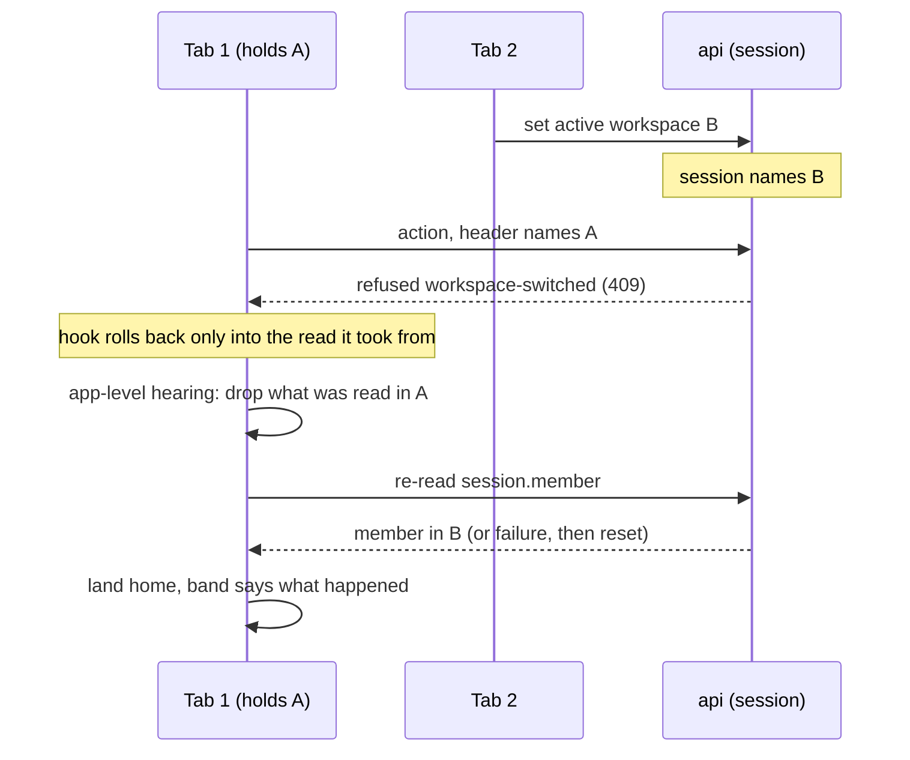

# Shared Member Ground and Actions Bound to the Tab's Workspace - Plan

## Goal Capsule

- **Objective:** a person who is a member of two workspaces, with one open in each of two browser tabs, can never change anything in a workspace other than the one their tab names. The next People page, and the audit words S2b or S3 add, take the member read, its reset and the audit words from one place.
- **Means:** the member read, what a member change does to it and the audit words move to `apps/web/src/shared/` (KTD1 to KTD3). Every tRPC action in a workspace then names the workspace its tab holds, and the api's workspace roads refuse one that names another (KTD4 to KTD7). A refused tab does what a switch does (KTD8), and a tab that learns of the switch from its own read drops what it held and says so (KTD9).
- **Product authority:** the acceptance criteria of Linear BA-81 and BA-50, then the owner's three rulings of 11/10/2026 recorded under Key Decisions, then this plan.
- **Stop conditions:** stop and report to the lead if any of these holds.
  - A migration or an edit under `contracts/` becomes necessary.
  - `packages/core` needs a change for BA-50. U2's one path in `packages/core/scripts/audit-actions.ts` is BA-81's and is expected.
  - Better Auth's own configuration in `apps/api/src/auth/` needs a change.
  - U5's proof cannot be made to pass by either mechanism KTD9 names.
  - Giving the api's test client a held workspace needs a harness seed route reshaped.
- **Execution profile:** one pull request for both issues, a commit per unit in the order U1 to U6. Reversible: no migration, no `contracts/` file, no stored data and no email. The body closes `Fixes BA-81` and `Fixes BA-50`.
- **Who finishes:** `ce-work` builds it, `/ce-code-review` reviews it after the last code change, and `ce-commit-push-pr` opens the pull request.
- **Open blockers:** none.

---

## Product Contract

### Summary

BA-81 moves three pieces of ground that People and the shell both stand on into `apps/web/src/shared/`, with no change in behaviour: the member read, the one function that says what a member change does to it, and the audit words. BA-50 then makes the web name, on every action it takes in a workspace, the workspace its tab holds. The api refuses the action in one word when the session is in another workspace. The refused tab drops what it read, lands home in the session's workspace and says in the band what happened.

### Problem Frame

The api takes the workspace from the session, and one browser has one session. A person in workspaces A and B switches to B in one tab. Their other tab still shows A. An action from that tab lands on the same person id in B: the wrong company's member is removed or loses a role. A person's id is the same in every workspace by design (one id per person), so the action finds a real member.

Research found the gap is wider than the issue says. A tab left showing A re-reads its lists from B as soon as the person opens another People page, while the band still names A. Invitation, request and group actions then carry B's ids and land in B. No list of exempt actions holds, and writes outside People (an upload, a source's review) have the same shape.

Separately, the member read has four production copies of its key, the logic for what a member change resets is written twice with two different outcomes on a failed re-read, and the audit words live under People although Activity and the audit log both read them. Each new page copies them again.

### Requirements

**The shared ground (BA-81)**

- R1. One member read lives in `apps/web/src/shared/`. It states `refetchOnMount: false` once, and every production reader of the member or of its key uses it.
- R2. One shared function owns what a member change does to the held member. Each caller is named with what it does when the re-read fails: a switch resets, a self-removal resets with no re-read, and a self-demotion keeps the held answer and says the role is unread.
- R3. `memberRefusal` moves with the member read.
- R4. The audit words move to `apps/web/src/shared/`: `sentenceOf`, `headlineOf`, `detailLinesOf`, `EventDays`, the generated actions file, and what those import. The audit log page stays under `apps/web/src/features/people/`.
- R5. BA-81 changes no behaviour. Tests rendered through the app's own router cover a member removed, reset and re-read, and assert on what the page draws.

**Actions bound to the tab's workspace (BA-50)**

- R6. Every action the web takes in a workspace names the workspace its tab holds, which is the one its band names.
- R7. The api refuses an action that names a workspace other than the session's, or names none, in one word of class *conflict*. Nothing changes in either workspace.
- R8. That refusal is judged before any ceiling is counted, before the person's role in the session's workspace is read, and before the action's input is parsed. A stale tab hears this word and no other.
- R9. No procedure can skip R7: the check belongs to the road, and a test walks the router to hold it.
- R10. A tab that hears the refusal drops what it read from the workspace it held, re-reads its member, lands at home, and says in the band that the workspace was changed in another tab and that the action was not done. It does so whether or not the page that asked is still drawn, and when the re-read fails it resets the member read.
- R11. An optimistic change that is refused is put back only into the read it was taken from, never into one dropped since.
- R12. No page draws rows read in one workspace while the tab holds another: when the member read answers a different workspace, what the tab read from the workspace it held is dropped before any page draws. The tab keeps its address, and its band says the workspace was changed in another tab. A switch, a pick or a join made in this tab says nothing of the kind.
- R13. A browser spec with two tabs proves R7 and R10 for an action on a member page, an action on a ticked set, and an action on a page the stale tab opened after the switch.

### Acceptance Examples

- AE1. **Covers R6, R7, R10.** Given Ada is an Admin of A and B and Sam is a member of both, with Sam's member page open in tab 1 under A. When Ada switches to B in tab 2 and then removes Sam in tab 1, then Sam is still a member of A and of B, tab 1 is at Ada's home in B, and its band says the workspace was changed in another tab and nothing was done.
- AE2. **Covers R8.** Given the same two tabs, and Ada is a Member, not an Admin, of B. When she changes Sam's role in tab 1, then the api answers the new word, not `role-forbids`.
- AE3. **Covers R7.** Given tab 1 has opened Invitations after the switch, so its rows are B's under a band naming A. When Ada cancels an invitation there, then the invitation still waits in B.
- AE4. **Covers R7.** Given a tab loaded before this release. When it takes any action in a workspace, then the api refuses it and the tab's own words tell the person to reload.
- AE5. **Covers R12.** Given tab 1 shows Members under A and was hidden while tab 2 switched. When tab 1 becomes visible and its member read answers B while its list read is held back, then no row of A is on the page once the band names B, the address is unchanged, and the band says the workspace was changed in another tab.

### Key Decisions

- **The refusal reaches every action in a workspace, not People alone.** (session-settled: user-directed — chosen over every People action carrying the workspace in its input, and over the ten actions first scoped: one check on each side needs no list to keep, and a stale tab's writes outside People have the same gap.) Governs R6, R7, R9.
- **A refused tab lands home and says so.** (session-settled: user-approved — chosen over leaving the old page up with a refusal sentence: the page belongs to a workspace the session has left.) Governs R10.
- **A tab that learns of the switch from its own member read keeps its address and says so.** (session-settled: user-directed — chosen over landing home as a refused tab does, and over redrawing with no sentence: the person keeps their place and is told why the page changed.) Governs R12.
- **BA-81's move lands before BA-50's change**, so the fix is written against the shared member read. Governs R1, R6.

### Scope Boundaries

- No migration and nothing under `contracts/`. A second pull request (BA-92 with BA-55) carries both and runs alone.
- `packages/core` gains no refusal word and no input field. Its actions already judge the principal's workspace.
- Reads are not refused. A stale tab can still draw the session's workspace under its old band until its next action.
- The MCP surface and `pnpm ops` are untouched. A token's workspace is fixed at consent, so only a browser session can be stale.
- The audit log page does not move to `features/system/`. That is O1's.
- `apps/web/src/features/auth/session-memory.ts` stays where it is (KTD3).

**Considered and not built**

- A channel that tells other tabs about a switch. R7 holds without it, and R12 covers the tab that learns from its own member read. Evidence that would change the call: people reporting they were surprised by the refusal often enough to want the tab to move first.
- A guard for a self-demotion that commits in A while another tab switches to B before the role is read again. It needs two actions in two tabs inside one request's time. It would misreport the role in the home line, and changes nothing stored.

#### Deferred to Follow-Up Work

- The consent page, `POST /consent` in `apps/api/src/auth/routes.ts`, grants for whatever workspace the session names when the form is sent. It is a Hono route, not a tRPC road. BA-149.
- Reads drawn from the session's workspace under a band naming another, in two visible windows. BA-149 also.
- `docs/solutions/logic-errors/workspace-switch-serves-left-workspace-member-after-failed-reread.md` has no entry for a two-tab spec or for commit `335dd2a7`. `/ce-compound` after this lands.

---

## Planning Contract

### Key Technical Decisions

- KTD1. **One module in `apps/web/src/shared/` holds the member read, its key and the function for a member change.** `apps/web/src/features/auth/member.ts` empties into it. The four key copies (`memberOptions`, `useHeldMember`, `useReconciledList`'s settle, `memberOf` in `self-action.tsx`) and the test's fifth all read it.
- KTD2. **The shared function takes its failed-read outcome from its caller, as a named choice, and never picks one.** `rereadMember` resets and `roleReadAgain` keeps: `apps/web/test/self-action.test.tsx` and the three specs in `apps/web/e2e/workspace-switcher.spec.ts` pin both. It picks its cache verb by who is watching, checks `status` and `fetchStatus` after a re-read, and is wired in a mutation's own options (`docs/solutions/logic-errors/workspace-switch-serves-left-workspace-member-after-failed-reread.md`, `docs/solutions/logic-errors/a-second-mutate-drops-the-first-actions-callbacks.md`).
- KTD3. **`memberRefusal` moves and is handed what to do when the read lands.** It calls `rememberTheSession("held")` today, and `shared/` may import nothing from `features/`. Its one caller, `apps/web/src/app/router.tsx`, passes that call in. Moving all of `session-memory.ts` was the alternative: it holds the sign-in channel, which is auth's ground.
- KTD4. **The tab names its workspace in a request header, and the api's workspace roads compare it.** (session-settled: user-directed — chosen over a `workspaceId` field on each action's input: the header needs one check on each side and no change to an input schema, `packages/core` or its tests.) Implements the first Key Decision; governs R6 to R9. `apiLink` in `apps/web/src/shared/api/link.ts` is the web's one link and already sets headers for uploads, so both of its arms carry the header.
- KTD5. **The header's value is the workspace of the held member read, read when the request is sent.** That is the read the band draws. `useRemoveMember`'s `meta.workspaceId` already reads the same value. With no member held, the link sends no header and the api refuses, as R7 says. No page in a workspace is drawn in that state: the router's member check runs before the shell, and a reset member read draws the frame's failure, so no action can be pressed from it.
- KTD6. **The check sits in the first step of each workspace road, straight after `claimsOf`, on mutations only.** `inTheResolversTransaction` and `ownTransactionProcedure` in `apps/api/src/trpc/base.ts` are the two roads. The order becomes: the session's words, the second-factor gate, `no-active-workspace`, the new word, the road's ceiling, the principal, the parsed input, admission, the action. The person's and the operator's roads name no workspace and are not checked.
- KTD7. **The new word is the transport's: `workspace-switched`, class *conflict*, declared beside `no-active-workspace` in `apps/api/src/refusal.ts`.** The catalogue is append-only, so the name and class are permanent (`docs/solutions/architecture-patterns/adr-0043-what-an-act-is.md`). *conflict* is the glossary's "the state moved: read again and decide again". It must not be *unauthenticated*: `wordSendingThemOn` sends the reader to sign-in for that class. A core word beside `admit` was the alternative. Only a browser session can be stale, and `no-session` and `no-active-workspace` set the precedent that a word about the session is the transport's.
- KTD8. **A refused tab runs the switch's own tail from the app-level hearing.** `createAppRouter` already hears every refused action through `clients.failures.answeredBy`. The step acts on the word alone, with no test of the address, since a refusal that lands after the person left the page still means the tab is stale. It is auth's, in `apps/web/src/features/auth/`, because `forgetTheWorkspaceLeft` and `AUTH_KEYS` are private there. The sentence goes in the band's outcome slot, which sits outside the subtree `Frame` keys by workspace.
- KTD9. **R12 is held by dropping the held workspace's reads in the same cache event that delivers the member answer.** `Frame` keys the page by the member's workspace, so the page remounts on that answer and would otherwise draw the cached rows. If U5's test shows a cache subscriber runs too late, the fallback is a workspace the tab holds apart from the live member read, which the frame's key and the link both read and which moves only after the drop.

### High-Level Technical Design

### Deferred to Implementation

- The header's name. Uploads use `x-upload-*`; pick one in that style and declare it once where both the link and the api read it, as `UPLOAD_HEADER_OF_FIELD` is.
- How the link reaches the held member. The key comes from the tRPC options proxy, which is built over the client the link belongs to, so the getter is read lazily.
- How `webClientOf` in `apps/api/tests/web-client.ts` holds a workspace. It uses the web's own `apiLink`. The tests that switch workspace mid-test are in `members-procedures.test.ts`, `member-revocation.test.ts` and `crossing.test.ts`.
- Which tests call a workspace mutation without the web's link: the api's tests by raw `client.fetch`, and the browser suite by `page.request.post`. Each needs the header or is itself a proof of R7. One is known: `actedAside` in `apps/web/e2e/people-invitations.spec.ts`, whose three callers expect 200.
- Whether a cache subscriber runs before observers render in the installed `query-core`, and whether the cache's `onError` runs before a hook's. U4's and U5's tests settle both.
- The exact sentences. They follow `packages/design-system/readme.md` and pass `apps/web/test/typographic-words.test.ts` and `apps/api/tests/avoid-words.test.ts`.

### Risks

| Risk | What holds it |
| --- | --- |
| The api's tests break widely, because every workspace mutation now needs the header | `webClientOf` is the one place a test client is built; fix it first in U3 and count what is left before touching a test file |
| A tab open across the release is refused on every action until reloaded | Intended (AE4). Releases run nightly at 02:35 UTC. Named in the pull request's body |
| The move breaks one of the two failed-read outcomes | U1 lands its app-rendered tests green before U3 to U5 touch the function |
| U5 fires on the tab's own switch, pick or join | Those roads drop before they re-read, so a second drop finds nothing. U5 says its sentence only when the tab held a workspace and did not make the change itself, and a scenario holds each of the three |
| A proof passes against the unfixed code | Every proof but AE2's seeds the acting person as an Admin of both workspaces and the target as a member of both (U3, U6). AE2's seeds the acting person as a Member of B, since it proves which word answers |

### Operational Notes

- `docs/solutions/architecture-patterns/adr-0043-what-an-act-is.md` gains a History line in U3's commit: a transport word and a check on the workspace roads. The pull request's body says so.
- Read "Who sees what" in `docs/solutions/architecture-patterns/adr-0047-the-platform-is-surfaces-groups-and-screens.md` during U4. Add a History line there only if landing home on this refusal changes a sentence it states.

---

## Implementation Units

### U1. The member read and what a member change does to it, in `shared/`

- **Goal:** one module in `apps/web/src/shared/` owns the member read, its key, `memberRefusal` and the function for a member change, and every reader uses it.
- **Requirements:** R1, R2, R3, R5.
- **Dependencies:** none.
- **Files:**
  - create: a member module under `apps/web/src/shared/`
  - modify: `apps/web/src/features/auth/member.ts` (emptied or removed), `apps/web/src/features/auth/auth-hooks.ts`, `apps/web/src/features/auth/pending-refusal.ts`, `apps/web/src/features/people/people-api.ts`, `apps/web/src/features/people/self-action.tsx`, `apps/web/src/app/frame.tsx`, `apps/web/src/app/go-home.tsx`, `apps/web/src/app/router.tsx`, `apps/web/src/app/unknown-page.tsx`
  - test: `apps/web/test/self-action.test.tsx` (its stand-in reads the shared options), a new app-rendered test file under `apps/web/test/`
- **Approach:**
  1. Move with `git mv` where a file moves whole, fix imports, then run the web's `check`.
  2. Write the shared function per KTD2, with its three callers named: `useSwitchWorkspace` (reset on a failed read), `goHome("removed")` (reset, no re-read), `goHome("demoted")` (keep, say unread).
  3. Hand `rememberTheSession` in from the router per KTD3.
  4. Leave `forgetMember`'s removal as it is: it is right only where no observer is mounted, which is the picker and the join.
- **Execution note:** write the app-rendered tests against the code before the move and see them pass, then move.
- **Patterns to follow:** `apps/web/test/open-app.tsx` (`openApp`, `appAt`) and `apps/web/test/stubbed-api.ts` for an app-rendered test; `apps/web/src/shared/refusal-outcome.tsx` for a `shared/` file that imports `@/shared/api/trpc.ts`.
- **Test scenarios:**
  - A self-removed Admin lands at the workspace chooser and the frame draws no role.
  - A switch whose member re-read fails draws no name of the workspace left.
  - A self-demoted Admin lands at an Editor's home with the home line saying why.
  - A self-demoted Admin whose re-read fails stays put and is told the role is unread.
  - The member is read once across drawing the shell and changing pages (`apps/web/test/member-redirect.test.tsx` passes unchanged).
  - A person with no session, and one whose second factor is pending, is still sent on by the router's member check (R3: `apps/web/test/frame.test.tsx` and `apps/web/test/pending-gate.test.tsx` pass unchanged).
- **Verification:** `apps/web/test/self-action.test.tsx`, `member-redirect.test.tsx`, `member-removal.test.tsx` and `workspace-switcher.test.tsx` pass with only import paths changed. A text search for `session.member.queryOptions` and `session.member.queryKey` under `apps/web/src` finds the shared module alone.

### U2. The audit words, in `shared/`

- **Goal:** Activity, the audit log page and any later page read the audit words from `apps/web/src/shared/`.
- **Requirements:** R4, R5.
- **Dependencies:** none.
- **Files:**
  - move to `apps/web/src/shared/audit/`: `audit-sentences.ts`, `audit-details.ts`, `audit-subjects.ts`, `event-days.tsx`, `audit-actions.ts` (generated), all from `apps/web/src/features/people/`
  - modify: `apps/web/src/features/people/audit-log-api.ts`, `audit-log-page.tsx`, `member-activity.tsx`, `packages/core/scripts/audit-actions.ts`, `apps/api/tests/kept-names.ts`, `apps/api/tests/avoid-words.test.ts`, `jscpd.config.mjs`
  - test: `apps/web/test/audit-sentences.test.ts`, `apps/web/test/audit-details.test.ts`, `packages/core/test/audit-actions.test.ts`, `apps/web/e2e/people.spec.ts` (imports only)
  - docs: the three files under `docs/solutions/` that quote the generated file's path
- **Approach:**
  1. `ReadAuditEvent` is declared in `shared/audit/`, and `audit-log-api.ts` imports it. `shared/` may not import the type from a feature.
  2. Regenerate the actions file into its new path with `pnpm --filter @better-answers/core run generate:audit-actions` after changing `AUDIT_ACTIONS_MODULE`. The proof of the move is a regeneration with no diff.
  3. Edit `jscpd.config.mjs` line 13 in place. A path placed below the first `/**` glob fails `check:gates` on comment density (`docs/solutions/integration-issues/cloc-counts-a-glob-in-a-config-string-as-a-block-comment.md`).
  4. Change the path `kept-names.ts` reads and the two planted trees in `avoid-words.test.ts` together.
- **Test scenarios:** no new scenario, since the move changes no behaviour. R4 is proven by the existing tests named above passing with imports changed: `apps/web/test/audit-sentences.test.ts` and `apps/web/test/audit-details.test.ts` for the words, and `packages/core/test/audit-actions.test.ts` comparing the moved file with a regeneration.
- **Verification:** the web's and core's `check` and `pnpm check:gates` pass. A text search for `features/people/audit-` finds only the audit log page's own files.

### U3. The api refuses an action that names another workspace

- **Goal:** both ends of the wire: the web's link names the tab's workspace, and the workspace roads refuse a mutation that names another or none.
- **Requirements:** R6, R7, R8, R9. Implements KTD4 to KTD7.
- **Dependencies:** U1.
- **Files:**
  - modify: `apps/api/src/trpc/base.ts`, `apps/api/src/refusal.ts`, `apps/web/src/shared/api/link.ts`, the file that builds the web's tRPC client under `apps/web/src/shared/api/`, `apps/web/src/shared/refusal-words.ts`, `apps/api/tests/web-client.ts`
  - test: `apps/api/tests/trpc-roads.test.ts`, `apps/api/tests/members-procedures.test.ts`, `apps/web/test/refusal.test.ts`, `apps/web/e2e/people-invitations.spec.ts` (`actedAside` sends the header for the workspace its Admin is signed in to)
  - docs: `docs/solutions/architecture-patterns/adr-0043-what-an-act-is.md`
- **Approach:**
  1. Declare the word and the header's name once each.
  2. Add the comparison to both roads per KTD6, thrown through `refused` so it is logged once as every refusal is.
  3. Give `apiLink` a getter for the held workspace and set the header on both arms. Wire the getter where the web's client is built (KTD5).
  4. Give `webClientOf` a held workspace before touching any test file, then count what still fails.
  5. Add one sentence for the word in `apps/web/src/shared/refusal-words.ts`, read ahead of the class's fallback, so no surface tells a person on the new bundle to reload and try again.
- **Execution note:** start with the failing road test for R9, then the comparison.
- **Patterns to follow:** `claimsOf` and `refused` in `apps/api/src/trpc/base.ts`; `transport` in `apps/api/src/refusal.ts`; `uploadHeadersOf` in `apps/web/src/shared/api/link.ts`; `setActiveWorkspace` in `apps/api/tests/flow.ts` and `memberOfTwoWorkspaces` in `apps/api/tests/crossing.test.ts` for a person in two workspaces.
- **Test scenarios:**
  - Covers AE1. An Admin of A and B whose session names B removes a member of both, naming A: refused `workspace-switched`, and the person is still a member of both.
  - The same for a ticked set, for an invitation sent, and for a group made: refused, and nothing is added in either workspace.
  - Covers AE2. The caller is a Member of B: the answer is `workspace-switched`, not `role-forbids`.
  - An invitation sent at its ceiling from a stale tab answers the refusal, not 429.
  - A mutation with no header is refused the same way (AE4).
  - A mutation naming the session's workspace runs as before.
  - A query naming another workspace, or none, is answered as before.
  - A mutation on the person's road and one on the operator's road run with no header.
  - Covers R9. Walking the app router, every mutation on a workspace road is refused when its header names another workspace.
- **Verification:** `IMAGE_PROBE_DEFERRED=true pnpm check:api` and `apps/web/e2e/people-invitations.spec.ts` pass, and the count of test files edited for the header alone is reported in the pull request.

### U4. A refused tab does what a switch does

- **Goal:** a tab that hears `workspace-switched` ends at home in the session's workspace with the band saying what happened, and no refused change is written back into a dropped read.
- **Requirements:** R10, R11. Implements KTD8.
- **Dependencies:** U1, U3.
- **Files:**
  - modify: `apps/web/src/features/auth/auth-hooks.ts`, `apps/web/src/features/auth/pending-refusal.ts` or a sibling, `apps/web/src/app/router.tsx`, `apps/web/src/app/frame.tsx`, `apps/web/src/app/workspace-switcher.tsx`, `apps/web/src/app/words.ts`, `apps/web/src/features/people/people-api.ts`, `apps/web/src/shared/api/optimistic.ts`, `apps/web/src/features/people/invitations-api.ts`, `apps/web/src/features/people/requests-api.ts`
  - test: a new app-rendered test file under `apps/web/test/`, `apps/web/test/self-action.test.tsx`
- **Approach:**
  1. The step is the switch's tail: `forgetTheWorkspaceLeft`, the shared re-read with reset on failure (KTD2), then home.
  2. The band's slot orders the switcher's own outcome first, then this sentence, then the unsaved note. The sentence stays until the person's next move.
  3. Every optimistic rollback in a workspace restores only when the read it took from is still the one held (R11). There are four: `useReconciledList` in `people-api.ts`, `useOptimistic` in `apps/web/src/shared/api/optimistic.ts` (groups and sources use it), `useMoving` in `invitations-api.ts`, and the rollback in `requests-api.ts`. The console's rollback in `apps/web/src/features/console/people-api.ts` is the operator's and names no workspace.
  4. Two refusals in flight run the step once in effect: the second finds nothing to drop and the same home.
- **Patterns to follow:** `detouringOn` and `detourAfter` in `apps/web/src/features/auth/pending-refusal.ts` for acting on a word at the app-level hearing; `useSwitchWorkspace` for the tail; `HomeLine` and `switchOutcome` for a sentence that outlives a navigation.
- **Test scenarios:**
  - Covers AE1. A member page's action is refused `workspace-switched`: the app lands at home, the band names the session's workspace and says the action was not done.
  - The refusal lands after the person has left the page that asked: the same end.
  - The member re-read fails after the refusal: the frame draws no name of the workspace left.
  - Two actions refused, the second held back until the tab is home, then Members opened with its read held back: no row of the workspace left is drawn.
  - An invitation cancelled from a tab that read Invitations before the switch is refused after the tab is home, then Invitations is opened with its read held back: no row of the workspace left is drawn.
  - A refusal of another word of class *conflict* leaves the tab where it is.
  - A ticked set refused this way leaves no row marked and no tick restored once the tab is home.
- **Verification:** the new tests pass, and `apps/web/e2e/workspace-switcher.spec.ts` passes unchanged.

### U5. No page draws one workspace's rows while the tab holds another

- **Goal:** when a tab's member read answers a different workspace, what it read from the workspace it held is gone before any page draws, and the band says why the page changed.
- **Requirements:** R12. Implements KTD9 and the third Key Decision.
- **Dependencies:** U1, U4 (the band's slot and its order).
- **Files:**
  - modify: `apps/web/src/features/auth/auth-hooks.ts`, the file under `apps/web/src/shared/api/` that builds the query client or the app's providers, `apps/web/src/app/frame.tsx`, `apps/web/src/app/words.ts`
  - test: a new app-rendered test under `apps/web/test/`
- **Approach:**
  1. State the condition in the code that holds it. A first read, a read after `forgetMember` or after a reset, and the same workspace with another role are not a change.
  2. The step changes no address: the page remounts under `Frame`'s key and reads again in the session's workspace. What the person's role there forbids is said by the page's own reads, as it is today.
  3. The band says the workspace was changed in another tab. This sentence does not say an action was not done, which is U4's. It takes the same place in the slot's order and stays until the person's next move.
  4. The tab's own switch is known from its press, never from its answer, so a switch whose answer was lost is treated as another tab's.
- **Execution note:** write the held-back-list test first. It decides between KTD9's two mechanisms.
- **Test scenarios:**
  - Covers AE5. The member read answers B with `members.list` held back: no row of A is on the page once the band names B, the address is unchanged, and the band says the workspace was changed in another tab.
  - The tab's own switch still lands home once and says nothing about another tab.
  - A pick at the chooser and a join by invitation say nothing about a changed workspace.
  - The member read answers the same workspace with another role: the lists are kept and nothing is said.
  - A member page open on a person who is a member of both workspaces redraws as that person in B, under a band that says the workspace changed.
- **Verification:** the new test passes, and the three specs in `apps/web/e2e/workspace-switcher.spec.ts` pass unchanged.

### U6. The two-tab browser spec

- **Goal:** the browser suite proves, in two tabs of one signed-in person, that a stale tab's action is refused with nothing changed.
- **Requirements:** R13.
- **Dependencies:** U3, U4.
- **Files:**
  - modify: `apps/web/e2e/harness.ts` (export `inTwoWorkspaces` if a second spec needs it)
  - test: a new spec under `apps/web/e2e/`, or `apps/web/e2e/workspace-switcher.spec.ts`
- **Approach:** load the `browser-suite` skill first. The second tab is `context.newPage()` on the fixture's context, which shares the session. Playwright fires no `visibilitychange` between pages of one context, so this spec proves the two-visible-windows case only. AE5 is U5's app-rendered test.
- **Patterns to follow:** `inTwoWorkspaces` and "switching from a member page lands home, showing no one" in `apps/web/e2e/workspace-switcher.spec.ts`; the two-tab shape of "says a request was decided meanwhile, and what next" in `apps/web/e2e/people-requests.spec.ts`.
- **Test scenarios:**
  - Covers AE1. Tab 2 switches to B; tab 1 removes Sam from his member page: refused, tab 1 is home in B with the band's sentence, and Sam is listed in both workspaces.
  - Tab 1 changes the role of a ticked set: refused, and each role is unchanged in both workspaces.
  - Covers AE3. Tab 1 opens Invitations after the switch, then cancels one: refused, and the invitation still waits in B.
  - The action's button pressed twice with the first answer held back sends one request.
  - The landing page passes the accessibility gate.
- **Verification:** the spec passes, and each scenario fails against the commit before U3.

---

## Verification Contract

| Check | Command or evidence | When |
| --- | --- | --- |
| Web types | `pnpm --filter @better-answers/web run typecheck` | after each unit |
| Web unit tests | `pnpm --filter @better-answers/web run test` | by file per unit; whole on the pushed head |
| Core | `pnpm --filter @better-answers/core run check` | after U2 |
| Generated file | `pnpm --filter @better-answers/core run generate:audit-actions` leaves no diff | after U2 |
| The api's suite | `IMAGE_PROBE_DEFERRED=true pnpm check:api` | after U2 and U3; on the pushed head |
| Browser suite | the web's build, then Playwright as the `browser-suite` skill says | by spec per unit; whole on the pushed head |
| Root gates | `pnpm check:gates` | after U2; on the pushed head |
| Docs gates | `pnpm check:docs` | after U2 and U3 |
| Red seen | U3's road test and U6's scenarios fail on the commit before U3 | once, after U6 |

## Definition of Done

- Every requirement R1 to R13 has a passing test named in its unit, and AE1 to AE5 each have the scenario that covers them.
- BA-81's four acceptance criteria and BA-50's two hold as the issues word them, with BA-50's reach as the first Key Decision sets it.
- The diff adds no migration, edits nothing under `contracts/`, and changes `packages/core` only in `packages/core/scripts/audit-actions.ts`.
- `docs/solutions/architecture-patterns/adr-0043-what-an-act-is.md` carries its History line, and the pull request's body names it.
- The plan, its tests and its page sentences say *action* and *member*.
- No scratch edit, probe or abandoned mechanism from KTD9's choice is left in the diff.
- `CI`'s `check` is green on the merge group.

---

## Sources

- Linear BA-81 and BA-50; `docs/plans/2026-10-08-2311-docs-architecture-review-before-s2-plan.md` (WP6); `docs/plans/2026-10-01-1807-feat-people-layout-rework-plan.md` (Deferred to Follow-Up Work).
- Bug history on this ground: `d05ae4b8`, `ff213801`, `8fa930b4`, `afed41ec`, `335dd2a7`.
- `docs/solutions/logic-errors/workspace-switch-serves-left-workspace-member-after-failed-reread.md`: choose the cache verb by who is watching; never trust an awaited refetch; prove it on the page.
- `docs/solutions/logic-errors/a-second-mutate-drops-the-first-actions-callbacks.md`: what must run for every request goes in the mutation's own options.
- `docs/solutions/architecture-patterns/adr-0043-what-an-act-is.md`: how a refusal word is declared; the catalogue is append-only.
- `docs/solutions/architecture-patterns/adr-0037-reader-screen-latency-budget.md`: an action applies at once and a refusal is never retried.
- `docs/solutions/best-practices/a-ceiling-keyed-on-the-target-does-not-bound-the-actor.md`: where the invitation ceilings are counted.
- tRPC 11: a middleware receives the call's `type`, and `httpBatchLink` and `httpLink` both take a `headers` function.
