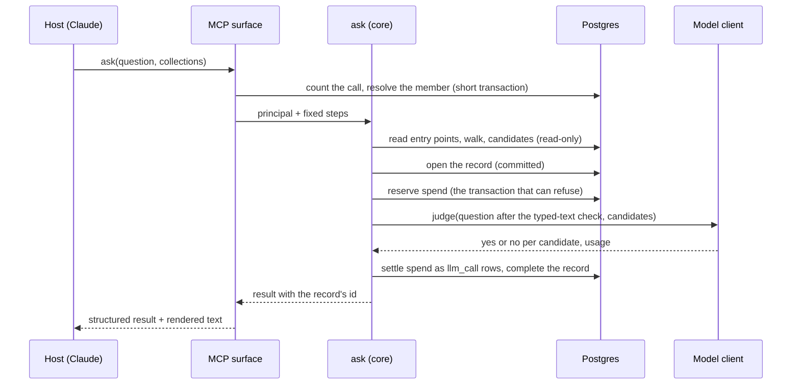
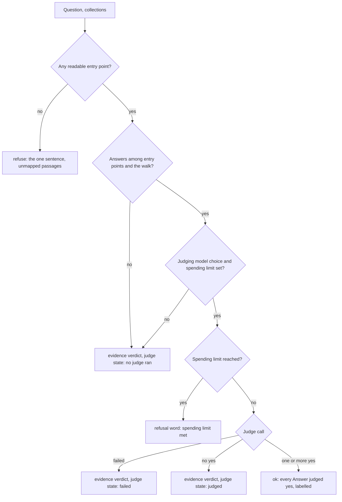
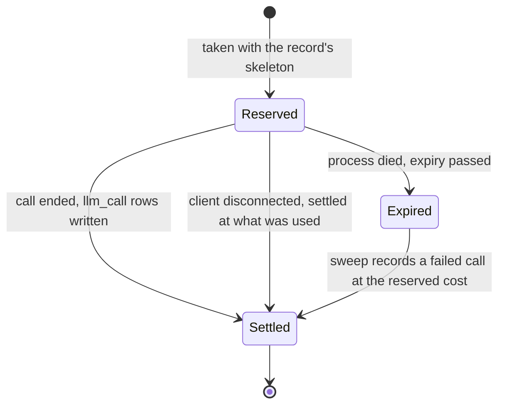

# S2b Ask - Plan

## Goal Capsule

- **Objective:** A person filling a procurement form from Claude gets, for each row, the company's approved `Answer`s that fit, word for word, with who verified them. Where none fits they get the concepts that bear on the question, and where nothing matches they are told so in one sentence. An Admin can read every question that was asked and every piece of feedback on it. A reader with no assistant gets the same result on the Ask page, with prose the platform drafts.
- **Means:** a no-model `ask` first, then the judge (KTD1); the collection as a stored fact of the concept index (KTD2); one result contract with a fourth verdict (KTD5); `ask` on an own-transaction road on both transports (KTD6, KTD14); one model client with two wire shapes (KTD10).
- **Product authority:**
  - `docs/specs/v01-route.md`, the S2b block, is authoritative for what S2b builds, except where the Key Decisions below change it. Each change names the ADR it amends (R28, R29).
  - The MCP App that shows a concept file in Claude is not active scope. It takes its own route line and its own plan (*How This Work Fits Together*).
  - S6 owns the platform's own run over a form. This plan builds the one call S6 will make per question.
- **Stop conditions:** stop and ask the owner in any of these cases:
  - Evidence that a Key Decision or a session-settled Key Technical Decision cannot work.
  - The walk cannot be seeded from a set within the budget U3 names, which would leave an evidence result as `find` plus a record.
  - A migration's lock wait exceeds its `lock_timeout` on staging.
  - The two contract stamps disagree after a `contracts/` unit lands.
  - A host is found to ask the person for permission on a call to a read-only tool, which breaks R22.
  - U8 reads recall through `ask`'s plan step on the buyer-worded set below S2a's 73.2 %, which would put the judge behind an entry step that misses its `Answer`s.
- **Execution profile:** one pull request per unit, in the order *Sequencing* gives. A unit that adds a migration or edits `contracts/` runs alone until it merges. U2, U4, U9, U10 and U11 are not reversible once merged and run. U6, U7 and U13 write records once released, so their merges are not reversible either.
- **Who finishes:**
  - `ce-work` builds each unit.
  - `/ce-code-review` reviews it before the pull request.
  - `ce-commit-push-pr` opens the pull request, and the merge queue merges it when `check` is green.
  - The owner reads the stage 1 result by hand after the release that carries U6, and reads AE1 and AE2 after the release that carries U13 once the ops commands of U9, U11 and U12 have set the judging model's key, its price, the spending limit and the judging model choice.
  - The owner starts the model readings of U14 and U15.
- **Open blockers:** none for planning or for the build.

---

## Product Contract

### Summary

`ask` becomes a reuse-first step that can be narrowed to collections. It returns every `Answer` that fits a question, unchanged and labelled, or the concepts that bear on it, or the refusal, in one form on every transport. Over MCP the assistant writes any prose; on the Ask page the platform drafts it. Every question is kept in *Questions asked* and feedback is stored against it. A typed judge decides what fits: its generative backend ships first, and its decision-model backend is measured before any workspace is set to run it. The work lands in four stages: `ask` over MCP with no model, then the model stage, then Ask's two pages, then Control Centre's Questions pages.

### Problem Frame

The first customer's bundle holds 241 `Answer` concepts in four collections, made to complete procurement forms: bids, RFPs and security checklists. `ask` is a stub today. It refuses every question with *Not answered from the company's knowledge* and lists the concepts its words match. So the only route to an approved `Answer` is `find` and `open`, one concept at a time.

The owner asked the same question through `find` and `ask` on 10/10/2026. `find` reached the right concept. `ask` cited every concept that answers the question and still refused, because nothing in it judges or writes.

A walk of one real form cell showed what the block's routed shape would miss. Principle 13 of an NCSC cloud security checklist, on spreadsheet row 45, sits in a form that names its product once, at the top. Seven of the customer's concepts bear on that cell, and their figures differ by product: 12 months and 90 days, 1 year and 3 months, 6 months and 7 days. A drafter given all seven must blend them or list every product, and the contract's conflict field would report a disagreement where there is none. Inside one collection, sixteen `Answer`s also come as Standard-module and Advanced-module pairs.

A ready-made bid library is the exception among clients. Most bundles will hold few `Answer`s, so the result where none fits is the common case elsewhere.

### Key Decisions

- **`ask` stays distinct from `find`, reuses first, and leaves the prose to the assistant over MCP.** Governs R1, R2, R5, R8, R9. (session-settled: user-directed — chosen over the platform drafting on every transport, over no drafting in v0.1, and over the routed shape with no narrowing: an assistant rewrites the platform's prose for the person anyway, so the second model call buys no guarantee there.)
- **Every `Answer` that fits is returned, labelled, and never reduced to one.** Governs R2, R3. (session-settled: user-directed — chosen over asking which collection and over picking the likeliest by a typed decision: the first blocks a plain question and the second is wrong without notice.)
- **The narrowing is the collection, and choosing between tiers is the caller's.** Governs R4, R11. (session-settled: user-approved — chosen over a narrowing by tier or product concept: the customer's Standard and Advanced module pairs sit inside one collection, R3 returns both, and a finer narrowing waits for S6.)
- **The contract stays one, with a verdict of its own for evidence.** Governs R1, R5, R28. (session-settled: user-approved — chosen over a second contract for MCP, which ADR 0016 rejects by name: drafting becomes a second step that only the Ask page runs over the same result.)
- **The judge is one typed judgement with two backends, the generative one built first.** Governs R15, R16, R24, R29. (session-settled: user-directed — chosen over a decision model alone and over a generative judge alone: the decision-model class is a month old with vendor benchmarks only, and the owner wants it measured, not assumed.)
- **Decision models are taken up inside the first block that needs them.** Governs R24. (session-settled: user-directed — chosen over a separate experiment or ticket: no work sits outside the route.)
- **The record holds what `ask` gave, and feedback is stored on it.** Governs R7, R19, R20, R21. (session-settled: user-directed — chosen over storing the assistant's final text and over a setting that makes the platform draft over MCP: an answer test replays retrieval, which the record keeps in full.)
- **The MCP App is built from its own plan.** (session-settled: user-directed — chosen over building it inside this block and over leaving it to S6: it rests on S2a's `open` alone and can ship before `ask`.)
- **One plan covers the block, built in four stages.** `ask` over MCP comes first, with no model and then with the judge, and is read on production after each. Ask's two pages follow, then Control Centre's Questions pages. Each later stage rests on a contract the stage before it proved.
- **Typed text passes an always-tier check before any model call.** Governs R42. (session-settled: user-directed — chosen over skipping the model when a question holds an identifier, and over sending a question as typed: the seam's always tier is pattern-based and can be read in the api tier, while names cannot.)

<!-- ce-section: work-relationships -->
### How This Work Fits Together

This plan covers `ask`, its record, its judge and its pages. The breakdown below is the current understanding, not a committed roadmap.

- **The MCP App that shows a concept file in Claude.** Can proceed independently of this plan: it rests on S2a's `open`. Shares one condition with it: a returned `Answer` and each citation name a concept the App can open (R2).
- **S6, answering a question set.** Depends on this plan: its job calls `ask` once per question with the form's collections fixed. Still to decide there: a narrowing finer than a collection, and how a response is measured against the `Answer` it must reuse.
- **S3, a concept typed or edited.** Shares the collection: this plan makes it a fact `ask` filters by (R11), and S3 builds *Collections and owners* and the owner per collection.
- **S5, suggestions and the promotion gate.** Depends on this plan for stored flags (R20). It builds the queue a flag lands in.
- **S8, vectors (reserve).** Depends on two readings as its trigger: recall at ten on the customer's answer tests at C1, which R23 to R25 prepare, and R27's unmapped-passage rate.

### Actors

- A1. The Bid Writer, an Editor, who fills a form from an assistant and checks every citation.
- A2. The Occasional Expert, a Viewer, who asks a plain question on the Ask page or through an assistant and names no collection.
- A3. The Knowledge Curator, an Admin, who reads *Questions asked* and acts on flags.
- A4. The assistant connected over MCP, which calls `ask`, writes any prose and sends feedback on the person's behalf.
- A5. The owner, who starts the model readings and reads the pass on production.

### Requirements

**What `ask` returns**

- R1. `ask` answers a question with one result in the same form on every transport: the `Answer`s that fit, or evidence, or the refusal.
- R2. Every `Answer` that fits the question is returned word for word, with its collection, the question it answered, its sources, and who verified it and when.
- R3. `Answer`s that fit and say different things are returned side by side, never blended into one text and never reduced to one.
- R4. A caller may name the collections a question concerns, and `ask` then considers only concepts in those collections.
- R5. Where no `Answer` fits and concepts bear on the question, the result holds the concepts the walk reached, their conflicts and any unmapped passages, under a verdict of its own whose first line never says the question was answered.
- R6. Where nothing the reader can read matches, the result is the refusal sentence with unmapped passages, as ADR 0016 states it.
- R7. Every result carries the id of its *Questions asked* record.

**Who writes the prose**

- R8. Over MCP, `ask` writes no prose, and the tool's text tells the assistant to quote an `Answer` unchanged and to assert only what the returned concepts state.
- R9. On the Ask page, a returned `Answer` is shown as it stands, and for an evidence result the platform drafts prose over that result's concepts with a footnote per claim, streamed first sentence first (ADR 0037).
- R10. A drafted claim whose footnote names nothing the result gives is removed, and a draft with no claim left is replaced by the refusal.

**Collections and what a reader may learn**

- R11. A concept's collection, as `CONCEPTS.md` defines it, is a fact `ask` can filter by and label with.
- R12. A reader is offered only collections that hold at least one concept they can read.
- R13. Naming a collection in which the reader can read nothing gives exactly the result that naming a collection that does not exist gives.
- R14. The judge and the walk run only over what the reader can read, and no result counts, hints at or explains an `Answer` or concept withheld from them; a question whose only matches are withheld gives R6's result.

**The judge, the model client and spend**

- R15. One typed judgement decides, per candidate, whether an `Answer` answers the question as asked: yes or no, never a ranking of one candidate against another.
- R16. The judge runs on the workspace's judging model choice, which may name a generative model or a decision model, and it never substitutes another model at run time.
- R17. Every model call goes through the model client, behind the redaction seam (ADR 0020), and writes one `llm_call` row (ADR 0025).
- R18. A question's spend is reserved when it starts and settled when it ends; at the workspace's spending limit `ask` refuses with the reason while `find` and `open` keep working (the pre-build gate's A21).

**The record and feedback**

- R19. Every question asked is one *Questions asked* record holding the question, who asked and where, the collections named, the verdict, the `Answer`s returned or the evidence set, and the judge's verdict per candidate; it holds drafted prose only when the platform drafted it.
- R20. `give_feedback` names the record it is about and is stored on it: *helpful*, or a flag with its reason and the reader's note.
- R21. A flag on prose an assistant wrote carries the sentence disputed and the concept it rested on, and a flag can be closed as no fault in the knowledge.
- R22. Asking through an assistant asks the person for no permission per question.

**The measures**

- R23. Recall at ten stays reported in CI over the synthetic set with no model called, from S2a's baseline of 73.2 % (249 of 340 paraphrases) against the 90 % threshold, and it fails no build.
- R24. A model reading is a run the owner starts with keys, over synthetic content only, and is recorded on the route: the judge's two backends on reuse, and a decision model at the entry step against R23's baseline.
- R25. The measure gains a second set of questions worded as a buyer words them, taken from public procurement forms, each naming the `Answer`s it must reach.
- R26. In CI the model client is faked at its wire and tests assert the shape of each call and result, never a model's judgement.
- R27. The unmapped-passage rate on answers flagged *incomplete* is reported from the records, as S8's second trigger beside recall at ten on the customer's answer tests.

**Decisions on record**

- R28. ADR 0016 is amended for R1 to R5 and R8: it names the *Two contracts, one per transport* entry in its Rejected list and states what is given up, that the prose a person reads through an assistant and on the Ask page will differ.
- R29. ADR 0017 is amended for R19 and R21, and the model client's ADR is written in this block as a registry of two wire shapes, the Messages API and one decision-model shape.

**The pages**

- R30. Ask › *New question* takes a question and, optionally, collections, and shows the result as R9 states.
- R31. Ask › *Your questions* lists the reader's own questions with their results, and no one else's (ADR 0046).
- R32. Control Centre › Questions › *Questions asked* lists every record for Admins, flagged first, with no totals, and groups refusals by the collection of the concepts the entry step matched.
- R33. Control Centre › Questions › *Answer tests* lists the workspace's answer tests (ADR 0047).

**What research added**

- R34. Every result states whether a judge ran, and whether it judged or failed; an `Answer` returned without a judge's yes is evidence and is never presented as a fit.
- R35. Prose the platform drafts is kept to one labelled part per collection and never blends figures across collections.
- R36. A reader marks a result on the Ask page *helpful* or flags it, with the same reasons `give_feedback` takes.
- R37. An Admin closes a flag on *Questions asked*, as fixed in the knowledge or as no fault in the knowledge.
- R38. *Questions asked* and *Your questions* show each returned or cited concept as the person reading may read it now, and one they cannot read is absent with no hint.
- R39. The erasure routine reaches the record: the asker's id is rewritten and the question and any note are removed (ADR 0020).
- R40. `ask`'s description tells the person that each question is kept, who may read it and for how long.
- R41. `find` shows each match's collection.
- R42. Typed text is checked against the redaction seam's always tier before any model call, and a hit is replaced by a placeholder in what the model is sent.
- R43. With no judging model choice or no spending limit set, `ask` calls no model and returns evidence.

### Key Flows

- F1. A form row, asked through an assistant
  - **Trigger:** A1 asks A4 to complete a row of a form whose product is named once.
  - **Actors:** A1, A4
  - **Steps:** A4 calls `ask` with the row's question and the product's collection. `ask` returns the `Answer`s that fit, each labelled. A4 writes the cell from them, quoting unchanged, and names the citation.
  - **Outcome:** the cell holds approved words, and the question is on record.
  - **Covered by:** R1, R2, R3, R4, R7, R8, R19, R22
- F2. A plain question with no collection named
  - **Trigger:** A2 asks a question on the Ask page or through A4.
  - **Actors:** A2, A4
  - **Steps:** `ask` returns every `Answer` that fits across the collections A2 can read, each under its collection's name. A2 reads the one that concerns them.
  - **Outcome:** no blended answer, and no step asking A2 how the knowledge is organised.
  - **Covered by:** R2, R3, R12, R14, R30
- F3. No `Answer` fits
  - **Trigger:** a question that concepts bear on and no `Answer` answers as asked.
  - **Actors:** A1 or A2, A4
  - **Steps:** `ask` returns the evidence under its own verdict. Through A4, the assistant writes from it. On the Ask page, the platform drafts with a footnote per claim.
  - **Outcome:** the person reads prose that cites concepts, and the record shows the platform answered with evidence.
  - **Covered by:** R5, R8, R9, R10, R19
- F4. A flag reaches the Curator
  - **Trigger:** A1 tells A4 an answer was wrong.
  - **Actors:** A1, A3, A4
  - **Steps:** A4 calls `give_feedback` with the record's id, the reason, the sentence disputed and the concept it rested on. A3 finds the record first on *Questions asked* and reads what `ask` gave beside the flag.
  - **Outcome:** A3 can tell a fault in the knowledge from a fault in the assistant's wording, and close the flag either way.
  - **Covered by:** R7, R20, R21, R32

### Acceptance Examples

- AE1. **Covers R1, R2, R3, R4, R7.** Given the first customer's workspace on production and Claude Desktop connected as the owner, when the checklist's spreadsheet row 45 (principle 13, *Audit information provision to consumers*) is asked with the `audits` collection named, then the result holds both *How do buyers access audit information about the actions their users have taken?* and *How do buyers access audit information about the actions Phew (the supplier) has taken?*, each word for word with who verified it, no `Answer` from `lms` or `website`, and the id of its record. The owner reads this pass by hand after the release that carries U13.
- AE2. **Covers R2, R3, R12.** Given the same row asked with no collection named, when the result returns, then it holds at least AE1's two `Answer`s under `audits`, *Buyer audit of user actions* under `lms` and *Audit Logs & Buyer Audit Access* under `website`, and no text states one retention period for all products. Whether an `Answer` in `company` also fits is the judge's call and does not decide the pass.
- AE3. **Covers R3, R15.** Given a question that a Standard-module `Answer` and an Advanced-module `Answer` both answer, when it is asked with their collection named, then both are returned side by side and neither is chosen over the other.
- AE4. **Covers R13, R14.** Given a Viewer and two `Answer`s that fit, one of them withheld from that Viewer, when the question is asked, then the result equals the result with the withheld `Answer` absent: no count, no conflict row and no line saying others exist. Naming the withheld `Answer`'s collection, where the Viewer can read nothing, gives the same result as naming a collection that does not exist.
- AE5. **Covers R5, R8.** Given a question no `Answer` fits and two concepts bear on, when it is asked over MCP, then the result carries the evidence verdict, its first line does not say the question was answered, and it holds no prose.
- AE6. **Covers R9, R10.** Given the same question on *New question*, when the result returns, then prose streams with a footnote per claim, and a claim whose footnote names no concept in the result does not appear.
- AE7. **Covers R6, R14.** Given a question nothing matches, and the same question asked by a reader whose only matches are withheld, when each is asked, then both results are the refusal sentence and are equal.
- AE8. **Covers R20, R21, R32.** Given a result returned over MCP, when the assistant sends a flag with the record's id, the reason *wrong*, the sentence disputed and its concept, then an Admin sees that record first on *Questions asked* with the flag and its sentence, and nothing has reached anyone's queue.
- AE9. **Covers R16, R18.** Given a workspace at its spending limit, when a question with an `Answer` candidate is asked, then `ask` refuses with the reason, no model is called, the question is still on record, and `find` still answers.
- AE10. **Covers R34, R43.** Given a workspace with no judging model choice, when AE1's question is asked, then the result carries the evidence verdict, names AE1's two `Answer`s among its evidence word for word, and says no judge ran.
- AE11. **Covers R42.** Given a question that holds a National Insurance number, when the judge is called, then the request the model client sends holds a placeholder in its place, and the record keeps the question as typed.
- AE12. **Covers R35.** Given an evidence result whose concepts sit in two collections, when the Ask page drafts, then the prose has one part under each collection's name and no sentence cites concepts from both.
- AE13. **Covers R38.** Given a record that cites a concept later narrowed to an audience the reading Admin is not in, when the Admin opens *Questions asked*, then the record shows without that concept and without a line saying one is missing.

### Success Criteria

- The owner reads AE1 and AE2 as a pass on production.
- The model readings of R24 are recorded on the route with their figures, and the route says which judge backend the first customer's workspace runs and why.
- Each of the four pages names which of ADR 0037's budgets it is under, and the browser suite asserts it.

### Scope Boundaries

- The platform's own run over a form: reading the form file, looping over its rows, writing cells and the response-set document. S6 builds it.
- The MCP App that shows a concept file in Claude.
- A narrowing finer than a collection, such as a tier or a product concept.
- The platform drafting prose over MCP, and storing an assistant's prose for an answer nobody flagged.
- Sending a flag to someone's queue, *Save as an Answer* and the promotion gate (S5), and verification requests (V1).
- *Collections and owners* and the owner per collection (S3).
- Vectors and the concept unit of the one index (S8).
- Choosing which decision model a workspace should run, and hosting one on the platform's own hardware.
- The customer's content in the repository: every fixture and every reading stays synthetic.
- Detecting a conflict between concepts. Nothing produces one today, so a result's conflicts stay empty until a later block builds the detector.
- Control Centre › Models › *Spending limit*, and a page for a model's key. Both values are set by an ops command here.
- *Your questions* over MCP.
- Adopting a decision model at the entry step. It is measured (R24); adopting it would amend ADR 0016's rule that the entry step calls no model.
- A BM25 ordering of the entry step. Ranking stays on S2a's rule: Postgres has no BM25, and a second ranking written for a test would prove nothing about the product. Evidence that would change this: U8's plan-step recall staying under the threshold after the caps are set.
- A per-person count of spend, tighter than the call ceilings both transports already apply. The workspace's limit bounds the money. Evidence that would change this: one member using up a workspace's month.

#### Deferred to Follow-Up Work

- The sweep that drops a month of record content at the end of its retention period. The partitioned shape is built now (KTD8); nothing is twelve months old.
- An aggregate of `llm_call` rows past six months (ADR 0025).

### Dependencies / Assumptions

- **The walk is built in this block.** The route's must-carry has the walk from every one of S2a's matches. R5's evidence result earns its place only with the walk and its conflicts. If planning cuts the walk, an evidence result is `find` plus a record, the honest shape is reuse or refuse, and the owner is asked before any unit is built.
- **BA-127** (Todo, held by another session) settles which list is the truth for a concept's sources. R2 shows whichever it settles.
- **BA-92** (Todo, held by another session) caps a concept's body. That cap bounds the size of R5's evidence.
- **BA-135** is ruled (owner, 12/10/2026): a writing MCP entry holds the member's rows to its commit (KTD7). U7 builds it and closes the issue.
- **BA-111** hands this block's planning the facts on where `ask` can record on each transport. It is absorbed by this plan, as is BA-112 once Ask's pages are built.
- **The collection has no home in code today.** It is the second folder of a concept's path and is only derived. The answering slice's `bundle` is the first folder, which is `knowledge` for every concept.
- **Cloudflare Clef** is assumed as read on 11/10/2026: Apache-2.0, weights published, 27 billion parameters with a 9 billion variant, and an API compatible with TypeSafe's. Every benchmark seen for a decision model is its vendor's own.
- **A host treats a tool that declares itself read-only as needing no per-call permission.** R22 rests on that. Anthropic's connector review criteria say so; how Claude Desktop treats a remote tool that writes was not verified.
- **Admins reading every question is workplace monitoring under ICO guidance.** The lawful basis, the notice to askers and the assessment ride with C1's lawyer's questions; R40 is this block's part.
- **A model provider's own retention is outside the platform's record.** `llm_call` holds no prompt, but a provider may keep requests for a period, so a workspace's model choice is limited to providers the DPIA text names.
- **The first customer is not live** until every v0.1 block is done, so the owner is the only reader of AE1 and AE2.
- **AE1 is the first model call and the first spend reservation on production.** The llm slice only reads model choices today, and a purpose with none configured answers nulls. The workspace needs its judging model choice, that model's key and a spending limit set before the reading. U9, U11 and U12 build the ops commands that set the key, the model's price, the limit and the model choice, since no model choice or price has a writer today.

### Sources / Research

- `docs/specs/v01-route.md`: the S2b block, the S6 block, and *Further Notes* for the owner's decisions of 08/10/2026 and 11/10/2026.
- `docs/solutions/architecture-patterns/`: the decision docs for ADR 0016 with its Rejected list, 0017, 0020, 0025, 0030, 0037, 0046 and 0047.
- `packages/core/src/answering/index.ts`: `ask` as a stub that always refuses, `give_feedback` keeping nothing, the three verdicts and `renderAnswer`'s first lines.
- `apps/api/src/mcp/entries/index.ts`: the four MCP entries, built per origin.
- `apps/api/tests/invisibility.test.ts`: the assertions a withheld-only result and an unreadable target must keep.
- `packages/core/test/recall.ts` and `packages/core/test/fixtures/recall-set.json`: S2a's measure and its synthetic set, left importable for this block.
- `docs/plans/2026-10-09-1344-feat-s2a-search-and-concept-page-plan.md`: R3 to R6 and KTD12 on the recall measure, and what S2a left to S2b on variants.
- `docs/plans/2026-10-10-1334-feat-mcp-entry-read-only-door-plan.md`: why an MCP entry that declares itself read-only cannot write in its own transaction.
- Machine-local and git-ignored: the first customer's bundle at `.planning/client-bundle/knowledge/`, the blank checklist at `.planning/forms/cloud-security-principles-checklist-blank.xlsx`, and the personas at `.planning/personas/personas.md`.
- [Cloudflare/clef on Hugging Face](https://huggingface.co/Cloudflare/clef), read 11/10/2026, for the licence, the weights and the question types.

---

## Planning Contract

**Product Contract preservation.** Changed: R18 and AE9 now say *spending limit*, the glossary's word for money. R34 to R43 and AE10 to AE13 were added after research and confirmed by the owner on 12/10/2026. The brainstorm's questions deferred to planning are settled in the Key Technical Decisions below, except those listed under Open Questions. A document review then clarified three entries: R25 says the buyer-worded questions are a second set, AE9 names a question with an `Answer` candidate and keeps its record, and the Problem Frame and AE1 name the checklist cell the same way. No earlier requirement lost a qualifier.

### Key Technical Decisions

- KTD1. **Four stages, and stage 1 calls no model.** Stage 1 (U1 to U8) ships `ask` with collections, the evidence result, the record and stored feedback. Stage 2 (U9 to U15) adds the judge. Stage 3 (U16 to U19) is Ask's pages, and stage 4 (U20 to U22) is Control Centre's. A workspace with no judging model choice is a lasting state under R43, so stage 1's result is a product state and not scaffolding.
- KTD2. **The collection is a stored generated column of the concept index.** It is the second segment of a concept's path, null for a concept directly under `knowledge/`, compared exactly as the folder is spelled. A generated column needs no change to either writer, takes an index, and gives S3 a column to key an owner against. Deriving it in each query was rejected because the filter then has no index. `find`'s matches carry `collection`, and `bundle` leaves the wire (R41).
- KTD3. **`ask`'s entry step is `find`'s rule, as ADR 0016 states it.** Every concept that shares a word with the question is an entry point, ranked by how many of the question's words it holds, read under the reader's predicate and inside the named collections. The walk's seeds, the evidence and the judge's candidates are taken in that rank order, up to caps set from U8's measure. This replaces the stub's own word rule, whose four-character floor drops acronyms such as MFA and SSO. Every cap applies after the readable filter, so a withheld concept takes no slot (R14).
- KTD4. **The walk takes a set of seeds in one statement.** Seeds are every entry point. One shared row cap applies after an `ORDER BY`, so what survives the cap is the same on every run. Each statement carries a `statement_timeout`. A concept *bears on* a question when it is an entry point inside the cap or the walk reaches it from one. The walk stays inside the named collections (R4). Unmapped passages are not narrowed by collection, because a passage no concept rests on belongs to none. The timeout is set on each short read transaction; when it fires that transaction is rolled back and the caller answers from a new one.
- KTD5. **One result object, four verdicts, one judge state.** The result holds the `Answer`s that fit, the evidence concepts with their text, the judge state (no judge ran, judged, failed), empty conflicts, unmapped passages, the map state, the collections considered and the collections the reader may name, and the record's id. `ok` means at least one `Answer` fits. The new verdict means concepts bear on the question and none is a judged fit. `warn` keeps its place in the vocabulary, and no path in this block produces it. A concept in no collection is labelled with the word U1 gives it. Equality between two results, as AE4 and AE7 assert it, ignores the record's id. On the web the result is the first event of a stream, drafted sentences follow, and one pure fold yields the same object with its prose; MCP returns the object. Implements R1, R5, R7, R34.
- KTD6. **`ask` runs on an own-transaction road over MCP, and the surface owns its bookkeeping.** (session-settled: user-directed — the owner sent the ruling to a staff review, which chose this over handing `ask` a door and over dropping the read-only claim: hosts run read-only tools without a per-call prompt, and a model call inside the entry's transaction would hold one of ten connections.) The surface resolves the member in a short transaction and releases the connection. `ask` is then handed fixed steps, never a door: open the record, reserve, settle, close the record. Its reads run in short read-only transactions. The record is opened and committed before anything that can refuse or call a model, so a question refused at the spending limit is still on record (R19), and it is completed after. Postgres still holds the read half of the read-only claim; the step types and a probe test hold the write half. ADR 0030 says read-only excludes the platform's own account of the call. Implements R19, R22, R40.
- KTD7. **A writing MCP entry holds the member's rows to its commit.** (session-settled: user-directed — chosen over leaving it unheld: a tRPC mutation already does, and `give_feedback` stores on a member's behalf for the first time.) The surface's door for an entry that does not declare read-only becomes the held one. `give_feedback` names a record id; a record that is another person's answers as a record that does not exist. Closes BA-135. Implements R20, R21.
- KTD8. **The record is a skeleton table, a month-partitioned content child and a feedback table, owned by the answering slice.** The skeleton holds the verdict, the judge state and its verdict per candidate, the predicate that applied, each returned or cited concept by IRI with its content hash and trust at the time, and each unmapped passage the result showed by its locator. The content child holds the question and each drafted sentence with the concepts its footnotes name. The feedback table holds a flag's reason, note, disputed sentence and the concept it rested on. ADR 0017 rejects thinning by `UPDATE`, so content leaves by dropping a partition. A definer function creates each month's partition ahead of time, with row-level security forced and the worker's grants revoked, because a request cannot create its own. The record never restates a concept's text (ADR 0014). A page re-reads each concept under the reader's predicate, and it returns a drafted sentence or a disputed sentence only when the reader may read every concept that sentence names (R38). The erasure routine rewrites the asker's id on all three tables and removes the question and the notes (R39).
- KTD9. **Spend is a reservation row and `llm_call` rows, owned by the llm layer.** `llm_call` follows `contracts/cost-ledger/rows.json`, with `answer_id` holding the record's id. A reservation is taken in the transaction that can refuse, sized from the candidate count, covers every attempt of one call, carries an expiry, and is replaced by `llm_call` rows at settle. A sweep settles an expired reservation as a failed `llm_call` row at the reserved cost, so spend a provider billed during a crash is still counted. The spending limit is a workspace config value set by an ops command, and it counts the spend of each calendar month (owner, 12/10/2026). Per-person pacing is the call ceilings both transports already apply, separate from the workspace's limit. Reaching it is a refusal word of class precondition, never `CeilingMet`, whose only remedy is time (ADR 0043). A model's price is a row keyed by provider and model with the date it takes effect, set by an ops command, and a model with no price cannot be a model choice. Implements R17, R18, R43.
- KTD10. **The model client is a fetch-shaped seam in the llm layer with a registry of wire shapes.** The registry is keyed by a model choice's provider. The Messages API shape lands first and one decision-model shape second; TypeSafe, Workers AI and self-hosted Clef share that request shape. The fetch function is injected through the server's dependencies, as the client-metadata fetcher is, so a test passes a fake at the wire. No SDK is added. The Messages shape has a streamed form for the drafter. A provider's spend-cap response maps to an outcome distinct from a rate limit. ADR 0049 records it. Implements R17, R29.
- KTD11. **A model's key is a credential row behind the credentials provider ADR 0041 describes.** No slice has built the provider, so U9 builds it for the LLM-provider class. An ops command sets the key. Nothing reads a provider key from the environment.
- KTD12. **The typed-text check is a TypeScript reader of the always tier, proven by the shared redaction contract.** It runs on a question and on any reader's text before a model call, inside the model client's caller, and replaces a hit with a placeholder. The record keeps the text as typed. Core ports the three always-tier detectors and the contract gains cases that both tiers run; the worker's patterns and its detector version are unchanged. ADR 0020 states the limit: names in typed text are not withheld. Implements R42.
- KTD13. **The judge is one call per question over the candidates, answering yes or no for each.** This keeps ADR 0016's one call over the shortlist and R15's verdict per candidate. The generative backend returns a structured list. The decision backend asks one true-or-false question per candidate and applies a threshold stored per backend and model version. Candidates are capped by a config value in entry-rank order, and an `Answer` beyond the cap is returned as evidence. A failed or timed-out call sets the judge state to failed and returns the candidates as evidence; it never refuses and never substitutes another model (R16, R34).
- KTD14. **On the web `ask` is a streamed mutation on the own-transaction road.** A mutation is refused on GET, carries the question in its body and is not retried, so a link on another site cannot ask in a member's name, the question never sits in an address a proxy logs, and a failed call cannot pay twice. A streamed query was rejected on all three counts: it travels as a GET, and the web's query client retries a failed query. A subscription was rejected because it reconnects and re-runs. The page reads the stream from the plain client with no query around it. The procedure counts against the person's knowledge ceiling, as `find` does, and reads everything it needs before its transactions settle, because a query through a settled transaction is refused. A client that disconnects cancels the call and settles its reservation. The Ask page never re-asks on window refocus.
- KTD15. **The drafter validates each sentence before it is sent.** It runs on the answering model choice, drafts one part per collection (R35), and emits a sentence only when every footnote in it names a concept of the result. It takes no `Answer` concept as input: an `Answer` in an evidence result is shown word for word under its collection with the judge state, so two unjudged `Answer`s are never blended. A drafting call refused at the spending limit ends the stream with the result as it stands and one line saying drafting is paused. A removed claim therefore never reaches the screen, which is how R10 and "first sentence first" hold together. The page says a sentence *cites* a concept, never that the concept verifies it.
- KTD16. **The four pages are built from S2a's parts.** They reuse the list state, the evidence panel, the words files and the keystroke declaration. *Questions asked* and *Your questions* carry no count in their page heads, which the route requires and ADR 0047's head rule does not; U1 records the exception in ADR 0047.
- KTD17. **Model readings are a script the owner runs, outside `check`.** It reads the synthetic sets through the same judge and entry step the product uses and writes its figures for the route. CI keeps the no-model recall measure and asserts only call and result shapes against the fake.
- KTD18. **The unmapped-passage rate is a read-only operator query.** It counts, over the records, answers flagged *incomplete* that showed unmapped passages. No page headlines a single percentage, which ADR 0017 rejects.

A Bake-off was considered for KTD6 and not run: the three mechanisms were already developed in BA-111, and choosing between them was a judgement the staff review made.

### High-Level Technical Design

One `ask` over MCP, in stage 2. No database connection is held while the model is called.

How a result's verdict is chosen.

A reservation's life.

### Sequencing

Units build in number order. These run alone until they merge, because each adds a migration or edits `contracts/`: U2, U4, U9, U10, U11, U15. U3 may build beside any unit that does not run alone, and U8 beside any such unit once U5 has merged. U8 merges before U9 starts, so its figure can stop the build before the model stage. U18 and U19 may build side by side once U16 and U17 have merged, as may U21 and U22 once U20 has. The owner reads the stage 1 result after U6 is released, and AE1 and AE2 after U13.

### Risks

- **`@hono/trpc-server` may buffer a streamed response.** Its streaming was not verified. U16 opens with a smoke test through the Hono mount and a reverse proxy. If it buffers, U16 stops and the owner is told before an SSE subscription with retries off is tried.
- **A host may not read `structuredContent`.** The rendered text therefore carries everything an assistant needs: each `Answer`'s label, the judge state and the record's id.
- **The generative judge may reuse wrongly on near-identical `Answer`s.** KTD13's per-candidate yes or no and R3's return of every fit bound the harm: a wrong yes adds a labelled `Answer` beside the right one and never replaces it. U14's reuse set holds hard negatives.
- **A decision model's threshold has no published calibration.** U15 ships the backend unselected; the owner's reading decides whether any workspace runs it.
- **The record's partitioned content child changes what the row-level-security suite asserts.** `index.passage` is the precedent; U4 names the assertion it changes.
- **An assistant steered by text in its conversation can call `ask` unprompted,** because a read-only tool needs no per-call permission. The harm is a record of a question the person did not ask, in their name, readable by an Admin. The record says where a question was asked, and R40's description tells the person it is kept; nothing in this block detects it.
- **A special-category cue withholds its whole sentence.** A typed question is usually one sentence, so a procurement question that holds such a cue reaches the judge as a placeholder alone and comes back with no fit. U10's cases show how often form wording does this, and the judge state then reads *judged* with no yes.
- **Stage 2 is the first outbound call the api makes on a person's request.** Timeouts, the provider's own retries and the reservation's expiry are sized together in U11 and U12.

### System-Wide Impact

- **Data lifecycle:** the question records hold personal data and join erasure. The spend rows hold no person's id; each names the record it served. Both families sit under row-level security and neither is an audit event.
- **The MCP contract:** `ask`'s and `give_feedback`'s inputs and outputs change, and `find`'s match loses `bundle`. A connected assistant sees new tool schemas at its next tools list.
- **The tier contract:** U10 and U11 edit `contracts/`, which moves both tiers' digests.
- **The read-only promise:** ADR 0030's guarantee is narrowed in words and kept in Postgres for every entry's reads.
- **Agent parity:** an assistant can ask, be answered and flag. It cannot list a person's past questions, which is recorded as not built.
- **Operations:** four new ops commands (a model's key, its price, the model choice and the spending limit), one new sweep, and each month's content partition made ahead of time by the daily sweep. The RUNBOOK gains the steps to set a workspace's model key and spending limit.

### Open Questions

Deferred to implementation, each with the constraint that binds it:

- The words a reader sees for the evidence verdict, the three judge states and a concept in no collection, and the name of the collections argument. U1 settles them in `CONCEPTS.md` before any unit uses them; *scope* is taken by OAuth.
- The entry cap, the candidate cap and the walk's depth and row cap. U8's plan-step recall sets the first two and U3's budget test the rest; depth four is the ceiling. The caps also keep one result inside what a host accepts as a single tool result, which U6 checks with the largest result its fixture can make.
- Which decision model U15 measures first, and where it runs. Clef-flash on Workers AI is the lowest-cost start; its 24,576-token window silently cuts a longer input, so the cap in KTD13 must fit it.

---

## Implementation Units

| Unit | Title | Key files | Depends on |
| --- | --- | --- | --- |
| U1 | Docs: route, ADRs and glossary | `docs/specs/v01-route.md`, `docs/solutions/architecture-patterns/`, `CONCEPTS.md` | none |
| U2 | The collection as a fact | `packages/schema/src/concept-tables.ts`, `packages/core/src/concepts/index.ts` | U1 |
| U3 | The walk from a set | `packages/core/src/store/map/index.ts` | U1 |
| U4 | The record's tables and erasure | `packages/schema/src/question-tables.ts`, `packages/core/src/answering/record.ts` | U2 |
| U5 | The result with no model | `packages/core/src/answering/index.ts` | U2, U3, U4 |
| U6 | `ask` on the MCP own-transaction road | `apps/api/src/mcp/surface.ts`, `apps/api/src/mcp/entries/` | U5 |
| U7 | `give_feedback` stored | `apps/api/src/mcp/entries/index.ts`, `packages/core/src/answering/feedback.ts` | U6 |
| U8 | Buyer-worded questions in the recall measure | `packages/core/test/recall.ts` | U5 |
| U9 | The credentials provider and the model key | `packages/core/src/llm/credentials.ts`, `apps/api/src/ops/index.ts` | U1 |
| U10 | The typed-text check | `contracts/redaction/`, `packages/core/src/llm/typed-text.ts` | U1 |
| U11 | Spend: `llm_call`, the limit and the reservation | `packages/schema/src/llm-tables.ts`, `packages/core/src/llm/spend.ts` | U4 |
| U12 | The model client and the Messages shape | `packages/core/src/llm/client.ts`, `apps/api/src/server.ts` | U9, U10, U11 |
| U13 | The generative judge | `packages/core/src/answering/judge.ts` | U5, U11, U12 |
| U14 | The owner's readings and the reuse set | `packages/core/test/readings/` | U13 |
| U15 | The decision-model shape and backend | `packages/core/src/llm/wire/decision.ts` | U13, U14 |
| U16 | `ask` and feedback over tRPC, streamed | `apps/api/src/trpc/ask.ts`, `apps/web/src/shared/api/link.ts` | U13 |
| U17 | The drafter | `packages/core/src/answering/draft.ts` | U16 |
| U18 | Ask › New question | `apps/web/src/features/ask/` | U17 |
| U19 | Ask › Your questions | `apps/web/src/features/ask/` | U16 |
| U20 | Reading and closing records | `packages/core/src/answering/records.ts`, `apps/api/src/trpc/questions.ts` | U7 |
| U21 | Control Centre › Questions asked | `apps/web/src/features/questions/` | U20 |
| U22 | Answer tests and the unmapped-passage rate | `apps/web/src/features/questions/`, `apps/api/src/trpc/` | U20 |

### U1. Docs: route, ADRs and glossary

- **Goal:** the decisions this plan makes are on record before code depends on them.
- **Requirements:** R28, R29, R40; KTD5, KTD6, KTD7, KTD12, KTD16.
- **Dependencies:** none.
- **Files:**
  - `docs/specs/v01-route.md`: S2b's block gains a dated paragraph for the owner's decisions of 11/10 and 12/10/2026, its status moves to *planned*, and its Plan column links this plan.
  - `docs/solutions/architecture-patterns/adr-0016-answers-assert-concepts-only.md`: amended per R28, with the fourth verdict in the ADR's own sentence, the judge as one call with a verdict per candidate, and the refusal sentence kept for R6 alone.
  - `docs/solutions/architecture-patterns/adr-0017-answers-are-retained-correctable-records.md`: amended per R29, saying that storing a flag precedes routing it and that S5 adds the routing.
  - `docs/solutions/architecture-patterns/adr-0030-mcp-surface-stays-mcp-sdk-v2.md` and `adr-0043-what-an-act-is.md`: the own-transaction road for an entry, read-only excluding the platform's own account of the call, and a writing entry holding the member's rows.
  - `docs/solutions/architecture-patterns/adr-0020-personal-data-withheld-at-the-seam.md`: the typed-text check and its stated limit.
  - `docs/solutions/architecture-patterns/adr-0047-the-platform-is-surfaces-groups-and-screens.md`: the two pages whose heads carry no count.
  - `docs/solutions/architecture-patterns/adr-0049-the-model-client-is-a-registry-of-wire-shapes.md`: new, per KTD10, recording the decision model and why the route's lean towards the Messages API alone was not taken: a decision model does not speak it.
  - `CONCEPTS.md`: the evidence verdict's word, the judge states, the collections argument's name, the word for a concept in no collection, and *spending limit* widened from extraction to every model call, with its calendar month.
- **Approach:** each ADR edit states what is given up as well as what is decided. The glossary words are chosen here and every later unit uses them.
- **Patterns to follow:** S2a's U1 in `docs/plans/2026-10-09-1344-feat-s2a-search-and-concept-page-plan.md`; `docs/agents/domain.md` for a glossary edit.
- **Test scenarios:** Test expectation: none -- documentation only. The words tests in `apps/api/tests/old-words.ts` and `avoid-words.test.ts` must stay green over the new prose.
- **Verification:** the route's status row and block agree with this plan, each amended ADR names its Rejected entry where it overturns one, and `check:gates` passes.

### U2. The collection as a fact

- **Goal:** a concept's collection can be filtered, labelled and offered.
- **Requirements:** R4, R11, R12, R13, R41; KTD2.
- **Dependencies:** U1.
- **Files:**
  - `packages/schema/src/concept-tables.ts`, and the next migration under `packages/schema/migrations/` (0075 as the tree stands)
  - `packages/core/src/concepts/index.ts`: a collections filter on the matching read, and a read of the collections that hold a concept the reader can read
  - `packages/core/src/answering/index.ts`, `packages/core/src/answering/boundary.ts`: `collection` on a concept match, `bundle` removed
  - `apps/api/src/mcp/entries/index.ts`, `apps/web/src/features/knowledge/`: the match's new field
  - `apps/web/e2e/harness.ts`, `apps/web/e2e/knowledge.ts`: a seed can name a concept's collection
  - Tests: `packages/core/test/concepts.test.ts`, `packages/core/test/answering.test.ts`, `packages/core/test/visibility.test.ts`, `apps/api/tests/invisibility.test.ts`
- **Approach:**
  1. Add the generated column and an index that leads with the workspace, under a bounded lock wait.
  2. Add the filter as one more predicate on the readable set, never in place of one.
  3. Offer collections from the same readable set, so an unreadable collection cannot appear.
- **Execution note:** this unit adds a migration and runs alone until it merges.
- **Patterns to follow:** migration `0074_the-concept-search.sql` for a generated column; `readableClause` in `packages/core/src/access/index.ts`.
- **Test scenarios:**
  - A concept at `knowledge/audits/x.md` reads back with collection `audits`; one at `knowledge/x.md` reads back with none.
  - A match read with collections `[audits]` returns only concepts in `audits`.
  - Covers AE4. A reader who can read nothing in `lms` gets, for collections `[lms]`, the same matches as for a collection that does not exist.
  - The offered collections for a Viewer omit a collection whose every concept is withheld from them, and include it for an Admin who can read one.
  - `Audits` and `audits` are two collections.
  - A concept in no collection is returned when no collection is named and left out when one is.
  - `find`'s structured match carries `collection` and no `bundle`, over MCP and over tRPC.
- **Verification:** the suites above pass, the roles surface and the worker's view of the schema are regenerated and committed, and Search still renders its matches within budget.

### U3. The walk from a set

- **Goal:** one walk from every entry point, with a cut that is the same on every run.
- **Requirements:** R5, R14; KTD4.
- **Dependencies:** U1.
- **Files:** `packages/core/src/store/map/index.ts`; tests `packages/core/test/map.test.ts`, `packages/core/test/map-budget.test.ts`, `packages/core/test/invisibility.test.ts`.
- **Approach:** seed the recursive statement from an array, order before the cap, set the statement timeout, and add a batched read of concepts by IRI under the predicate. The single-seed functions become calls with one seed.
- **Patterns to follow:** the readable predicate on the seed, each edge and each node, as the statement has it today.
- **Test scenarios:**
  - A walk from two seeds reaches the union of what each reaches alone, each node once at its least depth.
  - A walk whose rows exceed the cap returns the same rows on two runs.
  - A withheld seed among readable seeds contributes nothing, and the result equals the walk without it.
  - A withheld middle node cuts every path through it.
  - A walk over forty seeds on the budget fixture finishes inside the budget U3 records in the test.
  - A statement that outruns its timeout fails the walk, its transaction is rolled back, and the caller answers from a new one.
- **Verification:** the map suites pass and the budget test names its figure.

### U4. The record's tables and erasure

- **Goal:** a question has somewhere to be kept, and erasure reaches it.
- **Requirements:** R7, R19, R38, R39; KTD8.
- **Dependencies:** U2.
- **Files:**
  - `packages/schema/src/question-tables.ts`, `packages/schema/src/schema.ts`, the next migration under `packages/schema/migrations/`, `packages/schema/src/table-ownership.ts`
  - `packages/core/src/answering/record.ts`: the steps that open and complete a record
  - `packages/schema/src/definer-reach.ts` for the partition function, and `packages/core/src/sweeps/index.ts` with `apps/api/src/sweeps.ts` for the month made ahead
  - `packages/core/src/erasure/map.ts`: a new family that finds the asker's records; `packages/core/src/erasure/routine.ts`: a new step that rewrites the asker's id and removes the content rows; `packages/core/src/erasure/replay.ts`: the family list it parses
  - Tests: `packages/schema/test/table-ownership.test.ts`, `packages/devtools/test/table-ownership-scan.test.ts`, `packages/core/test/questions-asked.test.ts`, `packages/core/test/erasure-map.test.ts`, which pins the family list and its length
- **Approach:**
  1. Create the skeleton table, the month-partitioned content child and the feedback table, each under forced row-level security with the worker's grants revoked.
  2. Add a definer function, on the pattern of the workspace partition's, that creates one month's partition. The migration calls it for the current month and the next, and the daily sweep calls it for the month ahead.
  3. Key every concept reference by workspace and IRI, with the content hash and trust at the time. Keep each unmapped passage a result showed by its locator, and each drafted sentence with the concepts it cites (KTD8).
  4. Register the answering slice as owner and declare no cross-slice read.
  5. Add the erasure family, its step in `runErasure` and one declared cross-owner access per table the erasure slice touches. The map only finds locations, so the step is what erases, on all three tables.
  6. State in the test what the row-level-security assertion now covers for a partitioned child.
- **Execution note:** this unit adds a migration and runs alone until it merges. Ship each table with the test of what it refuses.
- **Patterns to follow:** `packages/schema/src/test-workspace-tables.ts` with migration `0062`; `index.passage` for a partitioned table under a policy; the `finding` tables' comments; the `identity-last-active` family and its step, the most recent store added to erasure.
- **Test scenarios:**
  - A record opened for a member reads back with its id, its skeleton and its content.
  - A member of another workspace reads no row of any of the three tables.
  - The worker's role can read and write none of them.
  - Erasing the asker rewrites the asker's id on the skeleton and the feedback rows, removes the content rows and the notes, and the skeleton remains.
  - A record opened on the first day of a month the migration did not create is stored, on a stopped clock.
  - A record of a result that showed unmapped passages reads back with their locators and none of their text.
  - A record whose cited concept is later deleted keeps its row and its other citations.
  - The ownership test fails if any of the three tables has no owner.
- **Verification:** the schema and core suites pass, the generated surfaces are committed, and the contract stamp is unchanged.

### U5. The result with no model

- **Goal:** `ask` returns the evidence result or the refusal, with collections and a judge state, and calls no model.
- **Requirements:** R1, R2, R3, R4, R5, R6, R12, R13, R14, R34, R43; F2, F3; KTD3, KTD4, KTD5.
- **Dependencies:** U2, U3, U4.
- **Files:** `packages/core/src/answering/index.ts`, `packages/core/src/answering/plan.ts`, `packages/core/src/answering/boundary.ts`; tests `packages/core/test/answering.test.ts`, `packages/core/test/invisibility.test.ts`.
- **Approach:**
  1. Split the action into a plan step that reads and a record step that writes, so no transaction is open across a later model call.
  2. Build the result object of KTD5 with every `Answer` candidate carried as evidence and the judge state *no judge ran*.
  3. Render the new verdict with a first line that tells an assistant what to do with evidence, and render each `Answer` with its collection, question, trust words and sources.
- **Execution note:** write the invisibility cases first; they are the contract most easily broken here.
- **Patterns to follow:** `find` and its admission declaration; `renderOpen` for a structured result with a derived rendering.
- **Test scenarios:**
  - Covers AE10. A question that two `Answer`s in one collection match returns both as evidence, word for word, labelled, with the judge state *no judge ran*.
  - Covers AE5. A question no `Answer` matches and two concepts bear on returns the evidence verdict, and its rendered first line does not say the question was answered.
  - Covers AE7. A question nothing matches, and one whose only matches are withheld, return equal results apart from the record's id.
  - Covers AE4. With one of two fitting `Answer`s withheld, the result equals the result without it: no conflict row, no count, no line.
  - A three-letter acronym in a question reaches the concept that holds it.
  - A question with collections `[audits]` returns nothing from `lms` in its `Answer`s or its evidence, and still returns its unmapped passages.
  - The result names the collections it considered, and a misspelt collection is echoed as considered.
  - An entry cap of two with a withheld `Answer` ranked first still returns two readable `Answer`s.
  - A concept that shares one word with the question is an entry point, ranked below one that shares three.
- **Verification:** the core suites pass and a mutation probe on the verdict choice and the cap order is killed.

### U6. `ask` on the MCP own-transaction road

- **Goal:** asking through an assistant returns stage 1's result and keeps a record, while the tool stays read-only for its host.
- **Requirements:** R7, R8, R19, R22, R40; F1; KTD6.
- **Dependencies:** U5.
- **Files:** `apps/api/src/mcp/surface.ts`, `apps/api/src/mcp/entries/define.ts`, `apps/api/src/mcp/entries/index.ts`; tests `apps/api/tests/mcp-doors.test.ts`, `apps/api/tests/invisibility.test.ts`, `apps/api/tests/mcp-surface.test.ts`.
- **Approach:**
  1. Add a second kind of entry that the surface runs on the own-transaction road and hands fixed steps.
  2. Move `ask` to it, keep its read-only declaration, and change the pinned door table and the entry type test on purpose.
  3. Write `ask`'s description: what it returns, how to use evidence, that `Answer`s under different labels are never merged, that an empty conflicts list means none was looked for, and that each question is kept, who may read it and for how long.
  4. Carry everything an assistant needs in the rendered text as well as the structured content.
- **Patterns to follow:** the gate's own transaction for `consumeCall` in `apps/api/src/mcp/surface.ts`; the own-transaction procedure in `apps/api/src/trpc/base.ts`.
- **Test scenarios:**
  - A call to `ask` leaves one record whose id equals the id in the result.
  - A probe that makes `ask`'s read step write fails at its statement, as it does for `find`.
  - A probe that removes a fixed step's type guard fails the type test.
  - The Viewer's withheld-only result equals an unrelated question's result, in structured content and in rendered text, apart from the record's id.
  - An Admin's result cites each concept by an absolute URL under the product's origin.
  - The tools list shows `ask` as read-only and its description names the record.
  - A call refused at admission leaves no record.
- **Verification:** the api suites pass. The owner reads the stage 1 result on production: checklist row 45 with `audits` named returns AE10's result.

### U7. `give_feedback` stored

- **Goal:** a flag sent by an assistant is kept on its record.
- **Requirements:** R20, R21; F4; KTD7.
- **Dependencies:** U6.
- **Files:** `packages/core/src/answering/feedback.ts`, `packages/core/src/answering/index.ts`, `apps/api/src/mcp/entries/index.ts`, `apps/api/src/mcp/surface.ts`; tests `packages/core/test/answering.test.ts`, `apps/api/tests/mcp-doors.test.ts`, `apps/api/tests/feedback.test.ts`.
- **Approach:** the input names a record id, with the reason, an optional note, and for prose an assistant wrote the sentence disputed and the concept it rested on. The writing door holds the member's rows. The receipt's sentence stops promising a page that is not built.
- **Patterns to follow:** a tRPC mutation's held principal in `apps/api/src/trpc/base.ts`.
- **Test scenarios:**
  - Covers AE8. A flag with reason *wrong*, a disputed sentence and its concept is stored on the record, and nothing is written to any suggestion or queue table.
  - *helpful* is stored with no reason.
  - A record id that is another member's, and one that does not exist, give the same refusal.
  - A flag with a reason outside the four is refused as malformed.
  - A revocation of the member waits on the entry's commit.
  - A second flag on one record is stored beside the first.
- **Verification:** the suites pass and BA-135 is closed by this unit's pull request.

### U8. Buyer-worded questions in the recall measure

- **Goal:** the measure reads `ask`'s entry step on questions worded as a buyer words them.
- **Requirements:** R23, R25.
- **Dependencies:** U5.
- **Files:** `packages/core/test/recall.ts`, `packages/core/test/recall.test.ts`, `packages/core/test/fixtures/buyer-questions.json`.
- **Approach:** a second fixture pairs wording taken from public procurement forms with the synthetic `Answer`s each must reach. The measure reports, for both sets, recall through `ask`'s plan step at the entry cap beside `find`'s recall at ten. The entry cap and the candidate cap are set from that figure.
- **Execution note:** this unit merges before U9 starts. A plan-step figure on the buyer-worded set below 73.2 % is a stop condition.
- **Patterns to follow:** `recallAt` and `landRecallSet` as S2a left them.
- **Test scenarios:**
  - The fixture's strict schema refuses a question that names no `Answer`.
  - The measure reports asked, recalled and recall for both sets and fails no build below 90 %.
  - No question in the buyer-worded set equals a title or a variant line of the `Answer` it names.
- **Verification:** `check` reports both figures, and the route records them.

### U9. The credentials provider and the model key

- **Goal:** a workspace's model key is stored as ADR 0041 requires and can be set by the operator.
- **Requirements:** R17; KTD11.
- **Dependencies:** U1.
- **Files:** `packages/core/src/llm/credentials.ts` over the existing `packages/core/src/kernel/envelope.ts`; a credential table in `packages/schema/src/llm-tables.ts` with the next migration and its ownership entry; `apps/api/src/config.ts` for the envelope key; `apps/api/src/ops/index.ts`; `docs/solutions/architecture-patterns/adr-0041-secrets-in-seven-credential-classes.md`; `docs/operations/SECRETS.md`; `docs/operations/RUNBOOK.md`; tests `packages/core/test/credentials.test.ts`, `apps/api/tests/ops.test.ts`.
- **Approach:**
  1. Amend ADR 0041 first, in this unit's pull request, with the three answers it leaves open: a provider's key is sealed under the envelope and not hashed, because it must be sent; the api tier reads it; setting or replacing a key is an audit event, and a read is accounted for by the `llm_call` row it serves.
  2. Carry the envelope key from the environment through the api's typed config, as `docs/operations/SECRETS.md` already says it is read.
  3. Build the provider for the LLM-provider class alone: a sealed row per workspace and provider, read only at the call.
  4. Add the ops command that sets and replaces a workspace's key.
- **Execution note:** this unit adds a migration and runs alone until it merges. Its pull request opens as a draft, which the merge workflow does not arm, and the owner marks it ready after reading the ADR 0041 amendment.
- **Patterns to follow:** `renameWorkspaceCommand` in `apps/api/src/ops/index.ts` and its test in `apps/api/tests/ops.test.ts`; `sealEnvelope` and `openEnvelope`, which only the contract test calls today.
- **Test scenarios:**
  - A key set for a workspace is read back only inside that workspace.
  - Setting a key writes one audit event that names the provider and never the key.
  - A row sealed under one envelope key cannot be opened under another.
  - A stored key never appears in a log line, an error or a returned value other than the provider's own read.
  - Setting a key twice leaves one current key.
  - A workspace with no key reads as none, and the caller treats that as no model available.
- **Verification:** the suites pass and the RUNBOOK names the command.

### U10. The typed-text check

- **Goal:** text a person types can be checked against the always tier in the api tier.
- **Requirements:** R42; KTD12.
- **Dependencies:** U1.
- **Files:** `contracts/redaction/cases.json`, `contracts/manifest.json`, `packages/core/src/llm/typed-text.ts`; tests `packages/core/test/typed-text.test.ts` and the worker's redaction contract test under `apps/worker/tests/`.
- **Approach:** the contract holds the tiers and categories today and no pattern, so it gains cases of input and expected output for the three always-tier categories. Core ports the three detectors to TypeScript and replaces each hit with that category's placeholder. The worker's contract test runs the same cases through its existing engine, with no change to its patterns or its detector version.
- **Execution note:** this unit edits `contracts/` and runs alone until it merges.
- **Patterns to follow:** `docs/solutions/logic-errors/two-tiers-regex-engines-split-lines-and-whitespace-differently.md` for a pattern both engines read alike.
- **Test scenarios:**
  - Covers AE11. A question holding a National Insurance number comes back with the placeholder in its place and the rest unchanged.
  - A financial account number and a special-category cue are each replaced.
  - A question with no hit comes back byte for byte.
  - A person's name comes back unchanged, and the test says that is the stated limit.
  - Every case in the contract gives the same result in the worker's suite and in core's.
  - The worker's detector version string is unchanged by this unit.
- **Verification:** both tiers' contract tests pass and the two stamps agree.

### U11. Spend: `llm_call`, the limit and the reservation

- **Goal:** a model call can be reserved, refused at the limit, settled and recorded.
- **Requirements:** R17, R18, R43; KTD9.
- **Dependencies:** U4.
- **Files:**
  - `packages/schema/src/llm-tables.ts`, the next migration under `packages/schema/migrations/`, `packages/schema/src/table-ownership.ts`, `contracts/cost-ledger/rows.json`
  - `packages/core/src/llm/spend.ts`, `packages/core/src/llm/index.ts`, `packages/core/src/sweeps/index.ts`, `apps/api/src/sweeps.ts`, `packages/core/src/store/postgres/index.ts` for the config setter
  - `apps/api/src/ops/index.ts`, `apps/web/src/features/knowledge/refusal-words.ts`
  - Tests: `packages/core/test/spend.test.ts`, `packages/core/test/sweeps.test.ts`, `apps/api/tests/ops.test.ts`, the cost-ledger contract tests in both tiers
- **Approach:**
  1. Create `llm_call` as the contract fixes it, a reservation table with an expiry, and a price table keyed by provider and model with the date a price takes effect.
  2. Reserve inside the transaction that refuses, so a refusal leaves no reservation.
  3. Settle by writing the call's rows and removing the reservation in one transaction.
  4. Add the refusal word, its class and its sentence, and the sweep, in the identity-set sweep's shape, which settles an expired reservation as a failed call at its reserved cost.
  5. Add the first setter for a workspace config value and the ops commands that set the limit and a model's price; the config table's declared access becomes read and write for its writer. The limit counts the calendar month's spend.
  6. Update the cost-ledger fixture's note, which says `llm_call` has no table.
- **Execution note:** this unit adds a migration and edits `contracts/`, and runs alone until it merges.
- **Patterns to follow:** `docs/solutions/best-practices/a-ceiling-keyed-on-the-target-does-not-bound-the-actor.md`, `a-race-test-held-late-or-released-in-turn-cannot-prove-a-lock-order.md` and `a-ceiling-test-on-the-wall-clock-splits-its-count-across-two-windows.md`.
- **Test scenarios:**
  - A reservation that fits under the limit is taken, and settling it writes one `llm_call` row per call with its cost as a decimal string.
  - Covers AE9. A reservation that would pass the limit is refused with the spending-limit word, and no row is left.
  - Two reservations raced together at the first contended statement cannot both pass a limit that fits one.
  - A workspace with no limit set answers that no model may be called, and nothing is reserved.
  - A reservation past its expiry is settled by the sweep, on a stopped clock, as one failed `llm_call` row at the reserved cost, and one inside its expiry is kept.
  - Spend from last calendar month does not count against this month's limit, on a stopped clock.
  - A price set for a later date does not price a call made today.
  - A settle for less than was reserved releases the difference.
  - An `llm_call` row holds no prompt and no completion.
- **Verification:** the suites pass, both contract stamps agree, and the RUNBOOK names the limit's command.

### U12. The model client and the Messages shape

- **Goal:** core can call a workspace's model for a purpose through one seam that a test fakes at the wire.
- **Requirements:** R17, R26, R29; KTD10.
- **Dependencies:** U9, U10, U11.
- **Files:** `packages/core/src/llm/client.ts`, `packages/core/src/llm/wire/messages.ts`, `packages/core/src/llm/index.ts`, `apps/api/src/server.ts`, `apps/api/src/ops/index.ts`, `packages/core/src/sources/dpia.ts`, `packages/core/test/face-admission.test.ts`; tests `packages/core/test/model-client.test.ts`, `apps/api/tests/model-client-wire.test.ts`, `apps/api/tests/ops.test.ts`.
- **Approach:**
  1. Add the first writer of a model choice: an action and its ops command, which refuse a provider the DPIA's sub-processor list does not name and a model with no price. The list is private and permissive today, so it is exported and guarded here.
  2. Resolve one purpose's model choice for a caller, with its key from U9.
  3. Send through an injected fetch function and map the response to an outcome: answered with usage, rate limited, the provider's spend cap, refused, or failed.
  4. Never log or return a prompt or a completion beyond the caller.
  5. Keep the client inside the `llm` face, which the package already exports; a function that takes a person admits or is listed as a step with its reason.
- **Execution note:** load the `claude-api` skill before writing the Messages shape, and take structured output, usage fields and error shapes from it and not from memory.
- **Patterns to follow:** `fetchClientMetadataResource` in `apps/api/src/server.ts` and `apps/api/tests/cimd-fetch.test.ts` for an injected fetch and its fake.
- **Test scenarios:**
  - A call for the judging purpose sends the workspace's model, its key and the request body the Messages shape defines, asserted against a literal.
  - A workspace whose purpose has no model choice answers that no model is available, and nothing is sent.
  - A rate-limit response and a spend-cap response map to different outcomes.
  - A response that is not the shape's JSON maps to failed, not to an answer.
  - A timeout maps to failed, and the usage recorded is zero.
  - No logger call made during a request holds the request body or the response body.
  - Setting a model choice whose provider has no sub-processor entry is refused, and one with an entry and a price is stored.
  - Setting a model choice for the embedding purpose is refused, since that choice is fixed.
- **Verification:** the suites pass with the fake, and no test in `check` reaches a real provider.

### U13. The generative judge

- **Goal:** an `Answer` that answers the question as asked is returned as a fit.
- **Requirements:** R2, R3, R15, R16, R18, R34, R42, R43; F1; KTD13.
- **Dependencies:** U5, U11, U12.
- **Files:** `packages/core/src/answering/judge.ts`, `packages/core/src/answering/index.ts`, `apps/api/src/mcp/entries/index.ts`; tests `packages/core/test/judge.test.ts`, `packages/core/test/answering.test.ts`, `apps/api/tests/ask.test.ts`.
- **Approach:**
  1. After the plan step, open the record and commit it, reserve in the transaction that can refuse, then call the judge with the question after U10's check and the capped candidates.
  2. Fold the verdicts into the result: every yes is a fit, the rest stay evidence, and the judge state says what happened.
  3. Settle and complete the record in one transaction.
- **Patterns to follow:** U6's fixed steps; the prompt holds each candidate apart from the others so the judge answers per candidate.
- **Test scenarios:**
  - Covers AE1. With the fake answering yes for two candidates and no for a third, the result is `ok` with those two word for word and the third as evidence.
  - Covers AE3. A Standard-module and an Advanced-module `Answer` both judged yes are both returned, neither ranked above the other.
  - A fake answering no for every candidate gives the evidence verdict with the judge state *judged*.
  - A fake that times out gives the evidence verdict with the judge state *failed*, one settled reservation and one `llm_call` row whose outcome is failed.
  - Covers AE9. At the spending limit the call is refused with the limit's word, the fake receives nothing, and the record of the question is kept.
  - At the spending limit a question with no `Answer` candidate still gets its evidence result, since no model would be called.
  - Covers AE10. With no judging model choice the fake receives nothing and the result is U5's.
  - A candidate beyond the cap is returned as evidence and is not sent.
  - The record holds the judge's verdict for each candidate sent.
  - No connection is held while the fake is awaited, shown by a contender that takes the table lock during the call.
- **Verification:** the suites pass. After the release, with the key and the limit set, the owner reads AE1 and AE2 on production.

### U14. The owner's readings and the reuse set

- **Goal:** the owner can read how well the judge and the entry step do, on synthetic content, outside CI.
- **Requirements:** R24, R25, R26; KTD17.
- **Dependencies:** U13.
- **Files:** `packages/core/test/readings/`, `packages/core/test/fixtures/reuse-set.json`, `packages/core/package.json` for the script, `docs/operations/RUNBOOK.md`, `docs/specs/v01-route.md` for the recorded figures.
- **Approach:** the reuse set pairs questions with the `Answer`s that fit and with hard negatives that differ in one qualifier. The script runs the product's judge over it with a real model and reports how many fits it found and how many negatives it wrongly took.
- **Patterns to follow:** `recordFigures` in `packages/core/test/recall.test.ts` for a reported figure.
- **Test scenarios:**
  - In `check`, the reading's harness runs against the fake and asserts the report's shape for a known set of verdicts.
  - The reuse set's schema refuses a question with no expected fit and no expected negative.
  - Test expectation for the real reading: none in `check` -- it is the owner's run, and its figures are recorded on the route.
- **Verification:** the owner runs the script once and the route carries the generative judge's figures.

### U15. The decision-model shape and backend

- **Goal:** a workspace's judging model choice may name a decision model.
- **Requirements:** R16, R24, R29; KTD10, KTD13.
- **Dependencies:** U13, U14.
- **Files:** `packages/core/src/llm/wire/decision.ts`, `packages/core/src/answering/judge.ts`, `packages/core/src/sources/dpia.ts`, `packages/core/test/readings/`, `contracts/model-choice/cases.json` if the provider vocabulary lives there; tests `packages/core/test/model-client.test.ts`, `packages/core/test/judge.test.ts`.
- **Approach:** add the second wire shape, one true-or-false question per candidate, and the threshold read from config per backend and model version. An input longer than the model's window is refused before it is sent, never cut. U14's script gains the decision backend as a judge and a decision model that scores entry points against U8's baseline; the product's entry step is unchanged.
- **Execution note:** if this unit edits `contracts/`, it runs alone until it merges.
- **Test scenarios:**
  - A call for a decision model sends the state and one question per candidate, asserted against a literal.
  - A probability at the threshold is a yes, and one below it is a no.
  - A model version with no stored threshold cannot be judged with, and the judge state is failed.
  - An input over the model's window is not sent and the judge state is failed.
  - The generative backend's tests still pass unchanged.
- **Verification:** the suites pass, the owner's reading of U14 is run for the decision backend, and the route records which backend the first customer's workspace runs and why.

### U16. `ask` and feedback over tRPC, streamed

- **Goal:** the web can ask, receive the result first and prose after, and send feedback.
- **Requirements:** R1, R9, R19, R36; KTD5, KTD14.
- **Dependencies:** U13.
- **Files:** `apps/api/src/trpc/ask.ts`, `apps/api/src/trpc/base.ts`, the router's composition, `apps/web/src/shared/api/link.ts`; tests `apps/api/tests/trpc-ask.test.ts`, `apps/api/tests/trpc-roads.test.ts`, `apps/web/test/api-client.test.tsx`.
- **Approach:**
  1. Open with a smoke test that a generator mutation streams through the Hono mount without buffering.
  2. Add `ask` on the own-transaction road as a streamed mutation whose first event is the result, counted against the person's knowledge ceiling as `find` is, and feedback as a mutation.
  3. Add the stream link to the web client for that procedure alone, read from the plain client with no query around it, so nothing retries it.
  4. Write the one fold that turns the events into the result object.
- **Execution note:** if the smoke test shows buffering, stop and tell the owner before trying another link.
- **Patterns to follow:** `apps/api/src/trpc/knowledge.ts` for a procedure; `committedAs` on the own-transaction road.
- **Test scenarios:**
  - The first event carries the whole result with its verdict, before any prose event.
  - A GET to the procedure is refused and leaves no record and no reservation.
  - The request the web client sends is a POST whose address holds no part of the question.
  - A person past their knowledge ceiling is refused with when to ask again, and another member of the workspace is still answered.
  - Folding the events of a stream gives an object equal to the result MCP returns for the same question, apart from prose and the record's id.
  - A refusal ends the stream with the refusal and no prose.
  - A client that disconnects after the first event leaves a completed record and a settled reservation.
  - A query made through a transaction that has settled is never attempted, shown by the settled-transaction refusal not appearing in the log.
  - Feedback over tRPC stores what `give_feedback` stores for the same input.
  - The roads test lists the procedure's road.
- **Verification:** the api suites pass and the web client's types compile against the new router.

### U17. The drafter

- **Goal:** the Ask page gets prose over an evidence result, one part per collection, with every sentence cited.
- **Requirements:** R9, R10, R35; F3; KTD15.
- **Dependencies:** U16.
- **Files:** `packages/core/src/answering/draft.ts`, `packages/core/src/answering/index.ts`, `packages/core/src/llm/client.ts`, `packages/core/src/llm/wire/messages.ts`, `apps/api/src/trpc/ask.ts`; tests `packages/core/test/draft.test.ts`, `packages/core/test/model-client.test.ts`, `apps/api/tests/model-client-wire.test.ts`, `apps/api/tests/trpc-ask.test.ts`.
- **Approach:**
  1. Add the streamed form of the Messages shape to the model client: it yields text as it arrives, takes usage from the closing events for the settle, maps an error that arrives mid-stream to failed, and passes the caller's abort signal to the fetch.
  2. Call the answering model choice once per collection in the result, under the same reservation rules as the judge, over the evidence concepts that are not `Answer`s.
  3. Parse the output a sentence at a time, check each footnote against the result's concepts with the shared footnote reader, and emit only sentences that pass.
- **Patterns to follow:** the footnote reader behind `contracts/links`; never a new pattern for a citation mark.
- **Test scenarios:**
  - Covers AE6. A sentence whose footnote names no concept of the result is not emitted, and the sentences around it are.
  - Covers AE12. A result with concepts in two collections yields two labelled parts, and no sentence cites a concept from the other part.
  - A draft whose every sentence fails the check ends in the refusal.
  - A sentence with no footnote is not emitted.
  - The first passing sentence is emitted before the model's output has ended.
  - A drafting call that fails leaves the result as it was, with no prose and a settled reservation.
  - A drafting call refused at the spending limit ends the stream with the result as it stands, no prose, the record completed, and the line that drafting is paused.
  - Two unjudged `Answer`s in one collection appear word for word in the result and in no drafted sentence.
  - A streamed fake's events are read into text and usage, asserted against literals.
  - A caller's abort ends the upstream request.
  - The record holds the prose that was emitted and nothing that was removed.
- **Verification:** the suites pass against the fake.

### U18. Ask › New question

- **Goal:** a reader asks a question on the web and reads the result.
- **Requirements:** R9, R30, R36; F2, F3; KTD16.
- **Dependencies:** U17.
- **Files:** `apps/web/src/features/ask/new-question-page.tsx`, `apps/web/src/features/ask/ask-api.ts`, `apps/web/src/features/ask/ask-words.ts`, `apps/web/src/shared/navigation.ts`, `apps/web/src/app/words.ts`, `apps/web/src/app/pages/unbuilt-page.tsx`, `apps/web/src/app/pages/connect-assistant.tsx`, `apps/web/e2e/ask-new-question.spec.ts`, `apps/web/e2e/home.spec.ts`, `apps/web/e2e/locators.ts`, `apps/web/test/connect-assistant.test.tsx`, `apps/web/test/navigation.test.ts`. No journey walks Ask today; `landedAtHome` checks the address and the first heading only.
- **Approach:** build the page with the `/better-answers-design` skill.
  1. Pressing Ask shows a pending state within the action budget, with words for the phase it is in, until the verdict arrives. Time to the verdict and time to the first drafted sentence each name the budget they are under.
  2. The page shows the verdict first, then each returned `Answer` under its collection with its trust words, the evidence, streamed prose and the collections the reader may name. The judge state is shown in U1's words, and an `Answer` with no judge's yes never looks like a fit.
  3. A drafted sentence carries its own flag, which sends the sentence and the concept it cites. A returned `Answer` and the result as a whole carry a flag with a reason and an optional note, and a helpful mark.
  4. The verdict is announced once through a live region mounted empty, and focus stays on the question box.
  5. The steps to connect Claude stop being the page's body and stay one link away from New question, which absorbs BA-112.
- **Patterns to follow:** `apps/web/src/features/knowledge/search-page.tsx` and `evidence-panel.tsx`; `docs/solutions/logic-errors/a-second-mutate-drops-the-first-actions-callbacks.md`; `a-non-modal-radix-sheet-still-loops-tab-inside-itself.md`.
- **Test scenarios:**
  - A question with a fitting `Answer` shows it word for word under its collection, with its trust words, within the answer budget for the first content.
  - With a slow fake, the pending state's words appear within the action budget and before the verdict.
  - With no judge run, with a judge that said no, and with a judge that failed, the page says which in U1's words and shows each `Answer` as evidence.
  - When drafting fails or is paused at the spending limit, the evidence stays and one line says no prose was drafted.
  - Flagging one drafted sentence stores that sentence and its concept.
  - An `Answer` in no collection shows under U1's word for that.
  - An Editor with no assistant connected reaches the connect steps from New question.
  - An evidence result shows its first drafted sentence before the stream ends.
  - A refusal shows the one sentence and its unmapped passages, and nothing is retried.
  - At the spending limit the page says so in the refusal's sentence.
  - A second press while an answer streams does not start a second question.
  - Refocusing the window does not ask again.
  - Flagging a result with a reason stores it, and the control then shows the flag was sent.
  - The collections offered omit one the reader can read nothing in.
  - Switching workspace clears the question and its result.
  - The page passes the accessibility gate at 1280 and 320 pixels, and the evidence panel can be tabbed out of.
- **Verification:** the browser spec passes with its budget asserted, and the page appears in the rail and in jump-to.

### U19. Ask › Your questions

- **Goal:** a reader sees their own past questions and results.
- **Requirements:** R31, R38; KTD16.
- **Dependencies:** U16.
- **Files:** `packages/core/src/answering/records.ts`, `apps/api/src/trpc/ask.ts`, `apps/web/src/features/ask/your-questions-page.tsx`, `apps/web/src/shared/navigation.ts`, `apps/web/e2e/ask-your-questions.spec.ts`; tests `packages/core/test/questions-asked.test.ts`, `apps/api/tests/trpc-ask.test.ts`.
- **Approach:** one query per page, filtered to the asker in SQL, newest first by a keyset with a load-more control, each concept re-read under the reader's predicate now. A row shows the question, the verdict's word and when it was asked. It opens U18's result view fed from the record, with stored prose and the flag shown read-only, at an address that answers not-found for another person's record. The head carries no count.
- **Test scenarios:**
  - Two members of one workspace each see only their own questions.
  - A question whose returned `Answer` the reader can no longer read shows without it and without a line saying so.
  - A reader with no questions sees the empty state and what to do next.
  - A drafted sentence that cites a concept the asker can no longer read is absent, and the sentences around it remain.
  - Opening the address of another person's record shows the not-found page.
  - The list renders a page of rows within the list budget.
  - A reader whose role changed since asking still sees their own questions.
- **Verification:** the suites and the browser spec pass.

### U20. Reading and closing records

- **Goal:** an Admin can read every record and close a flag.
- **Requirements:** R32, R37, R38; F4; KTD8.
- **Dependencies:** U7.
- **Files:** `packages/core/src/answering/records.ts`, the answering slice's audit actions, `packages/core/src/audit/stored-names.ts`, `apps/api/src/trpc/questions.ts`; tests `packages/core/test/questions-asked.test.ts`, `packages/core/test/stored-names.test.ts`, `packages/core/test/audit.test.ts`, `apps/api/tests/trpc-questions.test.ts`.
- **Approach:** a read for Admins alone, flagged first then newest, with refusals grouped by the collection of the concepts the entry step matched and a group for none (R32). A flag closes as fixed in the knowledge or as no fault in the knowledge (R37). Closing a flag records how it was closed and is an audit event in the knowledge family under a feedback subject. The vocabulary already refuses the record itself as a subject.
- **Test scenarios:**
  - An Editor and a Viewer are refused the read.
  - A flagged record sorts before an unflagged newer one.
  - Covers AE13. A concept the reading Admin cannot read is absent from the record they see.
  - A refusal that matched nothing appears in the group for no collection.
  - Closing a flag as no fault in the knowledge stores that, writes one audit event, and the record no longer sorts as flagged.
  - Closing a flag as fixed in the knowledge stores that outcome.
  - An Admin who cannot read the concept a disputed sentence rested on sees the flag and its reason without the sentence.
  - Closing a flag that is already closed is refused.
- **Verification:** the suites pass.

### U21. Control Centre › Questions asked

- **Goal:** an Admin reads the records on a page.
- **Requirements:** R32, R37, R38; F4; KTD16.
- **Dependencies:** U20.
- **Files:** `apps/web/src/features/questions/questions-asked-page.tsx`, `apps/web/src/features/questions/questions-words.ts`, `apps/web/src/shared/navigation.ts`, `apps/web/e2e/questions-asked.spec.ts`.
- **Approach:** build the page with the `/better-answers-design` skill from S2a's list parts. One flagged section sits at the top across all collections. Unflagged records follow, newest first, with refusals under a header for their collection; a header names only a collection the Admin can read, and the rest sit under the group for none. A row opens the record: the question, who asked and where, the verdict, the judge's verdict per candidate, each concept as the Admin may read it, the flag with its disputed sentence, and the two ways to close it.
- **Test scenarios:**
  - Covers AE8. A record flagged over MCP shows first, with its reason, its disputed sentence and the concept it rested on.
  - The page shows no total anywhere.
  - Refusals show under their collection's header, and no header names a collection the Admin cannot read.
  - A record whose content erasure removed shows its verdict, concepts and flag, with one line standing for the removed question and the asker shown as a removed person.
  - Closing a flag applies within the action budget and the row leaves the flagged group.
  - An Editor who opens the address sees the not-found page.
  - The list renders a page of rows within the list budget, in a workspace the spec seeded for itself.
- **Verification:** the browser spec passes and the page appears for Admins alone.

### U22. Answer tests and the unmapped-passage rate

- **Goal:** the Answer tests page exists and the second S8 reading can be taken.
- **Requirements:** R27, R33; KTD18.
- **Dependencies:** U20.
- **Files:** `apps/web/src/features/questions/answer-tests-page.tsx`, `apps/web/src/shared/navigation.ts`, `apps/web/e2e/answer-tests.spec.ts`, the operator's tRPC router under `apps/api/src/trpc/`; tests `apps/api/tests/trpc-roads.test.ts` and a test for the query.
- **Approach:** the page is an empty state that reads no table: it says what an answer test is and that none exists until a correction is recorded, which this block does not build. It is under the list budget. The rate is a procedure on the read-only operator road, which reports the unmapped-passage rate over the records.
- **Patterns to follow:** `docs/plans/2026-10-10-0227-feat-read-only-operator-queries-plan.md`.
- **Test scenarios:**
  - A workspace with no answer tests shows the empty state and no percentage.
  - The operator query over three flagged-incomplete records, two of which showed unmapped passages, reports two of three.
  - The query runs on the read-only operator road and writes nothing.
- **Verification:** the suites and the browser spec pass, and the route says recording a correction is not yet built.

---

## Documentation / Operational Notes

- `docs/operations/RUNBOOK.md` gains the commands that set a workspace's model key and its spending limit, and the owner's reading script.
- `docs/architecture/` is redrawn with `/c4-architecture` after stage 2, when the api gains its first outbound call on a person's request.
- The privacy notice says what R40 says. It is outside the repository and rides with C1.
- Each pull request's `Merge risk:` line says *not reversible* for U2, U4, U9, U10 and U11, and for U6, U7 and U13, which write records once released.

---

## Verification Contract

| What | Command or check | Applies to |
| --- | --- | --- |
| Types, tests and gates across the tree | `pnpm check` at the root | every unit |
| One workspace's types and tests | that workspace's `check` script | every unit |
| The words gates | the `old-words` and `avoid-words` tests in `apps/api/tests/` | U1 and every unit that adds a sentence |
| Both tiers read one contract | the contract stamps agree after `generate:contract-stamp`, and the worker's contract tests pass | U10, U11, U15 |
| Generated schema surfaces are current | the roles surface, the worker's view and the boundary schemas are regenerated and committed | U2, U4, U11 |
| A page's budget | its spec under `apps/web/e2e/`, run through `/browser-suite` | U18, U19, U21, U22 |
| Mutation findings on new core code | `pnpm mutant-probe` with both controls, per `docs/agents/mutation-triage.md` | U3, U5, U11, U13, U17 |
| The stage 1 reading | the owner asks checklist row 45 from Claude Desktop on production | after U6 |
| The pass | the owner reads AE1 and AE2 on production | after U13 |
| The model readings | the owner runs U14's script | U14, U15 |

CI's `check` is the arbiter for every unit. No test in `check` calls a real model.

---

## Definition of Done

- Every requirement from R1 to R43 is met by a merged unit, and every acceptance example is covered by a test that names it or by the owner's reading.
- The route's status row says *done* for S2b, with the owner's readings and the model figures recorded.
- ADR 0016, 0017, 0020, 0030, 0041, 0043 and 0047 are amended and ADR 0049 is written, each in the commit that makes it true.
- BA-111, BA-112 and BA-135 are closed by the units that absorb them.
- No abandoned attempt remains in the tree: a probe, a second link tried in U16 or a discarded wire shape is removed before its unit merges.
- Per unit: its test scenarios are tests whose titles are the behaviours named here, its pull request's `check` is green, and its `/ce-code-review` findings are fixed or answered.
