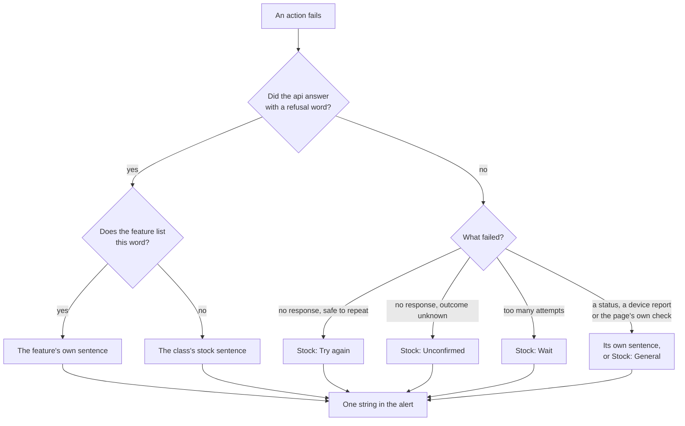
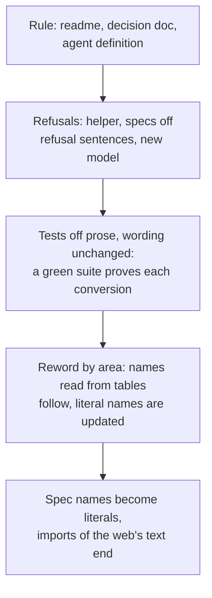

# Web Wording and Stock Refusals - Plan

## Goal Capsule

- **Objective:** A person reading any page of the web reads short, ordinary product sentences, and a session building the next page finds a written rule and existing text that both produce the same.
- **Means:** Rewrite the wording rule first, take prose out of the tests while the wording is unchanged, then reword the web by area (KTD1).
- **Authority:** The Key Decisions below, then `AGENTS.md` and `CODING_STANDARDS.md`, then this plan's units. Linear issue BA-150 opened this work with a narrower scope, and this contract wins where its acceptance criteria differ.
- **Stop conditions:** Stop and report when a conversion can only be made with a test id, when a refusal has no row in Appendix A, when an own sentence cannot keep its fact in two sentences, when the S2b session has started its unit 18 before U10 has merged, or when U4 finds a refusal S2b added that Appendix A does not hold.
- **Execution profile:** Fifteen units across thirteen pull requests, each built in a fresh session from `origin/main`. Phased Delivery names the cut.
- **Who finishes:** `ce-work` implements one pull request's units at a time. `ce-commit-push-pr` opens each pull request, and the merge queue merges it.
- **Open blockers:** None.

---

## Product Contract

### Summary

§3 of `packages/design-system/readme.md` is rewritten around the way Kibo's patterns word things, with Kibo's own strings as its examples, and the readme tells a builder to start from a Kibo pattern.
All of the web's text, about 1,500 strings, is brought into line with it: titles, buttons, confirmations, empty states, done messages and refusals.
Thirteen stock sentences replace 91 of the 168 refusals, and the other 77 keep one short sentence of their own.
No spec or test asserts on a sentence, and specs find controls by role and a name written in the spec.

### Problem Frame

The web's sentences read as rules filled in.
The owner read "You changed workspace in another tab, so nothing was done here. Check which workspace this tab shows before you do it again." on 12/10/2026 and found it odd, as other sentences in the web are.

Three things produce the style.
§3 of the readme states its rules as shapes: "An error says what went wrong, then what to do", "Make the outcome the subject", "Turn stacked conditions into two short sentences".
`apps/web/src/shared/refusal-words.ts` types every refusal as `{ why, next }` and joins the two with a space, so every refusal has a cause slot and an instruction slot and both are always filled.
Each session that builds a page copies the sentences already there.

The tests hold the style in place.
`.claude/skills/browser-suite/SKILL.md` tells a spec to read the web's own word tables and never to write a sentence itself, so 85 spec sites compare a refusal against its table entry and about 220 more read a table in a text assertion.
A reworded sentence breaks no spec, and no spec checks what the page does when the sentence is taken away.

The first copy pass (`docs/archive/specs/T-441.md`, 26/09/2026) rewrote the new-user and sign-in path and measured words a sentence, which fell.
It did not judge how a sentence reads, and its shared refusal template became the `{ why, next }` type.
BA-36's screen review scored the words against §3 and found the house tone held, so a review against the current §3 cannot find the problem.

The route is at S2b.
Every block built from here adds pages, and each one written in the current style is one more to rewrite.

Kibo UI is already a source of this product's components and of the People pages' layout.
Its patterns page holds 1,101 patterns and three error sentences.
The web holds 168 refusal sentences, most of them written by a feature for one refusal.

### Key Decisions

- **The web's wording follows Kibo's patterns as written** (session-settled: user-directed — chosen over Kibo's manner held inside the current §3 rules: conventional product sentences matter more than naming the precise fault). Governs R2, R3, R5.
- **This work covers all of the web's text** (session-settled: user-directed — chosen over rewording refusals only and filing the rest: the route is at S2b, and every later session imitates the text it finds). Governs R13, R14.
- **A refusal shows a stock sentence unless it earns its own** (session-settled: user-approved — chosen over rewording each one, which keeps the surface that produced the style, and over stock sentences only, which drops facts a person signing in needs). Governs R8, R9, R10.
- **Tests check behaviour and never prose** (session-settled: user-directed — chosen over specs that go on comparing a refusal against the web's word tables: language changes, and a test is for what the product does). Governs R15, R16, R18, R20, R21.
- **Non-standard machinery is removed at its source** (session-settled: user-directed — chosen over working to it or around it: machinery that produces this style goes on producing it). Governs R12, R19, R23.
- **A spec writes a control's name itself** (session-settled: user-directed — chosen over reading the name from the web's tables, and over test ids: Playwright's guidance writes the name in the spec, and no ordinary suite imports its app's text). Governs R17, R23.
- **A spec reads which refusal happened from the api's answer** (session-settled: user-approved — chosen over a code word carried on the alert: the suite allows no handle that exists only for a test). Governs R16. Conflict found in planning: four kinds of refusal have no answer in the api's refusal shape, and KTD6 says what a spec does for each.
- **The curly-quote test goes, with the rule it enforces** (session-settled: user-approved — chosen over keeping it as a check on punctuation: it is a hand-written scanner, and a pasted Kibo pattern fails it). Governs R4, R19.

### Actors

- A1. A person using the web: a member of a workspace, reading a page to act on it.
- A2. The owner: judges how a sentence reads, and rules where this contract leaves a call open.
- A3. A session building a page: reads the readme and copies the text already in the tree.

### Requirements

**The rule in the design-system readme**

- R1. §3 of `packages/design-system/readme.md` says what a sentence on a page is for and teaches by example, with no rule stated as a shape to fill.
- R2. §3's examples are Kibo's own strings where one fits the product, and sentences written in the same manner where Kibo has none.
- R3. §3 adopts Kibo's conventions as written: its casing for each kind of text, "Please" on an instruction, "successfully" on a done message, and a general error where no specific one is written.
- R4. §3 keeps the glossary's word for each thing, the closed set of trust words, British spelling, and UK dates and numbers, and leaves out Kibo's emoji and joke messages.
- R5. §6's "UI kit" rule says the web's wording follows Kibo's patterns, and that the trust words and the glossary's words stay the platform's own.
- R6. The readme tells a builder to start a page, a dialog or an empty state from a Kibo pattern where one fits, and says how to find one.
- R7. Every live doc that states a replaced rule agrees with the readme when this work lands, the ADR 0033 decision doc included.

**Refusals**

- R8. A refusal shows the stock sentence for its kind unless R9 gives it its own.
- R9. A refusal has its own sentence only when the reader can act and the stock sentence would not tell them how, or when it would leave them unaware of something the page did for them.
- R10. The stock set covers each refusal class, a call with no response, a wait after too many attempts, a failed copy and a general error, and stays near a dozen sentences.
- R11. A refusal is one sentence, with a second only where the reader has something to do.
- R12. No refusal is typed or stored as a cause part and an instruction part, and the `{ why, next }` type in `apps/web/src/shared/refusal-words.ts` is gone.

**The rest of the web's text**

- R13. Every string the web shows follows the rewritten §3: titles, buttons, confirmations, empty states, done messages and field messages.
- R14. The screens the first copy pass left are included: the sources dialogs, the review actions, the console and People's populated tabs.
- R22. A consequence line or a done message keeps a fact the reader needs and nothing else on the page shows.

**Tests**

- R15. No spec or test asserts on a sentence the web shows.
- R16. A spec tells which refusal happened from the api's answer where the api answered, and otherwise checks that the page shows an alert, and the page gains no marker that exists only for a test.
- R17. Specs find controls by role and accessible name, written as a literal in the spec, and a changed label updates its specs in the same change.
- R18. The six `*-words.test.ts` files under `apps/web/test/` keep each check of behaviour, such as a rounded wait, a count or a fact that must not be revealed, and lose each assertion on phrasing.
- R19. `apps/web/test/typographic-words.test.ts` and the rule it enforces are removed.
- R20. No new check reads the web's text, and review holds wording against §3.
- R21. A test may assert on seeded data, a closed-set word, a number, and the accessible name of a control, heading, region or dialog.
- R23. No browser spec or journey imports the web's text.

### Acceptance Examples

The work changes wording and tests and adds no multi-step path, so this contract has no Key Flows.

- AE1. **Covers R8, R9.** **Given** a Viewer on a page with an action only an Admin may take, **when** the api refuses it for their role, **then** the page shows the stock permission sentence, which names no Admin, because the Viewer cannot act on it themselves.
- AE2. **Covers R9.** **Given** a tab left open on a workspace the person has since switched away from, **when** they act in it, **then** the tab moves to the new workspace's home and shows its own sentence saying they switched workspace in another tab.
- AE3. **Covers R9, R11.** **Given** a sign-in code entered wrongly with two tries left, **when** the page refuses it, **then** the sentence says how many tries are left.
- AE4. **Covers R9.** **Given** a workspace with one Admin, **when** that Admin tries to change their own role, **then** the sentence tells them to make someone else an Admin first.
- AE5. **Covers R11.** **Given** a refusal that leaves the reader nothing to do, **when** the page shows it, **then** it is one sentence.
- AE6. **Covers R3, R13.** **Given** a dialog whose title is in sentence case and an empty state whose title is in sentence case, **when** this work lands, **then** the dialog's title is in Title Case and the empty state's title keeps its case.
- AE7. **Covers R15, R16.** **Given** this work has landed, **when** a later change rewords a refusal's sentence and nothing else, **then** no spec and no test fails or needs an edit.
- AE8. **Covers R17.** **Given** a button's label is reworded, **when** the change is made, **then** the specs that find that button by its label change with it and no other spec does.
- AE9. **Covers R18, R21.** **Given** a ceiling that lifts in 61 seconds, **when** the wait is shown, **then** a test still fails if the page says one minute, and passes whatever words stand around the number.
- AE10. **Covers R22.** **Given** an Admin about to remove a member, **when** the confirmation opens, **then** it still says the member loses access on every session and assistant they hold, in the text that describes the confirm control.

### Success Criteria

- The owner reads the sign-in path and the four screens R14 names, and finds no sentence odd.
- A session that builds a new page from the readme alone, with no sentence handed to it, writes text the owner would not send back.

### Scope Boundaries

- The audit log's lines keep today's wording. Kibo has no pattern for a log line, and each one already reads as who did what to whom.
- No layout changes. A refusal's instruction stays text and does not become a button.
- The trust words are untouched. A glossary head word keeps its wording and takes the casing of the kind of text it stands in, so the *Audit log* page's tab reads "Audit Log".
- Word tables are not moved or dissolved. No rule requires one, and text stays where it is.
- Text that the registries' own components carry in `apps/web/src/shared/ui/`, such as "Close" and "Next", stays as vendored.
- Prose in docs, plans and code comments is outside this work.
- `docs/archive/` is frozen, so T-441's "tests read the words; they don't copy them" stays as written there.

Considered and not built:

- A test that guards which refusals keep their own sentence. The owner ruled it out on 13/10/2026: the build does not need it. A refusal that falls back to stock by mistake fails nothing, and a report of one would change the call.
- A stock sentence that names what failed. A screen-reader user hears the stock sentence alone, as in any product built on these patterns. A finding from an accessibility review would change the call.
- Holding releases until the last pull request merges. Production shows mixed wording between the first merge and the last, and the owner accepted that on 13/10/2026.

#### Deferred to Follow-Up Work

- The emails the api sends, the sentences an assistant reads through MCP, and the consent page the api serves keep today's words. One new Linear issue carries the three, with `apps/web/e2e/consent.spec.ts`'s sentence assertions.
- The gates on code prose are the same kind of machinery: the ten-word test-title cap, the 25-word comment cap and the `string-cites-nothing` lint rule. A new Linear issue offers them to the owner to open or drop.
- `refusal.fields` is sent by the api and read nowhere in `apps/web/src`, so a form with several fields cannot say which one is wrong.

### Dependencies / Assumptions

- `packages/design-system/readme.md` and `.claude/skills/browser-suite/SKILL.md` are tracked skills, so their edits go through `ce-skill-work`.
- A change that moves a decision edits its doc in the same commit, so R5 carries an edit to `docs/solutions/architecture-patterns/adr-0033-ui-kit-is-tailwind-v4.md`.
- The S2b session (`docs/plans/2026-10-11-2309-feat-s2b-ask-plan.md`) reads this plan and its status before it starts its unit 18, the first that touches the web's pages and specs. Its unit 11 comes sooner and adds one refusal sentence, for the spending limit, to `apps/web/src/features/knowledge/refusal-words.ts`.
- A `kibo-ui` MCP server is entered in `.mcp.json` and was uncommitted in the main checkout on 13/10/2026. It has not been tried.
- Kibo's strings and its casing per kind were extracted from the page source of `https://www.kibo-ui.com/patterns` on 13/10/2026. Appendix B holds what was read.
- The count of 168 refusals and the 91 to 77 split are exact against Appendix A. The counts of test sites are estimates from pattern searches.

### Sources / Research

- Linear BA-150, with its notes on T-441, BA-36, BA-50 and BA-80.
- `packages/design-system/readme.md` §3 "Content fundamentals" and §6 "UI kit": the rules R1 to R6 replace. §6 says the platform owns "every word on a page".
- `docs/solutions/architecture-patterns/adr-0033-ui-kit-is-tailwind-v4.md`: "The platform owns meaning: the trust words, the citation unit, the register, the glossary's vocabulary and every sentence a reader sees."
- `docs/solutions/architecture-patterns/adr-0043-what-an-act-is.md`: a refusal crosses tRPC as `{ word, class }`, the catalogue is append-only, and a ceiling carries no word.
- `docs/solutions/best-practices/what-a-rename-prose-pass-gets-wrong-and-the-checks-that-catch-it.md`: what a tree-wide text pass breaks, and the checks that catch it.
- `docs/solutions/logic-errors/a-stale-tab-acted-in-the-workspace-the-session-had-moved-to.md`: the `workspace-switched` word drives the page, and its sentence does not.
- `apps/web/src/shared/refusal-words.ts`, `refusal-outcome.tsx` and `outcome.tsx`: the `{ why, next }` type, the class sentences, `saidOfRefusal`, `sentenceOf` and the alert that shows them.
- `apps/web/e2e/refused-read.ts` and `apps/web/e2e/switched-elsewhere.spec.ts`: a spec already waits on a response and rewrites one answer inside a batch.
- `apps/web/e2e/locators.ts`: `saysItsSentenceNotItsWord`, the helper behind 14 of the 85 refusal assertions.
- `.claude/skills/browser-suite/SKILL.md` "Writing a spec": "Read the SPA's own constants, words as well as pages, rather than copying them" and "Never pin prose as a literal".
- `apps/web/src/shared/ui/THIRD_PARTY_NOTICES.md`: how a registry component and a Kibo pattern arrive, and the notice each carries.
- `docs/plans/2026-10-12-1202-chore-remove-vocabulary-gate-plan.md`: the words test is gone (commit `6807a5e8`), and vocabulary is held by review.
- `docs/archive/specs/T-441.md` and `docs/archive/specs/T-441-closing-measure.md`: the first pass, its out-of-scope list and what it measured.
- Playwright's best-practices and locators docs: role and accessible name come first, the name is written in the test, and a test id is "not user facing".

---

## Planning Contract

Product Contract preservation: changed. Summary, R3, R4, R10, R16, R17, R19 and Scope Boundaries were rewritten, and R21, R22 and R23 were added. Research found 168 refusals where the brainstorm assumed about 100, and prose in about 500 test sites beyond the six word files. The owner ruled on 13/10/2026 to remove non-standard machinery at its source, and confirmed each change before this plan was written.

### Key Technical Decisions

- KTD1. **The order is rule, then tests, then words.** The readme lands first so no new page is written to the old rule. Tests come off prose while the wording is unchanged, so a green suite proves each conversion. The reword follows by area, and spec names become literals last, written once with their final labels.
- KTD2. **A refusal resolves to one string.** A word the feature lists gets that feature's sentence, any other word gets its class's stock sentence, and a path with no word names a stock key or its own sentence where it is raised. There is no second, shorter form. This was not put to a bake-off: the choice is a judgement between two shapes already in view, and it is cheap to reverse.
- KTD3. **The stock set is thirteen sentences, in Appendix A.** Seven answer the refusal classes. The others answer a call with no response that is safe to repeat, a call whose outcome is unknown, a read with no response, a wait after too many attempts, a failed copy and a general error. The wait sentence names nobody, because the ceiling is not always the reader's own, and review holds that under R20 in place of the test that checks it today.
- KTD4. **A refused item keeps its own short reason.** A set refused whole shows one line per item, and a stock sentence on every line would not say whom to untick. The row's cell shows the Refused pill alone.
- KTD5. **The ended-session line shows the stock sentence with its button.** Kibo's own error alert pairs "Please try again" with a Retry button, so the repeat is in pattern, and no cause-only form is kept. `apps/web/test/sign-in-again.test.tsx` holds today that the alert does not repeat the button's label, and that behaviour is removed on purpose.
- KTD6. **One helper reads the api's answer, by shape** (session-settled: user-approved — chosen over a code word carried on the alert: the suite allows no handle that exists only for a test). Governs R16. A tRPC answer gives the refusal's word, found by the procedure's place in a batch or in a single answer. A Better Auth answer gives its status and library code. A ceiling's answer carries no word, so the helper gives its 429 status and the seconds it sends, and the spec matches the wait's number in the alert. A dropped request, a refusal the page raises itself and the count of tries left have no answer, so the spec checks the alert, and reads the number from the page for tries left. The stream link S2b adds for `ask` is outside the helper.
- KTD7. **Each kind of text assertion has a named replacement**, in the table under High-Level Technical Design. A site that fits no row stops the unit and is reported.
- KTD8. **An aria snapshot keeps roles, names, levels, states and order.** Its prose lines of any kind go, `- text:` lines included, and its names are written as literals.
- KTD9. **Casing follows Kibo per kind of text, in Appendix B.** A page's heading takes Title Case by this plan's extension, because Kibo's patterns hold no page heading. Each string is recased by hand. A transform or a casing function would recase a person's name, a workspace's name or an address inside a label.
- KTD10. **A button's label is short.** The thing's name moves to the confirmation's own name, which is a dialog's title or an inline group's legend, and the consequence moves to the text that describes the control (R22). No inline confirmation becomes a dialog. Where a list repeats one action on every row, the control keeps an accessible name that carries the row's name.
- KTD11. **Exports that only a spec read are deleted.** `knip` fails on them once the imports go, and no rule keeps a word table for a spec's sake. The suite's own `quoted()` helper goes the same way once no snapshot interpolates a table.
- KTD12. **Reworded text uses whichever apostrophe its source uses.** Nothing polices the mark once U1 deletes the test, and existing curly marks are not swept.
- KTD13. **A reword unit lists its changed labels, old and new, and updates each literal that names one.** A Playwright name matches as a case-insensitive substring, so a stale literal can pass or find a different control. A name that sits inside another takes `exact: true`.
- KTD14. **Production may show mixed wording during the rollout** (session-settled: user-approved — chosen over holding releases until the last merge: a hold would also hold S2b's releases).
- KTD15. **A Kibo pattern arrives as it does today.** It is copied by hand into `apps/web/src/shared/ui/kibo-ui/` with a row in `THIRD_PARTY_NOTICES.md`, because a pattern is a demonstration file and no registry item. U1 tries the `kibo-ui` MCP server as the way to find one.

### High-Level Technical Design

How a refusal becomes text after this work:

The order of the work, and why each step can be checked:

What a test asserts in place of text (KTD7):

| Today's assertion | What it protects | Replacement |
|---|---|---|
| A refusal's sentence | The page showed the refusal for this cause | The api's answer through the helper, and an alert on the page (KTD6) |
| A done message | The action landed | The outcome's own status holds text, and the state or the data changed |
| A done message for part success | Part of the action failed | The alert holds text, the outcome's status is empty, and the state that stands |
| A count inside a sentence | A number shown nowhere else | The number, matched by pattern inside its region |
| A text fragment as a landed signal | The 100 ms action budget | The same signal by a number, through `clockTheNextKey` as it is |
| A heading's text | Which page the reader is on | Role, level and name, as a literal |
| A consequence line | The button is described | The control has an accessible description, and where the line names the seeded person the description holds that name |
| An aria snapshot | Order, levels, names, states | The same snapshot without prose lines (KTD8) |
| An absence check | A fact not revealed | The same check, on seeded data or a closed-set word |
| An audit sentence | Who acted on whom | The actor and the subject, matched in order |

The outcome's status stays in the tree while it is empty, and a list's region holds further statuses for its count and its selection. A spec scopes to the outcome's own status and checks it for text, as `apps/web/e2e/outcome-regions.spec.ts` does with `filter({ hasText: /\S/ })`. Where a scenario below says a status region shows, it means this.

### System-Wide Impact

- **Every web page changes.** The reword touches about 1,500 strings and Title Case reaches the navigation, tabs, table headers and form labels.
- **The browser suite changes shape.** It loses its imports of the web's source, so the typecheck no longer fails a spec when a label is renamed. The spec fails at run time instead, which is the ordinary arrangement.
- **Accessible names change.** Buttons get shorter names, and KTD10 keeps the names that tell one row's action from the next. The accessibility gate reads no sentence, so it reacts only to a missing name or a contrast change.
- **Two tracked skills and one agent definition change**, so every later session reads different rules for text and for specs.
- **The api, the worker, `contracts/` and the stored refusal words are untouched.** A refusal's word and class cross the wire as they do today.

### Risks & Dependencies

| Risk | What limits it |
|---|---|
| A conversion drops a behaviour only a sentence proved | KTD7's table names the replacement per kind, and U6 to U9 run against unchanged wording |
| A stale literal passes or finds another control after a reword | KTD13's label list and `exact: true` |
| `knip` fails on exports only a spec read | KTD11, in the unit that removes the import |
| `jscpd` at threshold 0 fails when two tables hold the same stock lines | The stock set lives in one module, and a feature lists only its own sentences |
| The docs lane fails when the browser-suite skill names a file that is gone | U2 and U14 edit the skill in the change that moves the file |
| The curly-quote test refuses the stock set's straight apostrophes | U1 deletes the test with the rule it enforces, before any sentence lands |
| An audit action's name shown as a filter option sits beside recased menu items | U11 gives it the option's casing, and the log's lines stay as they are |
| Two `sentenceOf` functions share a name | The audit one in `apps/web/src/shared/audit/` stays, and only the refusal one is deleted |
| A stock sentence shown twice in a row changes no text, so nothing is announced | U4 checks whether an alert is cleared when an action starts, and clears it if not |
| S2b lands a spec that imports `sentenceOf` after U5 deletes it | S2b reviews this plan before its unit 18, and whichever lands second fails the typecheck visibly |
| S2b's unit 11 adds a spending-limit refusal in the shape `main` holds on the day | Landed before U4, it gets a verdict by R9 and a row in Appendix A in U4. Landed after U5, it is written as one string |
| A wrong name in a journey first fails against production, after the release | Each journey name is copied from the spec that finds the same control, which the browser suite proves |
| The comment-density gate reacts as table entries shrink | Doc comments that restate the old rule are deleted with the entries they sat on |
| A reworded test title passes ten words | Each title is checked against the cap as it is written |

### Alternative Approaches Considered

- **Reword first, convert the tests after.** Every reword would then edit a sentence that a spec still pins, and a wrong conversion and a wrong reword would look alike. Rejected for the control KTD1 gives.
- **One pull request.** It would touch about 60 source files, 37 spec files and 50 test files at once, and no review could read it. Rejected for the cut in Phased Delivery.
- **Keep reading control names from the web's tables.** The typecheck would go on catching a renamed label. Rejected by the owner's ruling to remove non-standard machinery at its source.
- **Move every string out of its word table into the page.** It would be the ordinary arrangement, and it is about 950 strings of churn with no change a reader sees. Rejected: no rule requires a table after this work, so new text can sit where it is shown.

### Phased Delivery

| Phase | Units | Pull requests | Linear |
|---|---|---|---|
| 1. The rule, and the curly-quote test | U1 | One | BA-150 |
| 2. Refusals | U2, U3, then U4, U5 | Two | BA-150 |
| 3. Tests off prose | U6, U7, U8, U15, U9 | Five | A new issue |
| 4. Reword | U10, U11, U12, U13 | Four | A new issue |
| 5. Literal names | U14 | One | A new issue |

Each pull request's body carries `Merge risk: reversible`: no migration, nothing stored and nothing under `contracts/`.
BA-150's acceptance criteria in Linear are edited to match this contract when phase 1 opens.

### Documentation / Operational Notes

- `CONCEPTS.md`'s *refusal* entry says "a person reads its sentence". U4 edits it to say the sentence is the refusal's own or its class's stock sentence.
- The readme edit and the browser-suite skill edit each end with the `ce-skill-work` completion report: the goal each touched block now states, what was removed and its provenance, and the validation run.
- The two follow-up Linear issues under Deferred to Follow-Up Work are filed when phase 1 opens.

---

## Implementation Units

| Unit | Title | Primary files | Depends on |
|---|---|---|---|
| U1 | Rewrite the wording rule | `packages/design-system/readme.md`, the ADR 0033 doc, `.claude/agents/ui-designer.md`, `apps/web/test/typographic-words.test.ts` | none |
| U2 | Read the api's answer in a spec | `apps/web/e2e/refused-read.ts`, `.claude/skills/browser-suite/SKILL.md` | U1 |
| U3 | Specs off refusal sentences | `apps/web/e2e/*.spec.ts`, `apps/web/e2e/locators.ts`, `apps/web/journeys/every-role.ts` | U2 |
| U4 | The refusal model and the stock set | `apps/web/src/shared/refusal-words.ts`, the people, sources, console and knowledge refusal files | U3 |
| U5 | Auth refusals, and delete the old type | `apps/web/src/features/auth/` | U4 |
| U6 | People specs off prose | `apps/web/e2e/people*.spec.ts`, `apps/web/e2e/audit-log.spec.ts` | U5 |
| U7 | Auth specs off prose | the sign-in, second-factor, passkey and invitation specs | U5 |
| U8 | Sources and knowledge specs off prose | the sources, knowledge and concept specs | U5 |
| U9 | Unit tests off prose | `apps/web/test/` | U5 |
| U10 | Reword the shell and shared text | `apps/web/src/shared/`, `apps/web/src/app/` | U6, U7, U8, U9, U15 |
| U11 | Reword People and the console | `apps/web/src/features/people/`, `apps/web/src/features/console/` | U10 |
| U12 | Reword auth | `apps/web/src/features/auth/` | U10 |
| U13 | Reword sources, knowledge and model choices | `apps/web/src/features/sources/`, `knowledge/`, `model-choices/` | U10 |
| U14 | Spec names become literals | `apps/web/e2e/`, `apps/web/journeys/`, `.claude/skills/browser-suite/SKILL.md` | U11, U12, U13 |
| U15 | Console and shell specs off prose | the console, frame and shell specs, and the journeys | U5 |

### U1. Rewrite the wording rule

**Goal:** A session that reads the readme writes text in Kibo's manner and starts a page from a Kibo pattern.

**Requirements:** R1, R2, R3, R4, R5, R6, R7, R19.

**Dependencies:** none.

**Files:**
- `packages/design-system/readme.md`
- `apps/web/test/typographic-words.test.ts`, `packages/devtools/package.json`
- `docs/solutions/architecture-patterns/adr-0033-ui-kit-is-tailwind-v4.md`
- `.claude/agents/ui-designer.md`
- `apps/web/CODING_STANDARDS.md`

**Approach:**
1. Invoke `ce-skill-work` in its mode for changing an existing skill, and follow its provenance step before removing a line from §3.
2. Rewrite §3's *Tone*, *Casing*, *Consequence before the click*, *Symbols* and *Clarity* blocks. The new text says what a sentence on a page is for, then shows it with Appendix B's strings, grouped by kind of text. It states no rule as a shape.
3. Put Appendix B's casing table into §3 as the casing rule, with the proper nouns the present rule lists.
4. Put the stock set from Appendix A into §3 as the examples of a refusal, with three of the own sentences beside them.
5. Rewrite §6's "UI kit" rule per R5, and add the instruction R6 asks for: where a pattern is found, that it is copied by hand, and the notice row it carries (KTD15).
6. Try the `kibo-ui` MCP server if this session has its tools. Name it in the readme as the way to find a pattern only if it returns a pattern's source for a search. A session built from `origin/main` has the server only once its `.mcp.json` entry is on `main`, so without the tools the readme names the patterns page alone.
7. Amend the ADR 0033 doc's "platform owns meaning" line in the same commit, and say so in the pull request.
8. Edit `.claude/agents/ui-designer.md` where it says a refusal is shown "with what the person can do next" and where it asks each spec for an aria snapshot, so both agree with R11 and KTD8.
9. Leave `apps/web/CODING_STANDARDS.md` as it is if its pointer to the readme still holds, and edit it only where it names casing or symbols.
10. Delete `apps/web/test/typographic-words.test.ts` in this pull request, with §3's rule on apostrophes and quotes. `apps/web/test/source-files.ts` stays, because two other tests read it. Drop the `./parsed-source` subpath from `packages/devtools/package.json` if `knip` reports it unused.

**Patterns to follow:** `docs/solutions/skill-design/portable-agent-skill-authoring.md` for the readme's form. It states conditions and not cases, so §3 gets examples and no list of banned phrases.

**Test scenarios:** Test expectation: none -- the unit changes docs and deletes one test, and `packages/design-system` has nothing executable. `ce-skill-work` asks for a targeted evaluation of behaviour-bearing prose, and Verification states it.

**Verification:**
- A fresh subagent given the readme alone writes the text for a role refusal, a wrong-code refusal, a remove-member dialog and an empty list. None uses the cause-then-instruction form, the dialog's title and buttons are in Title Case, and the owner reads the four.
- A search of the tracked, live docs for "Sentence case everywhere", "every word on a page" and "every sentence a reader sees" finds nothing.
- `pnpm run check:docs`, `pnpm run check:web:test` and `pnpm run check:gates` pass.

### U2. Read the api's answer in a spec

**Goal:** A spec can learn which refusal the api answered with, in each shape the web receives, and the suite's skill states the new rules.

**Requirements:** R16, R21. KTD6, KTD8.

**Dependencies:** U1.

**Files:**
- `apps/web/e2e/refused-read.ts`
- `apps/web/e2e/locators.ts`
- `.claude/skills/browser-suite/SKILL.md`
- `apps/web/test/browser-suite-skill.test.ts`
- Tests: one existing spec per shape, changed in place: `apps/web/e2e/people.spec.ts`, `apps/web/e2e/sources.spec.ts`, `apps/web/e2e/sign-in.spec.ts`, `apps/web/e2e/knowledge-search.spec.ts`

**Approach:**
1. Add a helper beside `refusedFromNowOn` that waits for the answer to one named procedure and returns its refusal word and class. It reads the entry at that procedure's place in a batch, through one parse of the path that it shares with `refusedFromNowOn`.
2. Match the procedure as a whole path segment. `answer.url().includes(procedure)` also matches a procedure whose name starts with another's.
3. Add a second helper for a Better Auth path that returns the status and the library's code.
4. Rewrite the refusal and assertion parts of the browser-suite skill's "Writing a spec" block through `ce-skill-work`: what a test may assert (R21), how a refusal is checked (R16, KTD6) and what an aria snapshot holds (KTD8). The lines on reading a control's name from a table stay until U14, because U3 to U13 still do so.
5. Convert one refusal assertion per shape to prove the helpers: a tRPC refusal inside a batch, an upload's single answer, a Better Auth refusal, and a dropped request that checks the alert alone.

**Patterns to follow:** `apps/web/e2e/switched-elsewhere.spec.ts`'s `answerTo`, and `apps/web/e2e/refused-read.ts`'s batch handling.

**Test scenarios:**
- A Viewer's role change is refused: the helper returns `role-forbids` and class `forbidden`, and the page shows an alert.
- A batch holds one refused procedure beside two that succeeded: the helper returns the refused one's word and ignores the others.
- An upload of a refused file type answers alone, outside a batch: the helper returns `media-type-refused`.
- A wrong sign-in code: the Better Auth helper returns the status the page branches on, and the alert shows.
- A dropped request: no answer arrives, and the spec passes on the alert alone.
- A read that is asked again after a drop: the helper resolves on the first matching answer and does not wait for the retries.

**Verification:** The four converted assertions pass with no import of a refusal table, and `pnpm run check:docs` passes with the rewritten skill.

### U3. Specs off refusal sentences

**Goal:** No spec and no journey compares a refusal's sentence, so the type behind those sentences can go.

**Requirements:** R15, R16, R23.

**Dependencies:** U2.

**Files:**
- The 21 spec files under `apps/web/e2e/` that call `sentenceOf` or `saysItsSentenceNotItsWord`: people, knowledge-search, sign-in, accept-invitation, console-people, people-invitations, confirm-recovery, passkeys, second-factor, sources, workspace-switcher, concept-page, console, ask-to-join, display-name, sign-in-link, audit-log, no-workspace, people-groups, people-requests, switched-elsewhere
- `apps/web/e2e/locators.ts`
- `apps/web/journeys/every-role.ts`

**Approach:**
1. Convert each of the 85 sites by KTD6's shape: the api's word where a tRPC answer exists, the status on a Better Auth path, the alert alone where there is no answer.
2. Keep the second half of `saysItsSentenceNotItsWord`, that the code word is not on the page. It is an absence check on a closed-set word (R21). Rename the helper for what it still does.
3. For `codeWrong(n)`, assert the number of tries left by pattern inside the alert (AE3).
4. For the three sites that build a refusal's sentence into a longer string, assert the seeded name beside the alert.
5. The journey checks that the alert shows. Production has no harness, and the journey may not read a response it did not cause.
6. Remove each import of a refusal table and of `sentenceOf` as its last use goes.

**Execution note:** Run each converted spec against unchanged wording before moving on. A spec that passed on the sentence and fails on the answer has found a wrong mapping, in the spec or in the page.

**Patterns to follow:** The four sites U2 converted.

**Test scenarios:**
- Covers AE1. A Viewer attempts an Admin's action: the answer's word is `role-forbids` and an alert shows.
- Covers AE2. A stale tab acts: the answer's word is `workspace-switched`, the tab lands on the new workspace's home, and the band shows an alert.
- Covers AE3. A wrong code with two tries left: the alert holds the number 2.
- A code refused after the last try: the alert shows, and the control that asks for a new code is present.
- The only Admin changes their own role: the answer's word is `last-admin`.
- A set of members refused whole: the answer carries one word per refused item, and the list shows one line per seeded name.
- A refused read on the knowledge page: the code word is nowhere on the page.

**Verification:** A search of `apps/web/e2e` and `apps/web/journeys` for `sentenceOf` finds only the audit module's, imported as `saidOfAction`, and a search for an import of a `refusal-words` file finds only wire words, such as `NOT_THE_OPERATOR`. The browser suite passes with the web's source unchanged.

### U4. The refusal model and the stock set

**Goal:** A refusal is one string, the stock set exists in one place, and every feature outside auth uses it.

**Requirements:** R8, R9, R10, R11, R12. KTD2, KTD3, KTD4.

**Dependencies:** U3.

**Files:**
- `apps/web/src/shared/refusal-words.ts`, `apps/web/src/shared/refusal-outcome.tsx`, `apps/web/src/shared/outcome.tsx`, `apps/web/src/shared/display-name-words.ts`
- `apps/web/src/features/people/refusal-words.ts`, `refusal.tsx`, `invitation-words.ts`, `self-action.tsx`, `member-columns.tsx`
- `apps/web/src/features/sources/refusal-words.ts`, `refusal.tsx`
- `apps/web/src/features/console/refusal-words.ts`, `words.ts`
- `apps/web/src/features/knowledge/refusal-words.ts`, `refusal.tsx`, `concept-page.tsx`
- `apps/web/src/app/words.ts`, `apps/web/src/app/pages/connect-assistant.tsx`
- `CONCEPTS.md`
- Tests: `apps/web/test/refusal.test.ts`, `refusal-outcome.test.tsx`, `refused-tab.test.tsx`, `sources-actions.test.tsx`, `console-frame.test.tsx`, `connect-assistant.test.tsx`, `invitation-words.test.ts`, `reads-ceiling-words.test.ts`, `member-change.test.tsx`, `self-action.test.tsx`

**Approach:**
1. Add the stock set to the shared module, keyed as Appendix A names it, and a lookup that returns a feature's own sentence for a word or the class's stock sentence (KTD2).
2. Keep the old `{ why, next }` type and `sentenceOf` beside the new lookup for this unit only. Auth still reads them, and U5 deletes them.
3. Rewrite each feature's table to hold only the rows Appendix A marks Own, as strings. Delete every row marked Stock. Check each deleted row's word against its class in `packages/core/src/*/vocabulary.ts`, and report a row whose class gives a different stock key from the one Appendix A names.
4. Replace each ceiling function with the stock Wait sentence, passing the seconds. The sentence has a form with no number for an answer that carries none.
5. Keep each refused item's own reason, and change the row's cell to show the pill alone (KTD4).
6. Check whether the alert in `outcome.tsx` is cleared when an action starts. If it is not, clear it, so the same stock sentence shown twice is announced twice.
7. Keep every wire word a file exports, such as `NOT_THE_OPERATOR`. Only the sentences change.
8. Edit `CONCEPTS.md`'s *refusal* entry per Documentation / Operational Notes.
9. Convert every unit test under `apps/web/test` that asserts a sentence Appendix A changes, by KTD7's table, in the pull request that carries U4 and U5. Find them by searching the tests for each row's Today sentence. The listed files are the known ones, with `confirm-pages.test.tsx`, `member-change.test.tsx` and `self-action.test.tsx` beside them. A test that reads `.why` or `.next` asserts the number or the tone.

**Patterns to follow:** `refusalsOf` in `apps/web/src/shared/refusal-outcome.tsx` for the order of lookup: the word, then the class, then no response.

**Test scenarios:**
- A word the feature lists returns that feature's string.
- A word the feature does not list returns its class's stock string.
- A word the web has never met, from a newer api, returns its class's stock string.
- A failure with no word and no response returns the Try again string for an action and the Not loaded string for a read.
- Covers AE9. A ceiling of 61 seconds returns a string holding "2", and a ceiling with no seconds returns the form with no number.
- A set refused for two different item words returns two different reasons, one per item.
- An item whose word the feature does not list takes the whole set's string.
- The outcome for a refusal has the refused tone, and the outcome for a done action has the said tone.

**Verification:** No file outside `apps/web/src/features/auth/` reads `.why`, `.next` or `sentenceOf` for a refusal. Each row of Appendix A outside auth is either deleted from its table or holds the Becomes sentence. `pnpm run check:web:unit` and the browser suite pass for the pull request that carries U4 and U5 together, because auth reads the shared types until U5.

### U5. Auth refusals, and delete the old type

**Goal:** The auth pages use the same model, and the `{ why, next }` type no longer exists.

**Requirements:** R8, R9, R11, R12. KTD2, KTD5.

**Dependencies:** U4.

**Files:**
- `apps/web/src/features/auth/refusal-words.ts`, `second-factor-words.ts`, `link-words.ts`, `switched-elsewhere.ts`, `unsaved-change.ts`
- `apps/web/src/features/auth/auth-page.tsx`, `sign-in-page.tsx`, `link-page.tsx`, `accept-invitation-page.tsx`, `ask-to-join.tsx`, `display-name-page.tsx`, `no-workspace-page.tsx`, `account-page.tsx`, `account-sections.tsx`
- `apps/web/src/features/auth/authenticator-part.tsx`, `passkeys-part.tsx`, `passkey-sign-in.tsx`, `recovery-codes.tsx`, `second-factor-pages.tsx`, `second-factor-parts.tsx`
- `apps/web/src/features/console/sign-in-again.tsx`
- `apps/web/src/shared/refusal-words.ts`
- Tests: `apps/web/test/recovery-codes.test.tsx`, `sign-in-again.test.tsx`, `asked-too-often.test.ts`, `confirm-pages.test.tsx`, and any other test step 9 of U4 finds for an auth row

**Approach:**
1. Apply Appendix A's auth rows. A page that picks a sentence from a status, a library code or a device's report now picks a stock key or an own string at the same branch.
2. Sort the no-response rows as Appendix A does. The ones whose outcome is unknown take Unconfirmed, so nobody is told to repeat a spent code, make a second set of recovery codes or add a second passkey.
3. Show the stock Session sentence above the Sign In Again button on the ended-session line, and remove the test that held the two apart (KTD5).
4. Split `SIGN_IN_AGAIN` into the button's label and the sentence. It is one constant used as both today.
5. Keep `UNSAVED_AFTER_CONFIRMING` as a plain string with the said tone. It is not a refusal.
6. Delete `Said`, `SaidOfWord`, `sentenceOf` and `saidOfRefusal` from the shared module once nothing reads them.

**Patterns to follow:** The model U4 put in the shared module.

**Test scenarios:**
- Covers AE3. Two tries left returns a string holding "2", and one try left holds "1".
- No tries left returns the expired-code string and not the wrong-code string.
- A setup's finish with no response returns the Unconfirmed string.
- A passkey add that the device cancels returns no string at all, as today.
- A status the page has no branch for returns the General string.
- Covers AE2. The `workspace-switched` word returns its own string, and the listener still follows the session.
- The ended-session line shows an alert and a control named "Sign In Again".

**Verification:** A search of `apps/web` for `sentenceOf`, `saidOfRefusal`, `why:` and `next:` finds only the audit module's own `sentenceOf` and pagination. Each auth row of Appendix A is deleted or holds its Becomes sentence. `pnpm run check:web` passes.

### U6. People specs off prose

**Goal:** The People and audit-log specs assert behaviour and hold no sentence.

**Requirements:** R15, R21. KTD7, KTD8.

**Dependencies:** U5.

**Files:** `apps/web/e2e/people.spec.ts`, `people-invitations.spec.ts`, `people-groups.spec.ts`, `people-requests.spec.ts`, `audit-log.spec.ts`

**Approach:**
1. Replace each `toHaveText` and `toContainText` on the web's prose with its row in KTD7's table. Leave each one on seeded data, a role, a state or a trust word.
2. Trim each aria snapshot per KTD8. The snapshot at the removal card keeps its button and loses its two paragraph lines.
3. Convert each `clockTheNextKey(` site that passes a phrase as its landed signal to pass a number. The helper resolves on a text fragment, so a number goes through it as it is. A search for matchers does not find these sites.
4. Re-anchor each absence check that names a sentence on seeded data or a closed-set word. A literal absence check on a sentence passes for ever once the sentence changes.
5. Keep reading control names from the web's tables in this unit. U14 turns them into literals.

**Execution note:** Convert one spec file, run it, and compare what it proved before and after, before starting the next.

**Patterns to follow:** KTD7's table, and the sites U3 converted in the same files.

**Test scenarios:**
- A role change lands: a status region shows, and the member's row holds the new role.
- The removal card: the confirm control has an accessible description, and the confirmation group's name holds the seeded member's name.
- An invitation whose email did not go: the outcome is an alert, and the invitation stands in the list.
- Three members match a search: the count region holds 3.
- A bulk action over two ticked members lands within the action budget, signalled by the count and not by a phrase.
- The audit log after a role change: the newest line holds the actor's name before the subject's.
- Another workspace's member is nowhere on the page.

**Verification:** A search of the five files for a sentence inside `toHaveText`, `toContainText` or `getByText` finds only seeded data, closed-set words and number patterns. The five specs pass against unchanged wording.

### U7. Auth specs off prose

**Goal:** The sign-in, second-factor, passkey and invitation specs assert behaviour and hold no sentence.

**Requirements:** R15, R21. KTD7, KTD8.

**Dependencies:** U5.

**Files:** `apps/web/e2e/sign-in.spec.ts`, `sign-in-link.spec.ts`, `sign-out.spec.ts`, `second-factor.spec.ts`, `passkeys.spec.ts`, `confirm-recovery.spec.ts`, `accept-invitation.spec.ts`, `ask-to-join.spec.ts`, `display-name.spec.ts`, `no-workspace.spec.ts`, `workspace-switcher.spec.ts`, `switched-elsewhere.spec.ts`, `pending-gate.spec.ts`

**Approach:** As U6, steps 1 to 5. `apps/web/e2e/consent.spec.ts` is left as it is: its sentences belong to the page the api serves, which is deferred.

**Execution note:** As U6. `sign-in.spec.ts`'s expired-code case has been flaky across parallel workers, so run the converted files in parallel before the pull request.

**Patterns to follow:** KTD7's table.

**Test scenarios:**
- A sign-in email is sent: the page moves to the code step, and the code field has focus.
- A code is resent: a status region shows, and the code field is empty and has focus.
- A field refuses a blank display name: the field is invalid and has a description.
- An authenticator is set up: the account page lists it, and the recovery codes' region holds its codes.
- A recovery code is spent: the count of codes left falls by one.
- A workspace is picked: the band's switcher names the seeded workspace.

**Verification:** As U6, over these files.

### U8. Sources and knowledge specs off prose

**Goal:** The sources and knowledge specs assert behaviour and hold no sentence.

**Requirements:** R15, R21. KTD7, KTD8.

**Dependencies:** U5.

**Files:** `apps/web/e2e/sources.spec.ts`, `knowledge-search.spec.ts`, `concept-page.spec.ts`, `concept-body-links.spec.ts`, `models-and-spend.spec.ts`

**Approach:** As U6, steps 1 to 5. The trust words stay literal: they are a closed set (R21).

**Patterns to follow:** KTD7's table.

**Test scenarios:**
- A document is connected: its row appears with its seeded title and its state word.
- A sync that left four documents unreadable: the region holds 4.
- A search with no match: the empty state's region shows, and no result row does.
- A withheld concept's address: the not-found page shows, and the concept's seeded title is nowhere on it.
- Another workspace's model names are nowhere on the page.

**Verification:** As U6, over these files.

### U9. Unit tests off prose

**Goal:** The unit tests under `apps/web/test/` check what a function or a component does and hold no sentence.

**Requirements:** R15, R18, R21.

**Dependencies:** U5.

**Files:**
- `apps/web/test/console-list-words.test.ts`, `invitation-words.test.ts`, `member-action-words.test.ts`, `model-choices-words.test.ts`, `reads-ceiling-words.test.ts`, `sources-words.test.ts`
- `apps/web/test/audit-sentences.test.ts`, `failed-page.test.tsx`, and the rendering tests that still assert a literal sentence after U4 and U5

**Approach:**
1. In the six word files, keep the behaviour under each test and assert it by value: the number in a count, the plural's form by pattern, the rounded wait, the article before a role, the state a line maps to.
2. Delete a test whose only subject is phrasing, such as one that pins a glossary's name or bans a retired word. Review holds wording (R20).
3. In `audit-sentences.test.ts`, keep the check that every declared action has a sentence, and assert each sentence by the actor and subject it holds, in order.
4. In the rendering tests, find a control by role and name, and replace an assertion on a sentence with the state it reported.
5. Check each rewritten test title against the ten-word cap.

**Patterns to follow:** `apps/web/test/ceiling-wait.test.ts` and `passkey-name.test.ts`, which assert values and no wording.

**Test scenarios:**
- Covers AE9. A wait of 61 seconds yields a string holding "2", and 60 seconds yields "1".
- A count of one yields the singular form and a count of two the plural, matched by the noun's ending.
- An invitation outcome where an email did not go has the refused tone.
- A role that begins with a vowel takes "an".
- A sync state the web has not met is shown as itself.
- Every audit action the api declares has a sentence.
- A role change's audit sentence holds the actor's name before the subject's.

**Verification:** A search of `apps/web/test` for `toBe("` and `toEqual("` with a sentence finds none. `pnpm run check:web:unit` and `pnpm run check:gates` pass.

### U10. Reword the shell and shared text

**Goal:** The text every page shares is in Kibo's manner and casing.

**Requirements:** R3, R13, R22. KTD9, KTD10, KTD12, KTD13.

**Dependencies:** U6, U7, U8, U9, U15.

**Files:**
- `apps/web/src/shared/navigation.ts`, `role-words.ts`, `words.ts`, `keystroke-words.ts`
- `apps/web/src/shared/action-dialog.tsx`, `list-pages.tsx`, `filter-row.tsx`, `selection-bar.tsx`, `row-menu.tsx`, `grid-table.tsx`
- `apps/web/src/app/words.ts` and the `.tsx` files under `apps/web/src/app/`
- Tests: the specs and unit tests that hold one of these labels as a literal

**Approach:**
1. Reword each string to the rewritten §3, and recase it by Appendix B's row for its kind (KTD9).
2. Leave the trust words and a person's own data as they are. A glossary head word keeps its wording and takes Title Case only where its kind of text does.
3. Write the unit's list of changed labels, old and new, into the pull request (KTD13).
4. Update each literal in a spec or a unit test that names a changed label. Names still read from a table follow without an edit.
5. After the suite passes, search the specs for each old label once more, and for a new name that sits inside another.

**Execution note:** A small model or a codemod may draft the recasing from the list of strings. Every string is then read by the implementer against Appendix B, because a transform cannot tell a name inside a label from the label's own words.

**Patterns to follow:** Appendix B, and §3 as U1 left it.

**Test scenarios:**
- Covers AE6. The navigation's page names are in Title Case, and each still leads to its page.
- The shared dialog's cancel control is found by its new name in every spec that opens a dialog.
- An empty list's title is in sentence case with no full stop, and its action is in Title Case.
- A row's action menu is still named for its row.
- The accessibility gate passes on every page the shell frames.

**Verification:** The browser suite and `pnpm run check:web:unit` pass. No spec literal differs from a rendered label only by case. The owner reads the shell on one page.

### U11. Reword People and the console

**Goal:** People's pages and the console are in Kibo's manner and casing.

**Requirements:** R13, R14, R22. KTD9, KTD10, KTD13.

**Dependencies:** U10.

**Files:**
- `apps/web/src/features/people/`: `member-action-words.ts`, `invitation-words.ts`, `audit-log-words.ts`, `group-words.ts`, `empty-lines.ts`, `people-state.ts`, and the `.tsx` files that hold text inline, with `members-tab.tsx`, `requests-tab.tsx` and `member-sections.tsx` the largest
- `apps/web/src/features/console/`: `list-words.ts`, `correcting-words.ts`, `grant-words.ts`, `people-keystrokes.ts`, `person-sheet.tsx`, `correct-name-dialog.tsx`
- Tests: the specs and unit tests that hold one of these labels as a literal

**Approach:** As U10, steps 1 to 5, and:
1. Shorten each button that carries a name or a count, such as "Remove Sam Okoro from this workspace", to its verb, and move the name and the consequence as KTD10 says. Member removal is an inline card in `member-removal.tsx` with a group named "Confirm the removal of" and the member's name, and it stays a card.
2. Keep an accessible name that carries the row's name on each action a list repeats.
3. Leave the audit log's lines in `apps/web/src/shared/audit/` as they are. An audit action's name shown as a filter option takes the option's casing.

**Patterns to follow:** Kibo's "Remove Team Member" confirmation in Appendix B, for its wording.

**Test scenarios:**
- Covers AE10. The removal card's confirmation group names the member, its confirm control is short, and the control's description states the lost access.
- Covers AE8. A role's change control is found by its new name, and the specs that used the old name changed in this unit.
- Two rows' actions are told apart by their accessible names.
- The invite dialog's send control counts the addresses it will send to.
- The console's person sheet lists its sections under Title Case headings.

**Verification:** As U10. The owner reads People's populated tabs and the console.

### U12. Reword auth

**Goal:** The sign-in, second-factor, account and invitation pages are in Kibo's manner and casing.

**Requirements:** R13, R22. KTD9, KTD10, KTD13.

**Dependencies:** U10.

**Files:** `apps/web/src/features/auth/`: `account-words.ts`, `sign-in-words.ts`, `second-factor-words.ts`, `link-words.ts`, `workspace-words.ts`, `invitation-words.ts`, `ask-to-join-words.ts`, and the `.tsx` files that hold text inline; the specs and unit tests that hold one of these labels as a literal

**Approach:** As U10, steps 1 to 5. Better Auth's client says *organization* and the module's word map says *workspace*; that map stays.

**Patterns to follow:** Kibo's sign-in and verification strings in Appendix B.

**Test scenarios:**
- The sign-in page's send control is found by its new name, and sending moves to the code step.
- The code field's help text states its length rule in a field message's form.
- The recovery-codes dialog has a Title Case title and a sentence-case description.
- The account page's sections are found by their headings.
- The accessibility gate passes on each auth page in both themes.

**Verification:** As U10. The owner reads the sign-in path end to end.

### U13. Reword sources, knowledge and model choices

**Goal:** The sources dialogs, the review actions, the knowledge pages and model choices are in Kibo's manner and casing.

**Requirements:** R13, R14, R22. KTD9, KTD10, KTD13.

**Dependencies:** U10.

**Files:** `apps/web/src/features/sources/words.ts`, `sources-state.ts`, `connected-source-dialogs.tsx`, `connect-action.tsx`, `review.tsx`, `connected-source-list.tsx`; `apps/web/src/features/knowledge/knowledge-words.ts`, `knowledge-state.ts`; `apps/web/src/features/model-choices/words.ts`; the specs and unit tests that hold one of these labels as a literal

**Approach:** As U10, steps 1 to 5. A state word, a sensitivity value and a rule's word are closed sets or glossary words, so their wording stays and only their casing follows their kind.

**Patterns to follow:** Appendix B.

**Test scenarios:**
- The connect dialog has a Title Case title, and its confirm control is short.
- A publish that needs three confirmations still names each one beside its tick box.
- A review action's control is found by its new name, and the action lands.
- A search's empty state has a sentence-case title and a description.
- A connected source's state word is unchanged.

**Verification:** As U10. The owner reads the sources dialogs and the review actions.

### U14. Spec names become literals

**Goal:** No spec, journey or rendering test imports the web's text.

**Requirements:** R17, R23. KTD11.

**Dependencies:** U11, U12, U13.

**Files:**
- Every file under `apps/web/e2e/` and `apps/web/journeys/` that imports from `@/` for a word
- The unit tests under `apps/web/test/` that read a table for a control's name
- `.claude/skills/browser-suite/SKILL.md`, `apps/web/test/browser-suite-skill.test.ts`
- The word tables whose exports only a spec read

**Approach:**
1. Replace each name read from a table with the literal the page now shows, in locators and in the `quoted()` sites inside aria snapshots.
2. Keep an import of a value that is not text: a wire word such as `NOT_THE_OPERATOR`, a path, a limit or a count.
3. Delete each export `knip` reports as unused, the suite's `quoted()` helper included (KTD11).
4. Rewrite the rest of the browser-suite skill's "Writing a spec" block through `ce-skill-work`: a name is a literal (R17), and a spec imports none of the web's text (R23). Remove each line that names a word table as a spec's source.
5. Add no lint rule for R23. A journey imports a path and a word through the same door, so a rule could only list banned files, and review holds R23 as it holds wording (R20).
6. A unit test of a words function still imports that function. It is the subject under test, and R23 covers specs and journeys.

**Patterns to follow:** The literal names already in the suite, such as `getByRole("heading", { level: 1, name: "Sign in" })` in its reworded form.

**Test scenarios:**
- Covers AE8. A label changed in a throwaway edit fails only the specs that name it, at run time.
- Covers AE7. A refusal's sentence changed in a throwaway edit fails nothing.
- An aria snapshot holds its names as literals and matches.

**Verification:** A search of `apps/web/e2e` and `apps/web/journeys` for an import from `@/` finds only values that are not text. `pnpm run check` passes. The owner's read under Success Criteria is done.

### U15. Console and shell specs off prose

**Goal:** The console and shell specs and the journeys assert behaviour and hold no sentence.

**Requirements:** R15, R21. KTD7, KTD8.

**Dependencies:** U5.

**Files:** `apps/web/e2e/console.spec.ts`, `console-people.spec.ts`, `frame.spec.ts`, `home.spec.ts`, `jump-to.spec.ts`, `failed-page.spec.ts`, `unknown-address.spec.ts`, `list-parts.spec.ts`, `blueprint-parts.spec.ts`, `outcome-regions.spec.ts`, and the journeys under `apps/web/journeys/`

**Approach:** As U6, steps 1 to 5. A journey runs against production, so it asserts only what it can see: a region, a name, seeded data.

**Patterns to follow:** KTD7's table.

**Test scenarios:**
- The operator ends a person's sign-ins: a status region shows, and the person's sheet lists no session.
- A page that fails to load: the failed page's heading shows, and no error's name is on the page.
- An address with no page: the not-found page shows, and its control leads home.
- Jump-to with no match: the empty state's region shows, and no option does.
- A Viewer's journey reaches each page its role may see, found by heading.

**Verification:** As U6, over these files.

---

## Verification Contract

| Check | Command | Applies to |
|---|---|---|
| Types, with specs and journeys | `pnpm run check:web:typecheck` | U2 to U15 |
| Unit tests | `pnpm run check:web:test` | U1, U4, U5, U9 to U14 |
| Browser suite | `pnpm run check:web:e2e` | U2 to U15 |
| Lint, `knip`, `jscpd`, comment density | `pnpm run check:gates` | Every unit |
| Docs lane, with the browser-suite skill's path check | `pnpm run check:docs` | U1, U2, U14 |
| Everything | `pnpm run check` | Before each pull request |

- The journeys run against production after a release, so a pull request proves them by the typecheck alone.
- A reword unit is also checked by reading: `git diff --word-diff=plain -U0` over the unit's source files, read file by file.
- U1's skill evaluation is the subagent trial in its Verification, read by the owner.
- CI's `check` on the pull request is the arbiter.

## Definition of Done

- Every requirement R1 to R23 holds, and each acceptance example passes as a test scenario or as the owner's read.
- Appendix A has no row left in its old form: each is deleted or holds its Becomes sentence.
- A search of `apps/web` finds no `{ why, next }` refusal, no `sentenceOf` for a refusal, and no import of the web's text in a spec or a journey.
- The readme, the ADR 0033 doc, the browser-suite skill, the `ui-designer` definition and `CONCEPTS.md` agree with one another.
- The owner has read the sign-in path, the sources dialogs, the review actions, the console and People's populated tabs.
- BA-150's criteria in Linear match this contract, and the two follow-up issues are filed.
- Each pull request leaves no abandoned attempt in its diff: no unused helper, no table kept for a spec, no commented-out assertion.

Per unit, done means its Verification holds and `pnpm run check` passes on its branch.

---

## Appendix

### Appendix A. The stock set and every refusal's verdict

The stock set (KTD3). Each sentence is a proposal for the owner to read.

| Key | Answers | Sentence |
|---|---|---|
| Session | class *unauthenticated* | Your session has expired. Please sign in again. |
| Permission | class *forbidden* | You don't have permission to do this. |
| Gone | class *absent* | This is no longer available. Please reload the page. |
| Invalid | class *malformed* | Please check your entries and try again. |
| Unavailable | class *inapplicable* | This action isn't available. |
| Changed | class *conflict* | This has changed since you opened it. Please reload the page. |
| Not yet | class *precondition* | This can't be done yet. |
| General | a refusal with no class and no sentence of its own | Something went wrong. Please try again. |
| Try again | no response to an action that is safe to repeat | There was a problem processing your request. Please try again. |
| Unconfirmed | no response to an action whose outcome is unknown | We couldn't confirm that. Please reload the page to check. |
| Not loaded | no response to a read | This didn't load. Please try again. |
| Wait | too many attempts | Too many attempts. Please try again in 2 minutes. With no wait sent: Too many attempts. Please try again later. |
| Copy | a failed copy | Couldn't copy. Please select it and copy it manually. |

A word's stock key is its class's, as `packages/core/src/*/vocabulary.ts` classes it. U4 checks each Stock row against that class.

Every refusal, in the order the files hold them. Today gives the sentence as shown now, or its first half for a row that goes to stock. A row marked Own keeps one sentence of its own, or two where the reader has something to do.

**Auth: `apps/web/src/features/auth/refusal-words.ts`**

| # | Name | Today | Becomes |
|---|---|---|---|
| 1 | `SAID_OF_ACCEPTING["no-such-invitation"]` | There's no invitation at this link. Ask the person who invited you to send a new one. | Own: This invitation link isn't valid. Ask the person who invited you to send a new one. |
| 2 | `["invitation-expired"]` | This invitation has expired. Ask the person who invited you to send a new one. | Own: unchanged |
| 3 | `["invitation-for-another-address"]` | This invitation is for a different email address. Sign in with the address it was sent to. | Own: This invitation was sent to a different email address. Sign in with that address to accept it. |
| 4 | `["already-a-member"]` | You are already a member of this workspace. Open it from your workspaces. | Own: You're already a member of this workspace. |
| 5 | `["no-display-name"]` | You haven't given a display name yet. Type one, then join. | Own: Please enter a display name. |
| 6 | `.malformed` | This invitation link isn't valid. Open the link in the email again. | Own: as row 1 |
| 7 | `INVITATION_UNANSWERED` | No response, so the invitation can't be shown. | Stock: Not loaded |
| 8 | `INVITATIONS_UNANSWERED` | No response, so your invitations can't be shown. | Stock: Not loaded |
| 9 | `JOIN_UNANSWERED` | No response, so you haven't joined. | Stock: Try again |
| 10 | `REASON_REFUSED` | The reason needs a character other than a space. Say why you are asking and send it again. | Own: Please enter a reason. |
| 11 | `ASK_REFUSED` | Your request wasn't sent. | Stock: General |
| 12 | `ASK_UNANSWERED` | No response, so your request wasn't sent. | Stock: Try again |
| 13 | `askedTooOften` | You have asked to join too often. | Stock: Wait |
| 14 | `tooManyCodesAskedFor` | Too many codes have been asked for. | Stock: Wait |
| 15 | `tooManyCodesTried` | Too many codes have been tried. | Stock: Wait |
| 16 | `CODE_NOT_SENT` | No code was sent to that address. Check it, or use a different email address. | Own: We couldn't send a code to that address. Check it, or use a different email address. |
| 17 | `CODE_UNANSWERED` | No response, so no code was sent. | Stock: Try again |
| 18 | `CODE_SPENT` | That code can't be used any more. Send a new code. | Own: This code has expired. Please request a new one. |
| 19 | `codeWrong(n)` | That code is wrong. Check it and try again. 2 tries left. | Own: Verification code is incorrect. 2 tries left. |
| 20 | `SIGN_IN_UNANSWERED` | No response, so you aren't signed in. | Stock: Unconfirmed |
| 21 | `SWITCHER_UNREAD` | Your workspaces couldn't be read. | Stock: Not loaded |
| 22 | `noLongerAMemberOf` | You are no longer a member of Acme. Choose another workspace. | Own: You're no longer a member of Acme. |
| 23 | `PICK_REFUSED` | That workspace didn't open. | Stock: General |
| 24 | `SOLE_PICK_REFUSED` | Your workspace didn't open. | Stock: General |
| 25 | `CONNECTION_UNFINISHED` | The connection couldn't be finished. Start it again from the app you were connecting. | Own: The connection couldn't be completed. Start it again from the app you were connecting. |
| 26 | `SAID_OF_SECOND_FACTOR["no-passkey"]` | That passkey is no longer on your account. | Stock: Gone |
| 27 | `["passkey-name-empty"]` | A name needs a character other than a space. Type one and save again. | Own: Please enter a name. |
| 28 | `["passkey-name-too-long"]` | That name is longer than 64 characters. Shorten it and save again. | Own: Name must be 64 characters or fewer. |
| 29 | `["no-authenticator"]` | You have no authenticator set up. | Stock: Gone |
| 30 | `["last-second-factor"]` | You must keep one passkey or authenticator. Add another before removing this one. | Own: You need at least one passkey or authenticator. Add another before removing this one. |
| 31 | `["recovery-code-wrong"]` | That code is wrong or already used. Check it, or try another code. | Own: That code is incorrect or has already been used. |
| 32 | `["recovery-codes-held"]` | You already have recovery codes, made in another tab or window. Replace them if you need new ones. | Own: You already have recovery codes. Replace them if you need new ones. |
| 33 | `["changed-meanwhile"]` | These codes were replaced in another tab or window, so they no longer work. Reload the page to see the codes you hold. | Own: These codes have been replaced and no longer work. Reload the page to see your current codes. |
| 34 | `["restore-code-needed"]` | Your sign-in was restored, so its restore code comes first. Enter the code better-answers support gave you. | Own: Enter the restore code better-answers support gave you first. |
| 35 | `SETUP_CODE_WRONG` | That code doesn't match. Enter the code your authenticator shows now. If it still fails, check your phone sets its time automatically. | Own: Verification code is incorrect. Enter the code your authenticator shows now. The clock hint moves to the field's help text. |
| 36 | `NO_SETUP_WAITING` | This setup is no longer open. | Stock: Changed |
| 37 | `AUTHENTICATOR_HELD` | You already have an authenticator set up. | Stock: Changed |
| 38 | `SETUP_REFUSED` | Your authenticator wasn't set up. | Stock: General |
| 39 | `KEY_UNANSWERED` | No response, so no key was made. | Stock: Try again |
| 40 | `SETUP_UNANSWERED` | No response, so the setup may not have finished. | Stock: Unconfirmed |
| 41 | `tooManySetupsStarted` | Too many setups have been started. | Stock: Wait |
| 42 | `REMOVAL_UNANSWERED` | No response, so your authenticator wasn't removed. | Stock: Try again |
| 43 | `CODES_UNANSWERED` | No response, so no codes were made. | Stock: Unconfirmed |
| 44 | `codesMadeTooOften` | New codes have been made too often. | Stock: Wait |
| 45 | `CODES_NOT_TICKED` | You haven't ticked that you've saved the codes. Save them, then tick the box. | Own: Please confirm you've saved your codes. |
| 46 | `KEY_NOT_COPIED` | The key wasn't copied. | Stock: Copy |
| 47 | `PASSKEY_HELD` | This device already holds one of your passkeys. Use another device, or remove the old one first. | Own: This device already has one of your passkeys. Use another device, or remove the old one first. |
| 48 | `PASSKEY_NOT_VERIFIED` | Your device didn't check it was you, so no passkey was added. Use a device with a fingerprint, face or PIN check. | Own: Your device couldn't verify it's you. Use a device with a fingerprint, face or PIN check. |
| 49 | `PASSKEY_ASK_EXPIRED` | Your device took too long to answer, so no passkey was added. Add the passkey again. | Own: Your device took too long to respond. Please try again. |
| 50 | `PASSKEY_NOT_ADDED` | Your device's passkey couldn't be added. | Stock: General |
| 51 | `PASSKEY_ADD_UNANSWERED` | No response, so the passkey may not have been added. | Stock: Unconfirmed |
| 52 | `tooManyPasskeysAdded` | Too many passkeys have been added. | Stock: Wait |
| 53 | `RENAME_UNANSWERED` | No response, so the passkey wasn't renamed. | Stock: Try again |
| 54 | `PASSKEY_REMOVAL_UNANSWERED` | No response, so the passkey wasn't removed. | Stock: Try again |
| 55 | `PASSKEY_UNKNOWN` | That passkey no longer signs in to better-answers. Send a sign-in email, then remove the passkey from your device. | Own: This passkey no longer works here. Sign in by email, then remove the passkey from your device. |
| 56 | `PASSKEY_SIGN_IN_NOT_VERIFIED` | Your device didn't check it was you, so you aren't signed in. Use a device with a fingerprint, face or PIN check, or send a sign-in email. | Own: Your device couldn't verify it's you. Try another device, or sign in by email. |
| 57 | `PASSKEY_SIGN_IN_REFUSED` | That passkey didn't sign you in. Try again, or send a sign-in email. | Own: That passkey didn't work. Please try again, or sign in by email. |
| 58 | `tooManyPasskeySignIns` | Too many passkey sign-ins have been tried from here. | Stock: Wait |
| 59 | `CODES_NOT_COPIED` | The codes weren't copied. | Stock: Copy |
| 60 | `tooManyCodesTriedOr` | Too many codes have been tried. Try again in 2 minutes, or use your passkey or a recovery code. | Own: Too many attempts. Please try again in 2 minutes, or use your passkey or a recovery code. With no wait sent: Too many attempts. Please try again later, or use your passkey or a recovery code. |
| 61 | `AUTHENTICATOR_CODE_WRONG` | That code is wrong. Enter the code your authenticator shows now. | Own: Verification code is incorrect. Enter the code your authenticator shows now. |
| 62 | `CONFIRM_UNANSWERED` | No response, so nothing was confirmed. | Stock: Unconfirmed |
| 63 | `PASSKEY_NOT_YOURS` | That passkey isn't one of yours. Use another passkey, or another way below. | Own: That passkey isn't linked to your account. Try another way below. |
| 64 | `PASSKEY_CONFIRM_NOT_VERIFIED` | Your device didn't check it was you, so nothing was confirmed. Use a device with a fingerprint, face or PIN check, or another way below. | Own: Your device couldn't verify it's you. Try another way below. |
| 65 | `PASSKEY_CONFIRM_EXPIRED` | Your device took too long to answer, so nothing was confirmed. Use your passkey again. | Own: as row 49 |
| 66 | `NO_PASSKEY_TO_CONFIRM` | You have no passkey to confirm with. Use another way below. | Own: You don't have a passkey. Try another way below. |
| 67 | `PASSKEY_CONFIRM_REFUSED` | Your passkey didn't confirm it's you. Try again, or use another way below. | Own: That passkey didn't work. Please try again, or use another way below. |
| 68 | `tooManyConfirmations` | Too many confirmations have been tried. | Stock: Wait |
| 69 | `RECOVERY_UNANSWERED` | No response, so the code may not have been used. | Stock: Unconfirmed |
| 70 | `RESTORE_CODE_WRONG` | That restore code is wrong or has expired. Check it, or ask better-answers support for a new one. | Own: That restore code is incorrect or has expired. Check it, or ask better-answers support for a new one. |
| 71 | `SETUP_NOT_GRANTED` | This sign-in can't set up a new second factor. Confirm it's you first. | Own: Please confirm it's you before setting up a new second factor. |
| 72 | `RESTORE_CODE_NEEDED` | As row 34. | Own: as row 34 |
| 73 | `REPLACEMENT_SETUP_NEEDED` | This sign-in can only set up a factor that replaces your old ones. | Stock: Changed |
| 74 | `FACTORS_CHANGED_MEANWHILE` | Your second factors changed in another tab or window, so nothing was replaced. | Stock: Changed |

**Auth: other files**

| # | Name | Today | Becomes |
|---|---|---|---|
| 75 | `LINK_UNREAD` in `link-words.ts` | No response, so the link wasn't checked. | Stock: Try again |
| 76 | `CODE_NOT_COPIED` in `link-words.ts` | The code wasn't copied. Type it where you started. | Own: Couldn't copy. Type the code on the page where you started. |
| 77 | `UNSAVED_AFTER_CONFIRMING` in `second-factor-words.ts` | You've confirmed. Your last change wasn't saved. Make it again. | Own, and not a refusal: Confirmed. Your last change wasn't saved, so please make it again. |

**Console: `apps/web/src/features/console/refusal-words.ts`**

| # | Name | Today | Becomes |
|---|---|---|---|
| 78 | `ONLY_THE_OPERATOR` | Only better-answers support may open the console. | Stock: Permission |
| 79 | `READ_REFUSED` | This can't be shown to you. | Stock: Permission |
| 80 | `STANDING_UNANSWERED` | No response, so the console can't be shown. | Stock: Not loaded |
| 81 | `NO_SUCH_PERSON` | No person on the platform holds this id any more. | Stock: Gone |
| 82 | `SAID_OF_A_REVOCATION["sign-in-too-old"]` | Your sign-in is more than an hour old, and ending every sign-in and token needs one from the last hour. Once you have signed in, you come back to this person. | Own: Please sign in again to do this. Your sign-in must be less than an hour old. |
| 83 | `["not-the-operator"]` | Only better-answers support may end every sign-in and token everywhere. | Stock: Permission |
| 84 | `["no-such-user"]` | As row 81. | Stock: Gone |
| 85 | `SAID_OF_CORRECTING["display-name-empty"]` | A display name needs a character other than a space. Type the name others are to see them by. | Own: as row 163 |
| 86 | `["sign-in-too-old"]` | Your sign-in is more than an hour old, and correcting a name needs one from the last hour. | Own: as row 82 |
| 87 | `["not-the-operator"]` | Only better-answers support may correct a display name. | Stock: Permission |
| 88 | `["no-such-user"]` | As row 81. | Stock: Gone |
| 89 | The four display-name rows spread into `SAID_OF_CORRECTING` | As rows 164 to 167. | Own: as rows 164 to 167 |

**Knowledge: `apps/web/src/features/knowledge/refusal-words.ts`**

| # | Name | Today | Becomes |
|---|---|---|---|
| 90 | `SAID_OF_KNOWLEDGE["not-found"]` | Nothing you can read is there. Search again to see what is. | Own: This page isn't available. Try searching again. |
| 91 | `.malformed` | That search couldn't be read. | Stock: Invalid |
| 92 | `readsCeiling` | Too much has been asked this minute, so nothing new is shown. | Stock: Wait |

**People: `apps/web/src/features/people/`**

| # | Name | Today | Becomes |
|---|---|---|---|
| 93 | `SAID_OF_A_MEMBER["role-forbids"]` | Only an Admin of this workspace sees its members. | Stock: Permission |
| 94 | `["last-admin"]` | Nobody else here is an Admin, so the workspace would be left with none. Make someone else an Admin first. | Own: A workspace needs at least one Admin. Make someone else an Admin first. |
| 95 | `["changed-meanwhile"]` | Another change to these members was made at the same moment. | Stock: Changed |
| 96 | `["no-such-member"]` | This person is no longer a member of this workspace. | Stock: Gone |
| 97 | `["no-such-role"]` | The roles here are Admin, Editor and Viewer. | Stock: Gone |
| 98 | `["not-a-member"]` | You are not a member of this workspace. | Stock: Session |
| 99 | `SAID_OF_TICKED_MEMBERS["role-forbids"]` | As row 93. | Stock: Permission |
| 100 | `["not-a-member"]` | As row 98. | Stock: Session |
| 101 | `["no-such-role"]` | As row 97. | Stock: Gone |
| 102 | `["last-admin"]`, per item | This would leave the workspace with no Admin. Leave at least one Admin unticked. | Own: This would leave the workspace without an Admin. Keep at least one Admin unselected. |
| 103 | `["no-such-member"]`, per item | They are no longer a member of this workspace. Try again without them. | Own: No longer a member. |
| 104 | `["no-such-group"]`, per item | That group is no longer in this workspace. Choose another group. | Own: That group no longer exists. |
| 105 | `["changed-meanwhile"]`, per item | Another change to these members was made at the same moment, so nothing changed. | Stock: Changed |
| 106 | `SAID_OF_AN_INVITATION["role-forbids"]` | Only an Admin of this workspace sees and sends its invitations. | Stock: Permission |
| 107 | `["already-a-member"]` | That address belongs to a member of this workspace already. Find them on the Members tab. | Own: That address already belongs to a member. |
| 108 | `["off-testing-domain"]` | This workspace is kept for testing, so it invites only addresses on its testing domain. Use an address on that domain. | Own: This is a testing workspace. Use an address on its testing domain. |
| 109 | `["no-such-invitation"]` | That invitation is no longer waiting: it was accepted or cancelled. | Stock: Gone |
| 110 | `["no-such-role"]` | A role is Admin, Editor or Viewer. | Stock: Gone |
| 111 | `.malformed` | That is not an email address. Check the address and send the invitation again. | Own: Please enter a valid email address. |
| 112 | `["changed-meanwhile"]` | Another invitation to one of these addresses went out at the same moment, so nothing was sent. | Stock: Changed |
| 113 | `SAID_OF_TICKED_INVITATIONS["role-forbids"]` | As row 106. | Stock: Permission |
| 114 | `["no-such-invitation"]`, per item | It is no longer waiting: it was accepted or cancelled. Try again without it. | Own: No longer waiting. |
| 115 | `["off-testing-domain"]`, per item | Its address is off this workspace's testing domain, so nothing was sent. Try again without it. | Own: Not on the testing domain. |
| 116 | `["changed-meanwhile"]`, per item | Another change to these invitations was made at the same moment, so nothing changed. | Stock: Changed |
| 117 | `invitationsCeiling` | This workspace, or an address here, has had too many invitation emails this hour, so nothing was sent. | Stock: Wait |
| 118 | `SAID_OF_A_GROUP["role-forbids"]` | Only an Admin of this workspace sees its groups. | Stock: Permission |
| 119 | `["name-taken"]` | A group in this workspace has that name already. Choose another name. | Own: A group with that name already exists. |
| 120 | `.malformed` | A group's name needs at least one letter or figure. Give it a name. | Own: Please enter a group name. |
| 121 | `["no-such-group"]` | That group is no longer in this workspace. | Stock: Gone |
| 122 | `["no-such-member"]` | This person is no longer a member of this workspace. | Stock: Gone |
| 123 | `["already-in-group"]` | That member is in that group already: another change put them there first. | Stock: Changed |
| 124 | `["not-in-group"]` | That member is out of that group already: another change took them out first. | Stock: Gone |
| 125 | `SAID_OF_A_REQUEST["role-forbids"]` | Only an Admin of this workspace sees and decides its access requests. | Stock: Permission |
| 126 | `["already-decided"]` | This request was decided while you were deciding it. | Stock: Changed |
| 127 | `["no-such-request"]` | That request is no longer one of this workspace's. | Stock: Gone |
| 128 | `["no-such-role"]` | A role is Admin, Editor or Viewer. | Stock: Gone |
| 129 | `["off-testing-domain"]` | This workspace is kept for testing, so it invites only addresses on its testing domain. Decline the request instead. | Own: This is a testing workspace, so it can't invite this address. Decline the request instead. |
| 130 | `.malformed` | That request couldn't be read, so nothing was decided. | Stock: Invalid |
| 131 | `SAID_OF_THE_AUDIT_LOG["role-forbids"]` | Only an Admin of this workspace reads its audit log. | Stock: Permission |
| 132 | `auditExportCeiling` | You have exported the audit log 10 times this hour, so no file was saved. | Stock: Wait |
| 133 | `INVITE_REFUSED.flagged` in `invitation-words.ts` | Nothing was sent: an address below is flagged. Fix or remove it, then send again. | Own: Please fix or remove the flagged addresses. |
| 134 | `INVITE_REFUSED.none` | There is no address to send to. Type or paste one first. | Own: Please enter at least one email address. |
| 135 | `INVITE_REFUSED.capped` | One send holds at most `{most}` addresses. The rest wait in the field: send these first. | Own: You can send up to `{most}` addresses at a time. |
| 136 | `ROLE_UNREAD` in `self-action.tsx` | Your role changed, but it couldn't be read again. Reload the page in a moment. | Own: Your role has changed. Please reload the page. |

**Sources: `apps/web/src/features/sources/refusal-words.ts`**

| # | Name | Today | Becomes |
|---|---|---|---|
| 137 | `["role-forbids"]` | Only an Admin of this workspace may do this. | Stock: Permission |
| 138 | `["no-such-binding"]` | This workspace holds no such connected source. | Stock: Gone |
| 139 | `["no-such-document"]` | A document those groups of findings sit in is not under this connected source. | Stock: Gone |
| 140 | `["no-such-finding"]` | This connected source holds no finding of one of the ticked groups of findings. | Stock: Gone |
| 141 | `["already-published"]` | This connected source is already published. Narrow it if it reaches too far. | Own: This connected source is already published. |
| 142 | `["not-indexed"]` | The connected source's sync has not finished. Publish once its state reads `{indexed}`. | Own: This connected source is still syncing. You can publish once it reads `{indexed}`. |
| 143 | `["confirmation-missing"]` | A publish needs all three confirmations. Tick each one, then publish. | Own: Please tick all three confirmations. |
| 144 | `["special-category-unreviewed"]` | A special category finding in this connected source is still unreviewed, and a connected source holding one cannot widen. Review the connected source, narrow or dismiss that group of findings, then widen it. | Own: Review the special category findings before widening this connected source. |
| 145 | `["media-type-refused"]` | The platform converts markdown, plain text, Word (.docx) and PDF, and this file is none of them. Choose a file of one of those kinds. | Own: File type isn't supported. Choose a Markdown, plain text, Word (.docx) or PDF file. |
| 146 | `["too-large"]` | The file is over the `{cap}` MB one upload may carry. Connect a smaller file, or split this one. | Own: File must be `{cap}` MB or smaller. |
| 147 | `["not-the-always-set"]` | Only a group of findings in the always set can be kept in text. Untick the groups at another tier. | Own: Only findings in the always set can be kept in text. |
| 148 | `["not-special-category"]` | Only a special category group of findings can be dismissed as not special category. Untick the groups of another category. | Own: Only special category findings can be dismissed this way. |
| 149 | `["widening-refused"]` | That would widen who may read it, and a narrowing never widens. Choose a sensitivity narrower than the one it has. | Own: Please choose a narrower sensitivity. |
| 150 | `["not-wider"]` | That is no wider than the sensitivity and audience it has. Choose a wider sensitivity, or everyone in the workspace for its audience. | Own: Please choose a wider sensitivity or audience. |
| 151 | `["no-such-group"]` | A named group is not one this workspace holds. Name the groups the People page lists. | Own: One of those groups doesn't exist. Use the groups listed on the People page. |
| 152 | `.malformed` | Something in the form isn't valid, so nothing was saved. | Stock: Invalid |

`{most}`, `{cap}` and `{indexed}` in rows 135, 146 and 142 stand for values the code reads from its own constants.

**Shared and app: `apps/web/src/shared/`, `apps/web/src/app/words.ts`**

| # | Name | Today | Becomes |
|---|---|---|---|
| 153 | `SAID_OF_CLASS.unauthenticated` | Your session has ended. Sign in again. | Stock: Session, the sentence itself |
| 154 | `.forbidden` | Your role doesn't allow this. Ask an Admin of this workspace to do it. | Stock: Permission, the sentence itself |
| 155 | `.absent` | What you acted on isn't here any more. Reload the page to see what is. | Stock: Gone, the sentence itself |
| 156 | `.malformed` | What you sent couldn't be read, so nothing was saved. Check it and try again. | Stock: Invalid, the sentence itself |
| 157 | `.inapplicable` | This can't be done here. Choose something else to do. | Stock: Unavailable, the sentence itself |
| 158 | `.conflict` | This changed while you were working on it. Reload the page and try again. | Stock: Changed, the sentence itself |
| 159 | `.precondition` | Something else has to happen first. Try again once it has. | Stock: Not yet, the sentence itself |
| 160 | `SAID_ON_EVERY_SURFACE["workspace-switched"]` | You switched workspace in another browser tab, so that didn't go through. This one now shows the workspace you switched to. | Own: You switched workspace in another tab. |
| 161 | `NO_RESPONSE` | No response, so nothing was saved. Try again in a moment. | Stock: Try again, the sentence itself |
| 162 | `NO_RESPONSE_TO_A_READ` | No response, so nothing is shown. Try again in a moment. | Stock: Not loaded, the sentence itself |
| 163 | `DISPLAY_NAME_REFUSED["display-name-empty"]` | A display name needs a character other than a space. Type the name you want others to see. | Own: Please enter a display name. |
| 164 | `["display-name-not-one-line"]` | A display name is one line. Remove the line break and save again. | Own: Display name must be on one line. |
| 165 | `["display-name-control-character"]` | A display name cannot hold a special character, such as a tab. Type it again rather than pasting it. | Own: Display name can't contain special characters such as tabs. |
| 166 | `["display-name-angle-bracket"]` | A display name cannot hold < or >. Remove them and save again. | Own: Display name can't contain < or >. |
| 167 | `["display-name-too-long"]` | A display name is at most 100 characters. Shorten it and save again. | Own: Display name must be 100 characters or fewer. |
| 168 | `ADDRESS_NOT_COPIED` in `app/words.ts` | The address wasn't copied. | Stock: Copy |

Of the 168 rows, 91 go to stock and 77 keep a sentence of their own. Eight of the 77 repeat another row's sentence, so the web writes 69 own sentences.

Sentences near a refusal that are not typed as one are reworded in U10 to U13 with the rest of their file. The ones a reader meets as a failure are `noLongerAMember`, `WORKSPACES_UNREAD`, `CONFIRM_WORDS.passkeyNotUsed`, the dead-link title in `link-words.ts`, `FAILED_PAGE`, `UNKNOWN_PAGE`, `JUMP_TO.membersUnread`, `switchedInAnotherTab`, the four did-not-go messages in `people/invitation-words.ts`, the two bulk "Nothing changed" leads, and `model-choices/words.ts`'s `failed`.

### Appendix B. Kibo's wording and casing, as read on 13/10/2026

Casing per kind of text (KTD9). The counts are of distinct multi-word strings in Kibo's patterns.

| Kind of text | Kibo's casing | Read from | Examples |
|---|---|---|---|
| Confirmation dialog title | Title Case, 36 of 39 | `AlertDialogTitle` | "Leave Workspace", "Remove Team Member", "Delete Account Permanently" |
| Confirmation dialog buttons | Title Case, 23 of 24 | `AlertDialogAction`, `AlertDialogCancel` | "Leave Workspace", "Delete Project", "Go Back", "Keep Member" |
| Sheet and drawer title | Title Case, 32 of 32 | `SheetTitle`, `DrawerTitle` | "Edit Profile", "Add New Contact" |
| Form dialog title | Mixed, 8 Title and 12 sentence | `DialogTitle` | "Book Appointment", "Share this link". This plan uses Title Case, as the owner ruled for dialog titles. |
| Button | Title Case | `Button` | "Learn More", "View Details", "Save Changes" |
| Menu item | Title Case, 104 of 120 | `DropdownMenuItem`, `ContextMenuItem` | "View Details", "Mark as Complete", "Add Tags" |
| Tab | Title Case | `TabsTrigger` | "Personal Info", "Billing History" |
| Table header | Title Case | `TableHead` | "IP Address", "Payment Method" |
| Form field label and legend | Title Case | `FieldLabel`, `FieldLegend` | "First Name", "Street Address", "Personal Information" |
| Tick box and switch label | Sentence case | `Label`, `FieldLabel` | "Remember me", "Make project public", "Email notifications" |
| Card title | Title Case | `CardTitle` | "Meeting Notes". This plan uses the same for a page's heading, which Kibo's patterns do not hold. |
| Empty state title | Sentence case, 22 of 22, no full stop | `EmptyTitle` | "No projects yet", "No results found" |
| Description, help text, tooltip | Sentence case, with a full stop | `CardDescription`, `FieldDescription`, `TooltipContent` | "This will be displayed publicly.", "Must be at least 8 characters long." |
| Alert, toast, field message | Sentence case | `AlertDescription`, `toast`, validation messages | See below |

Kibo's strings by kind, for §3's examples:

| Kind | Kibo's string |
|---|---|
| Error toast | "Something went wrong" |
| Error alert | "There was a problem processing your request. Please try again." |
| Warning toast | "Your session will expire soon" |
| Done toast | "Your changes have been saved" |
| Done toast | "Verification code resent" |
| Done alert | "Your changes have been saved successfully." |
| Empty state | "No results found" with "Try adjusting your filters to see more results." |
| Empty state | "No projects yet" with "Get started by creating your first project." |
| Empty state | "No team members yet" with "Invite team members to collaborate on your projects." |
| Field message | "Passwords don't match" |
| Field message | "Verification code must be 6 characters." |
| Field message | "Please enter a valid email address." |
| Field message | "Username must be at least 3 characters." |
| Field help | "Must be at least 8 characters long." |
| Field help | "This will be visible to all team members." |
| Dialog description | "Enter a new name for your project." |
| Dialog description | "Add a new member to your team with a specific role." |
| Confirmation | "Leave Workspace" with "Are you sure you want to leave this workspace? You will need to be re-invited to access it again." |
| Confirmation | "Remove Team Member" with "Are you sure you want to remove this member from the team? They will lose access to all projects and data." |
| Confirmation | "Delete Project" with "This will permanently delete the project and all of its contents. This action cannot be undone." |
| Verification | "We've sent a 6-digit code to your email address. Please enter it below." |
