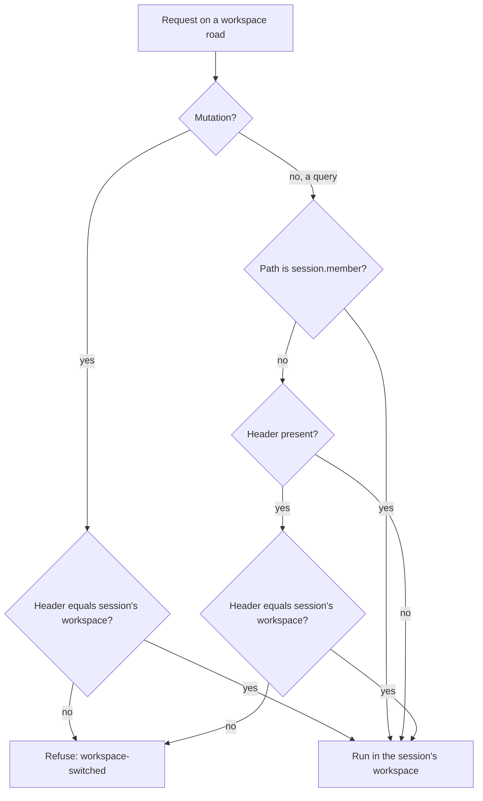

# A stale tab's workspace and a sign-in after a revocation - Plan

## Goal Capsule

- **Objective:** A person with two tabs open never connects an assistant to, or reads rows from, a workspace other than the one the tab in front of them shows. And a person whose sign-ins were all ended can sign in again at once and stay signed in.
- **Means:** The consent page carries the workspace it drew, and the api refuses a workspace read from a tab that names another workspace (KTD1, KTD2). The browser harness revokes at the api's own instant (KTD4).
- **Authority:** This plan, then BA-149 and BA-162 in Linear, then `CODING_STANDARDS.md` with `apps/api/CODING_STANDARDS.md` and `apps/web/CODING_STANDARDS.md`.
- **Stop conditions:** Stop and report if a migration or a `contracts/` change turns out to be needed. Stop if refusing reads breaks a flow the web has no way to recover from (a refused read that does not land the tab on the session's workspace).
- **Owner decisions:** The new consent refusal's words (R3) are a proposal. The owner rules on user-visible strings.
- **Finishes and ships:** The B2 worker, in one pull request. The orchestrator arms the merge.

---

## Product Contract

### Summary

The consent page names the workspace it was drawn for, and a grant sent after the session moved to another workspace is refused in words. A workspace read from a tab that still names a workspace the session has left is refused, so the tab lands on the session's workspace and says why, instead of drawing the other workspace's rows under its old name. A browser spec now proves a sign-in made straight after a revocation holds.

### Problem Frame

BA-50 refused every tRPC action from a stale tab, using the `x-tab-workspace` header the web's link sends. Two paths were left outside it (BA-149):

- **Consent.** `POST /consent` is a Hono route, not a tRPC road, so the header never reaches it. The grant is made for whatever workspace the session names when the form is sent, and a token's workspace is fixed at consent. A person who opened the consent page in workspace A, then switched to B in another tab, connects their assistant to B while the page said A.
- **Reads.** `claimsInTheTabsWorkspace` (`apps/api/src/trpc/base.ts`) refuses only mutations. A stale tab that opens another page reads its lists from the session's workspace while its band names the old one. `apps/web/e2e/switched-elsewhere.spec.ts`, "refuses cancelling an invitation read since the switch", pins this today: the stale tab draws the other workspace's invitation.

BA-162 asked whether a sign-in straight after "end every sign-in and token" holds. It does in the product; the browser harness was at fault (KTD4).

### Requirements

**Consent**

- R1. A grant sent from a consent page drawn for one workspace, after the session moved to another, is refused and connects nothing.
- R2. A grant from a page whose workspace is still the session's connects as today. A cancel is never refused for a moved workspace.
- R3. The refusal page says, in words, that the workspace changed since the page opened and that nothing was connected. Proposed wording (owner's to rule): title "Nothing was connected", why "You switched workspace after this page opened.", next "Start the connection again from where you began it."

**Reads from a stale tab**

- R4. A workspace read whose tab names a workspace other than the session's is refused with the same `workspace-switched` word an action gets.
- R5. The read that tells a tab which workspace the session holds (`session.member`) is never refused for it, so the tab can always learn where the session is.
- R6. A read from a tab that names no workspace yet (no member read held) is answered from the session's workspace, as today.
- R7. A stale tab whose read is refused lands on the session's workspace home and says the existing switched-elsewhere sentence, as a refused action already does.

**Sign-in after a revocation**

- R8. A browser spec proves that a person who signs in straight after every sign-in was ended stays signed in.

### Scope Boundaries

- The workspace in each read's query key (the learning doc's other route) is not built. Refusing at the api keeps rows from another workspace off the page whatever the cache holds. Revisit if a read ever has to answer a stale tab rather than refuse it.
- A grant whose form carries no workspace field (a page drawn before this release) is refused, not admitted. Only a consent page left open across the release meets it, and starting the connection again recovers.
- Operator (`console.*`) and person (`person.*`) roads name no workspace and stay outside the check, as for mutations today.

---

## Planning Contract

### Key Technical Decisions

- KTD1. **The consent page carries its workspace as a hidden field on the Connect form, and `POST /consent` compares it with the session's `claims.workspaceId` before calling the flow.** A missing or different value refuses with status 409 and the R3 page. The Cancel form needs no field. Rationale: the page is server-drawn HTML with no link to send a header, and the form is the only state it carries; the existing `sameOriginOnly` and `navigationOnly` guards already stop a cross-site post from forging it.
- KTD2. **`claimsInTheTabsWorkspace` refuses a query when the header is present and names another workspace, and refuses a mutation, as now, when the header is absent or different.** `session.member` is exempt by path. Rationale: every workspace read (`queryProcedure`, `queryCeiling`, `knowledgeReadProcedure`) runs through this one function, and the refusal is checked before any ceiling is spent.
- KTD3. **No web change for reads.** The query cache's `onError` already hands every read failure to `homeAfterASwitchElsewhere` (`apps/web/src/app/router.tsx`, `apps/web/src/shared/api/query-client.ts`), which follows the session through `followTheSession` and lands home with the switched-elsewhere sentence. `followTheSession` re-reads `session.member`, which R5 keeps answering, so the tab cannot loop.
- KTD4. **BA-162 is the browser harness, fixed on this branch.** `apps/api/tests/harness-control.ts`'s `/revocations` revoked one second ahead of the call. A browser sign-in about 320 ms later fell inside that mark, so its member read answered 401. Reproduced 3 of 3 runs, then the harness now revokes at the api's instant. The product path was already covered by `apps/api/tests/operator.test.ts` and `apps/api/tests/member-revocation.test.ts`, "admits ... fresh sign-in once the revocation lands".

### High-Level Technical Design

### Assumptions

- No existing api test queries a workspace road through a tab client that went stale without expecting a refusal. The full api suite in U2 settles this; a test that relied on reading across a switch changes to expect the refusal.
- `flow.ts`'s consent helper and `oauth-flow.test.ts` post `accept` without the page's field today; they will read it from the drawn page.

---

## Implementation Units

### U1. The browser harness revokes at the api's instant (done)

- **Goal:** BA-162: a sign-in made straight after a revocation holds in the browser suite.
- **Requirements:** R8
- **Dependencies:** none
- **Files:** `apps/api/tests/harness-control.ts`, `apps/web/e2e/sign-out.spec.ts`
- **Approach:** Committed on the branch (KTD4).
- **Test scenarios:**
  - A person signs in, every sign-in is ended, they sign in again at once, open Groups and reload: the banner names the workspace and the page is not sign-in.
- **Verification:** `sign-out.spec.ts` and `consent.spec.ts` pass three runs each.

### U2. The api refuses a read from a stale tab

- **Goal:** A workspace read from a tab naming another workspace is refused.
- **Requirements:** R4, R5, R6
- **Dependencies:** none
- **Files:** `apps/api/src/trpc/base.ts`, `apps/api/tests/trpc-roads.test.ts`
- **Approach:** Change `claimsInTheTabsWorkspace` per KTD2. Update its doc comment, which says a read changes nothing.
- **Patterns to follow:** The "every mutation the router serves" describe block in `trpc-roads.test.ts`: walk every query on a workspace road the same way.
- **Test scenarios:**
  - Every query on a workspace road, asked from a tab naming the workspace left, answers `workspace-switched`; the list includes `members.list` and `knowledge.find`.
  - `session.member`, asked from a tab naming the workspace left, answers the session's member.
  - A query asked with no tab header answers from the session's workspace.
  - A query from a tab naming the session's own workspace answers.
- **Verification:** The api suite passes whole.

### U3. The consent grant is bound to the workspace the page drew

- **Goal:** A grant after the workspace moved is refused in words.
- **Requirements:** R1, R2, R3
- **Dependencies:** none
- **Files:** `apps/api/src/auth/pages.ts`, `apps/api/src/auth/routes.ts`, `apps/api/tests/oauth-flow.test.ts`, `apps/api/tests/flow.ts`, `apps/web/e2e/consent.spec.ts`
- **Approach:**
  1. `consentPage` takes the workspace id and writes it as a hidden field on the Connect form only.
  2. `POST /consent` refuses an accept whose field is missing or differs from `claims.workspaceId`, before the flow call, with a new `REFUSAL_PAGES` entry (R3) and status 409.
  3. `flow.ts`'s consent step and the direct posts in `oauth-flow.test.ts` send the field the drawn page carries.
- **Patterns to follow:** `REFUSAL_PAGES.sessionEnded` and its test in `oauth-flow.test.ts`.
- **Test scenarios:**
  - A person draws consent in workspace A, the session moves to B, they press Connect: 409, the page says the workspace changed, no grant or token exists for the client.
  - The same with the session still in A: the grant redirects to the client with a code.
  - Cancel after the session moved: the flow's cancel answer, not the refusal.
  - An accept posted with no workspace field: refused with the same page.
  - In the browser: consent drawn in one workspace, another tab switches, Connect shows the refusal and the assistant is not connected.
- **Verification:** `oauth-flow.test.ts` and `consent.spec.ts` pass; the refusal page passes the accessibility gate.

### U4. A stale tab's read lands it on the session's workspace

- **Goal:** Prove R7 in the browser and move the spec that pinned the old behaviour.
- **Requirements:** R7
- **Dependencies:** U2
- **Files:** `apps/web/e2e/switched-elsewhere.spec.ts`
- **Approach:** "refuses cancelling an invitation read since the switch" can no longer draw the other workspace's invitations: opening Invitations in the stale tab is itself refused. Rewrite it so the stale tab opening Invitations lands home on the session's workspace, saying why, with the other workspace's invitation never drawn. Keep the cancel-after-switch case only if a path still reaches it.
- **Test scenarios:**
  - A stale tab opens Invitations after another tab switched: it lands on the session's workspace home with the switched-elsewhere sentence, and the other workspace's invitation address is never on the page.
- **Verification:** `switched-elsewhere.spec.ts` passes three runs.

---

## Verification Contract

| What | Command |
| --- | --- |
| Api suite, whole (U2 touches every road) | `IMAGE_PROBE_DEFERRED=true pnpm --filter @better-answers/api run test` |
| Web typecheck and unit suite | `pnpm --filter @better-answers/web run check` |
| Browser specs touched | `pnpm --filter @better-answers/web run build`, then `playwright test e2e/sign-out.spec.ts e2e/consent.spec.ts e2e/switched-elsewhere.spec.ts --repeat-each 3` |
| Mutation probe on the auth change | `/mutation-testing` scoped to `claimsInTheTabsWorkspace` and the consent post |
| Root gates | `pnpm check:gates` |

No journey walks the consent page or a stale tab, so the journeys need no run.

## Definition of Done

- Every R holds, each by a test named for its behaviour.
- The R3 words are flagged to the owner as a proposal in the report.
- No probe or experiment file is left in the diff.
