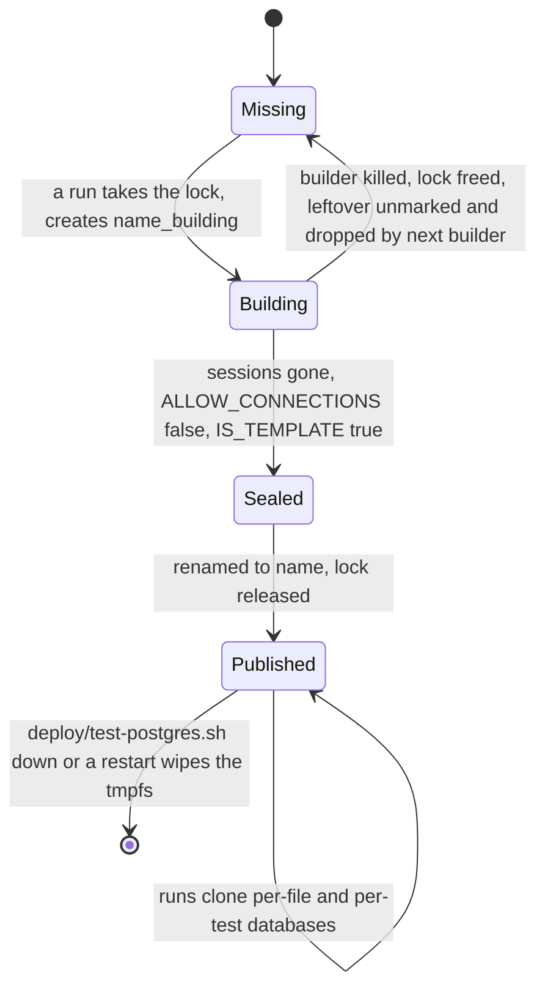
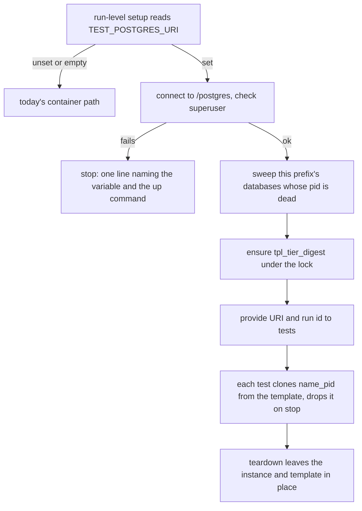

# Share One Warm Postgres per Machine - Plan

## Goal Capsule

- **Objective:** Several worktrees can run their test suites on one laptop at the same time without each starting its own Postgres. The machine stays usable and Docker stops collecting a data volume per run. CI runs exactly as it does today.
- **Means:** An environment variable, `TEST_POSTGRES_URI`, points both test tiers at one long-lived Postgres started by a script under `deploy/`. Each tier clones its databases from a template named for what built it (KTD1 to KTD5).
- **Authority:** Linear BA-187, and the scope the owner confirmed on 16/10/2026: Garage, a machine-wide cap on `check` runs, and the three test files that need a fresh server of their own all stay out.
- **Stop conditions:** Stop and report if the work needs a migration, a `contracts/` change, or a change to any CI workflow.
- **Execution profile:** One pull request, test infrastructure, a deploy script and docs. No production code changes.
- **Who finishes:** `ce-work` builds it, runs `ce-code-review`, and opens the pull request.

---

## Product Contract

### Summary

A developer starts one shared test Postgres with `deploy/test-postgres.sh up` and exports the URI it prints. From then on the warm harness in every vitest run in `packages/schema`, `packages/core` and `apps/api`, and every worker pytest run, clones its databases from a template on that instance instead of starting a container. The few test files that need a server to themselves still start one. With the variable unset, nothing changes.

### Problem Frame

On 15/10/2026 the owner's Mac ran at a load average of 45 on 14 cores. Four worktrees were running suites at once, and each run warmed its own Postgres container (and Garage), on a 24 GB laptop with a 10 GB Docker VM. Docker now holds 6 GB in 42 dangling volumes of 146 MB each, created about one an hour on 15/10. That is the size of an initialized Postgres data directory, and they are unlabeled, so neither Ryuk nor `pnpm reap-containers` ever claims them. The project is at S2b of the v0.1 route, and the local workflow is slowing it down.

Each run already shares one container across its own test files (`packages/schema/test/warm-postgres.ts`, `apps/worker/tests/pg_harness.py`). What is missing is sharing across runs.

### Requirements

**Locator**

- R1. With `TEST_POSTGRES_URI` set, the warm harness in a vitest run in `packages/schema`, `packages/core` or `apps/api` starts no Postgres container and clones its per-file databases from a template on the shared instance. The sites in Scope Boundaries that need a server of their own are the exception.
- R2. With `TEST_POSTGRES_URI` set, the worker's pytest suite starts no Postgres container and clones its per-test databases from a template on the shared instance.
- R3. With `TEST_POSTGRES_URI` unset or empty, both tiers behave exactly as today, so CI is unchanged.
- R4. With `TEST_POSTGRES_URI` set to an instance that cannot be reached or does not sign in as a superuser, the run fails at once with one line naming the variable and `deploy/test-postgres.sh up`. It never falls back to starting a container.

**Concurrency**

- R5. Two worktrees with different migration sets run at the same time against the shared instance, and neither clones the other's template.
- R6. Concurrent runs never drop or reuse each other's databases, whether in different worktrees or the same one.
- R7. A run that is killed while building a template leaves nothing that a later run would clone.
- R8. Databases left behind by killed runs do not pile up on the shared instance.
- R9. A test's check for a lock or a waiting session sees only its own database.

**Instance**

- R10. `deploy/test-postgres.sh up` starts the shared instance and prints the URI to export. `down` stops it and discards all its data.
- R11. The shared instance survives `pnpm reap-containers` and every Ryuk teardown.
- R12. `docs/operations/local-gates.md` says how to start, stop and point at the shared instance.

### Scope Boundaries

- The three test files that start a server of their own keep doing so: `packages/schema/test/knowledge-words-end-to-end.test.ts` and `packages/schema/test/concept-description-migration.test.ts` replay part of the migration history, and `apps/api/tests/browse-role.test.ts` alters a role that belongs to the whole server. A fourth site, the cold-path case in `packages/schema/test/warm-postgres.test.ts`, starts a container on purpose to prove the path without a warm cluster. A fifth, `packages/schema/test/roles-surface.test.ts`, moves off the warm harness onto a server of its own (U3), because it asserts every role on the server and the shared instance keeps the worker's login role between runs. R1 covers the per-file databases the warm harness opens.
- Not built: a cleanup job for old templates. U1 sizes the tmpfs to hold stale templates beside peak clones, and `down` clears them all. A full tmpfs shows as Postgres stopping every session at once on a failed WAL write. Revisit if that is seen.
- Not built: a silent fallback to a container when the locator is set but the instance is down. That would hide the fault and bring back the load this work removes (R4).

#### Deferred to Follow-Up Work

- Garage (`packages/core/test/warm-objects.ts`) has the same shape and takes the same fix.
- A machine-wide cap on concurrent `check` runs (each vitest config allows 6 workers).
- Find out what leaks the 146 MB unlabeled volumes today. `pnpm reap-containers` already passes `--volumes`, so the leak is elsewhere. Runs that use the shared instance stop creating them.
- Docker's 24 GB build cache is unrelated to tests. `docker builder prune` reclaims it.

---

## Planning Contract

### Key Technical Decisions

- KTD1. **`TEST_POSTGRES_URI`, read only in each tier's run-level setup.** The vitest `globalSetup` (`startWarmPostgres`) and the pytest cluster function (`_migrated_cluster`) read it. Empty counts as unset, as `apps/api/tests/image-probe.ts` and `apps/worker/tests/test_image.py` treat their variables. `openMigratedPostgres`'s no-warm path, which the cold-path test runs in a child process, never reads the variable and keeps starting a container, so that child inheriting it is harmless. The name sits beside the script's `TEST_POSTGRES_PORT` and `TEST_POSTGRES_PROJECT`, the way `LOCAL_DATABASE_*` sits beside `deploy/local-database.sh`. A `vitest.config.ts` may not read env under `node/no-process-env`, and the harness files may.
- KTD2. **Admin work always runs on the `postgres` database, as a checked superuser.** Each harness repoints the locator's URI at `/postgres`, whatever database it names, and checks `rolsuper` before anything else (R4). The template build runs `CREATE ROLE`, `CREATE EXTENSION` and `ALTER FUNCTION … LEAKPROOF`, which need a superuser. Advisory locks only conflict within one database, so every run must take them on the same one.
- KTD3. **A template is named for a digest of what builds it, per tier.** The name is `tpl_<tier>_<12 hex>`. The digest covers every file under `packages/schema/migrations` (path and content, sorted) and the source file holding that tier's build steps: `packages/schema/test/harness.ts` and the `MARK_THE_MATCH_LEAKPROOF` text for vitest, `apps/worker/tests/pg_harness.py` for pytest. The tiers build differently: the worker replays the journal itself and skips the LEAKPROOF step. So they cannot share a template. Hashing the builder's source replaces a hand-kept version string that someone would forget to bump. A rebuild costs seconds, so hashing more than the minimum is cheap.
- KTD4. **Build under one session lock for the instance, publish by rename last.** On `postgres`, take `pg_advisory_lock(hashtextextended('better-answers template build', 0))`: one key both tiers share, not one per template. Every build replays `0000_substrate.sql`, whose `CREATE ROLE app_rt` runs inside the build's migration transaction and catches only `duplicate_object`. Two builds of different templates at once would collide on that role with `unique_violation` and abort one build, so builds run one at a time. Session level is required, because `CREATE DATABASE` and `ALTER DATABASE … RENAME` refuse to run inside a transaction (pattern: `packages/core/src/store/postgres/index.ts`). If the template exists, release and return. Otherwise:
  1. If a killed builder left `<name>_building`, clear `IS_TEMPLATE` on it (Postgres refuses to drop a template database), then drop it `WITH (FORCE)`.
  2. Create `<name>_building` and migrate it.
  3. Close the build's connections and wait until no session remains on it.
  4. Set `ALLOW_CONNECTIONS false` and `IS_TEMPLATE true`.
  5. Rename it to `<name>`.
  6. Release.

  A killed builder's session ends, which frees the lock, and its half-built database never carries the published name (R7). No connection can reach a published template, so `CREATE DATABASE … TEMPLATE` never meets "source database is being accessed by other users".
- KTD5. **Per-run database names carry the owning process id, and each run sweeps the dead.** The vitest name becomes `ba_<stem ≤ 32>_<hash of the key, 12 hex>_<pid of the vitest main process>`, which `globalSetup` provides to workers beside the URI. The worker name becomes `case_<pid>_<n>`. The issue's claim that the test path already keeps names apart holds only for vitest, and only across worktrees. Today two runs in one worktree never collide only because each has its own container, and the worker's `case_<n>` restarts at 0 in every process, including each xdist worker. Under the locator, each tier drops its own prefix's databases whose embedded pid is not alive on this machine (R8): vitest once per run, in `globalSetup`, and pytest once per process, since each xdist worker is its own pid. Only a dead owner's database is dropped, so a live run is never touched. A recycled pid keeps a leftover rather than dropping a live database. The name stays under Postgres's 63-byte limit.
- KTD6. **The shared instance is its own compose project, in memory.** It lives in `deploy/test-postgres.sh` and `deploy/test-postgres.compose.yaml`, following `deploy/local-database.sh` and `deploy/local.compose.yaml`: the image is pinned by digest from `packages/schema/src/postgres-image.ts`, the port is refused when taken, the port is loopback only, and the healthcheck runs over TCP. The project defaults to `better-answers-test-postgres` and the port to `55433`, so it never touches the dev database and its seeded roles. The data directory is a `tmpfs`, so a restart or `down` wipes it and no volume is ever created. The command carries `POSTGRES_COMMAND`'s three durability flags, a raised `max_connections`, and a pinned `max_wal_size`. One `check` opens about 6 workers × 8 connections in each of three workspaces, plus pytest's 4 workers, and four worktrees multiply that. PG18 clones a template by writing it into WAL, so WAL shares the tmpfs with the clones and must have a ceiling. `up` passes `--no-recreate` and refuses when the running container's image differs from this checkout's pin, naming `down` then `up`. Compose would otherwise recreate the container for a branch with a different pin or compose file, and wipe every other worktree's live run. Compose labels the container only `com.docker.compose.*`. Ryuk and `packages/devtools/src/reap-containers.ts` select only on `org.testcontainers` labels, so neither can see it (R11).
- KTD7. **Lock and session checks name their database.** `isBlockedOnTable` (`packages/core/test/suite-postgres.ts`), `waitingOnTheGroupTable` (`packages/core/test/audit-export.test.ts`) and `isWaitingOnTheRoleRead` (`packages/core/test/test-workspace.test.ts`) gain the current-database filter that `packages/core/test/sweeps.test.ts` and `apps/api/tests/health.test.ts` already use. Databases cloned from one template share table oids. Joining `pg_locks` to `pg_class` by oid alone therefore matches another database's waiter, and the test moves on before its own waiter is blocked. One run's six workers are already exposed to this today, and the shared instance widens it to every worktree.

### High-Level Technical Design

The template's life on the shared instance:

One run under the locator:

### Assumptions

- A migrated template is small enough (tens of MB) that peak clones, stale templates and the WAL ceiling together fit in a tmpfs inside the 10 GB Docker VM. The 146 MB leaked volumes are whole data directories, not one database. U1 measures the template and sizes from that.

---

## Implementation Units

### U1. The shared instance

- **Goal:** `deploy/test-postgres.sh up | down` starts and stops a shared test Postgres that nothing in the test tooling can remove.
- **Requirements:** R10, R11 (KTD6)
- **Dependencies:** none
- **Files:**
  - create `deploy/test-postgres.sh`
  - create `deploy/test-postgres.compose.yaml`
  - create `apps/api/tests/test-postgres.test.ts`
  - create a shared docker helper beside `apps/api/tests/loopback-port.ts`, lifted out of `apps/api/tests/local-database.test.ts`
  - modify `apps/api/tests/local-database.test.ts` to import it
- **Approach:**
  1. Lift `containersOf`, `volumesOf` and `outcomeOf` out of `local-database.test.ts` into the shared helper first. jscpd runs at threshold 0 and would refuse a copy.
  2. Write the script from `deploy/local-database.sh`'s shape: env-overridable project and port, port validation, exact-one-digest pin, port refusal only when this project is not already running, and `compose up -d --wait --no-recreate`. When this project is already running on an image other than this checkout's pin, `up` refuses, names `down` then `up`, and leaves the running instance alone (KTD6). `up` needs no migrate or seed step. It ends by printing the `export TEST_POSTGRES_URI=…/postgres` line and how to stop. `down` runs `compose down`. There is no `--wipe`, because `down` discards everything.
  3. Write the compose file: `restart: unless-stopped`, `tmpfs` on `/var/lib/postgresql` (PG18 layout), a `shm_size`, and `command:` carrying the three flags and `max_connections`. Use the TCP healthcheck and its comment from `deploy/local.compose.yaml`.
  4. Measure one migrated template's size. Set `max_wal_size`, then size the tmpfs as that WAL ceiling, plus peak concurrent clones (about 22 per worktree × four worktrees × the template), plus a stated number of stale templates. Set `shm_size` and `max_connections` too, each with a one-line reason.
- **Patterns to follow:** `deploy/local-database.sh`, `deploy/local.compose.yaml`, `apps/api/tests/local-database.test.ts` (own project per pid, `beforeAll` up, `afterAll` down). Bash 3.2 and shellcheck rules from `docs/agents/workflow.md` *Platform: macOS*. Comments say only the why (`CODING_STANDARDS.md`).
- **Test scenarios:**
  - `up` starts on its loopback port and prints the URI to export and how to stop.
  - It runs the one pinned image, by digest (compare `docker inspect` with `POSTGRES_IMAGE`).
  - Its server runs with fsync, synchronous_commit and full_page_writes off, matching `POSTGRES_COMMAND`, and with the raised `max_connections`.
  - `up` a second time while running succeeds and starts nothing new.
  - `up` while the instance runs on another image refuses, names `down` then `up`, and leaves the running container untouched.
  - Its server runs with the pinned `max_wal_size`.
  - It refuses a port already in use and starts nothing.
  - It creates no volume, and a database made before `down` is gone after the next `up`.
  - Its container carries no `org.testcontainers` label, so the listing the reaper and Ryuk select from never includes it.
- **Verification:** The new test passes in the api suite with real Docker, and `local-database.test.ts` still passes on the shared helper.

### U2. Lock checks see only their own database

- **Goal:** The three lock and session checks match only waiters in the test's own database, and no warm-path test uses a fixed database name another run could share.
- **Requirements:** R6, R9 (KTD7)
- **Dependencies:** none
- **Files:**
  - modify `packages/core/test/suite-postgres.ts`
  - modify `packages/core/test/audit-export.test.ts`
  - modify `packages/core/test/test-workspace.test.ts`
  - modify `apps/api/tests/health.test.ts`
- **Approach:**
  1. Add the current-database filter to each query: `pg_locks.database` for the two lock joins, `datname = current_database()` for the `pg_stat_activity` check.
  2. Give `health.test.ts`'s scratch `unmigrated` database a per-process name, and drop it `WITH (FORCE)`. Today two api runs on one shared instance would create, connect to and drop the same database.
- **Patterns to follow:** `packages/core/test/sweeps.test.ts` (`sessionLocksHeld`), `apps/api/tests/health.test.ts`.
- **Test expectation:** none. These helpers are test code. The suites that call them stay green, and the change is proved by inspection against the patterns above.
- **Verification:** The core and api suites pass. A search of `pg_locks` and `pg_stat_activity` across the test trees finds no query without a database filter, apart from those already filtered by `pid`. A search for `CREATE DATABASE` and `DROP DATABASE` in warm-path tests finds no fixed name.

### U3. The vitest harness honours the locator

- **Goal:** With `TEST_POSTGRES_URI` set, every vitest run that uses the warm harness clones from a shared, digest-named template and starts no Postgres container.
- **Requirements:** R1, R3, R4, R5, R6, R7, R8 (KTD1 to KTD5)
- **Dependencies:** none. U1 is needed only for the manual check in the Verification Contract.
- **Files:**
  - modify `packages/schema/test/warm-postgres.ts`
  - modify `packages/schema/test/harness.ts` only if the build steps must be exported for the digest
  - modify `packages/schema/test/roles-surface.test.ts` to open its database with `startMigratedPostgres`, as `apps/api/tests/browse-role.test.ts` does
  - modify `packages/schema/test/warm-postgres.test.ts`
- **Approach:**
  1. Split `startWarmPostgres` into small functions under the complexity cap of 8: read the locator, check the superuser, sweep the dead, ensure the template, and provide. The unset branch stays today's code.
  2. Add `ensureTemplate`, taking the admin URI, the template name and a build callback, so a test can drive the lock and publish with a cheap build.
  3. Have `globalSetup` provide the template name, the admin URI, the run id (its own pid) and a `source` of `shared` or `container` under `warmPostgres`. `openMigratedPostgres` builds names from them per KTD5, with the stem cut to 32 characters.
  4. Under the locator, make teardown a no-op. The run's per-file databases are still dropped by each `stop`.
  5. Move `roles-surface.test.ts` onto a server of its own (Scope Boundaries). It reads every role on the server, so a login role another run left on the shared instance would fail it.
- **Execution note:** Prove each case against the run's own warm container, as the URI the test is given. That way the tests run in CI, where no shared instance exists.
- **Patterns to follow:** `warm-postgres.test.ts`'s child-process cold-path case (`execFile` on `process.execPath --eval`), `withAdmin`, `untilSessionsGone`, `endPool`. The present-tense, 10-word title gate from `test-title-setup`.
- **Test scenarios:**
  - A child running `startWarmPostgres` with the locator set to this run's server provides a URI on that server, a template named `tpl_ts_<digest>`, and a provided `source` of `shared`. The same child with the locator unset provides `container`, so the check proves something present rather than an absence.
  - A second child on the same server reuses the published template and does not rebuild it.
  - Two `ensureTemplate` calls racing on one name build it once, and both return it.
  - Two `ensureTemplate` calls with different names and different builds each see only their own template.
  - A leftover `<name>_building` is dropped, and the template is built and published.
  - A leftover `<name>_building` already marked as a template is unmarked and dropped, and the template is published.
  - Two `ensureTemplate` calls building different templates at once both succeed, because builds take one lock for the instance.
  - A published template refuses connections and is marked as a template.
  - The template name changes when a migration file's content changes, and stays the same when nothing changes (digest over a temporary folder).
  - Under the locator, a server that cannot be reached fails with one line naming `TEST_POSTGRES_URI` and `deploy/test-postgres.sh up`.
  - Under the locator, a URI that signs in as a non-superuser fails with the same kind of line.
  - Two opens of one key from different run ids get different databases, and stopping one leaves the other.
  - The sweep drops a `ba_*_<pid>` database whose pid is dead and keeps one whose pid is alive.
  - With the locator unset, today's cases still pass unchanged (R3).
- **Verification:** The schema, core and api suites pass with the locator unset. The new cases pass in the schema suite.

### U4. The pytest harness honours the locator

- **Goal:** With `TEST_POSTGRES_URI` set, the worker suite clones from its own shared, digest-named template, and its per-test names and roles are safe across processes.
- **Requirements:** R2, R3, R4, R5, R6, R7, R8 (KTD1 to KTD5)
- **Dependencies:** none
- **Files:**
  - modify `apps/worker/tests/pg_harness.py`
  - create `apps/worker/tests/test_pg_harness.py`
- **Approach:**
  1. Split `_migrated_cluster` into a locator branch and today's container branch. Under the locator, register no `atexit` stop.
  2. Add `ensure_template(maintenance, name, build)`, the same protocol as U3's, with `apply_journal` as the build callback.
  3. Name test databases `case_<pid>_<n>`, and sweep this prefix's dead-pid databases once per process under the locator. The four xdist workers sweep the same leftovers, so a drop that finds the database already gone or still being accessed is skipped, not raised.
  4. Make `login_in_role` race-safe: create the role and treat `duplicate_object` or `unique_violation` as already done. `packages/schema/migrations/0000_substrate.sql` catches only `duplicate_object`, which is why two concurrent creates need the second code as well. Both callers (`test_pipeline_host.py`, `test_pipeline_index.py`) pass a constant login and password, so a role an earlier run left behind still signs in.
- **Patterns to follow:** `apps/worker/tests/import_watch.py` (child process with a boxed env), `apps/worker/tests/test_monkeypatch_guard.py` (`monkeypatch` on `os.environ`). The worker standard that every test takes a fresh clone from `pg_harness.py` (`apps/worker/CODING_STANDARDS.md`). Ruff with `ANN`, `C901` at 8, and `T20`.
- **Test scenarios:**
  - With the locator set to this process's container, the cluster function returns that server and a published `tpl_py_<digest>`, and no `PostgresContainer` is constructed.
  - Two threads racing `ensure_template` on one name build it once.
  - Different names with different builds each see only their own template.
  - A leftover `<name>_building` is dropped, and the template is published.
  - A leftover `<name>_building` already marked as a template is unmarked and dropped.
  - Database names from two processes never collide (`case_<pid>_<n>`).
  - `login_in_role` called for the same login from two connections at once succeeds for both.
  - The sweep drops a `case_<dead pid>_0` database and keeps one whose pid is alive.
  - An unreachable or non-superuser locator fails with one line naming the variable and the `up` command.
  - With the locator unset, the existing worker suite passes unchanged (R3).
- **Verification:** `uv run --frozen check` passes in `apps/worker` with the locator unset. The new file passes under `-n 4`.

### U5. Docs

- **Goal:** A developer can read how to start, stop and point at the shared instance, and what it does not cover.
- **Requirements:** R12
- **Dependencies:** U1, U3, U4
- **Files:**
  - modify `docs/operations/local-gates.md`
  - modify `docs/agents/workflow.md`
- **Approach:**
  1. Add a section "The shared test Postgres" after "The `check` runner". It covers:
     - `up`, the export line, and `down`.
     - That the variable is opt-in and CI never sets it.
     - That `down` or a Docker restart wipes everything and the next run rebuilds its template.
     - That a branch with a different Postgres image pin gets a refusal from `up`, and must cycle the instance (`down`, then `up`) or leave the variable unset.
     - That a full instance shows as every run failing at once, and `down` then `up` clears it.
     - That the sites listed in Scope Boundaries and Garage still start containers.
     - The refusal you see when the instance is down.
  2. Add one sentence in `docs/agents/workflow.md` *Environment → Vitest* pointing at that section.
- **Test expectation:** none. Docs only.
- **Verification:** Both docs read correctly against the merged behaviour, and the comment gates pass.

---

## Verification Contract

| Check | Proves |
| --- | --- |
| `pnpm check` at the root with `TEST_POSTGRES_URI` unset | R3: every suite and gate passes as in CI |
| `apps/api/tests/test-postgres.test.ts` in the api suite | R10, R11 |
| The new cases in `packages/schema/test/warm-postgres.test.ts` | R1, R4 to R8 for vitest |
| `apps/worker/tests/test_pg_harness.py` under `uv run --frozen check` | R2, R4 to R8 for pytest |
| `packages/core` suite after U2 | R9 |
| Manual: `deploy/test-postgres.sh up`, export the URI, run the core suite and the worker suite from two worktrees on different migration sets at once, watching `docker ps` | R1, R2 and R5 end to end: both runs pass, and the only new containers are Garage's. The schema suite is a poor witness, because the sites in Scope Boundaries start Postgres on purpose |
| Manual: `pnpm reap-containers` while the instance is up, then `docker ps` | R11: the instance is still running |

---

## Definition of Done

- Every unit's verification holds, and `pnpm check` passes with the locator unset.
- The two manual checks were run, and their outcome is recorded in the pull request.
- No abandoned-attempt code, debug logging or unused export remains (knip and jscpd pass).
- The pull request body links BA-187 with `Fixes BA-187` and says `Merge risk: reversible`. It changes only test infrastructure, a local deploy script and docs.

---

## Appendix

### Sources

- `packages/schema/test/warm-postgres.ts`: `startWarmPostgres`, `databaseNameFor`, `openMigratedPostgres`.
- `apps/worker/tests/pg_harness.py`: `_migrated_cluster`, `migrated_postgres_at` (`case_<n>`), `login_in_role`.
- `packages/schema/migrations/0000_substrate.sql`: idempotent `CREATE ROLE` for `app_rt` and `worker_rt`.
- `packages/devtools/src/reap-containers.ts` and `patches/testcontainers.patch`: both select on `org.testcontainers` labels only.
- `apps/worker/src/better_answers_worker/check.py`: pytest runs `-n 4 --dist loadgroup` locally and in CI.
- `docs/solutions/` holds no learning on testcontainers, Ryuk, template databases or advisory-lock builds. `docs/solutions/best-practices/a-process-selector-is-proved-read-only-and-counted-before-anything-is-piped-to-kill.md` governs any change to what deletes containers. This plan changes no selector.
